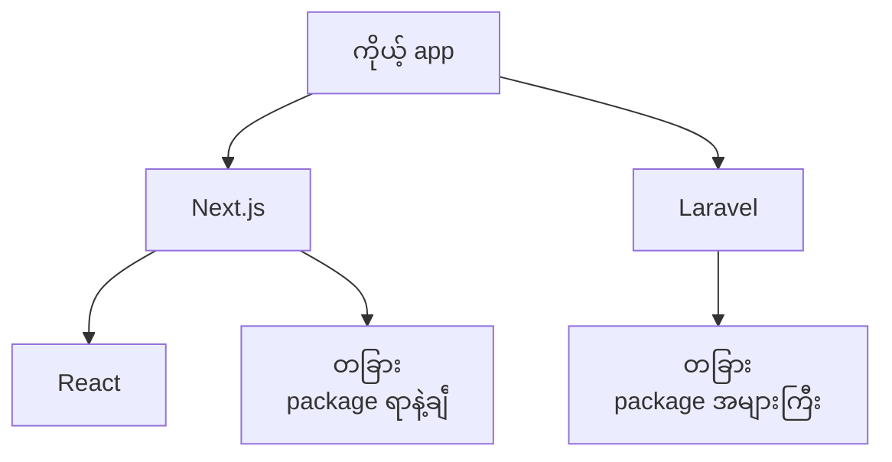
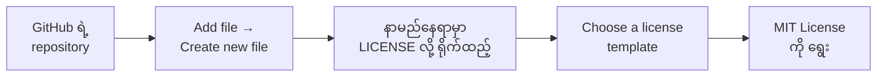

# OSS နဲ့ License အကြောင်း

> 🇯🇵 မူရင်း (ဂျပန်ဘာသာဖြင့်): [OSSとライセンスについて.md](<../../../2年生_システム開発実践/後期/2026_12_18/OSSとライセンスについて.md>) <!-- original-ja-link -->

ကိုယ်ပိုင် ဖန်တီးမှုမှာ သုံးနေတဲ့ Laravel၊ Next.js၊ React၊ Tailwind CSS တွေအားလုံးကို **အခမဲ့** သုံးလို့ ရပါတယ်။
ဒါက သူတို့တွေဟာ **OSS (Open Source Software)** တွေ ဖြစ်လို့ပါ။
ဒီမှာတော့ OSS အကြောင်းနဲ့ သုံးတဲ့အခါ လိုက်နာရမယ့် **License** အကြောင်းကို လေ့လာကြည့်ပါမယ်။

[ကိုယ်ပိုင် ဖန်တီးမှုသို့ ပြန်သွားရန်](../2026_10_09/2026_10_09_資料1.md)

---

## 1. OSS ဆိုတာ ဘာလဲ

**OSS (Open Source Software / အိုးပင်းဆော့စ် ဆော့ဖ်ဝဲ)** ဆိုတာ **Source code (ပရိုဂရမ်ရဲ့ အတွင်းပိုင်း) ကို အများသိအောင် ထုတ်ပြန်ထား** ပြီး
သတ်မှတ်ထားတဲ့ စည်းမျဉ်းတွေကို လိုက်နာရင် **ဘယ်သူမဆို လွတ်လပ်စွာ သုံးတာ၊ ပြင်ဆင်တာ၊ ဖြန့်ဝေတာ လုပ်လို့ရတဲ့** software ဖြစ်ပါတယ်။

| | OSS | OSS မဟုတ်တဲ့ software |
|---|---|---|
| Source code | **ထုတ်ပြန်ထားတယ်** | ထုတ်ပြန်မထားဘူး (ကုမ္ပဏီအတွင်းမှာပဲ) |
| ပြင်ဆင်ခြင်း | စည်းမျဉ်း လိုက်နာရင် လုပ်လို့ရတယ် | လုပ်လို့မရဘူး |
| ဥပမာ | Laravel၊ Next.js၊ React၊ MySQL၊ Linux၊ VS Code ရဲ့ အခြေခံ code | Windows၊ Microsoft Office၊ Photoshop |

> 💡 **ဥပမာပေးရရင် "ချက်နည်းကို အများသိအောင် ထုတ်ပြန်တာ"**
> ဟင်းချက်နည်းကို အင်တာနက်မှာ တင်ပြီး "စိတ်ကြိုက် ချက်ကြည့်ပါ။ ကိုယ့်စိတ်ကြိုက် ပြင်ချက်လည်း ရပါတယ်။ ဒါပေမဲ့ **မူရင်း ချက်နည်း ရေးသူရဲ့ နာမည်ကိုတော့ ထည့်ရေးပေးပါ**"——
> ဒါဟာ OSS ရဲ့ အတွေးအခေါ်ပါ။ ဒီ "ဒါပေမဲ့ 〇〇" ဆိုတဲ့ အပိုင်းက **License** ပါ။

---

## 2. ကိုယ့်ပတ်ဝန်းကျင်က OSS များ

ကိုယ်ပိုင် ဖန်တီးမှု app ကလည်း တကယ်တော့ **OSS တွေ စုပေါင်းထားတာ** ပါပဲ။

`npm install` ဒါမှမဟုတ် `composer install` နဲ့ ထည့်ထားတဲ့ အရာတွေ (`node_modules` ဒါမှမဟုတ် `vendor` ထဲက အရာတွေ) ဟာ အများစု OSS တွေ ဖြစ်ပါတယ်။
ကမ္ဘာတစ်ဝှမ်းက လူတွေ ရေးထားတဲ့ OSS တွေကြောင့် **အားလုံးကို သုညကနေ ရေးစရာမလိုဘဲ** app တွေ ဖန်တီးနိုင်နေတာပါ။

---

## 3. License ဆိုတာ ဘာလဲ

**License** ဆိုတာ "ဒီ software ကို **ဘယ်လို သုံးခွင့်ရှိလဲ**" ဆိုတာကို သတ်မှတ်ထားတဲ့ **စည်းမျဉ်း** ဖြစ်ပါတယ်။
OSS ကို လွတ်လပ်စွာ သုံးလို့ရပေမဲ့ **ကြိုက်သလို လုပ်လို့ရတာတော့ မဟုတ်ပါဘူး**။ License မှာ ရေးထားတဲ့ စည်းမျဉ်းတွေကို လိုက်နာဖို့ လိုပါတယ်။

### မကြာခဏ တွေ့ရတဲ့ License များ

| License | စည်းမျဉ်းရဲ့ တင်းကျပ်မှု | စည်းမျဉ်း (အလွယ်ပြောရရင်) | သုံးထားတဲ့ ဥပမာ |
|----------|------|-----------------|-----------|
| **MIT** | အရမ်း လျော့ရဲတယ် | **မူပိုင်ခွင့် ကြေညာချက်နဲ့ License စာသားကို ဆက်လက်ဖော်ပြထားရင်** ဘာအတွက် သုံးသုံး ရတယ် (ပိုက်ဆံယူတဲ့ app မှာလည်း ရတယ်) | Laravel၊ Next.js၊ React၊ Tailwind CSS |
| **Apache 2.0** | လျော့ရဲတယ် | MIT နဲ့ အတော်လေး တူတယ်။ **ပြင်ဆင်ခဲ့တာကို ရေးမှတ်ထားရမယ်** စတဲ့ စည်းမျဉ်း နည်းနည်း ပိုများတယ် | TypeScript၊ Kubernetes |
| **GPL** | တင်းကျပ်တဲ့ဘက်မှာ | GPL code ကို သုံးထားတဲ့ software ကို **ဖြန့်ဝေမယ်** ဆိုရင် **ကိုယ့် code ကိုလည်း GPL နဲ့ ထုတ်ပြန်** ရမယ် | Linux၊ WordPress |

> 📝 **GPL လိုမျိုး License ကို "Copyleft" လို့ ခေါ်တယ်**
> "လွတ်လပ်စွာ သုံးလို့ရတယ်၊ ဒါပေမဲ့ အဲဒါကို သုံးပြီး ဖန်တီးထားတဲ့ အရာကိုလည်း **အလားတူ လွတ်လပ်စွာ သုံးခွင့်** ပေးပါ" ဆိုတဲ့ အတွေးအခေါ် ဖြစ်ပါတယ်။
> ကုမ္ပဏီမှာ app ဖန်တီးတဲ့အခါ သုံးထားတဲ့ OSS ရဲ့ License ကို **မဖြစ်မနေ စစ်ဆေး** ရပါတယ်။

---

## 4. ကိုယ့် app ကို License တပ်မယ်

GitHub မှာ public လုပ်ထားတဲ့ ကိုယ့် repository မှာလည်း License တပ်လို့ ရပါတယ်။

> ⚠️ **License မတပ်ရင် တခြားသူတွေ လွတ်လပ်စွာ သုံးလို့ မရဘူး**
> Public repository ဖြစ်နေရင်တောင် License မရှိရင် **တခြားသူတွေကို code သုံးဖို့၊ ပြင်ဆင်ဖို့ ခွင့်ပြုချက် မပေးထားဘူး** လို့ ယူဆရပါတယ်။
> "လွတ်လပ်စွာ သုံးစေချင်ရင်" MIT၊ "ကြည့်ရုံပဲ ကြည့်စေချင်ရင် (မသုံးစေချင်ရင်) " License မတပ်ဘဲ ထားမယ်လို့ စဉ်းစားပါ။

---

## 5. Code မဟုတ်တဲ့ အရာတွေမှာလည်း "အခွင့်အရေး" ရှိတယ်

App ထဲ ထည့်မယ့် **ပုံ၊ သရုပ်ဖော်ပုံ၊ icon၊ font၊ ဂီတ** တွေမှာလည်း ဖန်တီးသူရဲ့ **မူပိုင်ခွင့် (Copyright)** ရှိပါတယ်။

| ✕ မလုပ်ရဘူး | ◯ ဒီလိုလုပ်ပါ |
|----------------|----------|
| အင်တာနက်မှာ ရှာလို့တွေ့တဲ့ ပုံကို ဒီအတိုင်း သုံးတာ | **အခမဲ့ သုံးခွင့်ရှိတဲ့ ပုံ/ပစ္စည်း** (အသုံးပြုမှု စည်းကမ်းချက်ကို စစ်ပါ) ဒါမှမဟုတ် ကိုယ်တိုင် ဆွဲထားတဲ့၊ ရိုက်ထားတဲ့ ပုံကို သုံးပါ |
| Anime ဒါမှမဟုတ် game ထဲက ဇာတ်ကောင် ပုံကို app မှာ ထည့်ပြီး ထုတ်ပြန်တာ | ထုတ်ပြန်မယ့် app မှာ မသုံးပါနဲ့။ သုံးမယ်ဆိုရင် **တရားဝင် လမ်းညွှန်ချက် (Guideline)** ကို စစ်ပါ |
| အခမဲ့ ပုံ/ပစ္စည်းရဲ့ အသုံးပြုမှု စည်းကမ်းချက်ကို မဖတ်ဘဲ သုံးတာ | "Credit (ဖန်တီးသူ နာမည်) ကို ဖော်ပြဖို့ လိုတယ်" စတဲ့ စည်းမျဉ်းတွေကို လိုက်နာပါ |

> 💡 **Icon နဲ့ font တွေအတွက် OSS ကို သုံးရင် အဆင်ပြေတယ်**
> Icon ဆိုရင် **Heroicons၊ Lucide**၊ font ဆိုရင် **Google Fonts** စတဲ့ အခမဲ့ ထုတ်ပြန်ထားတာတွေ ရှိပါတယ်။
> License ကို စစ်ဆေးပြီးမှ သုံးပါ။

> ⚠️ **Portfolio မှာ အထူးသတိထားပါ**
> Portfolio ဆိုတာ **ကုမ္ပဏီက လူတွေကို ပြမယ့်အရာ** ပါ။ မူပိုင်ခွင့် စည်းမျဉ်းတွေကို မလိုက်နာဘဲ သုံးထားတဲ့ ပုံတွေ ပါနေရင် ဒါတစ်ခုတည်းနဲ့တင် **ထင်မြင်ချက် အရမ်း ဆိုးသွား** နိုင်ပါတယ်။

---

## 6. OSS ကို "ပြန်လည် ကူညီ" မယ်

OSS တွေကို ကမ္ဘာတစ်ဝှမ်းက လူတွေက **စေတနာ့ဝန်ထမ်း အနေနဲ့ ဒါမှမဟုတ် အလုပ်အနေနဲ့** ဖန်တီးနေကြပါတယ်။ သုံးရုံသာမက ပြန်လည် ကူညီနိုင်တဲ့ နည်းလမ်းတွေလည်း ရှိပါတယ်။

| ပြန်လည် ကူညီနည်း | အကြောင်းအရာ |
|-----------|------|
| ⭐ **Star** | GitHub မှာ ကိုယ်သုံးနေတဲ့ OSS repository ကို Star ပေးတာ (အလွယ်ဆုံး) |
| 🐛 **Issue** | Bug တွေ့ရင် Issue နဲ့ အစီရင်ခံတာ |
| 📝 **Document ပြင်ဆင်ခြင်း** | ရှင်းပြချက်ထဲက အမှားတွေ၊ စာလုံးပေါင်း အမှားတွေကို Pull Request နဲ့ ပြင်ပေးတာ |
| 🔧 **Code ပြင်ဆင်ခြင်း** | Bug ပြင်တဲ့ Pull Request ကို ပို့တာ |

OSS project တစ်ခုဆီ Pull Request ပို့ပြီး လက်ခံပေါင်းစည်းခံရတဲ့ အတွေ့အကြုံက အလုပ်ရှာတဲ့အခါမှာလည်း **ကြီးမားတဲ့ အားသာချက်** ဖြစ်ပါတယ်။

---

## 7. အနှစ်ချုပ်

- **OSS** ＝ Source code ကို ထုတ်ပြန်ထားပြီး စည်းမျဉ်း လိုက်နာရင် **ဘယ်သူမဆို သုံးလို့ရ၊ ပြင်ဆင်လို့ရတဲ့** software
- Laravel၊ Next.js၊ React တွေလည်း OSS ပါ။ ကိုယ့် app ဟာ **OSS တွေ စုပေါင်းထားတာ**
- **License** ＝ ဘယ်လို သုံးခွင့်ရှိလဲ ဆိုတဲ့ စည်းမျဉ်း။ **MIT** (အရမ်း လျော့ရဲတယ်)၊ **GPL** (ကိုယ့် code ကိုလည်း ထုတ်ပြန်ဖို့ လိုတဲ့ အခြေအနေ ရှိတယ်) စသည်
- ကိုယ့် repository မှာလည်း **LICENSE** file နဲ့ License တပ်လို့ ရတယ်
- ပုံ၊ icon၊ font၊ ဂီတ တွေမှာလည်း **မူပိုင်ခွင့်** ရှိတယ်။ Portfolio မှာ အထူးသတိထားပါ
- သုံးရုံသာမက **Star၊ Issue၊ Pull Request** နဲ့ ပြန်လည် ကူညီနိုင်တယ်

[ကိုယ်ပိုင် ဖန်တီးမှုသို့ ပြန်သွားရန်](../2026_10_09/2026_10_09_資料1.md)
