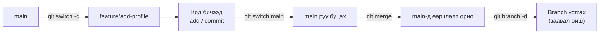
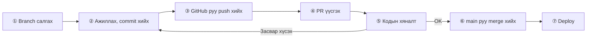
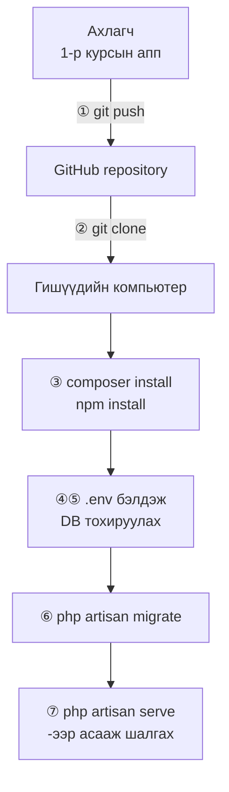

# Git-ээр багаар хөгжүүлэхэд бэлтгэх

> 🇯🇵 Эх хувь (япон хэлээр): [2026_04_30.md](<../../../2年生_システム開発実践/前期/2026_04_30/2026_04_30.md>) <!-- original-ja-link -->

---

## Git давтлага + branch / merge

### Өнөөдрийн зорилго
- 1-р курст сурсан commit/push-ийг давтах
- Branch-ийн тухай ойлголттой болж, ашиглаж чаддаг болох
- Merge хийх аргыг мэддэг болох

---

### Branch гэж юу вэ

**Branch = ажлын «салаа». Үндсэн кодыг эвдэлгүйгээр шинэ функц хөгжүүлж болно**

```
main (production branch)
  │
  ├── feature/login    ← Нэвтрэх функцийг хөгжүүлж байна
  ├── feature/search   ← Хайлтын функцийг хөгжүүлж байна
  └── bugfix/404-error ← Алдаа засаж байна
```

```bash
# Одоогийн branch-ийг шалгах
git branch
# → * main (* нь одоогийн branch)

# Шинэ branch үүсгээд түүн рүү шилжих
git checkout -b feature/add-profile
# эсвэл (Git 2.23-аас эхлэн)
git switch -c feature/add-profile

# Branch-уудыг жагсааж харуулах
git branch -a   # -a-аар remote branch-уудыг ч харуулна

# main руу буцах
git switch main

# Branch устгах
git branch -d feature/add-profile
```

---

### merge — Branch-уудыг нэгтгэх

Ажлын branch дээр хийсэн өөрчлөлтүүдээ эцэст нь main руу оруулахыг merge гэнэ.



```bash
# ① feature/add-profile branch дээр ажиллаж commit хийнэ
git switch feature/add-profile
# ... код бичнэ ...
git add .
git commit -m "プロフィール画面を追加"

# ② main branch руу буцна
git switch main

# ③ feature/add-profile-ийн өөрчлөлтийг main руу оруулна
git merge feature/add-profile

# ④ Merge хийсний дараа branch-ийг устгана (заавал биш)
git branch -d feature/add-profile
```

---

### Conflict (зөрчил)-ийг шийдэх

```bash
# 2 хүн нэг мөрийг өөрчилсөн бол merge хийх үед conflict үүснэ
# Conflict гарсан файлыг нээвэл...

<<<<<<< HEAD
  echo "Aさんが書いたコード";
=======
  echo "Bさんが書いたコード";
>>>>>>> feature/b-work

# ↑ Үүнийг гараар зөв код болгон засна
# Зассаны дараа:
git add .
git commit -m "コンフリクトを解消"
```

---

## 02-р цаг: GitHub Flow — PR, кодын хяналт (code review)

### GitHub Flow гэж юу вэ

Багаар хөгжүүлэхэд зориулсан тохиролцоо (дүрэм) юм.

```
① main-аас ажлын branch салгана
      git switch -c feature/xxxx

② Branch дээр ажиллаж commit хийнэ
      git add .
      git commit -m "мессеж"

③ GitHub руу push хийнэ
      git push origin feature/xxxx

④ Pull Request (PR) үүсгэнэ
      → GitHub дээр «энэ кодыг main-д оруулмаар байна» гэж хүсэлт гаргана

⑤ Багийн гишүүд кодыг хянана
      → Сэтгэгдэл бичих, засвар хийхийг хүсэх гэх мэт

⑥ Асуудалгүй бол main руу merge хийнэ
⑦ Deploy хийнэ (production-д нэвтрүүлнэ)
```

Зургаар үзүүлбэл дараах урсгалтай болно. Хяналтын үеэр засвар хүсвэл ② руу буцаж засаад дахин push хийнэ.



### Pull Request бичих арга

```markdown
## Өөрчлөлтийн агуулга
- Профайл дэлгэц нэмсэн
- Хэрэглэгчийн нэр, дүрс тэмдгийг харуулдаг болгосон

## Шалгаж өгөхийг хүссэн зүйлс
- `/profile` руу ороход зөв харагдаж байгаа эсэх
- Нэвтрээгүй үед `/login` руу redirect хийгдэж байгаа эсэх

## Дэлгэцийн зураг
(Зургаа хавсаргана)
```

### Кодын хяналтын гол санаанууд

- Алдаа (bug) эсвэл логикийн алдаа байгаа эсэх
- Аюулгүй байдлын асуудал байгаа эсэх (XSS, SQL Injection гэх мэт)
- Код уншихад ойлгомжтой эсэх
- Тест бичсэн эсэх (2-р курст заавал биш)

---

## 03-р цаг: 1-р курсын аппыг багаараа ажиллуулах

### Алхмууд

Ахлагчийн GitHub-д байршуулсан аппыг багийн бүх гишүүн өөрийн компьютер дээр ажиллуулах хүртэлх урсгал юм.



```bash
# ① Багийн ахлагч 1-р курсын аппаа GitHub руу push хийнэ
git init
git remote add origin https://github.com/багийн_нэр/app.git
git add .
git commit -m "initial commit"
git push -u origin main

# ② Багийн гишүүд clone хийнэ
git clone https://github.com/багийн_нэр/app.git
cd app

# ③ Хамаарлуудыг (dependencies) суулгана
composer install
npm install

# ④ Орчны тохиргоо
cp .env.example .env
php artisan key:generate

# ⑤ DB-ийн тохиргоо (.env-г засна)
# DB_DATABASE=app_db
# DB_USERNAME=root
# DB_PASSWORD=

# ⑥ Migration
php artisan migrate

# ⑦ Асааж шалгана
php artisan serve
```

---

## Дүгнэлт

| Команд | Утга |
|---------|------|
| `git switch -c branch-ийн_нэр` | Branch үүсгээд түүн рүү шилжинэ |
| `git switch main` | main руу буцна |
| `git merge branch-ийн_нэр` | Branch-ийг одоогийн branch-тэй нэгтгэнэ |
| `git push origin branch-ийн_нэр` | Branch-ийг remote руу push хийнэ |
| Pull Request (PR) | GitHub дээр кодоо merge хийх хүсэлт гаргана |
| Кодын хяналт | PR дээр сэтгэгдэл бичиж, асуудлыг зааж хэлнэ |
