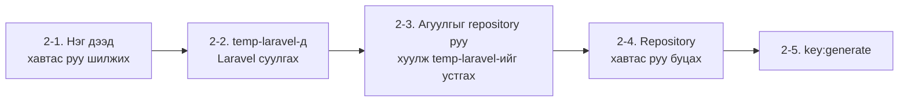
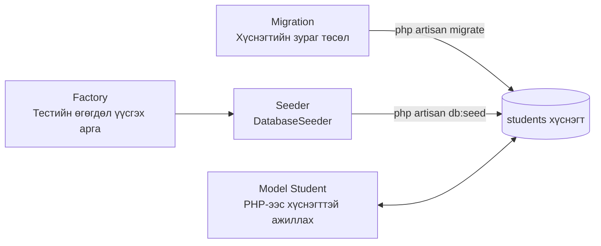

> 🇯🇵 Эх хувь (япон хэлээр): [20260506.md](<../../../2年生_システム開発実践/前期/2026_05_06/20260506.md>) <!-- original-ja-link -->

## Laravel төслийн анхны тохиргоо

> **Зорилго:** Энэ хичээлд ашиглах Laravel төслийг тэгээс эхлэн үүсгэж, API хөгжүүлэлтийг эхлүүлэх боломжтой төлөвт хүргэх.

---

### Эхлээд: Шаардлагатай програмууд суусан эсэхийг шалгах

Ажлаа эхлэхээс өмнө шаардлагатай програмууд суулгагдсан эсэхийг шалгана.  
Терминалаа нээгээд дараах командуудыг **нэг нэг мөрөөр** ажиллуулна уу.

---

#### PHP-г шалгах

```bash
php --version
```

**OK бол:**
```
PHP 8.2.x (cli) ...  ← Хувилбар харагдвал OK
```

**NG бол (`command not found` эсвэл `'php' は認識されていません` (танигдахгүй байна) гэж гарсан):**

PHP суугаагүй байна. XAMPP суулгавал PHP болон MySQL-ийг хамтад нь ашиглах боломжтой болно.

**Windows-ийн хувьд:**
1. `https://www.apachefriends.org/` руу орно
2. «XAMPP for Windows»-ийг татаж аваад суулгана
3. Суулгасны дараа `C:\xampp\php`-г **орчны хувьсагч PATH**-д нэмнэ  
   (Start цэсээс «環境変数» (орчны хувьсагч) гэж хайна → «システム環境変数の編集» (системийн орчны хувьсагчийг засах) → «環境変数» (орчны хувьсагч) → «Path»-ийг сонгоод «編集» (засах) → «新規» (шинэ)-ээр `C:\xampp\php`-г нэмнэ)
4. Терминалаа **хаагаад дахин нээж**, `php --version`-г дахин ажиллуулна

**Mac-ийн хувьд:**
1. Терминал дээр дараахыг ажиллуулна (Homebrew суусан бол)
   ```bash
   brew install php
   ```
2. Homebrew суугаагүй бол эхлээд дараахыг ажиллуулна
   ```bash
   /bin/bash -c "$(curl -fsSL https://raw.githubusercontent.com/Homebrew/install/HEAD/install.sh)"
   ```

---

#### Composer-ийг шалгах

```bash
composer --version
```

**OK бол:**
```
Composer version 2.x.x ...  ← Хувилбар харагдвал OK
```

**NG бол (`command not found` эсвэл `'composer' は認識されていません` (танигдахгүй байна) гэж гарсан):**

Composer суугаагүй байна. Дараах алхмаар суулгана.

**Windows-ийн хувьд:**
1. `https://getcomposer.org/download/` руу орно
2. «Composer-Setup.exe»-г татаж аваад ажиллуулна
3. Суулгах явцад PHP-ийн байршлыг асуувал `C:\xampp\php\php.exe`-г зааж өгнө
4. Суулгаж дууссаны дараа терминалаа **хаагаад дахин нээж**, `composer --version`-г ажиллуулна

**Mac-ийн хувьд:**
```bash
brew install composer
```

---

#### MySQL-ийг шалгах

```bash
mysql --version
```

**OK бол:**
```
mysql  Ver 8.0.x ...  ← Хувилбар харагдвал OK
```

Хувилбар харагдвал дараа нь MySQL **сервер** ажиллаж байгаа эсэхийг шалгана.

> **Анхаар (Mac):** `mysql --version` харагдаж байсан ч сервер суугаагүй байх тохиолдол бий.  
> `mysql-client` (зөвхөн холбогдох хэрэгсэл) болон `mysql` (сервер өөрөө) нь өөр зүйл юм.  
> Дараах алхмаар сервер ажиллаж байгаа эсэхийг заавал шалгаарай.

**Mac-ийн хувьд:**
```bash
brew services list | grep mysql
```

| Харагдах байдал | Утга |
|------|------|
| `mysql  started` | Сервер ажиллаж байна. Дараагийн алхам руу шилжиж болно |
| `mysql  stopped` | Сервер зогссон байна. Доорх «Асаах» алхам руу |
| mysql-ийн мөр гарахгүй | Сервер өөрөө суугаагүй байна. Доорх «Суулгах» алхам руу |

**Windows (XAMPP)-ийн хувьд:**  
XAMPP Control Panel-ийг нээгээд MySQL-ийн хажууд байгаа «Start» товчийг дарна.  
«Running» гэж харагдвал асаалттай байна.

**MySQL сервер stopped байвал (асаах):**

```bash
# Mac-ийн хувьд
brew services start mysql
```

XAMPP-ийн хувьд Control Panel-ийн «Start» товчийг дарна.

**MySQL сервер өөрөө суугаагүй бол (Mac):**

```bash
brew install mysql
brew services start mysql
```

> **Холбогдох үеийн нууц үгийн тухай**  
> `mysql -u root -p`-г ажиллуулахад нууц үг асууна.  
> Homebrew-ээр шинээр суулгасан бол **нууц үггүй** тул шууд Enter дарна.  
> XAMPP-ийн хувьд ч анхны тохиргоогоор **нууц үггүй** байдаг.  
> Өөрөө нууц үг тохируулсан гэдгээ санаж байвал тэр нууц үгээ оруулна.

---

**NG бол (`command not found` эсвэл `'mysql' は認識されていません` (танигдахгүй байна) гэж гарсан):**

MySQL суугаагүй байна.

**Windows (XAMPP ашиглах бол):**
1. XAMPP суулгасан бол `C:\xampp\mysql\bin`-г орчны хувьсагч PATH-д нэмнэ  
   (PHP-г нэмсэнтэй ижил алхмаар, энэ удаа `C:\xampp\mysql\bin`-г нэмнэ)
2. Терминалаа **хаагаад дахин нээж**, `mysql --version`-г ажиллуулна

**Mac-ийн хувьд:**
```bash
brew install mysql
brew services start mysql
```

---

> **Тэгсэн ч шийдэгдэхгүй бол багшдаа хандаарай.**  
> Хувилбар хэт хуучин (PHP 7 цуврал гэх мэт) байвал ч багшаасаа асуугаарай.  
> **PHP 8.1 ба түүнээс дээш, Composer 2 цуврал, MySQL 8 цуврал** нь зөвлөмжтэй хувилбарууд юм.

---

### Step 1｜Clone хийсэн repository дотор шилжих

Та GitHub-ээс clone хийсэн repository-той байх ёстой.  
Терминалаа нээгээд тэр хавтас руу шилжинэ.

**Windows-ийн хувьд (PowerShell эсвэл Command Prompt):**
```bash
cd C:\Users\（өөрийн_хэрэглэгчийн_нэр）\Documents\（repository-ийн_нэр）
```

**Mac-ийн хувьд:**
```bash
cd ~/Documents/（repository-ийн_нэр）
```

Шилжсэн эсэхээ шалгана:
```bash
pwd
```
```
/Users/（өөрийн_хэрэглэгчийн_нэр）/Documents/（repository-ийн_нэр）  ← Repository дотор байвал OK
```

Git repository гэж танигдаж байгаа эсэхийг ч шалгая:
```bash
git status
```
```
On branch main
nothing to commit, working tree clean  ← Ингэж харагдвал OK
```

> **`git status`-д алдаа гарвал** (`not a git repository` гэх мэт)  
> Repository дотор шилжиж чадаагүй байна. Хавтасны нэрээ шалгаад `cd`-г дахин хийгээрэй.

---

### Step 2｜Laravel суулгах

Clone хийсэн хавтсанд `git clone`-ийн үед автоматаар үүсдэг `.git` хавтас байдаг.  
`composer create-project laravel/laravel .` нь хавтас бүрэн хоосон биш бол ажилладаггүй тул алдаа гарна.

```
Project directory "..." is not empty.  ← Энэ алдаа гарна
```

> **`.git` нь нуугдмал хавтас учраас Finder болон Explorer дээр харагдахгүй.**  
> Терминал дээр `ls -a`-г ажиллуулбал харж болно.

Тиймээс **эхлээд өөр хавтсанд үүсгээд, дараа нь агуулгыг нь зөөх** алхмаар явна.



#### 2-1. Нэг дээд хавтас руу шилжих

```bash
cd ..
```

Шалгана:
```bash
pwd
```
```
/Users/（өөрийн_хэрэглэгчийн_нэр）/Documents  ← Repository-ийн нэг дээд хавтсанд байвал OK
```

#### 2-2. Түр хавтсанд Laravel суулгах

```bash
composer create-project laravel/laravel temp-laravel
```

> Ажиллахад **2–5 минут** зарцуулна. Дэлгэц дээр олон бичиг гүйх боловч хүлээгээрэй.  
> Эцэст нь `Application ready!` гэж гарвал амжилттай.

#### 2-3. Түр хавтасны агуулгыг repository хавтас руу зөөх

**Mac-ийн хувьд:**
```bash
cp -r temp-laravel/. （repository-ийн_нэр）/
rm -rf temp-laravel
```

**Windows-ийн хувьд (PowerShell):**
```powershell
Copy-Item -Path temp-laravel\* -Destination （repository-ийн_нэр）\ -Recurse -Force
Copy-Item -Path temp-laravel\.* -Destination （repository-ийн_нэр）\ -Recurse -Force -ErrorAction SilentlyContinue
Remove-Item -Recurse -Force temp-laravel
```

> **（repository-ийн_нэр）** гэсэн хэсгийг өөрийн repository-ийн хавтасны нэрээр солиорой.

#### 2-4. Repository хавтас руу буцах

```bash
cd （repository-ийн_нэр）
```

Зөв шилжсэн эсэхээ шалгана:
```bash
pwd
```
```
/Users/（өөрийн_хэрэглэгчийн_нэр）/Documents/（repository-ийн_нэр）  ← Repository дотор байвал OK
```

`app/`, `routes/` зэрэг хавтсууд үүссэн бол амжилттай:
```bash
ls
```
```
README.md  app  artisan  bootstrap  composer.json  config  database  ...
```

#### 2-5. Application key үүсгэх

Laravel нь session болон шифрлэлтэд зориулж **application key** (нууц түлхүүр) шаарддаг.  
Заавал ажиллуулаарай.

```bash
php artisan key:generate
```

```
   INFO  Application key set successfully.
```

> Энэ командыг ажиллуулахад `.env` файлын `APP_KEY=`-д утга автоматаар тохируулагдана.  
> Мартвал `MissingAppKeyException` гэсэн алдааны дэлгэц гарна.

**Алдаа гарвал: `No APP_KEY variable was found in the .env file`**

`.env` файлд `APP_KEY=` мөр байхгүй байна.  
VSCode-оор `.env`-г нээж, файлын төгсгөлд дараах 1 мөрийг нэмж бичээрэй.

```dotenv
APP_KEY=
```

Хадгалсны дараа дахин ажиллуулна:

```bash
php artisan key:generate
```

`APP_KEY=`-ийн ард урт тэмдэгт мөр автоматаар орвол амжилттай.

**Энэ үеийн хавтасны бүтэц (зөвхөн гол хэсгүүд):**

```
（repository-ийн_нэр）/    ← Clone хийсэн хавтас (= Git repository)
├── app/
│   ├── Http/
│   │   └── Controllers/   ← Controller байрлуулах газар
│   └── Models/            ← Model байрлуулах газар
├── database/
│   ├── migrations/        ← Хүснэгтийн тодорхойлолт байрлуулах газар
│   ├── factories/         ← Тестийн өгөгдөл үүсгэх тохиргоо
│   └── seeders/           ← Тестийн өгөгдөл оруулах тохиргоо
├── routes/
│   ├── api.php            ← API-ийн routing (энэ удаа гол нь ашиглана)
│   └── web.php            ← Blade-ийн routing (1-р курст ашигласан)
└── .env                   ← DB холболтын мэдээлэл зэрэг тохиргооны файл
```

---

### Step 3｜Өгөгдлийн сан бэлдэх

#### phpMyAdmin гэж юу вэ?

**phpMyAdmin** нь MySQL-ийн өгөгдлийн санг хөтөч дээр удирдах боломжтой удирдлагын хэрэгсэл юм.  
Команд бичихгүйгээр зөвхөн дэлгэц дээр ажиллаад өгөгдлийн санг үүсгэх, шалгах, устгах боломжтой.

| Орчин             | phpMyAdmin нээх арга                                                        |
| -------------- | ---------------------------------------------------------------------- |
| Windows (XAMPP) | XAMPP Control Panel-ийн «Admin» товчийг дарна → Хөтөч дээр `http://localhost/phpmyadmin` нээгдэнэ |
| Mac (XAMPP)     | XAMPP Control Panel-ийн «Admin» товчийг дарна → Хөтөч дээр `http://localhost/phpmyadmin` нээгдэнэ |
| Mac (Homebrew)  | phpMyAdmin-ийг тусад нь суулгах шаардлагатай (доор тайлбарласан терминалын аргыг ашиглах нь илүү хялбар)                             |

---

#### 3-1. Өгөгдлийн сан үүсгэх

**Windows-ийн хувьд (XAMPP + phpMyAdmin):**

1. XAMPP Control Panel дээр MySQL-ийг «Start» хийнэ
2. Хөтөч дээр `http://localhost/phpmyadmin`-г нээнэ
3. Зүүн талын цэсний «**新規作成**» (шинээр үүсгэх) дээр дарна
4. Дараахыг оруулаад «**作成**» (үүсгэх) товчийг дарна

   - **Өгөгдлийн сангийн нэр:** `school_api`
   - **Collation (жиших дараалал):** `utf8mb4_unicode_ci`

**Mac-ийн хувьд (Homebrew):**

phpMyAdmin тохируулах шаардлагагүй, терминалаас үүсгэх аргаар явна.  
MySQL ажиллаж байгааг шалгасны дараа ажиллуулаарай.

```bash
mysql -u root
```
```sql
CREATE DATABASE school_api CHARACTER SET utf8mb4 COLLATE utf8mb4_unicode_ci;
EXIT;
```

> Нууц үг тохируулсан бол `mysql -u root -p` гэж бичээд нууц үгээ оруулаарай.

#### 3-2. `.env` файлыг тохируулах

VSCode-оор төслөө нээгээд root хавтсанд байгаа `.env` файлыг нээнэ.

```
（repository-ийн_нэр）/
└── .env   ← Үүнийг нээнэ
```

> **⚠️ Анхаар: Файлын агуулгыг бүгдийг нь устгаад шинээр бичиж болохгүй.**  
> `.env`-д `APP_KEY` зэрэг олон тохиргоо аль хэдийн бичигдсэн байгаа.  
> **Зөвхөн DB-тэй холбоотой 5 мөрийг олж утгыг нь өөрчилнө. Бусад мөрөнд хүрч болохгүй.**

Файлыг доош гүйлгэвэл дараах мөрүүд байгаа.  
Эдгээр 5 мөрийн `=`-ийн баруун талыг л өөрчилнө:

```dotenv
DB_CONNECTION=mysql
DB_HOST=127.0.0.1
DB_PORT=3306
DB_DATABASE=school_api    ← Саяхан үүсгэсэн DB-ийн нэрээр солино
DB_USERNAME=root           ← MySQL-ийн хэрэглэгчийн нэр (ихэвчлэн root)
DB_PASSWORD=               ← Нууц үг тохируулаагүй бол хоосон үлдээнэ
```

Өөрчилсний дараа **Ctrl+S** (Mac дээр **Cmd+S**)-ээр хадгална.

> **`.env` бол нууц үг бичигдсэн тохиргооны файл юм.**  
> Git-д автоматаар орохгүй байхаар тохируулагдсан тул бусдад харуулахгүй байцгаая.

---

### Step 4｜Model, Migration, Factory үүсгэх

Энэ хичээлээр **сурагч (Student)**-ийг удирдах API хийнэ.  
Дараах 1 командаар шаардлагатай файлуудыг нэг дор үүсгэж болно.

```bash
php artisan make:model Student -mf
```

| Сонголт | Утга                  | Үүсэх файл                                             |
| ----- | ------------------- | ---------------------------------------------------- |
| (байхгүй)  | Model үүсгэнэ              | `app/Models/Student.php`                             |
| `-m`  | Migration (хүснэгтийн тодорхойлолт)-ийг бас үүсгэнэ | `database/migrations/xxxx_create_students_table.php` |
| `-f`  | Factory (тестийн өгөгдөл үүсгэх)-ийг бас үүсгэнэ  | `database/factories/StudentFactory.php`              |

Үүсэх 3 файл болон дараа нь ашиглах seeder хоорондоо дараах байдлаар холбогддог.



Ажиллуулсны дараа дараах байдлаар харагдвал амжилттай:

```
   INFO  Model [app/Models/Student.php] created successfully.
   INFO  Factory [database/factories/StudentFactory.php] created successfully.
   INFO  Migration [database/migrations/2024_xx_xx_create_students_table.php] created successfully.
```

---

### Step 5｜Model засах (`$fillable` тохируулах)

Үүссэн `app/Models/Student.php`-г VSCode-оор нээнэ.

```
school-api/
└── app/
    └── Models/
        └── Student.php   ← Үүнийг нээнэ
```

Файлыг нээхэд дараах агуулгатай байна. `$fillable`-г нэмнэ:

```php
<?php
namespace App\Models;

use Illuminate\Database\Eloquent\Factories\HasFactory;
use Illuminate\Database\Eloquent\Model;

class Student extends Model
{
    use HasFactory;

    // ↓ Энэ 1 мөрийг нэмнэ
    protected $fillable = ['name', 'email', 'score'];
}
```

> **`$fillable` гэж юу вэ?**  
> Laravel-ийн аюулгүй байдлын боломж юм. Энд бичсэн баганын нэрсийг л `create()` болон `update()`-ээр өөрчлөх боломжтой болгоно.  
> Үүнийг тохируулахгүй бол дараа нь API-аас өгөгдөл хадгалах үед алдаа гарна.

---

### Step 6｜Migration файлыг засах

`database/migrations/` хавтсыг VSCode-оор нээвэл огноогоор эхэлсэн файлууд жагсаж байна.

```
school-api/
└── database/
    └── migrations/
        ├── 0001_01_01_000000_create_users_table.php    ← Laravel анхнаасаа бэлдсэн файл
        ├── 0001_01_01_000001_create_cache_table.php    ← Laravel анхнаасаа бэлдсэн файл
        ├── 0001_01_01_000002_create_jobs_table.php     ← Laravel анхнаасаа бэлдсэн файл
        └── 2024_xx_xx_xxxxxx_create_students_table.php ← ← Step4-д үүссэн файл (үүнийг засна)
```

**Хамгийн доод талын `create_students_table.php`-г нээж**, `up()` method-ийн агуулгыг өөрчилнө:

```php
public function up(): void
{
    Schema::create('students', function (Blueprint $table) {
        $table->id();                              // ID (автоматаар дугаарлагдана)
        $table->string('name', 100);              // Овог нэр
        $table->string('email')->unique();         // Имэйл хаяг (давхардаж болохгүй)
        $table->integer('score')->default(0);     // Оноо (анхны утга нь 0)
        $table->timestamps();                      // Үүсгэсэн болон шинэчилсэн огноо, цаг (автоматаар)
    });
}
```

---

### Step 7｜Migration ажиллуулж хүснэгт үүсгэх

```bash
php artisan migrate
```

Амжилттай бол дараах байдлаар харагдана:

```
   INFO  Running migrations.

  0001_01_01_000000_create_users_table ................... 21ms DONE
  0001_01_01_000001_create_cache_table ................... 10ms DONE
  0001_01_01_000002_create_jobs_table .................... 10ms DONE
  2024_xx_xx_xxxxxx_create_students_table ............... 15ms DONE
```

Хүснэгт үүссэн эсэхийг шалгана.

**Windows-ийн хувьд (phpMyAdmin):**  
Хөтөч дээр `http://localhost/phpmyadmin`-г нээж, зүүн талын `school_api` дээр дарвал `students` хүснэгт харагдаж байх ёстой.

**Mac-ийн хувьд (терминал):**
```bash
mysql -u root -e "SHOW TABLES IN school_api;"
```
```
+----------------------+
| Tables_in_school_api |
+----------------------+
| cache                |
| jobs                 |
| migrations           |
| students             |  ← Энэ харагдвал OK
| users                |
+----------------------+
```

#### Түгээмэл алдаанууд ба шийдэх арга

**Алдаа 1: DB-тэй холбогдож чадахгүй**
```
SQLSTATE[HY000] [2002] Connection refused
```
→ MySQL ажиллаагүй байна.  
→ **Windows:** XAMPP Control Panel дээр MySQL-ийг «Start» хийнэ үү.  
→ **Mac:** `brew services start mysql`-г ажиллуулна уу.

**Алдаа 2: Өгөгдлийн сан олдохгүй**
```
SQLSTATE[HY000] [1049] Unknown database 'school_api'
```
→ Step3-т өгөгдлийн сан үүсгээгүй, эсвэл `.env` дахь өгөгдлийн сангийн нэр буруу байна.  
→ **Windows:** phpMyAdmin дээр өгөгдлийн сангийн нэрийг шалгана уу.  
→ **Mac:** `mysql -u root -e "SHOW DATABASES;"`-ээр өгөгдлийн сангийн жагсаалтыг шалгана уу.

**Алдаа 3: Нууц үг буруу**
```
SQLSTATE[HY000] [1045] Access denied for user 'root'@'localhost'
```
→ `.env`-ийн `DB_PASSWORD` буруу байна. MySQL-ийн нууц үгээ шалгаад дахин бичнэ үү.

---

### Step 8｜Тестийн өгөгдөл оруулах

API-ийн ажиллагааг шалгахад ашиглах тестийн өгөгдлийг бэлдэнэ.

#### 8-1. Factory засах

`database/factories/StudentFactory.php`-г нээнэ.

```
school-api/
└── database/
    └── factories/
        └── StudentFactory.php   ← Үүнийг нээнэ
```

`definition()` method-ийн агуулгыг өөрчилнө:

```php
public function definition(): array
{
    return [
        'name'  => $this->faker->name(),                      // Санамсаргүй нэр
        'email' => $this->faker->unique()->safeEmail(),        // Санамсаргүй имэйл
        'score' => $this->faker->numberBetween(0, 100),        // 0–100 хооронд санамсаргүй оноо
    ];
}
```

#### 8-2. Seeder засах

`database/seeders/DatabaseSeeder.php`-г нээж, `run()` method-д 1 мөр нэмнэ:

```php
public function run(): void
{
    \App\Models\Student::factory(10)->create(); // Сурагчийн өгөгдлийг 10 ширхэг үүсгэнэ
}
```

#### 8-3. Тестийн өгөгдөл оруулах

```bash
php artisan db:seed
```

```
   INFO  Seeding database.
```

Өгөгдөл орсон эсэхийг шалгана.

**Windows-ийн хувьд (phpMyAdmin):**  
`http://localhost/phpmyadmin`-г нээж, `school_api` → `students` дээр дарвал 10 мөр өгөгдөл харагдана.

**Mac-ийн хувьд (терминал):**
```bash
mysql -u root -e "SELECT COUNT(*) FROM school_api.students;"
```
```
+----------+
| COUNT(*) |
+----------+
|       10 |  ← 10 гэж харагдвал OK
+----------+
```

---

### Step 9｜Хөгжүүлэлтийн серверийг асаах

```bash
php artisan serve
```

```
   INFO  Server running on [http://127.0.0.1:8000].

  Press Ctrl+C to stop the server
```

Хөтөч дээр `http://localhost:8000` руу орж, «Laravel»-ийн лого харагдвал амжилттай асчээ.

> **Энэ нүүр дэлгэц нь зөвхөн сервер ажиллаж байгааг шалгах дэлгэц юм.**  
> Seeder-ээр оруулсан өгөгдөл өгөгдлийн сан дотор байгаа бөгөөд энэ дэлгэц дээр харагдахгүй.  
> Дараагийн хичээлээс API endpoint хийснээр өгөгдлийг авч харуулах боломжтой болно.

> **Серверийг зогсоохдоо `Ctrl + C`-г дарна.**  
> Сервер ажиллаж байх хооронд терминалаа хааж болохгүй.

#### Seeder-ийн өгөгдөл зөв орсон эсэхийг шалгахыг хүсвэл

**Mac-ийн хувьд (терминал дээр шалгах):**

```bash
mysql -u root -e "SELECT id, name, score FROM school_api.students LIMIT 5;"
```

```
+----+------------------+-------+
| id | name             | score |
+----+------------------+-------+
|  1 | Tanaka Taro      |    72 |
|  2 | Yamada Hanako    |    88 |
...
+----+------------------+-------+
```

Ингэж санамсаргүй өгөгдөл харагдвал seeder амжилттай ажилласан байна.

**Windows-ийн хувьд (phpMyAdmin дээр шалгах):**

`http://localhost/phpmyadmin`-г нээж, `school_api` → `students` дээр дарвал 10 мөр өгөгдөл жагсаалтаар харагдана.

---

### Энэ хүртэлх шалгах жагсаалт

| Шалгах зүйл | Тэмдэглэгээ |
|---------|---------|
| `php --version` / `composer --version`-ээр хувилбар харагдсан | □ |
| `composer create-project`-оор төсөл үүсгэж чадсан | □ |
| `php artisan key:generate`-ээр application key үүсгэсэн | □ |
| `school_api` өгөгдлийн сан үүсгэсэн | □ |
| `.env`-ийн DB холболтын мэдээллийг тохируулсан | □ |
| `app/Models/Student.php`-д `$fillable` нэмсэн | □ |
| Migration файлд багана нэмсэн | □ |
| `php artisan migrate`-ээр `students` хүснэгт үүсгэж чадсан | □ |
| `php artisan db:seed`-ээр тестийн өгөгдөл 10 мөр орсон | □ |
| `php artisan serve`-ээр сервер асч, хөтөч дээр шалгаж чадсан | □ |
