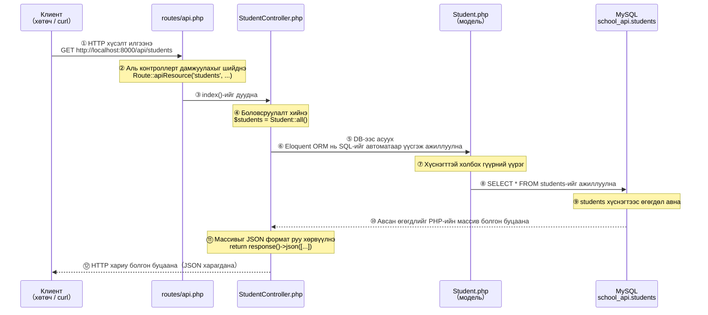
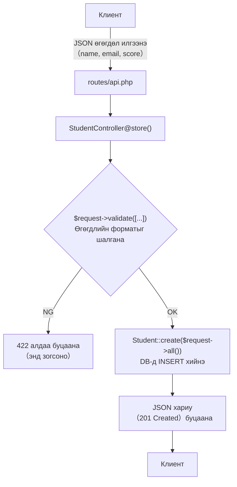

> 🇯🇵 Эх хувь (япон хэлээр): [20260514.md](<../../../2年生_システム開発実践/前期/2026_05_14/20260514.md>) <!-- original-ja-link -->

## Blade аппыг API болгох

### Өнөөдрийн зорилго
- REST API гэж юу болохыг тайлбарлаж чаддаг болох
- JSON хариу буцаадаг контроллер бичиж чаддаг болох
- `api.php`-ийн чиглүүлэлтийг ойлгох

---

### REST API гэж юу вэ

#### «API гэж юу вэ?» гэдгийг нэг үгээр хэлбэл

**API = «Зөвхөн өгөгдөл буцаадаг интерфейс»**

1-р курст хөтөч дээр URL руу хандахад HTML (харагдах байдлыг багтаасан хуудас) буцаж ирдэг байсан.  
API нь яг ижил механизмыг ашигладаг ч HTML-ийн оронд **зөвхөн өгөгдлийг (JSON)** буцаадаг.

```
【Blade апп (1-р курст хийсэн зүйл)】
Хөтөч → GET /students → Сервер → HTML хуудас буцаана
                                      ↑ Хүснэгт, товч, дизайн гээд бүгд багтсан

【REST API (өнөөдрөөс эхлэн хийнэ)】
Хөтөч эсвэл бусад апп → GET /api/students → Сервер → Зөвхөн JSON өгөгдөл буцаана
                                                      ↑ Харагдах байдалгүй, зөвхөн өгөгдөл
```

> **Яагаад зөвхөн JSON буцаадаг вэ?**  
> React, Vue зэрэг фронтэнд нь «дизайнаа өөрөө бүтээдэг» тул  
> серверээс «зөвхөн өгөгдлийг» илгээхийг хүсдэг.  
> API хийвэл «React дээр ажилладаг апп», «гар утасны апп» гэх мэт олон янзын дэлгэцээс нэг өгөгдлийг дахин ашиглах боломжтой.

---

#### JSON ямар хэлбэртэй вэ?

**JSON (жэйсон)** бол өгөгдлийг илэрхийлэх текстийн формат юм.  
Хөтөч болон бусад апп уншихад хялбар байхаар тогтсон бичлэгийн дүрэмтэй.

```json
{
    "status": "ok",
    "data": [
        {
            "id": 1,
            "name": "田中太郎",
            "email": "tanaka@example.com",
            "score": 85
        },
        {
            "id": 2,
            "name": "山田花子",
            "email": "yamada@example.com",
            "score": 72
        }
    ]
}
```

> **Унших гол санаанууд:**  
> - `{ }` дотор «түлхүүр»: «утга» хэлбэрээр бичнэ  
> - `[ ]` бол жагсаалт (олон өгөгдлийг нэгтгэнэ)  
> - Тэмдэгт мөрийг `"`-ээр хүрээлнэ. Тоог хүрээлэхгүй  
> - Хамгийн сүүлийн элементийн ард таслал `,` тавихгүй

---

#### REST-ийн үзэл санаа: URL болон HTTP методын хослол

REST API нь «**URL (хаана)** × **HTTP метод (юу хийх)**»-оор хийх үйлдлээ тодорхойлдог.  
HTTP метод гэдэг нь хүсэлтийн төрлийг илэрхийлэх үг юм.

| HTTP метод | Утга | Өдөр тутмын үйлдэлтэй зүйрлэвэл |
|-------------|------|-------------------|
| `GET`       | Авах | Хуудас үзэх, хайх |
| `POST`      | Шинээр үүсгэх | Форм илгээх |
| `PUT/PATCH` | Шинэчлэх | Агуулгыг засварлах |
| `DELETE`    | Устгах | Устгах товч дарах |

Энэ хичээлээр хийх сурагчийн API-ийн жагсаалт:

| URL                  | Метод      | Утга   | Юу хийх вэ           |
| -------------------- | --------- | ---- | --------------- |
| `/api/students`      | GET       | Жагсаалт авах | Бүх сурагчийн өгөгдлийг буцаана      |
| `/api/students`      | POST      | Шинээр үүсгэх | Шинэ сурагч бүртгэнэ      |
| `/api/students/{id}` | GET       | Дэлгэрэнгүй авах | Заасан нэг сурагчийг буцаана    |
| `/api/students/{id}` | PUT/PATCH | Шинэчлэх   | Заасан сурагчийн мэдээллийг засварлана |
| `/api/students/{id}` | DELETE    | Устгах   | Заасан сурагчийг устгана     |

> `{id}`-ийн оронд тоо орно. Жишээ нь `GET /api/students/3` нь «id нь 3 байгаа сурагчийг авах» гэсэн утгатай.

---

### HTTP статус кодын тухай

API-ийн хариунд заавал **статус код** (тоо) дагалддаг.  
Хөтөч болон React энэ тоог хараад «амжилттай юу, амжилтгүй юу» гэдгийг шийддэг.

| Код | Утга | Хэзээ ашиглах вэ |
|-------|------|---------|
| `200 OK` | Амжилттай | Авах, шинэчлэх, устгах үйлдэл амжилттай болсон үед |
| `201 Created` | Амжилттай үүсгэсэн | POST-оор шинээр үүсгэсэн үед |
| `404 Not Found` | Олдсонгүй | Заасан id байхгүй үед |
| `422 Unprocessable Entity` | Өгөгдлийн шалгалтын алдаа | Оруулсан утга буруу үед |
| `500 Internal Server Error` | Серверийн алдаа | Програмд алдаа (bug) байгаа үед |

> Жишээ нь `GET /api/students/999` хүсэлтээр id=999 сурагч байхгүй бол  
> «404» буцааж «олдсонгүй» гэдгийг мэдэгдэнэ.

---

### Step 10｜API контроллер үүсгэх

#### 10-1. Контроллер файл үүсгэх

Терминал дээр дараах командыг ажиллуулна (`php artisan serve` ажиллаж байгаа терминалаас **өөр таб** нээгээрэй).

```bash
php artisan make:controller Api/StudentController --api
```

**Командын утга:**
- `make:controller` → контроллер файл үүсгэнэ
- `Api/StudentController` → `Api` хавтас дотор `StudentController.php` үүсгэнэ
- `--api` → API-д зориулсан 5 методыг (`index` `store` `show` `update` `destroy`) урьдчилан бичиж өгнө

Ажиллуулсны дараа дараах мессеж гарвал амжилттай:

```
   INFO  Controller [app/Http/Controllers/Api/StudentController.php] created successfully.
```

Үүсгэсэн файлын байршлыг шалгая:

```
（репозиторийн нэр）/
└── app/
    └── Http/
        └── Controllers/
            └── Api/                     ← Шинээр үүссэн хавтас
                └── StudentController.php  ← Энэ үүссэн
```

---

#### 10-2. Контроллер файлыг нээх

VSCode дээр `app/Http/Controllers/Api/StudentController.php`-ийг нээнэ.  
`--api` сонголтоор үүссэн файл анхнаасаа ийм агуулгатай байдаг:

```php
<?php

namespace App\Http\Controllers\Api;

use Illuminate\Http\Request;
use App\Http\Controllers\Controller;

class StudentController extends Controller
{
    public function index()
    {
        //
    }

    public function store(Request $request)
    {
        //
    }

    public function show(string $id)
    {
        //
    }

    public function update(Request $request, string $id)
    {
        //
    }

    public function destroy(string $id)
    {
        //
    }
}
```

> **`namespace` болон `use` гэж юу вэ?**  
> - `namespace` нь энэ файлын «хаяг» шиг зүйл юм. `Api` хавтас дотор байгааг илэрхийлж байна.  
> - `use` нь өөр файлыг «дуудаж ашиглах зарлал» юм. `Student` моделийг ашиглахын тулд дараа нь нэмнэ.

---

#### 10-3. Контроллерт боловсруулалт бичих

Файлын агуулгыг **бүхэлд нь** дараах кодоор солино уу.  
(Ctrl+A-аар бүгдийг сонгоод → буулгах, эсвэл байгаа агуулгыг устгаад дахин бичнэ)

```php
<?php

namespace App\Http\Controllers\Api;

use App\Http\Controllers\Controller;
use App\Models\Student;           // ← Student model-ийг ашиглах боломжтой болгоно
use Illuminate\Http\Request;

class StudentController extends Controller
{
    // -------------------------------------------------------
    // GET /api/students  → Бүх сурагчийн жагсаалтыг буцаана
    // -------------------------------------------------------
    public function index()
    {
        $students = Student::all();  // Өгөгдлийн сангаас бүх бичлэгийг авна

        return response()->json([
            'status' => 'ok',
            'data'   => $students,   // Авсан өгөгдлийг JSON-д хийж буцаана
        ]);
    }

    // -------------------------------------------------------
    // POST /api/students  → Шинэ сурагч бүртгэнэ
    // -------------------------------------------------------
    public function store(Request $request)
    {
        // Өгөгдлийн шалгалт: илгээсэн өгөгдлийн форматыг шалгана
        $request->validate([
            'name'  => 'required|max:100',          // Заавал, 100 тэмдэгтээс ихгүй
            'email' => 'required|email|unique:students', // Заавал, и-мэйл формат, давхардахгүй
            'score' => 'required|integer|min:0|max:100', // Заавал, бүхэл тоо, 0–100
        ]);

        $student = Student::create($request->all()); // DB-д хадгална

        // 201 Created (амжилттай үүсгэсэн) статус кодоор буцаана
        return response()->json([
            'status' => 'ok',
            'data'   => $student,
        ], 201);
    }

    // -------------------------------------------------------
    // GET /api/students/{id}  → id-аар заасан нэг сурагчийг буцаана
    // -------------------------------------------------------
    public function show($id)
    {
        $student = Student::find($id); // id-аар нэг бичлэг хайна

        if (!$student) {
            // Олдохгүй бол → 404 Not Found буцаана
            return response()->json([
                'status'  => 'error',
                'message' => 'Student not found',
            ], 404);
        }

        return response()->json([
            'status' => 'ok',
            'data'   => $student,
        ]);
    }

    // -------------------------------------------------------
    // PUT /api/students/{id}  → id-аар заасан сурагчийг шинэчилнэ
    // -------------------------------------------------------
    public function update(Request $request, $id)
    {
        $student = Student::findOrFail($id); // Олдохгүй бол автоматаар 404 буцаана

        $request->validate([
            'name'  => 'sometimes|max:100',          // sometimes = зөвхөн илгээсэн үед шалгана
            'score' => 'sometimes|integer|min:0|max:100',
        ]);

        $student->update($request->all()); // DB-г шинэчилнэ

        return response()->json([
            'status' => 'ok',
            'data'   => $student,
        ]);
    }

    // -------------------------------------------------------
    // DELETE /api/students/{id}  → id-аар заасан сурагчийг устгана
    // -------------------------------------------------------
    public function destroy($id)
    {
        Student::findOrFail($id)->delete(); // Олоод устгана

        return response()->json([
            'status'  => 'ok',
            'message' => 'Deleted',
        ]);
    }
}
```

**Солисны дараа Ctrl+S (Mac дээр Cmd+S)-ээр хадгална.**

---

#### Метод бүрийн үүргийн тойм

| Методын нэр | Харгалзах URL | Юу хийх вэ |
|-----------|------------|---------|
| `index()` | GET /api/students | Бүх бичлэгийг аваад JSON-оор буцаана |
| `store()` | POST /api/students | Өгөгдлийн шалгалт → DB-д хадгалах → 201-ээр буцаана |
| `show($id)` | GET /api/students/{id} | Нэг бичлэг хайх → байхгүй бол 404 → JSON-оор буцаана |
| `update($request, $id)` | PUT /api/students/{id} | Нэг бичлэг хайх → Өгөгдлийн шалгалт → DB шинэчлэх |
| `destroy($id)` | DELETE /api/students/{id} | Нэг бичлэг хайх → устгах |

---

### Step 11｜API чиглүүлэлтийг идэвхжүүлэх

Зөвхөн контроллер үүсгэсэн төдийгөөр URL болон контроллер хоорондоо холбогдохгүй.  
«Энэ URL руу хандвал энэ методыг дуудна» гэсэн **чиглүүлэлтийг** тохируулна.

#### 11-1. `routes/api.php` үүсгэх

> **⚠️ Laravel 11-ээс эхлэн `routes/api.php` анхнаасаа байдаггүй.**  
> Дараах командыг ажиллуулсны дараа л үүснэ.

```bash
php artisan install:api
```

Ажиллуулахад явцын дунд 2 удаа баталгаажуулалт асууна. Хоёуланд нь `yes` (эсвэл Enter товч)-оор үргэлжлүүлээрэй.

---

**【Баталгаажуулалт 1】Миграци ажиллуулах уу?**

```
   INFO  Published API routes file.

 One new database migration has been published. Would you like to run all pending database migrations? (yes/no) [yes]:
 > yes
```

> `routes/api.php` үүссэний дараа миграцийг одоо шууд ажиллуулах эсэхийг асууна.  
> `yes` эсвэл Enter-ээр үргэлжлүүлнэ.

---

**【Баталгаажуулалт 2】Бодит (production) орчинд ажиллуулах баталгаажуулалт**

```
                                                                    
                         APPLICATION IN PRODUCTION.                 
                                                                    

 ┌ Are you sure you want to run this command? ──────────────────┐
 │ Yes                                                          │
 └──────────────────────────────────────────────────────────────┘
```

> **«APPLICATION IN PRODUCTION (бодит орчин байна)» гэж гарч ирэхэд гайхаж магадгүй ч санаа зовох хэрэггүй.**  
> Энэ бол «Үнэхээр ажиллуулах уу?» гэсэн Laravel-ийн аюулгүй байдлын баталгаажуулалт юм.  
> «Yes»-ийг сонгоод үргэлжлүүлээрэй.

---

**Миграци ажиллана**

```
   INFO  Running migrations.

  2026_xx_xx_xxxxxx_create_personal_access_tokens_table .......... DONE
```

> `personal_access_tokens` (personal access token) хүснэгт үүснэ.  
> Энэ бол **Sanctum баталгаажуулалтын токеныг хадгалах хүснэгт** юм.  
> 07-р цагт баталгаажуулалтын функцийг хэрэгжүүлэхэд ашиглана. Одоохондоо «автоматаар үүссэн» гэдгийг л санахад хангалттай.

---

**Эцэст нь энэ мессеж гарвал амжилттай:**

```
   INFO  API scaffolding installed. Please add the [Laravel\Sanctum\HasApiTokens] trait to your User model.
```

> Төгсгөлийн `Please add the [Laravel\Sanctum\HasApiTokens] trait...` нь  
> «User моделд тохиргоо нэмнэ үү» гэсэн зөвлөмж боловч **үүнийг 07-р цагт хийнэ. Одоохондоо үл тоомсорлож болно.**

---

Энэ командын хийсэн зүйлс:
- `routes/api.php` файлыг үүсгэсэн
- `bootstrap/app.php`-д API чиглүүлэлтийг бүртгэсэн
- Laravel Sanctum (07-р цагт ашиглах баталгаажуулалтын багц)-ыг суулгасан
- `personal_access_tokens` хүснэгтийн миграцийг ажиллуулсан

Ажиллуулсны дараах хавтасны бүтэц:

```
（репозиторийн нэр）/
└── routes/
    ├── api.php   ← Энэ үүссэн (API-ийн routing)
    └── web.php   ← Энэ нь Blade-д зориулсан (энэ удаа хөндөхгүй)
```

> **`api.php` ба `web.php`-ийн ялгаа**  
> - `web.php` … HTML буцаадаг маршрутуудыг бичнэ  
> - `api.php` … JSON буцаадаг API-д зориулсан. URL-ийн эхэнд `/api/` автоматаар нэмэгдэнэ

#### 11-2. Маршрут нэмэх

VSCode дээр `routes/api.php`-ийг нээнэ. Анх бараг хоосон байдаг. Дараах байдлаар солино:

```php
<?php

use Illuminate\Support\Facades\Route;
use App\Http\Controllers\Api\StudentController;  // ← Энэ мөрийг нэмнэ

Route::apiResource('students', StudentController::class);
// ↑ Ганцхан энэ мөрөөр 5 route автоматаар бүртгэгдэнэ
```

**Солисны дараа Ctrl+S (Mac дээр Cmd+S)-ээр хадгална.**

---

#### `Route::apiResource`-ийн бүртгэдэг маршрутуудыг шалгах

`Route::apiResource('students', StudentController::class)` нь дараах 5 маршрутыг **нэг мөрөөр** нэг дор бүртгэнэ.

Шалгах команд:

```bash
php artisan route:list --path=api/students
```

```
  GET|HEAD   api/students ............. students.index  › Api\StudentController@index
  POST       api/students ............. students.store  › Api\StudentController@store
  GET|HEAD   api/students/{student} ... students.show   › Api\StudentController@show
  PUT|PATCH  api/students/{student} ... students.update › Api\StudentController@update
  DELETE     api/students/{student} ... students.destroy› Api\StudentController@destroy
```

> Эдгээрийг нэг нэгээр нь гараар бичвэл 5 мөр болно, харин `apiResource` ашиглавал нэг мөрөөр болчихно.

---

### Step 12｜Хөтөч дээр API-ийн ажиллагааг шалгах

Хөгжүүлэлтийн сервер ажиллаагүй байвал асаана:

```bash
php artisan serve
```

#### 12-1. Жагсаалт авах (GET /api/students)-ыг хөтөч дээр шалгах

Хөтөч дээр дараах URL руу хандана:

```
http://localhost:8000/api/students
```

Дараах шиг JSON харагдвал амжилттай:

```json
{
    "status": "ok",
    "data": [
        {
            "id": 1,
            "name": "Tanaka Taro",
            "email": "tanaka@example.com",
            "score": 72,
            "created_at": "2024-xx-xx ...",
            "updated_at": "2024-xx-xx ..."
        },
        ...
    ]
}
```

> **JSON харагдахгүй алдаа гарвал дараах зүйлсийг шалгана уу.**

**Түгээмэл алдаа ба шийдэл:**

| Алдааны агуулга | Шалтгаан | Шийдэл |
|-----------|------|-------|
| `Class "App\Http\Controllers\Api\StudentController" not found` | use-ийн бичлэг буруу | `api.php`-ийн `use` мөрийг шалгана |
| `SQLSTATE[HY000] [2002] Connection refused` | MySQL ажиллаагүй байна | MySQL-ийг асаана (XAMPP эсвэл `brew services start mysql`) |
| Хоосон хуудас, 500 алдаа | PHP-ийн синтаксийн алдаа | `.storage/logs/laravel.log`-ийг нээж алдааг шалгана |
| Зөвхөн `{"message":""}` харагдана | Маршрут олдсон ч боловсруулалтад алдаа гарсан | Контроллерийн агуулгыг шалгана |

---

#### 12-2. Нэг бичлэг авах (GET /api/students/{id})-ыг хөтөч дээр шалгах

Хөтөч дээр дараах URL руу хандана (id-ийн тоог бодитоор байгаа өгөгдөлдөө тааруулаарай):

```
http://localhost:8000/api/students/1
```

```json
{
    "status": "ok",
    "data": {
        "id": 1,
        "name": "Tanaka Taro",
        "email": "tanaka@example.com",
        "score": 72,
        "created_at": "2024-xx-xx ...",
        "updated_at": "2024-xx-xx ..."
    }
}
```

Байхгүй id-аар хандвал:

```
http://localhost:8000/api/students/999
```

```json
{
    "status": "error",
    "message": "Student not found"
}
```

Ийм байдлаар харагдвал зөв ажиллаж байна.

---

#### 12-3. POST, PUT, DELETE-ийг curl командаар шалгах

Хөтчийн хаягийн мөрөөс зөвхөн GET хүсэлт илгээх боломжтой.  
POST (шинээр үүсгэх), PUT (шинэчлэх), DELETE (устгах)-ийг **curl (курл)** гэдэг командыг ашиглан шалгана.

> **curl гэж юу вэ?**  
> Терминалаас HTTP хүсэлт илгээдэг команд юм. Mac, Windows аль алинд нь стандартаар суусан байдаг.  
> `php artisan serve` ажиллаж байгаа терминалаас **өөр таб**-д ажиллуулаарай.

---

**curl командын сонголтуудыг унших нь:**

| Сонголт | Утга |
|-----------|------|
| `-X POST` | HTTP методыг заана (POST / PUT / DELETE гэх мэт) |
| `-H "Content-Type: application/json"` | «JSON илгээж байна» гэсэн зарлал |
| `-d '{...}'` | Илгээх өгөгдөл (JSON формат) |

---

**① Шинээр үүсгэх (POST /api/students)**

**Mac-ийн хувьд:**
```bash
curl -X POST http://localhost:8000/api/students \
  -H "Content-Type: application/json" \
  -d '{"name": "新しい生徒", "email": "new@example.com", "score": 90}'
```

**Windows (Command Prompt)-ийн хувьд:**
```cmd
curl -X POST http://localhost:8000/api/students -H "Content-Type: application/json" -d "{\"name\": \"新しい生徒\", \"email\": \"new@example.com\", \"score\": 90}"
```

> Windows дээр `"`-ийн өмнө урвуу ташуу зураас тавьж `\"` болгон escape хийх шаардлагатай.

Амжилттай болсон үеийн хариу (статус код `201 Created`):

```json
{"status":"ok","data":{"id":11,"name":"新しい生徒","email":"new@example.com","score":90,...}}
```

---

**② Шинэчлэх (PUT /api/students/{id})**

id нь `1` сурагчийн score-ийг `95` болгон өөрчлөх жишээ:

**Mac-ийн хувьд:**
```bash
curl -X PUT http://localhost:8000/api/students/1 \
  -H "Content-Type: application/json" \
  -d '{"score": 95}'
```

**Windows (Command Prompt)-ийн хувьд:**
```cmd
curl -X PUT http://localhost:8000/api/students/1 -H "Content-Type: application/json" -d "{\"score\": 95}"
```

Амжилттай болсон үеийн хариу (статус код `200 OK`):

```json
{"status":"ok","data":{"id":1,"name":"Tanaka Taro","email":"tanaka@example.com","score":95,...}}
```

---

**③ Устгах (DELETE /api/students/{id})**

id нь `1` сурагчийг устгах жишээ:

**Mac-ийн хувьд:**
```bash
curl -X DELETE http://localhost:8000/api/students/1
```

**Windows (Command Prompt)-ийн хувьд:**
```cmd
curl -X DELETE http://localhost:8000/api/students/1
```

Амжилттай болсон үеийн хариу (статус код `200 OK`):

```json
{"status":"ok","message":"Deleted"}
```

---

**Устгасны дараа жагсаалтыг шалгаад, бичлэгийн тоо багассан бол амжилттай:**

```bash
curl http://localhost:8000/api/students
```

---

### Хүсэлт аль файлуудаар дамждаг вэ

`GET /api/students`-ийг хөтөч эсвэл curl-ээр илгээхэд дотооддоо аль файлууд ямар дарааллаар ажилладгийг харцгаая.

---

#### Ерөнхий урсгалын диаграм

Үйл явдлууд дээрээс доош цаг хугацааны дарааллаар өрнөнө. Бүтэн зураастай сум нь «илгээх (хүсэлт)», тасархай зураастай сум нь «буцах (хариу)»-ыг илэрхийлнэ.



---

#### Файл бүрийн үүргийн тойм

| Файл | Үүрэг | Хариуцах алхам |
|---------|------|---------------|
| `routes/api.php` | «Аль URL → аль контроллер» гэдгийг харгалзуулна | ② |
| `app/Http/Controllers/Api/StudentController.php` | Хүсэлтийг хүлээн авч, боловсруулаад хариу буцаана | ④⑥⑪ |
| `app/Models/Student.php` | DB-ийн хүснэгт болон PHP кодыг холбох гүүр | ⑦ |
| `Өгөгдлийн сан（MySQL）` | Өгөгдлийг бодитоор хадгалж, хайна | ⑨ |

---

#### Eloquent ORM гэж юу вэ (⑥⑦-ийн нэмэлт тайлбар)

`Student::all()` гэж бичихэд л Laravel автоматаар `SELECT * FROM students;` гэсэн SQL-ийг үүсгэж ажиллуулдаг.  
Энэ механизмыг **Eloquent ORM (элоквэнт)** гэдэг.

```php
// PHP дээр бичих зүйл        →  Бодитоор ажиллах SQL
Student::all()           →  SELECT * FROM students;
Student::find(1)         →  SELECT * FROM students WHERE id = 1 LIMIT 1;
Student::create([...])   →  INSERT INTO students (...) VALUES (...);
$student->update([...])  →  UPDATE students SET ... WHERE id = ?;
$student->delete()       →  DELETE FROM students WHERE id = ?;
```

> **SQL-ийг шууд бичих шаардлагагүй** нь ORM-ийн давуу тал юм.  
> Моделийн классын нэр (`Student`) автоматаар хүснэгтийн нэр (`students`)-тэй харгалзана.

---

#### POST үеийн урсгалын ялгаа

`POST /api/students` (шинээр үүсгэх)-ийн үед ч үндсэн урсгал ижил боловч дундуур нь **өгөгдлийн шалгалт** орно.



---

### Энэ хүртэлх шалгах жагсаалт

| Шалгах зүйл | Тэмдэглэгээ |
|---------|---------|
| REST API бол «зөвхөн өгөгдөл буцаадаг механизм» гэж тайлбарлаж чадна | □ |
| JSON-ийн үндсэн бичлэгийг (`{}` `[]` `"key": "value"`) ойлгож байна | □ |
| `php artisan make:controller Api/StudentController --api`-ийг ажиллуулсан | □ |
| `StudentController.php`-д 5 методын кодыг бичсэн | □ |
| `php artisan install:api`-ийг ажиллуулж `routes/api.php`-ийг үүсгэсэн | □ |
| `routes/api.php`-д `Route::apiResource`-ийг нэмсэн | □ |
| `php artisan route:list`-ээр 5 маршрут харагдсан | □ |
| Хөтөч дээр `http://localhost:8000/api/students` руу хандахад JSON буцаж ирсэн | □ |
| `http://localhost:8000/api/students/1`-ээр нэг бичлэгийн JSON буцаж ирсэн | □ |
| `http://localhost:8000/api/students/999`-ээр 404 алдааны JSON буцаж ирсэн | □ |
