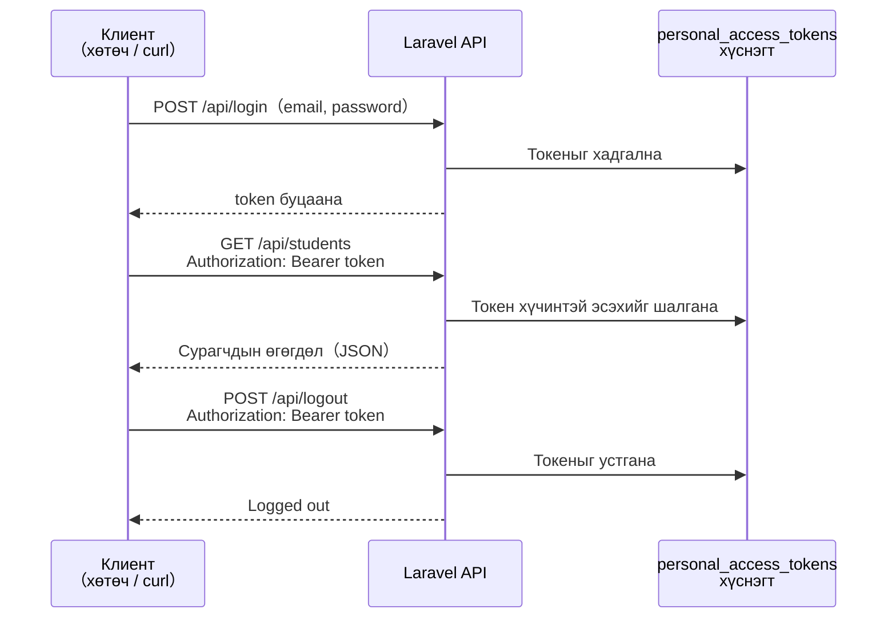
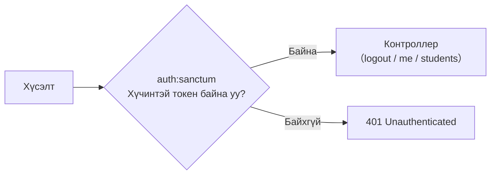

# Laravel-ийг REST API болгох

> 🇯🇵 Эх хувь (япон хэлээр): [20260521.md](<../../../2年生_システム開発実践/前期/2026_05_21/20260521.md>) <!-- original-ja-link -->

---

## 05-р цаг: Resource контроллер ашиглан CRUD API-г цэгцлэх

### API Resource — хариуны бүтцийг цэгцлэх

```bash
php artisan make:resource StudentResource
```

```php
// app/Http/Resources/StudentResource.php
class StudentResource extends JsonResource
{
    public function toArray(Request $request): array
    {
        return [
            'id'         => $this->id,
            'name'       => $this->name,
            'email'      => $this->email,
            'score'      => $this->score,
            'evaluation' => $this->score >= 80 ? 'A' : 'B',  // Тооцоолсон утгыг ч нэмж болно
            'created_at' => $this->created_at->format('Y/m/d'),
            // Шаардлагагүй талбаруудыг (password гэх мэт) оруулахгүй
        ];
    }
}
```

**Контроллер дотор ашиглах нь:**

```php
use App\Http\Resources\StudentResource;
use App\Http\Resources\StudentCollection;

public function index()
{
    $students = Student::all();
    return StudentResource::collection($students);
    // → Бүх бичлэгийг Resource ашиглан багцалж буцаана
}

public function show($id)
{
    return new StudentResource(Student::findOrFail($id));
}
```

---

## 06-р цаг: API хариуны бүтцийг нэг мөр болгох

### API хариуны бүтцийн шилдэг туршлага

```json
// Амжилттай үед
{
    "status": "ok",
    "data": { ... }
}

// Алдаа гарсан үед
{
    "status": "error",
    "message": "Not found",
    "errors": {
        "email": ["このメールアドレスは既に使われています"]
    }
}
```

---

## 07-р цаг: Sanctum ашиглан токен баталгаажуулалт хийх

### Sanctum гэж юу вэ

Laravel-ийн **API баталгаажуулалтын багц** юм.  
Токен (нэг төрлийн нууц үг) ашиглан нэвтэрсэн төлөвийг удирдана.

Нэвтрэхээс гарах хүртэлх хүсэлт, хариу солилцох үйл явц дараах байдлаар явагдана.



```bash
composer require laravel/sanctum
php artisan vendor:publish --provider="Laravel\Sanctum\SanctumServiceProvider"
php artisan migrate
```

**Баталгаажуулалтын API-г хэрэгжүүлэх:**

```php
// app/Http/Controllers/Api/AuthController.php
class AuthController extends Controller
{
    // POST /api/login
    public function login(Request $request)
    {
        $request->validate([
            'email'    => 'required|email',
            'password' => 'required',
        ]);
        
        // И-мэйл болон нууц үгийг шалгана
        if (!Auth::attempt($request->only('email', 'password'))) {
            return response()->json([
                'status'  => 'error',
                'message' => 'メールアドレスまたはパスワードが違います',
            ], 401);
        }
        
        $user = Auth::user();
        
        // Токен олгоно
        $token = $user->createToken('api-token')->plainTextToken;
        
        return response()->json([
            'status' => 'ok',
            'token'  => $token,
            'user'   => $user,
        ]);
    }
    
    // POST /api/logout
    public function logout(Request $request)
    {
        // Одоогийн токеныг устгана
        $request->user()->currentAccessToken()->delete();
        
        return response()->json(['status' => 'ok', 'message' => 'Logged out']);
    }
    
    // GET /api/me
    public function me(Request $request)
    {
        return response()->json(['status' => 'ok', 'user' => $request->user()]);
    }
}
```

---

## 08-р цаг: Баталгаажуулалтын middleware ба эрхийн удирдлага

`auth:sanctum` middleware нь контроллероос өмнө «токентой эсэх»-ийг шалгадаг харуул юм.



```php
// routes/api.php

// Баталгаажуулалт шаардлагагүй route-ууд
Route::post('/login', [AuthController::class, 'login']);
Route::post('/register', [AuthController::class, 'register']);

// Баталгаажуулалт шаардлагатай route-ууд（auth:sanctum）
Route::middleware('auth:sanctum')->group(function () {
    Route::post('/logout', [AuthController::class, 'logout']);
    Route::get('/me', [AuthController::class, 'me']);
    Route::apiResource('students', StudentController::class);
});
```

**API-г турших арга (curl команд):**

```bash
# Нэвтрэх
curl -X POST http://localhost:8000/api/login \
  -H "Content-Type: application/json" \
  -d '{"email":"test@example.com","password":"password"}'
# → {"token": "1|abc123..."}

# Баталгаажуулалт шаардлагатай API-г дуудах
curl http://localhost:8000/api/students \
  -H "Authorization: Bearer 1|abc123..."
```

---

## Дүгнэлт

| Ойлголт | Blade (1-р курс) | API (2-р курс) |
|------|-------------|------------|
| Хариу | HTML（view） | JSON（response()->json()） |
| Чиглүүлэлт | routes/web.php | routes/api.php |
| Баталгаажуулалт | Сесс | Sanctum токен |
| Дэлгэц | Blade буцаана | Фронтэнд бүтээнэ |
