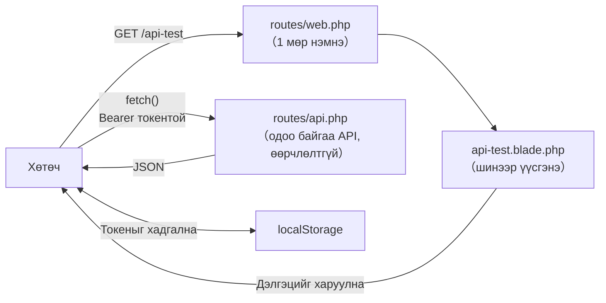

> 🇯🇵 Эх хувь (япон хэлээр): [20260528.md](<../../../2年生_システム開発実践/前期/2026_05_28/20260528.md>) <!-- original-ja-link -->

## Хөтөч дээр токен баталгаажуулалтыг шалгах (нэмэлт)

Зөвхөн curl-ээр бус, хөтөч дээр токен баталгаажуулалтын ажиллагааг нүдээр харж шалгах хуудас бэлдэнэ.

### Тойм

`/api-test` руу хандахад нэвтрэх дэлгэц нээгдэнэ.  
Нэвтэрсний дараа API-аар авсан сурагчдын жагсаалт харагдах бөгөөд нэмэх, устгах үйлдэл хийх боломжтой.

```
【Нэвтрэхийн өмнө】
┌──────────────────────────────────┐
│  API トークンテスター             │
│                                  │
│   ログインすると生徒一覧が         │
│   表示されます                    │
│                                  │
│   [メールアドレス       ]         │
│   [パスワード          ]         │
│   [ログイン（POST /api/login）]   │
└──────────────────────────────────┘

【Нэвтэрсний дараа】
┌──────────────────────────────────────────────────────────────┐
│  APIトークンテスター  ● ログイン中：テストユーザー  [ログアウト] │
├──────────────────────────────────────────────────────────────┤
│  生徒一覧  GET /api/students  HTTP 200                        │
│  ┌────┬──────────┬────────────────────┬──────┬──────┐        │
│  │ ID │  名前    │  メール             │ 点数 │      │        │
│  ├────┼──────────┼────────────────────┼──────┼──────┤        │
│  │  1 │ 田中太郎 │ tanaka@example.com │  85  │ 削除 │        │
│  │  2 │ 山田花子 │ yamada@example.com │  72  │ 削除 │        │
│  └────┴──────────┴────────────────────┴──────┴──────┘        │
│                                                              │
│  新規追加（POST /api/students）                               │
│  [名前] [メールアドレス] [点数] [追加]                         │
│                                                              │
│  ▶ このページが使っているコード（React でも同じ書き方になる）   │
└──────────────────────────────────────────────────────────────┘
```

> **Одоо байгаа API кодыг огт өөрчлөхгүй.**  
> Нэмэх зүйл нь зөвхөн `routes/web.php`-ийн 1 мөр болон 1 view файл.

Нэмэх файлууд болон одоо байгаа API-ийн хамаарал дараах байдалтай. Дэлгэцийг харуулах үүргийг `web.php`, өгөгдөл солилцох үүргийг өмнөх шигээ `api.php` гүйцэтгэнэ.



---

### Step 1｜`routes/web.php`-д маршрут нэмэх

VSCode дээр төслийн `routes/web.php`-ийг нээнэ.

```
（репозиторийн нэр）/
└── routes/
    └── web.php   ← Үүнийг нээнэ
```

Файлын төгсгөлд дараах 1 мөрийг нэмнэ:

```php
Route::get('/api-test', fn() => view('api-test'));
```

> **`use` нэмэх шаардлагагүй.**  
> Энэ маршрут нь closure (нэргүй функц) ашигладаг тул контроллерийн классыг дууддаггүй.  
> `use App\Http\Controllers\...` мөрийг нэмэхгүй ч ажиллана.

Нэмсний дараах `routes/web.php` ийм хэлбэртэй болно:

```php
<?php

use Illuminate\Support\Facades\Route;

Route::get('/', function () {
    return view('welcome');
});

Route::get('/api-test', fn() => view('api-test'));  // ← Энэ мөрийг нэмнэ
```

**Нэмсний дараа Ctrl+S (Mac дээр Cmd+S)-ээр хадгална.**

---

### Step 2｜`resources/views/api-test.blade.php` үүсгэх

`resources/views/` хавтас дотор `api-test.blade.php` нэртэй шинэ файл үүсгэнэ.

#### 2-1. Файлыг шинээр үүсгэх

VSCode-ийн Explorer дээр `resources/views/` хавтас дээр хулганы баруун товч дарна  
→ «New File»-ийг сонгоно → файлын нэрэнд `api-test.blade.php` гэж бичээд Enter дарна.

```
（репозиторийн нэр）/
└── resources/
    └── views/
        ├── welcome.blade.php   ← Анхнаасаа байсан файл
        └── api-test.blade.php  ← Шинээр үүсгэнэ
```

#### 2-2. Дараах кодыг бүгдийг нь хуулж буулгах

Үүсгэсэн файлаа нээгээд дараах кодыг **бүгдийг нь** хуулж буулгана:

```html
<!DOCTYPE html>
<html lang="ja">
<head>
    <meta charset="UTF-8">
    <title>API トークンテスター</title>
    <style>
        * { box-sizing: border-box; margin: 0; padding: 0; }
        body { font-family: sans-serif; background: #f4f6f8; color: #333; }

        .header {
            background: #1565C0; color: white;
            padding: 16px 32px;
            display: flex; align-items: center; gap: 16px;
        }
        .header h1 { font-size: 1.2em; font-weight: bold; }
        .header .sub { font-size: 0.85em; opacity: 0.85; }

        .layout { display: grid; grid-template-columns: 340px 1fr; gap: 0; min-height: calc(100vh - 56px); }

        /* Зүүн талбар */
        .left { background: white; border-right: 1px solid #e0e0e0; padding: 24px; display: flex; flex-direction: column; gap: 24px; }

        .section-title {
            font-size: 0.75em; font-weight: bold; letter-spacing: .05em;
            color: #888; text-transform: uppercase; margin-bottom: 10px;
        }

        /* Нэвтрэлтийн төлөвийн тэмдэг */
        .status-badge {
            display: flex; align-items: center; gap: 8px;
            padding: 10px 14px; border-radius: 8px; font-size: 0.88em;
        }
        .status-badge.logged-out { background: #fff3e0; color: #e65100; }
        .status-badge.logged-in  { background: #e8f5e9; color: #2e7d32; }
        .dot { width: 9px; height: 9px; border-radius: 50%; flex-shrink: 0; }
        .dot-red   { background: #e53935; }
        .dot-green { background: #43a047; }

        /* Токен харуулах */
        .token-box {
            background: #f5f5f5; border: 1px solid #ddd;
            border-radius: 6px; padding: 8px 10px;
            font-family: monospace; font-size: 0.8em;
            word-break: break-all; color: #555;
            max-height: 70px; overflow-y: auto;
        }

        /* Форм */
        label { display: block; font-size: 0.85em; font-weight: bold; margin-bottom: 4px; }
        input[type="email"], input[type="password"] {
            width: 100%; padding: 8px 10px;
            border: 1px solid #ccc; border-radius: 6px;
            font-size: 0.95em; margin-bottom: 10px;
        }
        input:focus { outline: 2px solid #1976D2; border-color: transparent; }

        /* Товч */
        .btn {
            width: 100%; padding: 9px; border: none; border-radius: 6px;
            font-size: 0.95em; cursor: pointer; font-weight: bold;
        }
        .btn-primary { background: #1976D2; color: white; }
        .btn-primary:hover { background: #1565C0; }
        .btn-danger  { background: #D32F2F; color: white; }
        .btn-danger:hover  { background: #B71C1C; }
        .btn:disabled { opacity: 0.45; cursor: not-allowed; }

        /* API туршилтын товчнууд */
        .api-btn-group { display: flex; flex-direction: column; gap: 8px; }
        .api-btn {
            width: 100%; padding: 9px 12px; border-radius: 6px;
            font-size: 0.88em; cursor: pointer; font-weight: bold;
            text-align: left; border: 1.5px solid;
        }
        .api-btn .method { font-size: 0.75em; letter-spacing: .05em; opacity: 0.8; }
        .api-btn .path   { font-family: monospace; }
        .api-btn-noauth  { background: #fff8e1; border-color: #FFA000; color: #E65100; }
        .api-btn-noauth:hover  { background: #fff3e0; }
        .api-btn-auth    { background: #e3f2fd; border-color: #1976D2; color: #0d47a1; }
        .api-btn-auth:hover    { background: #bbdefb; }
        .api-btn-auth:disabled { opacity: 0.45; cursor: not-allowed; }

        /* Баруун талбар: хариу */
        .right { padding: 24px; display: flex; flex-direction: column; gap: 16px; }

        .res-header {
            display: flex; align-items: center; gap: 12px; flex-wrap: wrap;
        }
        .res-title { font-size: 0.75em; font-weight: bold; color: #888; letter-spacing: .05em; text-transform: uppercase; }
        .res-meta  { display: flex; gap: 10px; align-items: center; }

        .status-pill {
            padding: 3px 12px; border-radius: 99px;
            font-weight: bold; font-size: 0.85em;
        }
        .status-200 { background: #e8f5e9; color: #2e7d32; }
        .status-201 { background: #e8f5e9; color: #2e7d32; }
        .status-401 { background: #fff3e0; color: #e65100; }
        .status-422 { background: #fce4ec; color: #880e4f; }
        .status-4xx { background: #fce4ec; color: #880e4f; }
        .status-5xx { background: #fce4ec; color: #880e4f; }
        .status-0   { background: #f5f5f5; color: #888; }

        .endpoint-label {
            font-family: monospace; font-size: 0.85em; color: #555;
            background: #f5f5f5; padding: 3px 10px; border-radius: 4px;
        }

        .res-body {
            flex: 1;
            background: #1e1e1e; color: #d4d4d4;
            border-radius: 8px; padding: 20px;
            font-family: 'Courier New', monospace; font-size: 0.9em;
            line-height: 1.6; white-space: pre-wrap;
            min-height: 300px; overflow: auto;
        }
        .res-body.empty { color: #555; font-style: italic; }

        /* JSON синтаксийн өнгө */
        .jk { color: #9cdcfe; }   /* key */
        .js { color: #ce9178; }   /* string value */
        .jn { color: #b5cea8; }   /* number */
        .jb { color: #569cd6; }   /* boolean/null */

        /* Тайлбарын хэсэг */
        .hint-box {
            background: #e8f5e9; border: 1px solid #a5d6a7;
            border-radius: 6px; padding: 10px 14px;
            font-size: 0.83em; line-height: 1.6; color: #1b5e20;
        }
        .hint-box.warn { background: #fff8e1; border-color: #ffe082; color: #6d4c00; }
        .hint-box.info { background: #e3f2fd; border-color: #90caf9; color: #0d47a1; }

        /* Навигацийн холбоос */
        .nav { font-size: 0.82em; }
        .nav a { color: #1976D2; text-decoration: none; }
        .nav a:hover { text-decoration: underline; }

        .divider { border: none; border-top: 1px solid #eee; }
    </style>
</head>
<body>

<div class="header">
    <div>
        <div class="header h1">API トークンテスター</div>
        <div class="sub">コマ07〜08 Sanctum トークン認証の動作確認ツール</div>
    </div>
    <div style="margin-left:auto; font-size:0.82em; opacity:0.8;">
        <a href="/students" style="color:white;">← Blade管理画面</a>
    </div>
</div>

<div class="layout">

    <!-- Зүүн талбар: удирдлагын самбар -->
    <div class="left">

        <!-- ① Нэвтрэлтийн төлөв -->
        <div>
            <div class="section-title">① 認証状態</div>
            <div id="badge-logged-out" class="status-badge logged-out">
                <span class="dot dot-red"></span>
                <span>ログアウト中（トークンなし）</span>
            </div>
            <div id="badge-logged-in" class="status-badge logged-in" style="display:none;">
                <span class="dot dot-green"></span>
                <span id="badge-username">ログイン中</span>
            </div>
            <div id="token-area" style="margin-top:10px; display:none;">
                <div class="section-title" style="margin-bottom:4px;">現在のトークン</div>
                <div id="token-display" class="token-box">—</div>
            </div>
        </div>

        <hr class="divider">

        <!-- ② Нэвтрэх -->
        <div id="login-section">
            <div class="section-title">② ログイン</div>
            <label>メールアドレス</label>
            <input type="email" id="email" value="test@example.com" placeholder="test@example.com">
            <label>パスワード</label>
            <input type="password" id="password" value="password" placeholder="password">
            <button class="btn btn-primary" onclick="doLogin()">POST /api/login</button>
        </div>

        <!-- ② Гарах (нэвтэрсэн үед харагдана) -->
        <div id="logout-section" style="display:none;">
            <div class="section-title">② ログアウト</div>
            <button class="btn btn-danger" onclick="doLogout()">POST /api/logout</button>
        </div>

        <hr class="divider">

        <!-- ③ API туршилт -->
        <div>
            <div class="section-title">③ API を叩いてみる</div>
            <div class="api-btn-group">
                <button class="api-btn api-btn-noauth" onclick="testNoToken()">
                    <div class="method">⚠ トークンなし</div>
                    <div class="path">GET /api/students</div>
                </button>
                <button class="api-btn api-btn-auth" id="btn-with-token" onclick="testWithToken()" disabled>
                    <div class="method">✓ トークンあり</div>
                    <div class="path">GET /api/students</div>
                </button>
                <button class="api-btn api-btn-auth" id="btn-me" onclick="testMe()" disabled>
                    <div class="method">✓ トークンあり</div>
                    <div class="path">GET /api/me</div>
                </button>
                <button class="api-btn api-btn-noauth" onclick="testBadPassword()">
                    <div class="method">✗ パスワード間違い</div>
                    <div class="path">POST /api/login</div>
                </button>
            </div>
        </div>

        <hr class="divider">

        <div class="nav">
            <a href="/students">Blade 管理画面 (/students)</a><br>
            <a href="/api/students" target="_blank">API JSON (/api/students) ↗</a>
        </div>

    </div>

    <!-- Баруун талбар: хариу харуулах -->
    <div class="right">

        <div>
            <div class="res-header">
                <div class="res-title">レスポンス</div>
                <div class="res-meta">
                    <span id="res-status" class="status-pill status-0">—</span>
                    <span id="res-endpoint" class="endpoint-label">—</span>
                </div>
            </div>
        </div>

        <div id="hint" class="hint-box info">
            左のパネルでボタンを押すと、ここにレスポンス（サーバーからの返答）が表示されます。<br>
            まず「② ログイン」→ トークンを取得 → 「③ APIを叩いてみる」の順に試してみましょう。
        </div>

        <pre id="res-body" class="res-body empty">// ここにレスポンスが表示されます</pre>

    </div>
</div>

<script>
// ─── Төлөвийн удирдлага ───────────────────────────────────────────
let token = localStorage.getItem('api_token') || null;
let userName = localStorage.getItem('api_username') || null;

// Эхлэх үед UI-г шинэчилнэ
updateUI();

// ─── UI шинэчлэх ─────────────────────────────────────────────
function updateUI() {
    const loggedIn = !!token;

    document.getElementById('badge-logged-out').style.display = loggedIn ? 'none' : 'flex';
    document.getElementById('badge-logged-in').style.display  = loggedIn ? 'flex' : 'none';
    document.getElementById('token-area').style.display       = loggedIn ? 'block' : 'none';
    document.getElementById('login-section').style.display    = loggedIn ? 'none' : 'block';
    document.getElementById('logout-section').style.display   = loggedIn ? 'block' : 'none';

    if (loggedIn) {
        document.getElementById('badge-username').textContent = `ログイン中：${userName || 'ユーザー'}`;
        document.getElementById('token-display').textContent  = token;
    }

    document.getElementById('btn-with-token').disabled = !loggedIn;
    document.getElementById('btn-me').disabled         = !loggedIn;
}

// ─── Хариу харуулах ──────────────────────────────────────
function showResult(status, data, endpoint, method = 'GET') {
    // Статусын тэмдэг
    const pill = document.getElementById('res-status');
    const statusText = status === 0 ? 'ERROR' : String(status);
    pill.textContent = statusText;
    pill.className = 'status-pill ' + (
        status === 200 ? 'status-200' :
        status === 201 ? 'status-201' :
        status === 401 ? 'status-401' :
        status === 422 ? 'status-422' :
        status >= 400  ? 'status-4xx' :
        status >= 500  ? 'status-5xx' : 'status-0'
    );

    document.getElementById('res-endpoint').textContent = `${method} ${endpoint}`;

    // JSON синтаксийн тодруулга
    const json = JSON.stringify(data, null, 2);
    document.getElementById('res-body').innerHTML = highlight(json);
    document.getElementById('res-body').classList.remove('empty');

    // Зөвлөмжийн мессеж
    const hint = document.getElementById('hint');
    if (status === 401) {
        hint.className = 'hint-box warn';
        hint.innerHTML = '🔒 <strong>401 Unauthenticated</strong><br>トークンがない（または無効な）リクエストは拒否されます。<br>ログインしてトークンを取得してから再度試してください。';
    } else if (status === 200 && data.data) {
        hint.className = 'hint-box';
        hint.innerHTML = '✅ <strong>200 OK</strong><br>有効なトークンを Bearer ヘッダーに付けたリクエストが成功しました。<br>React からも同じヘッダーを付けてデータを取得します。';
    } else if (status === 200 && data.token) {
        hint.className = 'hint-box';
        hint.innerHTML = '✅ <strong>ログイン成功</strong><br>トークンが発行されました。このトークンを <code>Authorization: Bearer &lt;token&gt;</code> ヘッダーに付けてAPIを呼びます。<br>右のパネルの <code>token</code> フィールドをコピーしてcurlでも使えます。';
    } else if (status === 200 && data.message === 'Logged out') {
        hint.className = 'hint-box warn';
        hint.innerHTML = '🔓 <strong>ログアウト成功</strong><br>サーバー側でトークンが削除されました。<br>このトークンは無効になり、以降のリクエストで 401 が返ります。';
    } else {
        hint.className = 'hint-box info';
        hint.innerHTML = `レスポンス受信：HTTP ${status}`;
    }
}

// ─── API дуудах ─────────────────────────────────────────
async function doLogin() {
    const email    = document.getElementById('email').value;
    const password = document.getElementById('password').value;

    const res = await fetch('/api/login', {
        method: 'POST',
        headers: {
            'Content-Type': 'application/json',
            'Accept':       'application/json',
        },
        body: JSON.stringify({ email, password }),
    });
    const data = await res.json();
    showResult(res.status, data, '/api/login', 'POST');

    if (res.ok && data.token) {
        token    = data.token;
        userName = data.user?.name || 'ユーザー';
        localStorage.setItem('api_token',    token);
        localStorage.setItem('api_username', userName);
        updateUI();
    }
}

async function doLogout() {
    const res = await fetch('/api/logout', {
        method: 'POST',
        headers: {
            'Accept':        'application/json',
            'Authorization': `Bearer ${token}`,
        },
    });
    const data = await res.json();
    showResult(res.status, data, '/api/logout', 'POST');

    token    = null;
    userName = null;
    localStorage.removeItem('api_token');
    localStorage.removeItem('api_username');
    updateUI();
}

async function testNoToken() {
    const res  = await fetch('/api/students', {
        headers: { 'Accept': 'application/json' },
    });
    const data = await res.json();
    showResult(res.status, data, '/api/students');
}

async function testWithToken() {
    const res  = await fetch('/api/students', {
        headers: {
            'Accept':        'application/json',
            'Authorization': `Bearer ${token}`,
        },
    });
    const data = await res.json();
    showResult(res.status, data, '/api/students');
}

async function testMe() {
    const res  = await fetch('/api/me', {
        headers: {
            'Accept':        'application/json',
            'Authorization': `Bearer ${token}`,
        },
    });
    const data = await res.json();
    showResult(res.status, data, '/api/me');
}

async function testBadPassword() {
    const email = document.getElementById('email').value || 'test@example.com';
    const res = await fetch('/api/login', {
        method: 'POST',
        headers: {
            'Content-Type': 'application/json',
            'Accept':       'application/json',
        },
        body: JSON.stringify({ email, password: 'wrong_password' }),
    });
    const data = await res.json();
    showResult(res.status, data, '/api/login (パスワード間違い)', 'POST');
}

// ─── JSON синтаксийн тодруулга ──────────────────────────
function highlight(json) {
    return json
        .replace(/&/g, '&amp;').replace(/</g, '&lt;').replace(/>/g, '&gt;')
        .replace(
            /("(\\u[a-zA-Z0-9]{4}|\\[^u]|[^\\"])*"(\s*:)?|\b(true|false|null)\b|-?\d+(?:\.\d*)?(?:[eE][+\-]?\d+)?)/g,
            match => {
                if (/^"/.test(match)) {
                    return /:$/.test(match)
                        ? `<span class="jk">${match}</span>`
                        : `<span class="js">${match}</span>`;
                }
                if (/true|false|null/.test(match)) return `<span class="jb">${match}</span>`;
                return `<span class="jn">${match}</span>`;
            }
        );
}
</script>

</body>
</html>
```

**Буулгасны дараа Ctrl+S (Mac дээр Cmd+S)-ээр хадгална.**

---

### Step 3｜Хөтөч дээр шалгах

Хөгжүүлэлтийн сервер ажиллаагүй байвал асаана:

```bash
php artisan serve
```

Хөтөч дээр дараах URL руу хандана:

```
http://localhost:8000/api-test
```

«API トークンテスター» (API токен шалгагч) гэсэн гарчиг харагдаж, хуудас зүүн болон баруун гэсэн хоёр хэсэгт хуваагдсан байвал амжилттай.

**Түгээмэл алдаа ба шийдэл:**

|Алдааны агуулга|Шалтгаан|Шийдэл|
|---|---|---|
|`View [api-test] not found`|Файлын нэр эсвэл хавтас буруу|`resources/views/api-test.blade.php` байгаа эсэхийг шалгана|
|Дэлгэц харагдахгүй (404)|Маршрут нэмээгүй байна|`routes/web.php`-ийн төгсгөлийг шалгана|
|Дэлгэц нээгддэг ч товч дарахад алдаа гарна|Хөгжүүлэлтийн сервер ажиллаагүй байна|`php artisan serve`-ээр асаана|

---

### Step 4｜Ажиллагааг шалгах

#### ① Нэвтрэх

Нэвтрэх дэлгэц дээр бүртгэлийн мэдээлэл урьдчилан оруулсан байгаа:

|Зүйл|Утга|Үүсгэсэн алхам|
|---|---|---|
|И-мэйл хаяг|`test@example.com`|Энэ материалын төгсгөл дэх нэмэлт|
|Нууц үг|`password`|Энэ материалын төгсгөл дэх нэмэлт|

> **Бүртгэл хараахан үүсгээгүй бол**  
> Энэ материалын төгсгөл дэх нэмэлтийг харж, дараах командыг ажиллуулан хэрэглэгч үүсгээрэй:
> ```bash
> php artisan tinker
> ```
> ```php
> \App\Models\User::create(['name' => 'テストユーザー', 'email' => 'test@example.com', 'password' => bcrypt('password')]);
> ```
> `exit`-ээр tinker-ээс гарсны дараа энэ алхам руу буцаж ирээрэй.

1. Урьдчилан оруулсан и-мэйл хаяг болон нууц үгийг шалгана
2. «ログイン（POST /api/login）» (Нэвтрэх) товчийг дарна
3. Толгой хэсэгт «ログイン中：テストユーザー» (Нэвтэрсэн: Тест хэрэглэгч) гэж гарч, сурагчдын жагсаалтын хүснэгт харагдвал амжилттай

Толгой хэсгийн баруун талд олгогдсон токен товчлогдон харагдана.  
Энэ токен цаашдын бүх хүсэлтэд автоматаар хавсаргагдана.

> **Хуудсаа хаасан ч зүгээр.**  
> Токен хөтчийн `localStorage`-д хадгалагддаг тул дахин нээсэн ч нэвтэрсэн төлөв хадгалагдана.

---

#### ② Сурагчдын жагсаалтыг шалгах

Нэвтэрсний дараа шууд сурагчдын жагсаалт харагдана.  
Хүснэгтийн дээр «`GET /api/students` → `HTTP 200`» гэж харагдаж байгааг шалгана.

> **Нэвтрээгүй бол энэ өгөгдлийг авах боломжгүй.**  
> Токенгүйгээр `GET /api/students`-ийг дуудвал `401 Unauthenticated` буцна.  
> Нэвтрэх → жагсаалт харуулах гэсэн урсгал нь токен баталгаажуулалтын ажиллагаа өөрөө юм.

---

#### ③ Сурагч нэмэх

«新規追加（POST /api/students）» (Шинээр нэмэх) форм дээр мэдээлэл оруулаад «追加» (Нэмэх) товчийг дарна.

| Зүйл      | Оруулах жишээ                       |
| ------- | ------------------------- |
| Нэр      | `新しい生徒`                   |
| И-мэйл хаяг | `new-student@example.com` |
| Оноо      | `88`                      |

Амжилттай нэмэгдвэл жагсаалт автоматаар дахин татагдаж, шинэ мөр нэмэгдэнэ.

> **Өгөгдөл шалгах үед алдаа гарвал**  
> Ижил и-мэйл хаяг аль хэдийн бүртгэгдсэн байна. Өөр хаяг ашиглаарай.

---

#### ④ Сурагч устгах

Устгах мөрийн «削除» (Устгах) товчийг дарна.  
Баталгаажуулах цонх гарч ирэх тул «OK» дарвал устгагдаж, жагсаалт дахин татагдана.

---

#### ⑤ Гараад токен хүчингүй болж байгааг шалгах

1. Толгой хэсгийн баруун талын «ログアウト（POST /api/logout）» (Гарах) товчийг дарна
2. Нэвтрэх дэлгэц рүү буцвал амжилттай

> **Яагаад жагсаалт харагдахаа больдог вэ?**  
> `POST /api/logout`-ийг дуудахад серверийн `personal_access_tokens` хүснэгтээс  
> тухайн токены бичлэг устгагдана.  
> Устгагдсан токеныг хаашаа ч илгээсэн баталгаажуулалт амжилтгүй болох тул жагсаалтыг ч авах боломжгүй болно.

---

### fetch() гэж юу вэ (React-д бэлтгэх алхам)

Энэ хуудас JavaScript-ийн `fetch()`-ийг ашиглан API-г дуудаж байна.  
Хуудасны доод хэсгийн «▶ このページが使っているコード» (Энэ хуудасны ашиглаж буй код) дээр дарвал бодит кодыг харж болно.

```javascript
// Authorization header-т токен хавсаргаж хүсэлт илгээнэ
const res = await fetch('/api/students', {
    headers: {
        'Accept':        'application/json',
        'Authorization': `Bearer ${token}`,  // ← Энэ токеныг header-т хавсаргана
    },
});
const data = await res.json();
// data.data-д сурагчдын массив байгаа
```

> React-ийг судлах үед (17-р цагаас) энэ код гарч ирэхэд  
> «Энэ хуудсан дээр ажиллаж байсан код байна» гэж анзаарах байх.

---

### Шалгах жагсаалт (нэмэлт)

|Шалгах зүйл|Тэмдэглэгээ|
|---|---|
|`routes/web.php`-ийн төгсгөлд маршрут нэмсэн|□|
|`resources/views/api-test.blade.php`-ийг шинээр үүсгэсэн|□|
|Кодыг бүгдийг нь буулгаж хадгалсан|□|
|`http://localhost:8000/api-test` руу хандахад нэвтрэх дэлгэц харагдсан|□|
|Нэвтэрсний дараа сурагчдын жагсаалтын хүснэгт харагдсан|□|
|Хүснэгтийн дээр «HTTP 200» харагдсан|□|
|Формоос сурагч нэмэхэд жагсаалтад тусгагдсан|□|
|Устгах товчоор сурагчийг устгахад жагсаалтаас алга болсон|□|
|Гарсны дараа нэвтрэх дэлгэц рүү буцсан|□|

---

### Нэмэлт: Нэвтрэх бүртгэл үүсгэх

`/api-test`-ийн нэвтрэх дэлгэц дээр `test@example.com` / `password` урьдчилан оруулсан байгаа боловч  
энэ бүртгэлийг `php artisan tinker`-ээр үүсгэнэ.

**Бүртгэл хараахан үүсгээгүй бол дараах алхмуудыг хийгээрэй:**

```bash
php artisan tinker
```

```php
\App\Models\User::create(['name' => 'テストユーザー', 'email' => 'test@example.com', 'password' => bcrypt('password')]);
```

`exit`-ээр tinker-ээс гарсны дараа Step 3-аас алхмуудаа үргэлжлүүлээрэй.
