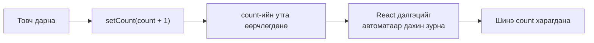
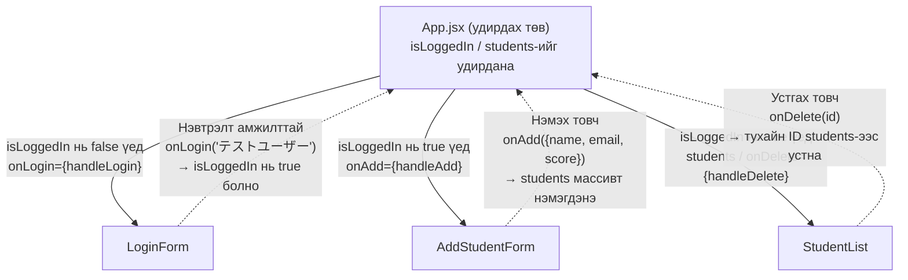

# 16-р цаг｜React-ийн үндэс — компонент・JSX・props・useState

> 🇯🇵 Эх хувь (япон хэлээр): [2026_06_11.md](<../../../2年生_システム開発実践/前期/2026_06_11/2026_06_11.md>) <!-- original-ja-link -->

## Өнөөдрийн зорилго
- JSX хэрхэн бичихийг ойлгох
- Компонент үүсгэж ашиглаж чаддаг болох
- `props`-оор өгөгдөл дамжуулж чаддаг болох
- `useState`-ээр төлөвийг (state) удирдаж чаддаг болох

> **Энэ хичээлийн зорилго:** Дараагийн хичээлээр үзэх Next.js-ийн «суурь» болгон судална.  
> «JSX гэж юу вэ, яагаад компонентод хуваадаг вэ» гэдгийг ойлгох нь зорилго.

---

## 0. React орчныг бэлдэх (зөвхөн эхний удаа!)

### 0-1. Node.js суулгасан эсэхийг шалгах

Эхлээд **Node.js** суулгасан эсэхийг шалгана.  
Терминал (VSCode-ийн терминал) дээр доорх командыг ажиллуулна уу.

```bash
node -v
```

Хувилбар нь харагдвал болж байна (жишээ: `v20.11.0`).  
`command not found` гарвал эхлээд Node.js-ийг суулгана уу.

> **Node.js суулгах:** https://nodejs.org/ хаягаас **LTS хувилбарыг** (санал болгож буй хувилбар) татаж авна

---

### 0-2. React төсөл үүсгэх (Vite ашиглана)

Терминал дээр **төсөл үүсгэх гэж буй хавтас** руугаа шилжээд, доорх командыг ажиллуулна.

```bash
npm create vite@latest my-app -- --template react
```

> `my-app` хэсэг нь төслийн нэр. Хүссэн нэрээрээ сольж болно (жишээ: `react-practice`)

Ажиллуулахад доорх мессеж гарах тул Enter дарж үргэлжлүүлнэ.

```
✔ Select a framework: › React
✔ Select a variant: › JavaScript
```

---

### 0-3. Шаардлагатай багцуудыг суулгаад ажиллуулах

Төсөл үүсгэсний дараа доорх дарааллаар командуудыг ажиллуулна.

```bash
# ① Үүсгэсэн хавтас руу шилжих
cd my-app

# ② Шаардлагатай багцуудыг нэг дор суулгах
npm install

# ③ Хөгжүүлэлтийн серверийг асаах
npm run dev
```

Терминал дээр доорх шиг зүйл гарвал амжилттай!

```
  VITE v5.x.x  ready in xxx ms

  ➜  Local:   http://localhost:5173/
```

Браузер дээр `http://localhost:5173/`-ийг нээхэд React-ийн жишээ дэлгэц гарч ирнэ.

> **Серверийг зогсоохын тулд:** терминал дээр `Ctrl + C` дарна

---

### 0-4. Хавтасны бүтцийг харцгаая

```
my-app/
├── public/          # Зураг гэх мэт статик файл байрлуулах газар
├── src/             # ← Голчлон энд засвар хийнэ!
│   ├── App.jsx      # Үндсэн компонент (хамгийн түрүүнд засах файл)
│   ├── App.css      # App.jsx-ийн загвар (style)
│   ├── main.jsx     # Аппын эхлэх цэг (ерөнхийдөө хөндөхгүй)
│   └── index.css    # Бүх хуудасны загвар
├── index.html       # Аппын HTML загвар (template)
└── package.json     # Төслийн тохиргоо・ашиглах багцуудын жагсаалт
```

**Эхлээд зөвхөн `src/App.jsx`-ийг засахад л хангалттай!**

---

### 0-5. App.jsx-ийг өөрчилж үзье

`src/App.jsx`-ийг нээгээд, доторх бүх кодыг устгаж доорх кодоор сольж үзье.

```jsx
function App() {
  return (
    <div>
      <h1>はじめての React！</h1>
      <p>環境構築できました！</p>
    </div>
  );
}

export default App;
```

Хадгалахад браузер автоматаар шинэчлэгдэнэ (hot reload).  
«はじめての React！» (Анхны React!) гэж харагдвал бэлтгэл дууслаа!

---

## 1. React гэж юу вэ

**React = UI-г «компонент (эд анги)»-оор бүтээдэг JavaScript сан**

```
Уламжлалт HTML + JavaScript:
  <div id="app"></div>
  document.getElementById("app").innerHTML = "...";
  → Хуудас олшрох тусам удирдахад хэцүү

React:
  <Button label="送信" />  ← Дахин ашиглаж болох эд анги
  <Card title="タイトル" body="内容" />
  → Эд ангиудыг нийлүүлж хуудас бүтээнэ
```

---

## 2. JSX — JavaScript дотор HTML бичих

> **Хэзээ ашиглах вэ?** Зөвхөн HTML-ээр хувьсагчийн утгыг шууд бичиж чадахгүй. JSX ашиглавал `{хувьсагчийн_нэр}` гэж бичиж, утгыг бодит цаг хугацаанд оруулж болно. Хэрэглэгчийн нэр, огноо, тооцооны үр дүн зэрэг «динамик утга» харуулах үед ашиглана.  
> **Шалгах зүйл:** `namae`-г өөрийн нэрээр сольж хадгалаад → дэлгэц автоматаар шинэчлэгдэж байгаа эсэхийг шалга. `{1 + 1}` нь `2` гэж харагдаж байгаа эсэхийг шалга.

```jsx
// ▼ src/App.jsx-д бичиж үзье (файлын доторх бүх кодыг устгаад доорхоор солино)

// JSX = JavaScript + XML (HTML-тэй төстэй бичиглэл)

// Энгийн функц (компонент)
function Hello() {
  // JSX-ийг return хийнэ
  return (
    <div>
      <h1>こんにちは！</h1>
      <p>React を始めよう</p>
    </div>
  );
}

// JavaScript-ийн илэрхийллийг {} дотор оруулна
function Greeting() {
  const namae = "田中太郎";
  const today = new Date().toLocaleDateString("ja-JP");
  
  return (
    <div>
      <h1>こんにちは、{namae}さん！</h1>
      <p>今日は {today} です</p>
      <p>1 + 1 = {1 + 1}</p>
    </div>
  );
}

export default Greeting;
```

**JSX-ийн анхаарах зүйлс:**

> **Хэзээ ашиглах вэ?** JSX бичиж байхад алдаа гарвал ихэнхдээ эдгээр 3 дүрмийн аль нэгээс шалтгаалдаг. Улаан алдаа гарвал энд буцаж ирээд тулгаж шалгаарай.

```jsx
// ▼ Бичих аргын лавлах тэмдэглэл (дангаараа ажиллахгүй・уншаад цээжлээрэй)

// ① class-ийн оронд className (class нь JS-ийн нөөц үг)
<div className="container">

// ② Бүх элементийг хаана
<input type="text" />  // Өөрөө хаагддаг таг

// ③ Олон элементийг нэг эцэг элементээр хүрээлнэ
return (
  <div>
    <h1>タイトル</h1>
    <p>内容</p>
  </div>
);
// эсвэл Fragment (<></>)-ийг ашиглана
return (
  <>
    <h1>タイトル</h1>
    <p>内容</p>
  </>
);
```

---

## 3. props — компонент руу өгөгдөл дамжуулах

> **Хэзээ ашиглах вэ?** Ижил загвартай, «зөвхөн өгөгдөл нь өөр» карт эсвэл мөрийг олноор харуулах үед. Компонентыг нэг удаа бичээд, дамжуулах өгөгдлөө солиход л хэдэн ч удаа дахин ашиглаж болно.  
> **Шалгах зүйл:** `passed={false}` гэсэн StudentCard-ийн дэвсгэр өнгө улбар шар туяатай болж байгаа эсэхийг шалга. 4 дэх `<StudentCard>`-ийг өөрөө нэмж үзээрэй.

```jsx
// ▼ src/App.jsx-д бичиж үзье (файлын доторх бүх кодыг устгаад доорхоор солино)

// props = компонент руу дамжуулах «аргумент»

// Компонентын тодорхойлолт (props хүлээн авна)
function StudentCard({ name, score, passed }) {
  return (
    <div style={{
      border: "1px solid #ddd",
      padding: "16px",
      margin: "8px",
      backgroundColor: passed ? "#e3f2fd" : "#fbe9e7"
    }}>
      <h3>{name}</h3>
      <p>点数: {score}点</p>
      <span>{passed ? "✅ 合格" : "❌ 不合格"}</span>
    </div>
  );
}

// Ашиглах жишээ (эцэг компонент)
function App() {
  return (
    <div>
      <StudentCard name="田中太郎" score={85} passed={true} />
      <StudentCard name="鈴木花子" score={45} passed={false} />
      <StudentCard name="山田次郎" score={91} passed={true} />
    </div>
  );
}

export default App;
```

---

## 4. useState — төлөвийг удирдах

> **Хэзээ ашиглах вэ?** Товч дарах・оруулах・сонгох гэх мэт «хэрэглэгчийн үйлдлээр өөрчлөгддөг утга»-ыг тэр даруй дэлгэцэд харуулах үед. `count` шиг «өөрчлөгддөг утга»-ыг заавал `useState`-ээр удирдана. Энгийн хувьсагч (`let count = 0`)-аар бол дэлгэц шинэчлэгдэхгүй.  
> **Шалгах зүйл:** `+1`-ийг 5 удаа дарж тоо нэмэгдэж байгаа эсэхийг шалга. `リセット` (Дахин эхлүүлэх) дарахад 0 болж байгаа эсэхийг шалга. Хуудас дахин ачаалагдахгүй байгааг ч шалга.

```jsx
// ▼ src/App.jsx-д бичиж үзье (файлын доторх бүх кодыг устгаад доорхоор солино)
import { useState } from "react";

function Counter() {
  // useState(анхны утга) → [одоогийн утга, утгыг өөрчлөх функц]
  const [count, setCount] = useState(0);
  
  return (
    <div>
      <p>カウント: {count}</p>
      
      {/* Товч дарах бүрд count нэмэгдэнэ */}
      <button onClick={() => setCount(count + 1)}>+1</button>
      <button onClick={() => setCount(count - 1)}>-1</button>
      <button onClick={() => setCount(0)}>リセット</button>
    </div>
  );
}

export default Counter;
```

`setCount`-ийг дуудахад React дэлгэцийг дахин зурдаг энэ урсгалыг зургаар харуулбал дараах байдалтай.



---

## 5. Жагсаалтыг дүрслэх (rendering)

> **Хэзээ ашиглах вэ?** Барааны жагсаалт・сурагчдын жагсаалт・сэтгэгдлийн хэсэг гэх мэт «массивын өгөгдлийг давтан харуулах» үед заавал ашигладаг хэв загвар. Өгөгдөл нэмэгдэхэд харагдах зүйл ч автоматаар нэмэгдэнэ.  
> **Шалгах зүйл:** `students` массивт 4 дэх хүнийг нэмж үзье → `<li>` автоматаар нэмэгдэж байгаа эсэхийг шалга. `key={student.id}`-г устгаад браузерын консол (F12) дээр анхааруулга гарахыг ч шалгаж үзээрэй.

```jsx
// ▼ src/App.jsx-д бичиж үзье (файлын доторх бүх кодыг устгаад доорхоор солино)
function StudentList() {
  const students = [
    { id: 1, name: "田中太郎", score: 85 },
    { id: 2, name: "鈴木花子", score: 72 },
    { id: 3, name: "山田次郎", score: 91 },
  ];
  
  return (
    <ul>
      {/* Массивын map-аар элементүүдийг үүсгэнэ */}
      {/* key нь React ялгааг тодорхойлоход хэрэгтэй (давталт дотор заавал өгнө) */}
      {students.map((student) => (
        <li key={student.id}>
          {student.name} - {student.score}点
        </li>
      ))}
    </ul>
  );
}

export default StudentList;
```

---

## 6. Форм ба үйл явдал (event)

> **Хэзээ ашиглах вэ?** Хайлт・нэвтрэлт・өгөгдөл оруулах гэх мэт «хэрэглэгчийн оруулсан утгыг аваад боловсруулах» үед. `onChange`-ээр оруулах бүрд state-ийг шинэчилж, `onSubmit`-ээр товч дарах үеийн үйлдлийг хийнэ.  
> **Шалгах зүйл:** Ямар нэг юм бичээд «検索» (Хайх) дарахад үр дүнгийн текст гарч байгаа эсэхийг шалга. `e.preventDefault()`-ийг коммент болгоод (`//` нэмээд) илгээх үед хуудас дахин ачаалагдахыг ч шалгаж үзээрэй.

```jsx
// ▼ src/App.jsx-д бичиж үзье (файлын доторх бүх кодыг устгаад доорхоор солино)
import { useState } from "react";

function SearchForm() {
  const [query, setQuery] = useState("");
  const [result, setResult] = useState(null);
  
  function handleSubmit(e) {
    e.preventDefault();  // Хуудас дахин ачаалагдахаас сэргийлнэ
    setResult(`"${query}" を検索しました`);
  }
  
  return (
    <form onSubmit={handleSubmit}>
      <input
        type="text"
        value={query}
        onChange={(e) => setQuery(e.target.value)}
        // onChange = оруулсан утга өөрчлөгдөх бүрд setQuery-ээр state-ийг шинэчилнэ
        placeholder="検索キーワード"
      />
      <button type="submit">検索</button>
      {result && <p>{result}</p>}
    </form>
  );
}

export default SearchForm;
```

---

## 7. Практик дасгал — Mock өгөгдлөөр сурагч удирдах апп хийцгээе

Одоог хүртэл үзсэн JSX, компонент, props, useState-ийг бүгдийг ашиглаж,  
**«Сурагч удирдах апп»** хийнэ.

> **Mock гэж юу вэ?**  
> Жинхэнэ API-ийн оронд код дотор бичсэн өгөгдлийг ашиглахыг хэлнэ.  
> «API-гүйгээр дэлгэц хийх дасгал» юм.  
> Дараагийн хичээлээр (Next.js) ижил дэлгэцийг жинхэнэ API-тай холбож ашиглана.

---

### 7-1. Эцсийн үр дүнгийн дүр төрх

```
[Нэвтрэхээс өмнө]
┌──────────────────────────┐
│  ログイン                 │
│                          │
│  [メールアドレス        ] │
│  [パスワード            ] │
│  [    ログイン          ] │
│                          │
│  ※ test@example.com     │
│     / password           │
└──────────────────────────┘

[Нэвтэрсний дараа]
┌──────────────────────────────────────────────────┐
│ 生徒管理アプリ（React Mock版） ● ログイン中  [ログアウト] │
├──────────────────────────────────────────────────┤
│ 新規追加                                          │
│ [名前] [メールアドレス] [点数] [追加]               │
├──────────────────────────────────────────────────┤
│ 生徒一覧（3件）                                    │
│ ID │ 名前     │ メール              │ 点数 │      │
│  1 │ 田中太郎 │ tanaka@example.com │  85  │ 削除 │
│  2 │ 山田花子 │ yamada@example.com │  72  │ 削除 │
└──────────────────────────────────────────────────┘
```

---

### 7-2. Файлын бүтэц

`src/` дотор `components/` хавтас үүсгээд, компонентуудыг салгана.

```
src/
├── App.jsx                      ← Үндсэн (төлөвийг нэг дор удирдана)
├── components/
│   ├── LoginForm.jsx            ← Нэвтрэх форм
│   ├── StudentList.jsx          ← Сурагчдын жагсаалтын хүснэгт
│   └── AddStudentForm.jsx       ← Сурагч нэмэх форм
└── main.jsx                     ← Хөндөхгүй
```

VSCode дээр `src/` хавтас дээр баруун товч дарж → `New Folder` → `components` гэж бичээд Enter дарна.

---

### 7-3. Step 1｜LoginForm.jsx үүсгэх

`src/components/LoginForm.jsx`-ийг шинээр үүсгээд, доорхыг хуулж буулгана.

```jsx
import { useState } from "react";

// Mock-д зориулсан тогтмол нэвтрэх мэдээлэл (жинхэнэ API-ийн оронд)
const MOCK_EMAIL = "test@example.com";
const MOCK_PASSWORD = "password";
const MOCK_NAME = "テストユーザー";

// onLogin = нэвтрэлт амжилттай болоход дуудах, App.jsx-ээс дамжуулж авах функц
function LoginForm({ onLogin }) {
  const [email, setEmail] = useState("test@example.com");
  const [password, setPassword] = useState("password");
  const [error, setError] = useState("");

  function handleSubmit(e) {
    e.preventDefault(); // Хуудас дахин ачаалагдахаас сэргийлнэ

    // Оруулсан утга mock мэдээлэлтэй таарвал нэвтрэлт амжилттай
    if (email === MOCK_EMAIL && password === MOCK_PASSWORD) {
      onLogin(MOCK_NAME); // Эцэг компонент руу хэрэглэгчийн нэрийг дамжуулна
    } else {
      setError("メールアドレスまたはパスワードが違います");
    }
  }

  return (
    <div style={{
      maxWidth: "400px", margin: "80px auto",
      background: "white", padding: "32px",
      borderRadius: "8px", boxShadow: "0 2px 8px rgba(0,0,0,0.1)"
    }}>
      <h2 style={{ marginBottom: "24px", textAlign: "center" }}>ログイン</h2>

      <form onSubmit={handleSubmit}>
        <div style={{ marginBottom: "16px" }}>
          <label style={{ display: "block", marginBottom: "6px", fontWeight: "bold" }}>
            メールアドレス
          </label>
          <input
            type="email"
            value={email}
            onChange={(e) => setEmail(e.target.value)}
            style={{ width: "100%", padding: "10px", border: "1px solid #ccc", borderRadius: "6px", fontSize: "1em", boxSizing: "border-box" }}
          />
        </div>

        <div style={{ marginBottom: "16px" }}>
          <label style={{ display: "block", marginBottom: "6px", fontWeight: "bold" }}>
            パスワード
          </label>
          <input
            type="password"
            value={password}
            onChange={(e) => setPassword(e.target.value)}
            style={{ width: "100%", padding: "10px", border: "1px solid #ccc", borderRadius: "6px", fontSize: "1em", boxSizing: "border-box" }}
          />
        </div>

        {/* error хоосон биш үед л алдааг харуулна */}
        {error && (
          <p style={{ color: "#D32F2F", fontSize: "0.9em", marginBottom: "12px" }}>
            {error}
          </p>
        )}

        <button
          type="submit"
          style={{ width: "100%", padding: "12px", background: "#1976D2", color: "white", border: "none", borderRadius: "6px", fontSize: "1em", fontWeight: "bold", cursor: "pointer" }}
        >
          ログイン
        </button>
      </form>

      <p style={{ marginTop: "16px", fontSize: "0.85em", color: "#888", textAlign: "center" }}>
        ※ Mock用: test@example.com / password
      </p>
    </div>
  );
}

export default LoginForm;
```

---

### 7-4. Step 2｜StudentList.jsx үүсгэх

`src/components/StudentList.jsx`-ийг шинээр үүсгээд, доорхыг хуулж буулгана.

```jsx
// StudentList: сурагчдын жагсаалтын хүснэгт бүхэлдээ
// students = сурагчдын өгөгдлийн массив (эцэг компонентоос ирнэ)
// onDelete = устгах товч дарахад дуудах функц (эцэг компонентоос ирнэ)
function StudentList({ students, onDelete }) {
  return (
    <div style={{ background: "white", borderRadius: "8px", padding: "24px", boxShadow: "0 2px 8px rgba(0,0,0,0.05)" }}>
      <h2 style={{ marginBottom: "16px", fontSize: "1.1em" }}>
        生徒一覧
        <span style={{ color: "#888", fontWeight: "normal", fontSize: "0.85em" }}>
          （{students.length}件）
        </span>
      </h2>

      {/* Сурагч 0 байвал «бүртгэл алга» гэсэн мессеж харуулна */}
      {students.length === 0 ? (
        <p style={{ color: "#888", textAlign: "center", padding: "24px" }}>
          生徒が登録されていません
        </p>
      ) : (
        <table style={{ width: "100%", borderCollapse: "collapse" }}>
          <thead>
            <tr style={{ background: "#f5f5f5" }}>
              <th style={thStyle}>ID</th>
              <th style={thStyle}>名前</th>
              <th style={thStyle}>メール</th>
              <th style={thStyle}>点数</th>
              <th style={thStyle}></th>
            </tr>
          </thead>
          <tbody>
            {/* Массив дахь сурагч бүрийг StudentRow компонентоор харуулна */}
            {students.map((student) => (
              <StudentRow
                key={student.id}
                student={student}
                onDelete={onDelete}
              />
            ))}
          </tbody>
        </table>
      )}
    </div>
  );
}

// StudentRow: хүснэгтийн нэг мөр
function StudentRow({ student, onDelete }) {
  function handleDelete() {
    // Баталгаажуулах цонх харуулсны дараа устгана
    if (window.confirm(`${student.name} を削除しますか？`)) {
      onDelete(student.id); // Эцэг компонентод «энэ ID-тайг устга» гэж мэдэгдэнэ
    }
  }

  return (
    <tr style={{ borderBottom: "1px solid #eee" }}>
      <td style={tdStyle}>{student.id}</td>
      <td style={tdStyle}>{student.name}</td>
      <td style={tdStyle}>{student.email}</td>
      <td style={tdStyle}>{student.score}</td>
      <td style={tdStyle}>
        <button
          onClick={handleDelete}
          style={{ background: "#D32F2F", color: "white", border: "none", borderRadius: "4px", padding: "4px 12px", cursor: "pointer", fontSize: "0.85em" }}
        >
          削除
        </button>
      </td>
    </tr>
  );
}

// Загварын тогтмолууд (давтан ашиглах style-уудыг нэгтгэнэ)
const thStyle = { padding: "10px 16px", textAlign: "left", fontWeight: "bold", fontSize: "0.9em" };
const tdStyle = { padding: "12px 16px", fontSize: "0.95em" };

export default StudentList;
```

---

### 7-5. Step 3｜AddStudentForm.jsx үүсгэх

`src/components/AddStudentForm.jsx`-ийг шинээр үүсгээд, доорхыг хуулж буулгана.

```jsx
import { useState } from "react";

// onAdd = нэмэх товч дарахад дуудах функц (эцэг компонентоос ирнэ)
function AddStudentForm({ onAdd }) {
  const [name, setName] = useState("");
  const [email, setEmail] = useState("");
  const [score, setScore] = useState("");
  const [error, setError] = useState("");

  function handleSubmit(e) {
    e.preventDefault();
    setError(""); // Алдааг цэвэрлэнэ

    // Баталгаажуулалт (оруулсан утгыг шалгах)
    if (!name || !email || !score) {
      setError("すべての項目を入力してください");
      return;
    }
    if (Number(score) < 0 || Number(score) > 100) {
      setError("点数は0〜100の数値を入力してください");
      return;
    }

    // Эцэг компонент руу шинэ сурагчийн өгөгдлийг дамжуулна
    onAdd({ name, email, score: Number(score) });

    // Формыг цэвэрлэнэ
    setName("");
    setEmail("");
    setScore("");
  }

  return (
    <div style={{ background: "white", borderRadius: "8px", padding: "24px", boxShadow: "0 2px 8px rgba(0,0,0,0.05)", marginBottom: "24px" }}>
      <h2 style={{ marginBottom: "16px", fontSize: "1.1em" }}>新規追加</h2>

      <form onSubmit={handleSubmit} style={{ display: "flex", gap: "12px", alignItems: "flex-end", flexWrap: "wrap" }}>
        <div>
          <label style={labelStyle}>名前</label>
          <input
            type="text"
            value={name}
            onChange={(e) => setName(e.target.value)}
            placeholder="田中太郎"
            style={inputStyle}
          />
        </div>
        <div>
          <label style={labelStyle}>メールアドレス</label>
          <input
            type="email"
            value={email}
            onChange={(e) => setEmail(e.target.value)}
            placeholder="tanaka@example.com"
            style={inputStyle}
          />
        </div>
        <div>
          <label style={labelStyle}>点数</label>
          <input
            type="number"
            value={score}
            onChange={(e) => setScore(e.target.value)}
            placeholder="85"
            min="0"
            max="100"
            style={{ ...inputStyle, width: "80px" }}
          />
        </div>
        <button
          type="submit"
          style={{ padding: "10px 20px", background: "#1976D2", color: "white", border: "none", borderRadius: "6px", fontWeight: "bold", cursor: "pointer", fontSize: "0.95em" }}
        >
          追加
        </button>
      </form>

      {error && (
        <p style={{ color: "#D32F2F", marginTop: "10px", fontSize: "0.9em" }}>{error}</p>
      )}
    </div>
  );
}

const labelStyle = { display: "block", marginBottom: "4px", fontSize: "0.85em", fontWeight: "bold" };
const inputStyle = { padding: "9px 12px", border: "1px solid #ccc", borderRadius: "6px", fontSize: "0.95em", width: "180px" };

export default AddStudentForm;
```

---

### 7-6. Step 4｜App.jsx-д бүгдийг холбох

`src/App.jsx`-ийг нээгээд, **доторх бүх кодыг устгаж** доорхоор солино.

```jsx
import { useState } from "react";
import LoginForm from "./components/LoginForm";
import StudentList from "./components/StudentList";
import AddStudentForm from "./components/AddStudentForm";

// Эхнээсээ харуулах mock өгөгдөл
const INITIAL_STUDENTS = [
  { id: 1, name: "田中太郎", email: "tanaka@example.com", score: 85 },
  { id: 2, name: "山田花子", email: "yamada@example.com", score: 72 },
  { id: 3, name: "山田次郎", email: "jiro@example.com", score: 91 },
];

function App() {
  // Нэвтэрсэн төлөвийг удирдана
  const [isLoggedIn, setIsLoggedIn] = useState(false);
  const [userName, setUserName] = useState("");

  // Сурагчдын жагсаалтыг удирдана
  const [students, setStudents] = useState(INITIAL_STUDENTS);
  const [nextId, setNextId] = useState(4); // Дараа нь нэмэх сурагчийн ID

  // Нэвтрэлт амжилттай болох үед: LoginForm-оос дуудагдана
  function handleLogin(name) {
    setIsLoggedIn(true);
    setUserName(name);
  }

  // Гарах үед
  function handleLogout() {
    setIsLoggedIn(false);
    setUserName("");
  }

  // Сурагч нэмэх: AddStudentForm-оос дуудагдана
  function handleAdd(newStudent) {
    setStudents([...students, { ...newStudent, id: nextId }]);
    setNextId(nextId + 1);
  }

  // Сурагч устгах: StudentList-ээс дуудагдана
  function handleDelete(id) {
    setStudents(students.filter((s) => s.id !== id));
  }

  return (
    <div style={{ background: "#f4f6f8", minHeight: "100vh" }}>

      {/* Толгой хэсэг */}
      <header style={{
        background: "#1565C0", color: "white",
        padding: "16px 32px",
        display: "flex", alignItems: "center"
      }}>
        <h1 style={{ fontSize: "1.2em" }}>生徒管理アプリ（React Mock版）</h1>

        {/* Нэвтэрсэн үед л толгой хэсгийн баруун талд хэрэглэгчийн нэр болон гарах товчийг харуулна */}
        {isLoggedIn && (
          <div style={{ marginLeft: "auto", display: "flex", alignItems: "center", gap: "12px" }}>
            <span style={{ fontSize: "0.9em" }}>● ログイン中：{userName}</span>
            <button
              onClick={handleLogout}
              style={{ background: "#D32F2F", color: "white", border: "none", borderRadius: "6px", padding: "6px 14px", cursor: "pointer" }}
            >
              ログアウト
            </button>
          </div>
        )}
      </header>

      {/* Үндсэн агуулга */}
      <main style={{ padding: "32px", maxWidth: "900px", margin: "0 auto" }}>
        {/* isLoggedIn нь true бол сурагч удирдах дэлгэц, false бол нэвтрэх дэлгэц */}
        {isLoggedIn ? (
          <>
            <AddStudentForm onAdd={handleAdd} />
            <StudentList students={students} onDelete={handleDelete} />
          </>
        ) : (
          <LoginForm onLogin={handleLogin} />
        )}
      </main>

    </div>
  );
}

export default App;
```

---

### 7-7. Ажиллагааг шалгах

Хөгжүүлэлтийн серверийг асаагаад браузер дээр шалгана.

```bash
npm run dev
```

`http://localhost:5173/` руу ороод, доорхыг дарааллаар нь туршина уу.

| Шалгах зүйл | Үйлдэл | Хүлээгдэж буй үр дүн |
|---------|------|------------|
| Нэвтрэхээс өмнөх дэлгэц | Хуудсыг нээх | Нэвтрэх форм харагдана |
| Нэвтрэлт амжилттай | `test@example.com` / `password`-оор нэвтрэх | Толгой хэсэгт «ログイン中» (Нэвтэрсэн), сурагчдын жагсаалт харагдана |
| Нэвтрэлт амжилтгүй | Нууц үгийг өөрчилж нэвтрэх | Алдааны мессеж харагдана |
| Сурагч нэмэх | Формыг бөглөөд «追加» (Нэмэх) дарах | Хүснэгтэд шинэ мөр нэмэгдэнэ |
| Сурагч устгах | «削除» (Устгах) товч дарах | Баталгаажуулах цонх → OK дарахад мөр алга болно |
| 0 бичлэгтэй үед | Бүгдийг устгах | «生徒が登録されていません» (Сурагч бүртгэгдээгүй байна) харагдана |
| Гарах | «ログアウト» (Гарах) товч дарах | Нэвтрэх форм руу буцна |

---

### 7-8. Кодын урсгалыг цэгцлэх

Доорх зургийн тасралтгүй шугам нь «эцгээс → хүүхэд рүү props дамжуулах» урсгал, тасархай шугам нь «хүүхэд эцгийн функцийг дуудаж төлөвийг өөрчлөх» урсгал юм.



> **Гол санаа:** Өгөгдлийг (төлөвийг) `App.jsx` нэг дор удирдаж,  
> хүүхэд компонентуудад «өгөгдөл» болон «түүнийг өөрчлөх функц»-ийг props-оор дамжуулах нь React-ийн үндсэн хэв загвар юм.

---

### 7-9. Next.js-ээс ялгаатай нь (дараагийн хичээлийн урьдчилсан бэлтгэл)

| | React (энэ удаа) | Next.js (дараагийн удаа) |
|--|--|--|
| Өгөгдөл авах | Код доторх Mock массив | `fetch('/api/students')`-ээр Laravel API-аас авна |
| Нэвтрэх | Тогтмол утгатай тулгана | `POST /api/login`-оор токен авна |
| Устгах | Массивыг filter-ээр шинэчилнэ | `DELETE /api/students/{id}`-г дуудаад дахин авна |
| Дэлгэцийн харагдах байдал | **Яг адилхан** | **Яг адилхан** |

Дараагийн хичээлээр **энэ удаа хийсэн дэлгэцээ хэвээр нь ашиглаж**, зөвхөн өгөгдөл авах хэсгийг API-д холбож солино.

---

## Дүгнэлт

| Ойлголт | Тайлбар |
|------|------|
| Компонент | UI-ийн дахин ашиглаж болох эд анги. Функцээр тодорхойлно |
| JSX | JavaScript дотор HTML-тэй төстэй бичиглэлээр UI бичнэ |
| props | Эцэг компонентоос хүүхэд компонент руу өгөгдөл дамжуулна |
| useState | Компонент доторх төлөвийг удирдана |
| key | Жагсаалт харуулах үед элемент бүрийг ялгах атрибут |

---

## Дараагийн хичээлийн (17-р цаг) танилцуулга

Next.js-ийн анхан шат.  
React-ийн мэдлэгээ ашиглан App Router・хуудасны бүтэц・файлд суурилсан чиглүүлэлтийг үзнэ.
