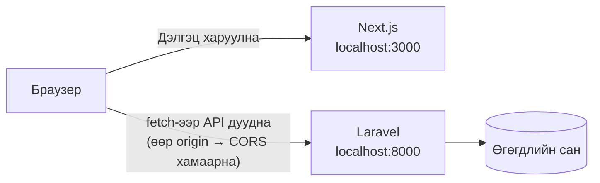
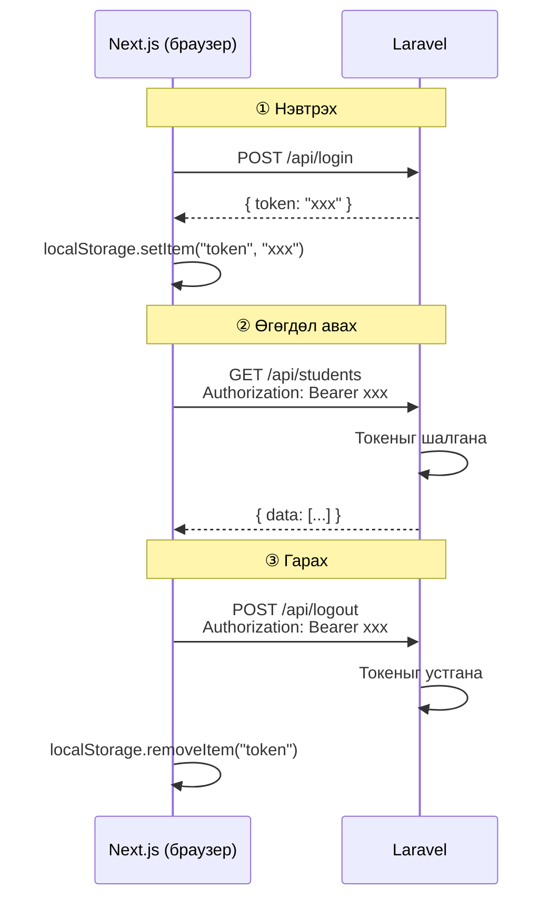

# 17〜22-р цаг｜Next.js-ийн анхан шат → Laravel API-тай холбох

> 🇯🇵 Эх хувь (япон хэлээр): [2026_07_02.md](<../../../2年生_システム開発実践/前期/2026_07_02/2026_07_02.md>) <!-- original-ja-link -->

---

## 17-р цаг: Mock хувилбарыг API-тай холбосон хувилбараар солих

### Өнөөдрийн зорилго
- Next.js төсөл үүсгэж чаддаг болох
- App Router хэрхэн ажилладгийг ойлгох
- 16-р цагт хийсэн Mock хувилбарын дэлгэцийг жинхэнэ Laravel API-тай холбож чаддаг болох

> **Өнөөдрийн гол санаа:**  
> 16-р цагт хийсэн компонентуудыг (LoginForm・StudentList・AddStudentForm)  
> **бараг хэвээр нь ашиглаж болно.** Өөрчлөгдөх нь зөвхөн өгөгдөл авах арга юм.

---

### 0. Mock хувилбар ба API хувилбарын ялгааг шалгах

| | 16-р цаг (Mock хувилбар・React) | 17-р цаг (API хувилбар・Next.js) |
|--|--|--|
| Өгөгдөл авах | Код доторх тогтмол массив | `fetch()`-ээр Laravel API-аас авна |
| Нэвтрэх | Тогтмол утгатай тулгана | `POST /api/login`-оор токен авна |
| Сурагч нэмэх | Массивт нэмнэ | `POST /api/students`-ийг дуудна |
| Сурагч устгах | Массиваас хасна | `DELETE /api/students/{id}`-г дуудна |
| Дэлгэцийн харагдах байдал | **Яг адилхан** | **Яг адилхан** |

---

### 1. Next.js төсөл үүсгэх

#### 1-1. Суулгах

Терминал дээр доорхыг ажиллуулна (`my-app`-аас **өөр хавтаст** үүсгэнэ).

```bash
npx create-next-app@latest school-frontend
```

Хэдэн асуулт гарч ирж магадгүй. Асуулт гарвал доорх шиг хариулна уу.

```
Would you like to use TypeScript?             → Yes  ← TypeScript ашиглана
Would you like to use ESLint?                 → Yes
Would you like to use Tailwind CSS?           → Yes  ← Урьдчилан суулгана
Would you like your code inside a src/ dir?   → No   ← app/ хавтсыг төслийн root хавтаст шууд байрлуулна
Would you like to use App Router?             → Yes
Would you like to use Turbopack?              → No
Would you like to customize the import alias? → No
```

> **TypeScript-ийн тухай**  
> Файлын өргөтгөл нь `.tsx` (TypeScript) болно. Үндсэн код нь JavaScript-тэй бараг адилхан.  
> Төрөл (type) бичих шаардлагатай хэсгүүдийг тухай бүрд нь тайлбарлана.
>
> **Tailwind CSS-ийн тухай**  
> Суулгах боловч энэ удаа inline style ашиглана. Tailwind-ийг цаашдын сургалтад ашиглаж болно.

#### 1-2. Суулгаад ажиллуулах

```bash
# Төслийн хавтас руу шилжих
cd school-frontend

# Хөгжүүлэлтийн серверийг асаах (create-next-app багцуудыг автоматаар суулгачихсан)
npm run dev
```

`http://localhost:3000`-ийг нээгээд Next.js-ийн жишээ дэлгэц харагдвал амжилттай.

---

### 2. Хавтасны бүтцийг шалгах

```
school-frontend/
├── app/                         ← Хуудасны файлуудыг байрлуулах газар (чиглүүлэлт)
│   ├── layout.tsx               ← Бүх хуудсанд нийтлэг HTML хүрээ
│   ├── page.tsx                 ← / руу ороход харагдах хуудас
│   ├── login/
│   │   └── page.tsx             ← /login хуудас
│   └── students/
│       └── page.tsx             ← /students хуудас
├── components/                  ← 16-р цагийнхтай ижил байршил
│   ├── LoginForm.tsx
│   ├── StudentList.tsx
│   └── AddStudentForm.tsx
└── package.json
```

**16-р цагаас ялгаатай нь:**

| 16-р цаг (React + Vite) | 17-р цаг (Next.js) |
|--|--|
| `src/App.jsx` нь үндсэн файл | `app/page.tsx` нь нүүр хуудас |
| Ганцхан хуудас (SPA) | Хавтас = URL болно (`login/page.tsx` → `/login`) |
| `index.html`-ээр эхэлнэ | `layout.tsx` нь HTML хүрээг хариуцна |

---

### 3. 16-р цагийн компонентуудыг хуулах

Эхлээд `src/components/` хавтас үүсгээд, 16-р цагт хийсэн файлуудыг хуулна.

```
school-frontend/components/ руу доорхыг хуулна:
  ├── LoginForm.tsx      ← 16-р цагийн LoginForm.jsx-ийг хуулна (өргөтгөлийг .tsx болгож солино)
  ├── StudentList.tsx    ← 16-р цагийн StudentList.jsx-ийг хуулна (өргөтгөлийг .tsx болгож солино)
  └── AddStudentForm.tsx ← 16-р цагийн AddStudentForm.jsx-ийг хуулна (өргөтгөлийг .tsx болгож солино)
```

> **Өргөтгөлийн тухай**  
> TypeScript ашиглах тул файлын өргөтгөлийг `.tsx` (JSX агуулсан файл) болгож нэг мөр болгоно.  
> Кодын агуулгыг 16-р цагийн `.jsx`-ээс бараг хэвээр нь хуулж болно.

Хуулсан файл бүрийн **эхний мөрөнд** `"use client";`-ийг нэмнэ.

```js
"use client";  // ← Энэ нэг мөрийг нэмнэ!
import { useState } from "react";
// ... үлдсэн хэсэг нь 16-р цагийн кодтой яг адилхан
```

> **`"use client"` гэж юу вэ?**  
> Next.js анхдагчаар кодыг сервер талд ажиллуулдаг.  
> `useState`, `onClick` гэх мэт «браузерын боломж» ашигладаг компонентод  
> `"use client"`-ийг эхэнд нь бичиж «үүнийг браузерт ажиллуул» гэж мэдэгдэнэ.

---

### 4. layout.js-ийг өөрчлөх

`app/layout.tsx`-ийг нээгээд, доторх бүх кодыг устгаж доорхоор солино.

```tsx
export const metadata = {
  title: "生徒管理アプリ",
};

export default function RootLayout({
  children,
}: {
  children: React.ReactNode;
}) {
  return (
    <html lang="ja">
      <body style={{ margin: 0, fontFamily: "sans-serif", background: "#f4f6f8" }}>
        {children}
      </body>
    </html>
  );
}
```

> **`{ children }: { children: React.ReactNode }` гэж юу вэ?**  
> TypeScript-ийн төрлийн тодорхойлолт. «children-д React-ийн элемент орно» гэж мэдэгдэж байна.  
> `React.ReactNode` нь «JSX, текст гэх мэт React-ийн харуулж чадах бүх зүйл» гэсэн утгатай.

---

### 5. Нүүр хуудсыг (/) нэвтрэх хуудас руу чиглүүлэх (redirect)

`app/page.tsx`-ийг нээгээд, доторх бүх кодыг устгаж доорхоор солино.

```tsx
import { redirect } from "next/navigation";

// / руу ороход /login руу автоматаар шилжүүлнэ
export default function Home() {
  redirect("/login");
}
```

---

### 6. Нэвтрэх хуудас хийх (/login)

`app/login/` хавтас үүсгээд, `page.tsx`-ийг шинээр үүсгэнэ.

```
app/login/page.tsx  ← Шинээр үүсгэнэ
```

Доорхыг хуулж буулгана.

```tsx
"use client";

import { useState } from "react";
import { useRouter } from "next/navigation";

export default function LoginPage() {
  const router = useRouter(); // Хуудас шилжихэд ашиглана
  const [email, setEmail] = useState("test@example.com");
  const [password, setPassword] = useState("password");
  const [error, setError] = useState("");
  const [loading, setLoading] = useState(false);

  async function handleSubmit(e) {
    e.preventDefault();
    setError("");
    setLoading(true);

    // ★ 16-р цагаас ялгаатай нь: тогтмол утгаар шалгах → жинхэнэ API-г дуудна
    const res = await fetch("http://localhost:8000/api/login", {
      method: "POST",
      headers: {
        "Content-Type": "application/json",
        "Accept": "application/json",
      },
      body: JSON.stringify({ email, password }),
    });

    const data = await res.json();
    setLoading(false);

    if (res.ok) {
      // ★ Токеныг браузерт хадгалж авна
      localStorage.setItem("token", data.token);
      localStorage.setItem("userName", data.user?.name || "ユーザー");
      // /students хуудас руу шилжинэ
      router.push("/students");
    } else {
      setError("メールアドレスまたはパスワードが違います");
    }
  }

  return (
    <div style={{
      maxWidth: "400px", margin: "80px auto",
      background: "white", padding: "32px",
      borderRadius: "8px", boxShadow: "0 2px 8px rgba(0,0,0,0.1)"
    }}>
      <h2 style={{ marginBottom: "24px", textAlign: "center" }}>ログイン</h2>

      <form onSubmit={handleSubmit}>
        <div style={{ marginBottom: "16px" }}>
          <label style={{ display: "block", marginBottom: "6px", fontWeight: "bold" }}>
            メールアドレス
          </label>
          <input
            type="email"
            value={email}
            onChange={(e) => setEmail(e.target.value)}
            style={{ width: "100%", padding: "10px", border: "1px solid #ccc", borderRadius: "6px", fontSize: "1em", boxSizing: "border-box" }}
          />
        </div>

        <div style={{ marginBottom: "16px" }}>
          <label style={{ display: "block", marginBottom: "6px", fontWeight: "bold" }}>
            パスワード
          </label>
          <input
            type="password"
            value={password}
            onChange={(e) => setPassword(e.target.value)}
            style={{ width: "100%", padding: "10px", border: "1px solid #ccc", borderRadius: "6px", fontSize: "1em", boxSizing: "border-box" }}
          />
        </div>

        {error && (
          <p style={{ color: "#D32F2F", fontSize: "0.9em", marginBottom: "12px" }}>
            {error}
          </p>
        )}

        <button
          type="submit"
          disabled={loading}
          style={{ width: "100%", padding: "12px", background: loading ? "#aaa" : "#1976D2", color: "white", border: "none", borderRadius: "6px", fontSize: "1em", fontWeight: "bold", cursor: loading ? "not-allowed" : "pointer" }}
        >
          {loading ? "ログイン中..." : "ログイン"}
        </button>
      </form>
    </div>
  );
}
```

**16-р цагийн `LoginForm.tsx`-ээс ялгаатай нь:**

| | 16-р цаг (Mock) | 17-р цаг (API) |
|--|--|--|
| Баталгаажуулалтын арга | Тогтмол утгатай тулгана | `fetch("http://localhost:8000/api/login")` |
| Нэвтэрсний дараа | `setIsLoggedIn(true)` | `localStorage.setItem("token", ...)` + хуудас шилжинэ |
| Хуудас шилжих | Нөхцөлөөр салаалж дэлгэц солино | `router.push("/students")` |

---

### 7. Сурагч удирдах хуудас хийх (/students)

`app/students/` хавтас үүсгээд, `page.tsx`-ийг шинээр үүсгэнэ.

```
app/students/page.tsx  ← Шинээр үүсгэнэ
```

Доорхыг хуулж буулгана.

```tsx
"use client";

import { useState, useEffect } from "react";
import { useRouter } from "next/navigation";
import StudentList from "@/components/StudentList";
import AddStudentForm from "@/components/AddStudentForm";

export default function StudentsPage() {
  const router = useRouter();
  const [students, setStudents] = useState([]);
  const [userName, setUserName] = useState("");
  const [loading, setLoading] = useState(true);
  const [addError, setAddError] = useState(""); // ← Нэмэх үеийн алдааг харуулахад зориулсан

  // ★ useEffect: хуудас харагдах үед ганц удаа ажиллана
  useEffect(() => {
    const token = localStorage.getItem("token");

    // Токен байхгүй бол нэвтрэх хуудас руу буцаана
    if (!token) {
      router.push("/login");
      return;
    }

    setUserName(localStorage.getItem("userName") || "ユーザー");
    loadStudents(token);
  }, []); // [] = зөвхөн эхний ганц удаа ажиллана

  // Сурагчдын жагсаалтыг API-аас авна
  async function loadStudents(token) {
    setLoading(true);

    const res = await fetch("http://localhost:8000/api/students", {
      headers: {
        "Accept": "application/json",
        "Authorization": `Bearer ${token}`, // ★ Токеныг header-т хавсаргана
      },
    });

    // 401 = токен хүчингүй → нэвтрэх хуудас руу буцаана
    if (res.status === 401) {
      router.push("/login");
      return;
    }

    const data = await res.json();
    setStudents(data.data); // Laravel API нь { data: [...] } хэлбэрээр буцаана
    setLoading(false);
  }

  // Сурагч нэмнэ
  async function handleAdd(newStudent) {
    const token = localStorage.getItem("token");
    setAddError(""); // ← Алдааг цэвэрлэнэ

    const res = await fetch("http://localhost:8000/api/students", {
      method: "POST",
      headers: {
        "Content-Type": "application/json",
        "Accept": "application/json",
        "Authorization": `Bearer ${token}`,
      },
      body: JSON.stringify(newStudent),
    });

    if (res.ok) {
      loadStudents(token); // ★ Нэмсний дараа жагсаалтыг дахин авч дэлгэцийг шинэчилнэ
    } else {
      // ★ Амжилтгүй болбол API-ийн алдааны агуулгыг дэлгэцэд харуулна
      const data = await res.json();
      if (data.errors) {
        const messages = Object.values(data.errors).flat().join(" / ");
        setAddError(messages);
      } else {
        setAddError(`エラーが発生しました（HTTP ${res.status}）`);
      }
    }
  }

  // Сурагч устгана
  async function handleDelete(id) {
    const token = localStorage.getItem("token");

    const res = await fetch(`http://localhost:8000/api/students/${id}`, {
      method: "DELETE",
      headers: {
        "Accept": "application/json",
        "Authorization": `Bearer ${token}`,
      },
    });

    if (res.ok) {
      loadStudents(token); // ★ Устгасны дараа жагсаалтыг дахин авч дэлгэцийг шинэчилнэ
    }
  }

  // Гарах
  async function handleLogout() {
    const token = localStorage.getItem("token");

    await fetch("http://localhost:8000/api/logout", {
      method: "POST",
      headers: {
        "Accept": "application/json",
        "Authorization": `Bearer ${token}`,
      },
    });

    localStorage.removeItem("token");
    localStorage.removeItem("userName");
    router.push("/login");
  }

  if (loading) {
    return (
      <div style={{ textAlign: "center", padding: "80px", color: "#888" }}>
        読み込み中...
      </div>
    );
  }

  return (
    <div style={{ background: "#f4f6f8", minHeight: "100vh" }}>

      {/* Толгой хэсэг (16-р цагийнхтай ижил харагдана) */}
      <header style={{
        background: "#1565C0", color: "white",
        padding: "16px 32px",
        display: "flex", alignItems: "center"
      }}>
        <h1 style={{ fontSize: "1.2em" }}>生徒管理アプリ（Next.js API版）</h1>
        <div style={{ marginLeft: "auto", display: "flex", alignItems: "center", gap: "12px" }}>
          <span style={{ fontSize: "0.9em" }}>● ログイン中：{userName}</span>
          <button
            onClick={handleLogout}
            style={{ background: "#D32F2F", color: "white", border: "none", borderRadius: "6px", padding: "6px 14px", cursor: "pointer" }}
          >
            ログアウト
          </button>
        </div>
      </header>

      {/* Үндсэн агуулга (16-р цагийнхтай ижил компонентуудыг ашиглана) */}
      <main style={{ padding: "32px", maxWidth: "900px", margin: "0 auto" }}>
        <AddStudentForm onAdd={handleAdd} />
        {/* ★ Нэмэх үйлдэл амжилтгүй болоход API-ийн алдааны мессежийг харуулна */}
        {addError && (
          <p style={{ color: "#D32F2F", marginBottom: "16px", fontWeight: "bold" }}>
            ⚠ {addError}
          </p>
        )}
        <StudentList students={students} onDelete={handleDelete} />
      </main>

    </div>
  );
}
```

**16-р цагийн `App.tsx`-ээс ялгаатай нь:**

|                            | 16-р цаг (Mock)            | 17-р цаг (API)                         |
| -------------------------- | --------------------- | --------------------------------- |
| Анхны өгөгдөл                      | `INITIAL_STUDENTS` массив | `useEffect` → `fetch`-ээр авна         |
| Нэмэх                         | Массивт push хийнэ              | `POST /api/students` → дахин авна        |
| Устгах                         | Массивыг filter хийнэ            | `DELETE /api/students/{id}` → дахин авна |
| StudentList/AddStudentForm | **Яг адилхан**              | **Яг адилхан**                          |

---

### 8. CORS тохиргоо (Laravel тал)

Next.js (`http://localhost:3000`)-ээс Laravel (`http://localhost:8000`)-ийг дуудах үед  
**браузерын аюулгүй байдлын механизм (CORS)**-ын улмаас ихэвчлэн холболт хаагддаг.

Дэлгэц нь 3000, API нь 8000 гэж өөр порттой хоёр сервер рүү хандаж байгааг харцгаая.



**Laravel 13-д анхдагчаар бүх origin (`*`) зөвшөөрөгдсөн байдаг тул хөгжүүлэлтийн явцад тохиргоо өөрчлөх шаардлагагүй.**

> **CORS гэж юу вэ?**  
> Браузер «өөр сервер (зөвхөн порт нь өөр байсан ч өөр гэж үзнэ) рүү илгээх хүсэлт»-ийг  
> аюулгүй байдлын үүднээс хаадаг механизм юм.  
> Laravel тал дээр «энэ origin-оос хандахыг зөвшөөрнө» гэж тодорхой заавал хаалт арилна.

---

#### (Лавлагаа) Production орчинд хандах эх үүсвэрийг хязгаарлах

Хөгжүүлэлт дуусч production-д нийтлэх үед хандахыг зөвшөөрөх origin-уудыг хязгаарлана.

Эхлээд тохиргооны файлыг үүсгэнэ:

```bash
php artisan config:publish cors
```

Үүссэн `config/cors.php`-г нээгээд өөрчилнө:

```php
// Өөрчлөхөөс өмнө (бүх origin-ыг зөвшөөрнө)
'allowed_origins' => ['*'],

// Өөрчилсний дараа (зөвхөн production frontend-ийн URL-ыг зөвшөөрнө)
'allowed_origins' => ['https://your-frontend.com'],
```

Өөрчилсний дараа кэшийг цэвэрлэнэ:

```bash
php artisan config:clear
```

---

### 8-2. Route тохиргооны түгээмэл алдаа (`routes/api.php`)

> **⚠ Анхаарах цэг: `Route::apiResource`-ийг давхар бүртгэх**  
>
> Доорх шиг `students` route-ийг 2 удаа бичвэл **сүүлд бичсэн нь давуу эрхтэй** болно.  
> Баталгаажуулалтгүй хувилбар ба баталгаажуулалттай хувилбар холилдвол төлөвлөөгүй байдлаар ажиллана.
>
> ```php
> // ❌ Буруу: ижил resource 2 удаа бүртгэгдсэн
> Route::apiResource('students', StudentController::class); // ← Устгана
>
> Route::middleware('auth:sanctum')->group(function () {
>     Route::apiResource('students', StudentController::class); // ← Зөвхөн үүнийг үлдээнэ
> });
> ```
>
> ```php
> // ✅ Зөв: зөвхөн auth:sanctum дотор бичнэ
> Route::post('/login', [AuthController::class, 'login']);
>
> Route::middleware('auth:sanctum')->group(function () {
>     Route::post('/logout', [AuthController::class, 'logout']);
>     Route::get('/me',      [AuthController::class, 'me']);
>     Route::apiResource('students', StudentController::class);
> });
> ```
>
> Тохируулсны дараа `php artisan route:list --path=api/students`-ээр route-уудын жагсаалтыг шалгаж болно.

---

### 9. Хоёр серверийг хоёуланг нь асааж ажиллагааг шалгах

**Хоёр терминал нээгээд** тус бүрт нь асаана.

```bash
# Терминал ① Laravel (backend)
cd （Laravel төслийн хавтас）
php artisan serve
# → http://localhost:8000 дээр асна

# Терминал ② Next.js (frontend)
cd school-frontend
npm run dev
# → http://localhost:3000 дээр асна
```

Браузер дээр `http://localhost:3000` руу ороход `/login` руу чиглүүлэгдэнэ.

---

### 10. Ажиллагаа шалгах жагсаалт

| Шалгах зүйл | Үйлдэл | Хүлээгдэж буй үр дүн |
|---------|------|------------|
| Чиглүүлэлт (redirect) | `http://localhost:3000`-ийг нээх | `/login` руу автоматаар шилжинэ |
| Нэвтрэлт амжилтгүй | Нууц үгийг өөрчилж нэвтрэх | Алдааны мессеж харагдана |
| Нэвтрэлт амжилттай | Зөв мэдээллээр нэвтрэх | `/students` руу шилжиж, сурагчдын жагсаалт харагдана |
| API-аас авсныг шалгах | Сурагчдын жагсаалтыг харах | Laravel DB-ийн бодит өгөгдөл харагдана |
| Сурагч нэмэх | Формыг бөглөөд нэмэх | Хүснэгтэд шинэ мөр нэмэгдэнэ |
| Сурагч устгах | Устгах товч дарах | Баталгаажуулсны дараа мөр алга болно |
| Гарах | Гарах товч дарах | `/login` руу буцна |
| Нэвтрээгүй хандалт | Гарсны дараа `/students`-ийг шууд нээх | `/login` руу чиглүүлэгдэнэ |

---

### 11. 16-р цаг→17-р цагийн өөрчлөлтийн хураангуй

```
16-р цаг (Mock хувилбар React)      17-р цаг (API хувилбар Next.js)
─────────────────────────────────────────────────────────
src/
├── App.jsx                →  app/students/page.tsx
│   (useState-ээр удирдана)     (useEffect + fetch-ээр удирдана)
│
├── components/
│   ├── LoginForm.jsx      →  app/login/page.tsx
│   │   (тогтмол утгаар шалгана)  (fetch POST /api/login)
│   │
│   ├── StudentList.jsx    →  components/StudentList.tsx
│   │                           ("use client" нэмэхэд л болно)
│   │
│   └── AddStudentForm.jsx →  components/AddStudentForm.tsx
│                               ("use client" нэмэхэд л болно)
│
└── main.jsx               →  app/layout.tsx
```

> **Чухал санаа:**  
> `StudentList` болон `AddStudentForm`-ийн **агуулгыг огт өөрчлөөгүй.**  
> Зөвхөн `"use client"` гэсэн нэг мөр нэмсэн.  
> Компонент нь «харуулах үүрэг»-тээ л төвлөрч, «өгөгдөл авах арга»-ыг Page хариуцна —  
> энэ бол React / Next.js-ийн компонент зохиомжийн үндэс юм.

---

## 18-р цаг: Компонентын зохиомж

### Өнөөдрийн зорилго
- Нийтлэг компонентыг салгаж гаргаж чаддаг болох
- props-ийн төрлийг (ямар өгөгдөл ирэхийг) анхаарч чаддаг болох

---

### Дахин ашиглаж болох компонент хийх

17-р цагт хийсэн аппаа эргэн харвал бусад хуудсанд ч ашиглаж болох хэд хэдэн компонент байна.

```
components/
├── ui/                      ← Ерөнхий зориулалтын UI эд анги
│   ├── Button.tsx
│   ├── StatusBadge.tsx      ← «○○ хийгдэж байна» гэх мэт тэмдэг (badge) харуулна
│   └── LoadingSpinner.tsx
└── students/                ← Зөвхөн сурагч удирдахад зориулсан эд анги
    ├── StudentList.tsx
    └── AddStudentForm.tsx
```

---

### Button компонентын жишээ

```tsx
"use client";

// variant = "primary" (цэнхэр) эсвэл "danger" (улаан)
function Button({ children, onClick, variant = "primary", disabled = false }: {
  children: React.ReactNode;
  onClick?: () => void;
  variant?: "primary" | "danger";
  disabled?: boolean;
}) {
  const bgColor = variant === "danger" ? "#D32F2F" : "#1976D2";

  return (
    <button
      onClick={onClick}
      disabled={disabled}
      style={{
        padding: "9px 18px",
        background: disabled ? "#aaa" : bgColor,
        color: "white",
        border: "none",
        borderRadius: "6px",
        fontWeight: "bold",
        cursor: disabled ? "not-allowed" : "pointer",
        fontSize: "0.95em",
      }}
    >
      {children}
    </button>
  );
}

export default Button;

// Ашиглах жишээ
// <Button onClick={handleSave}>保存</Button>
// <Button variant="danger" onClick={handleDelete}>削除</Button>
// <Button disabled={loading}>{loading ? "送信中..." : "送信"}</Button>
```

---

### LoadingSpinner компонентын жишээ

```tsx
function LoadingSpinner({ message = "読み込み中..." }: { message?: string }) {
  return (
    <div style={{ textAlign: "center", padding: "60px", color: "#888" }}>
      <p>{message}</p>
    </div>
  );
}

export default LoadingSpinner;
```

---

## 19-р цаг: useEffect-ийг гүнзгийрүүлэх

### Өнөөдрийн зорилго
- `useEffect` хэзээ ажилладгийг тайлбарлаж чаддаг болох
- Хамаарлын массивын (2 дахь аргумент) утгыг ойлгох

---

### useEffect гэж юу вэ

```js
useEffect(() => {
  // Энд бичсэн үйлдэл «тодорхой мөчид» ажиллана
}, [хамаарлын массив]);
```

| Хамаарлын массив | Ажиллах мөч |
|---------|-------------|
| `[]` | Компонент анх харагдах үед **ганц удаа** |
| `[value]` | `value` өөрчлөгдөх бүрд ажиллана |
| Орхих (байхгүй) | Рендер бүрийн дараа ажиллана (бараг ашиглахгүй) |

---

### Түгээмэл хэрэглээ: ID өөрчлөгдвөл дахин авах

```tsx
"use client";

import { useState, useEffect } from "react";

export default function StudentDetailPage({ params }: { params: { id: string } }) {
  const [student, setStudent] = useState<any>(null);

  useEffect(() => {
    const token = localStorage.getItem("token");

    fetch(`http://localhost:8000/api/students/${params.id}`, {
      headers: {
        "Accept": "application/json",
        "Authorization": `Bearer ${token}`,
      },
    })
      .then((res) => res.json())
      .then((data) => setStudent(data.data));

  }, [params.id]); // ← params.id өөрчлөгдөх бүрд дахин авна

  if (!student) return <p>読み込み中...</p>;

  return (
    <div>
      <h1>{student.name}</h1>
      <p>メール: {student.email}</p>
      <p>点数: {student.score}</p>
    </div>
  );
}
```

---

## 20-р цаг: Баталгаажуулалтын механизмыг цэгцлэх

### Өнөөдрийн зорилго
- Токен баталгаажуулалтын урсгалыг зургаар тайлбарлаж чаддаг болох
- Нэвтрээгүй үеийн чиглүүлэлтийг хэрэгжүүлж чаддаг болох

---

### Токен баталгаажуулалтын урсгал

Нэвтрэх → өгөгдөл авах → гарах явцад токен хэрхэн дамжиж байгааг дарааллаар нь зургаар харуулав.



---

### Нэвтрээгүй үеийн чиглүүлэлт (custom hook)

Ижил чиглүүлэх үйлдлийг олон хуудсанд ашиглах бол **custom hook** болгон нэгтгэнэ.

```ts
// hooks/useAuth.ts
import { useEffect, useState } from "react";
import { useRouter } from "next/navigation";

export function useAuth() {
  const router = useRouter();
  const [token, setToken] = useState(null);
  const [userName, setUserName] = useState("");

  useEffect(() => {
    const savedToken = localStorage.getItem("token");
    if (!savedToken) {
      router.push("/login");
      return;
    }
    setToken(savedToken);
    setUserName(localStorage.getItem("userName") || "ユーザー");
  }, []);

  return { token, userName };
}

// Ашиглах жишээ (хуудас бүрт)
// const { token, userName } = useAuth();
// → Токен байхгүй бол автоматаар /login руу шилжинэ
```

---

## 21-р цаг: Формын validation-ийг цэгцлэх

### Өнөөдрийн зорилго
- Frontend талын validation (оруулсан утгыг шалгах)-ийг хэрэгжүүлж чаддаг болох
- Laravel талын validation алдааг хүлээн авч харуулж чаддаг болох

---

### Validation алдааг Laravel-ээс хүлээн авах

Laravel нь 422 алдааны үед response body-д амжилтгүй болсон талбар болон шалтгааныг буцаана.

```json
{
  "message": "The email has already been taken.",
  "errors": {
    "email": ["The email has already been taken."]
  }
}
```

Үүнийг дэлгэцэд харуулахын тулд `data.errors`-ийг давталтаар гүйлгэж гаргаж авна.

```tsx
if (res.ok) {
  loadStudents(token);
} else {
  const data = await res.json();
  if (data.errors) {
    // errors-ийн утгуудыг (массив) бүгдийг нь нийлүүлж нэг текст болгоно
    const messages = Object.values(data.errors).flat().join(" / ");
    setAddError(messages);
  } else {
    setAddError(`エラーが発生しました（HTTP ${res.status}）`);
  }
}
```

> **⚠ 422-ийн түгээмэл шалтгаан: имэйл хаяг давхардах**  
> Laravel-ийн `unique:students` дүрмийн дагуу ижил имэйл хаягийг зөвхөн 1 удаа бүртгэж болно.  
> «The email has already been taken.» гэж гарвал өөр имэйл хаяг ашиглана уу.
>
> | Алдааны мессеж | Шалтгаан |
> |--|--|
> | The email has already been taken. | Тэр имэйл хаяг DB-д аль хэдийн байна |
> | The score must be an integer. | Оноонд бутархай тоо (жишээ: 80.5) орсон |
> | The name field is required. | Нэр хоосон байна |

---

## 22-р цаг: Дунд шатны даалгавар — Full-stack апп-аа дуусгах

**Эхний улирлын API (Laravel) + Next.js дэлгэц**-ээр full-stack аппаа гүйцээнэ.

### Шалгах жагсаалт

- [ ] Нэвтрэх дэлгэц (`/login`)
- [ ] Сурагчдын жагсаалтын хуудас (`/students`) — API-аас өгөгдөл авна
- [ ] Сурагч нэмэх функц (форм + validation)
- [ ] Сурагч устгах функц
- [ ] Нэвтрээгүй үеийн чиглүүлэлт
- [ ] Гарах функц
- [ ] CORS тохиргоо (Laravel тал)
- [ ] Хоёр серверийг зэрэг асааж ажиллагааг шалгах

---

## Дараагийн хичээлийн (23-р цаг) танилцуулга

Төгсөлтийн ажил эхэлнэ.  
Шаардлага тодорхойлох・дэлгэцийн зохиомжоос эхлээд, багаараа бүрэн хэмжээний Web апп бүтээнэ.
