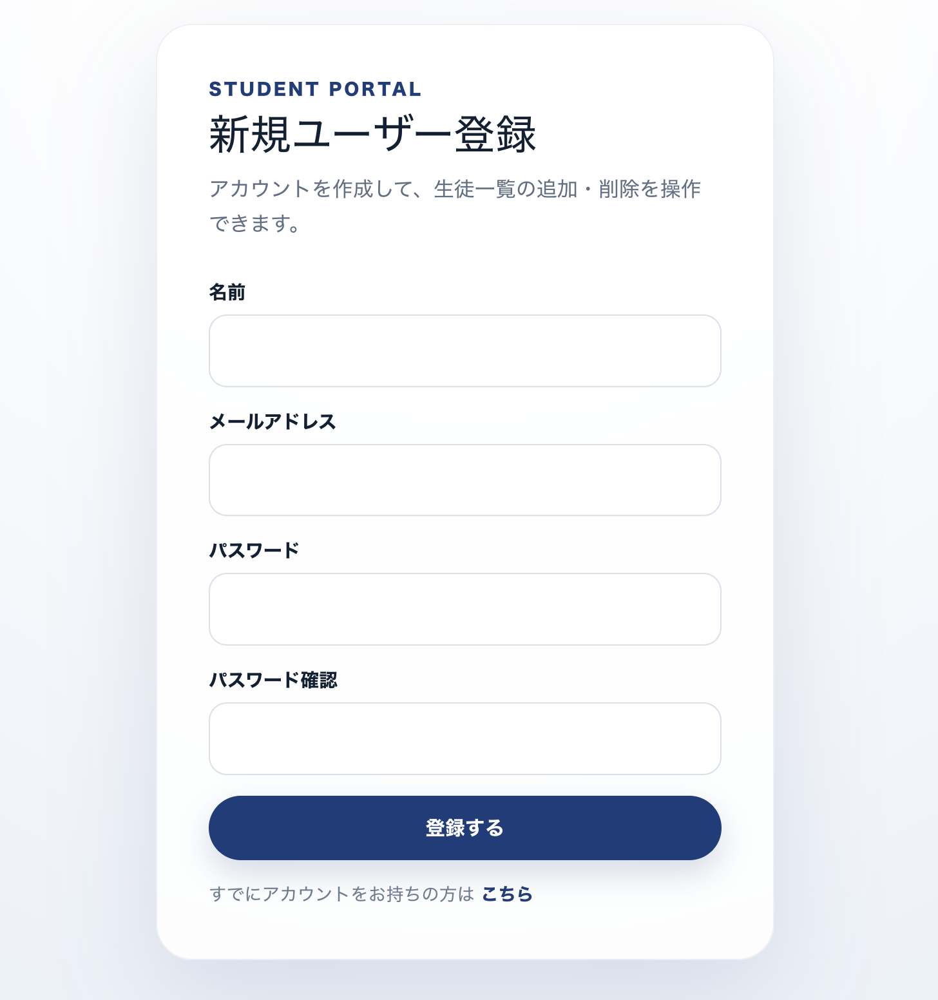
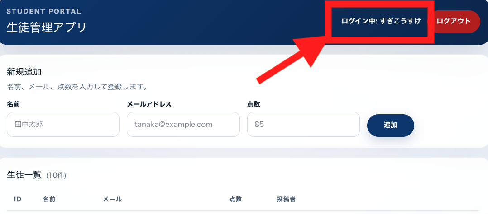
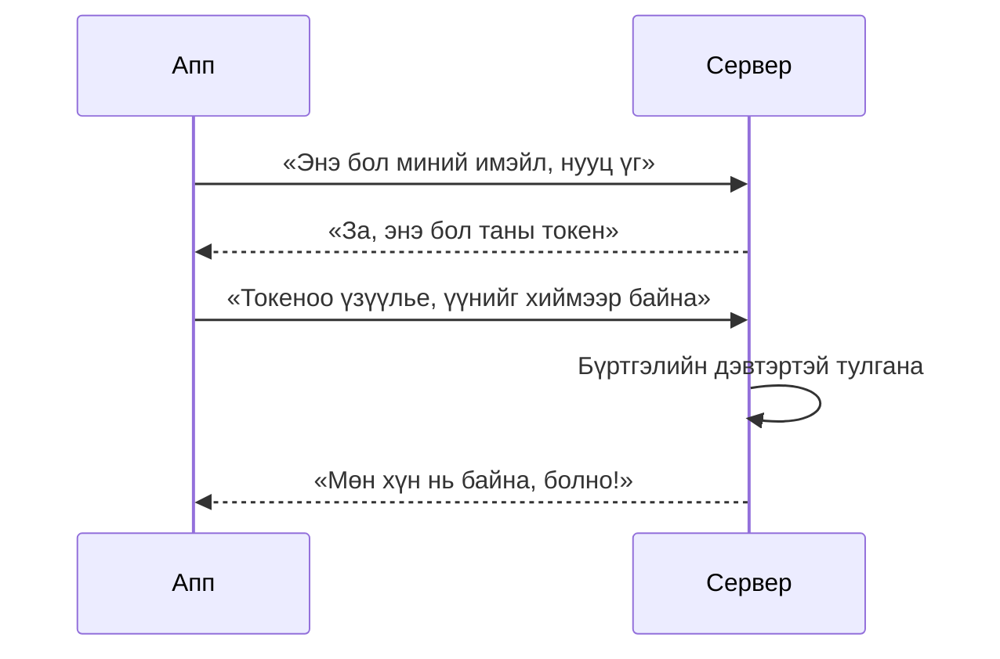
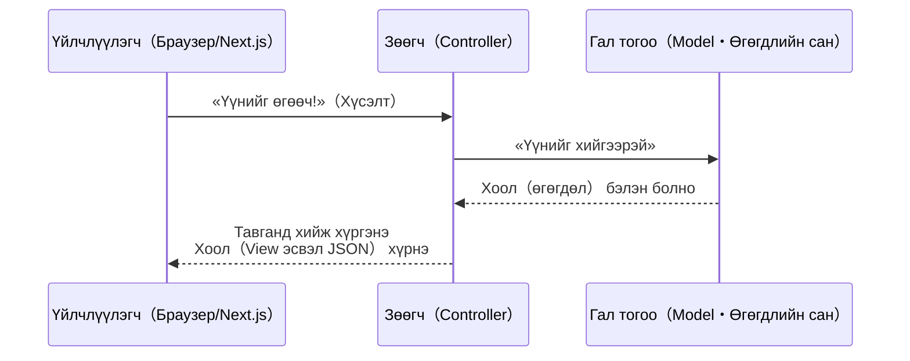

# 23-р цаг｜Шинэ хэрэглэгч бүртгэх функц нэмэх ба өмнөх хичээлүүдийн давталт

> 🇯🇵 Эх хувь (япон хэлээр): [2026_07_09.md](<../../../2年生_システム開発実践/前期/2026_07_09/2026_07_09.md>) <!-- original-ja-link -->

---

# Энэ хүртэл хийж чадсан бол дараа нь шинэ хэрэглэгч бүртгэх дэлгэц хийцгээе

Одоогийн байдлаар зөвхөн нэвтрэх дэлгэц байгаа тул шинээр сурагч нэмэх гэсэн хүн системд орж чадахгүй.

## Юу хийх вэ

Доорх зураг шиг «Шинэ хэрэглэгч бүртгэх» дэлгэц хийнэ. Шинэ бүртгэл үүсгэх боломжтой болгосноор анх удаа ирж буй хүн ч өөрөө бүртгэл үүсгээд нэвтэрч чадна.



Шинээр бүртгүүлсэн хэрэглэгчээр нэвтэрч чадвал болоо!!!



## Дэлгэцэд шаардлагатай элементүүд

- **Нэр** оруулах талбар
- **Имэйл хаяг** оруулах талбар
- **Нууц үг** оруулах талбар
- **Нууц үг баталгаажуулах** талбар (буруу бичихээс сэргийлж, ижил нууц үгийг дахин оруулуулна)
- **Бүртгүүлэх товч**
- «Бүртгэлтэй бол энд дарна уу» гэсэн нэвтрэх дэлгэц рүү очих холбоос

## Хэрэгжүүлэх зөвлөгөө (өмнө сурсан зүйлстэй холбоотой)

- Энэ дэлгэцийн хийх гэж буй зүйл нь CRUD-ийн **Create (шинэ хэрэглэгч үүсгэх)**-тэй тохирно. Laravel талд `store()`-той адил боловсруулалт юм
- Next.js-ийн **форм** дээр хэрэглэгчийн оруулсан нэр, имэйл, нууц үгийг Laravel API руу илгээнэ (POST)
- Laravel талын **Controller** хүлээн авсан утгуудыг шалгаж баталгаажуулсны дараа (нууц үг болон нууц үг баталгаажуулах талбарын утга таарч байгаа эсэх, имэйл хаяг давхардаагүй эсэх гэх мэт) **Model**-оор дамжуулан өгөгдлийн санд хадгална
- Бүртгэл амжилттай болбол шууд нэвтрэх дэлгэц рүү шилжүүлэх (эсвэл үргэлжлүүлээд нэвтрүүлж **токен** олгох) урсгалаар хийвэл зохимжтой

---

# Өмнөх хичээлүүдийн давталт (самбар дээр тайлбарлана!)

## 1. Токены ажиллах зарчим

Аппын сервер олон хүнээс хүсэлт (request) хүлээн авдаг. Тэр үед «Энэ үнэхээр нэвтэрсэн хүн өөрөө илгээсэн хүсэлт мөн үү?» гэдгийг шалгах ёстой. Үүнийг шалгахад ашигладаг «нууц үгийн карт» шиг зүйлийг **токен** гэнэ.

### Зугаа цэнгэлийн паркийн бугуйвчаар төсөөлье

Зугаа цэнгэлийн парк руу орохдоо тасалбараа үзүүлбэл «бугуйвч» өгдөг шүү дээ. Түүнээс хойш тоглоом болгон дээр суух бүртээ тасалбараа дахин үзүүлэх шаардлагагүй, **зөвхөн бугуйвчаа үзүүлэхэд л** «Энэ хүн аль хэдийн орсон зочин юм байна» гэж ойлгоно.

Токен яг үүнтэй адил үүрэгтэй.

```
   [Тасалбарын касс дээр бүртгүүлэх]
          ↓
   Ажилтан «Болсон, бугуйвчаа аваарай»
          ↓
   ★ Бугуйвчаа бугуйндаа зүүнэ ★
          ↓
   Цаашид тоглоом болгон дээр суухдаа
   зөвхөн бугуйвчаа үзүүлэхэд л болно!
```

### Аппын ертөнцөд ч ижил урсгал

1. **Нэвтрэх**: Имэйл хаяг, нууц үгээ илгээж «Би байна» гэж мэдэгдэнэ
2. **Токен авах**: Сервер «Мөн хүн нь байна» гэж баталгаажуулж чадвал нууц үгийн карт (токен) олгоно
3. **Картаа хадгалах**: Авсан токеноо апп талд хадгална
4. **Картаа үзүүлэх**: Ямар нэг үйлдэл хийх бүрдээ тэр токеныг хамт илгээнэ
5. **Сервер шалгана**: «Энэ токен үнэхээр нэвтэрсэн хүнийх байна» гэж тулган шалгаад зөвшөөрнө

Энэ урсгалыг диаграмаар харуулбал дараах байдалтай.



### Санаж байх зүйлс

- Токен бол нууц үгтэй адил. **Бусдад үзүүлэх эсвэл хулгайлуулбал тухайн хүн таны дүрээр нэвтрэх боломжтой** тул болгоомжтой хандана
- «Системээс гарах» = сервер талын бүртгэлийн дэвтэрт «Энэ токен цаашид хүчингүй» гэж тэмдэглэх
- Энэ шалгалтыг хүн гараар тухай бүр хийх нь хэцүү тул Laravel-д `auth:sanctum` гэдэг механизм автоматаар шалгаж өгдөг

### Токеныг хөгжүүлэгчийн хэрэгслээр шалгаж болно

Үнэндээ өөрийн апп одоо ямар токентой байгааг **браузерын хөгжүүлэгчийн хэрэгсэл (DevTools)-ийг нээж харж болно**.

- **Application таб (Chrome-ийн хувьд)** → `Local Storage`-ийг харвал хадгалагдсан токены тэмдэгт мөрийг шалгаж болно
- **Network таб** → API руу хүсэлт илгээх үеийн харилцааг харвал `Authorization: Bearer ○○○` гэсэн толгой хэсэгт бодит токен байгааг шалгаж болно

«Токен зөв авч чадсан уу», «Хүсэлтэд зөв хавсаргасан уу» гэдгийг мэдэхгүй байвал эхлээд хөгжүүлэгчийн хэрэгслээр шалгаж хэвшвэл алдааны шалтгааныг олоход хялбар болно.

### Бодит JavaScript код

Доорх код бол **Laravel талд биш, Next.js талд (фронтэндэд) бичих код** юм. Зөөгчид (Controller) хүсэлт гаргаж буй тал, өөрөөр хэлбэл «үйлчлүүлэгч»-ийн код гэж төсөөлөөрэй.

#### 1. Нэвтэрч токен авах, хадгалах

```javascript
async function login(email, password) {
  const response = await fetch('http://localhost:8000/api/login', {
    method: 'POST',
    headers: {
      'Content-Type': 'application/json',
    },
    body: JSON.stringify({ email, password }),
  });

  const data = await response.json();

  // Серверээс ирсэн токеныг браузерт хадгална
  localStorage.setItem('token', data.token);
}
```

#### 2. Хадгалсан токеныг хавсаргаж API дуудах

```javascript
async function fetchMyProfile() {
  // Сая хадгалсан токеноо гаргаж авна
  const token = localStorage.getItem('token');

  const response = await fetch('http://localhost:8000/api/user', {
    method: 'GET',
    headers: {
      // Энд «нууц үгийн карт»-аа үзүүлэх байдлаар токеныг хавсаргана
      Authorization: `Bearer ${token}`,
    },
  });

  const data = await response.json();
  console.log(data);
}
```

#### 3. Системээс гарах (токеныг хүчингүй болгох)

```javascript
async function logout() {
  const token = localStorage.getItem('token');

  await fetch('http://localhost:8000/api/logout', {
    method: 'POST',
    headers: {
      Authorization: `Bearer ${token}`,
    },
  });

  // Браузер талд үлдсэн токеныг ч устгана
  localStorage.removeItem('token');
}
```

`Authorization: Bearer ${token}` хэсэг нь яг «бугуйвчаа үзүүлэх» үйлдэлтэй тохирно. Ийм хэлбэрээр толгой хэсгийг хавсаргахгүй бол сервер тал «Хэнээс ирсэн хүсэлт болохыг мэдэхгүй» тул 401 алдаа (баталгаажуулалтын алдаа) буцаана.

## 2. CRUD-ийн тухай

CRUD гэдэг нь апп өгөгдөл дээр хийдэг **4 үндсэн үйлдлийн** эхний үсгүүдийг авсан нэр юм. Дэвтэр төсөөлбөл ойлгоход хялбар.

| Эхний үсэг | Үйлдэл | Дэвтрээр жишээлбэл |
|------|------|------------------|
| **C**reate (үүсгэх) | Шинэ өгөгдөл нэмэх | Дэвтэрт шинэ хуудас бичих |
| **R**ead (унших) | Өгөгдлийг харах | Бичсэн хуудсаа эргэж унших |
| **U**pdate (шинэчлэх) | Өгөгдлийг өөрчлөх | Бичсэнээ арилгаад дахин бичих |
| **D**elete (устгах) | Өгөгдлийг устгах | Хуудсыг урж хаях |

```
      ┌─────────── Дэвтэр (өгөгдлийн сан) ───────────┐
      │                                             │
 Create│ Шинэ хуудас нэмэх →  [ 1-р хуудас ]        │
      │                                             │
  Read │ Унших            →  «Тийм тийм, энэ байна» │
      │                                             │
Update │ Дахин бичих      →  [ 1-р хуудас (зассан) ] │
      │                                             │
Delete │ Урж хаях         →  (хуудас алга болно)     │
      └─────────────────────────────────────────────┘
```

### Яагаад чухал вэ?

- Мэдээллийн самбар, онлайн дэлгүүр, сошиал сүлжээ, ажил удирдах апп… ихэнх апп «өгөгдөл үүсгэх, харах, засах, устгах»-ын хослолоор бүтдэг
- Laravel-д `Route::apiResource` гэдэг хэрэгтэй функц байдаг бөгөөд энэ 4 (үнэндээ 5) үйлдлийг нэг дор бэлдэж өгдөг

```php
Route::apiResource('users', UserController::class);
// Ганцхан энэ мөрөөр «үүсгэх, харах, засах, устгах» замууд бүгд холбогдоно
```

CRUD-ийн үйлдлүүдийг бодолцож ажиллавал «Энэ товч ямар үүрэгтэй вэ» гэдгийг багийн бүх хүнд ойлгуулахад хялбар болно.

## 3. Laravel-ийн MVC загварын тухай

Laravel-ийн аппыг **ресторан**-аар жишээлбэл төсөөлөхөд хялбар. Үүрэг хуваарилалт нь тодорхой тул олон хүн хамт ажилласан ч будлиан гардаггүй.

### Рестораны ажилтнуудын үүргээр жишээлж бодъё

- **Controller (контроллер) = Зөөгч**: Үйлчлүүлэгчээс (хүсэлт) захиалга авч, гал тогоо руу дамжуулаад, бэлэн болсон хоолыг үйлчлүүлэгчид хүргэдэг хүн
- **Model (модел) = Гал тогоо, хөргөгч**: Түүхий эдийг (өгөгдөл) хадгалж, бодитоор хоол (өгөгдөл авах, хадгалах) хийдэг газар
- **View (вью) = Тавган дээр тавьсан хоол**: Үйлчлүүлэгчийн өмнө гарч ирэх эцсийн харагдах байдал

Захиалгаас хоол хүрэх хүртэлх урсгалыг диаграмаар харуулбал дараах байдалтай.



### API болгоход юу өөрчлөгдөх вэ?

API болгохоос өмнө зөөгч (Controller) гал тогооноос авсан хоолоо **ресторан дотроо** тавганд хийж үйлчлүүлэгчийн өмнө тавьдаг байсан (Blade-ээр дэлгэц хийдэг байсан).

API болгосны дараа зөөгч (Controller) **тавганд хийхгүй, зөвхөн түүхий эд болон жор (JSON өгөгдөл)-ыг** үйлчлүүлэгчид өгдөг болно. Харин бодитоор харагдах байдлыг угсрах (тавганд хийх) ажлыг Next.js тал хариуцдаг болно.

Өөрөөр хэлбэл «захиалга авч, гал тогоотой харилцах» гэсэн зөөгчийн үндсэн ажил өөрчлөгдөхгүй, **зөвхөн эцэст нь хоолыг тавганд хийх (дэлгэцийн харагдах байдлыг бүтээх) ажил Next.js талд шилжсэн** гэж төсөөлбөл ойлгоход хялбар.

