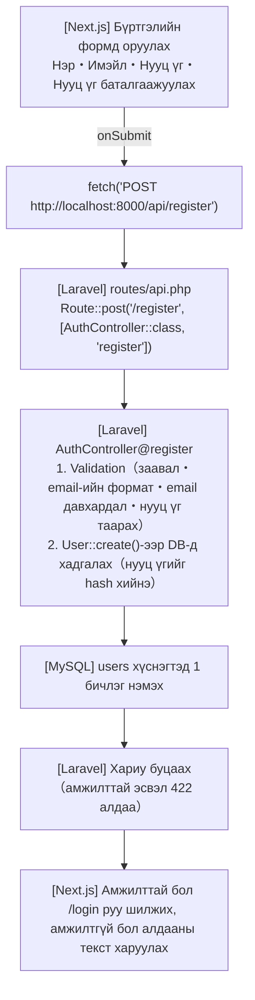

# Шинэ хэрэглэгч бүртгэх дэлгэц хийх дараалал

> 🇯🇵 Эх хувь (япон хэлээр): [2026_07_09_2.md](<../../../2年生_システム開発実践/前期/2026_07_09/2026_07_09_2.md>) <!-- original-ja-link -->

Энэ баримт бичиг нь 23-р цагийн даалгавар «Шинэ хэрэглэгч бүртгэх дэлгэц хийх»-ийг өөрийн гараар хийж гүйцэтгэх алхмын заавар юм.  
`2026_07_09.md`-д өгсөн сэдвийг өмнөх хичээлүүдэд (17〜22-р цаг) хийсэн `school-frontend` төсөл дээр хэрэгжүүлнэ.

---

## 0. Ерөнхий зураг: юу юутай холбогдох вэ

Бүртгэлийн дэлгэц нь «нэг шинэ бичлэг үүсгэх» функц тул CRUD-ийн **Create**-тэй тохирно.  
Урсгал нь нэвтрэх дэлгэцтэй (17-р цаг) бараг ижил бөгөөд зөвхөн илгээх URL болон validation-ий агуулга л өөрчлөгдөнө.



`routes/api.php`-д үнэндээ **08-р цагийн үед бүртгэлийн route аль хэдийн бичигдсэн.**

```php
// routes/api.php（аль хэдийн бичигдсэн байх ёстой）
Route::post('/login', [AuthController::class, 'login']);
Route::post('/register', [AuthController::class, 'register']);
```

Гэхдээ `AuthController`-ийн дотор зөвхөн `login` / `logout` / `me` хэрэгжсэн тул  
**`register()` метод одоогоор байхгүй** байна. Өнөөдөр үүнийг хийхээс эхэлнэ.

---

## 1. Laravel тал: `register()`-ийг хэрэгжүүлэх

`app/Http/Controllers/Api/AuthController.php`-г нээж, `login()` методын ойролцоо нэмнэ.

```php
// app/Http/Controllers/Api/AuthController.php
use App\Models\User;
use Illuminate\Support\Facades\Hash;

// POST /api/register
public function register(Request $request)
{
    // ① Оролтыг шалгах
    $validated = $request->validate([
        'name'     => 'required|string|max:255',
        'email'    => 'required|email|unique:users,email',
        'password' => 'required|min:8|confirmed',
    ]);

    // ② Хэрэглэгч үүсгэх（нууц үгийг заавал hash хийнэ）
    $user = User::create([
        'name'     => $validated['name'],
        'email'    => $validated['email'],
        'password' => Hash::make($validated['password']),
    ]);

    // ③ Шууд нэвтрүүлэхийн тулд токен ч олгож буцаана
    $token = $user->createToken('api-token')->plainTextToken;

    return response()->json([
        'status' => 'ok',
        'token'  => $token,
        'user'   => $user,
    ], 201); // 201 = Шинээр амжилттай үүсгэсэн
}
```

### Validation-ий гол дүрмүүд

| Дүрэм | Утга |
|--------|------|
| `required` | Оруулаагүй бол 422 алдаа |
| `email` | Имэйлийн формат эсэхийг шалгана |
| `unique:users,email` | `users` хүснэгтэд ижил имэйл байхгүй эсэхийг шалгана (давхар бүртгэлээс сэргийлнэ) |
| `min:8` | Нууц үг хамгийн багадаа 8 тэмдэгттэй байна |
| `confirmed` | **«Ижил нэр + `_confirmation`» гэсэн талбарын утгатай таарч байгаа эсэхийг** автоматаар шалгадаг тусгай дүрэм |

`confirmed` дүрмийг ашиглавал frontend-ээс илгээх түлхүүрийн нэрийг заавал дараах байдлаар өгөх шаардлагатай.

```json
{
  "name": "田中太郎",
  "email": "tanaka@example.com",
  "password": "password123",
  "password_confirmation": "password123"
}
```

`password_confirmation` гэсэн нэрийг ганц үсгээр ч буруу бичвэл `confirmed` дүрэм ажиллахгүй, «таарч байгаа хэрнээ алдаа гарах» алдаа үүсэх шалтгаан болдог тул анхаараарай.

---

## 2. Next.js тал: `/register` хуудас хийх

`app/register/` хавтас үүсгэж, `page.tsx`-ийг шинээр үүсгэнэ.

```
app/register/page.tsx  ← шинээр үүсгэх
```

Нэвтрэх хуудастай (17-р цаг) ижил бүтэцтэй хийнэ. **Ялгаатай нь зөвхөн оруулах талбарууд болон илгээх хаяг л** юм.

```tsx
"use client";

import { useState } from "react";
import { useRouter } from "next/navigation";

export default function RegisterPage() {
  const router = useRouter();
  const [name, setName] = useState("");
  const [email, setEmail] = useState("");
  const [password, setPassword] = useState("");
  const [passwordConfirmation, setPasswordConfirmation] = useState("");
  const [error, setError] = useState("");
  const [loading, setLoading] = useState(false);

  async function handleSubmit(e) {
    e.preventDefault();
    setError("");
    setLoading(true);

    const res = await fetch("http://localhost:8000/api/register", {
      method: "POST",
      headers: {
        "Content-Type": "application/json",
        "Accept": "application/json",
      },
      // ★ Түлхүүрийн нэрийг Laravel талын validation-тэй тааруулна
      body: JSON.stringify({
        name,
        email,
        password,
        password_confirmation: passwordConfirmation,
      }),
    });

    const data = await res.json();
    setLoading(false);

    if (res.ok) {
      // ★ Шууд нэвтэрсэн төлөвт оруулна（токеныг хадгалаад /students руу）
      localStorage.setItem("token", data.token);
      localStorage.setItem("userName", data.user?.name || "ユーザー");
      router.push("/students");
    } else if (data.errors) {
      // 21-р цагт сурсантай ижил Laravel-ийн validation алдааг харуулна
      const messages = Object.values(data.errors).flat().join(" / ");
      setError(messages);
    } else {
      setError(`エラーが発生しました（HTTP ${res.status}）`);
    }
  }

  return (
    <div style={{
      maxWidth: "400px", margin: "80px auto",
      background: "white", padding: "32px",
      borderRadius: "8px", boxShadow: "0 2px 8px rgba(0,0,0,0.1)"
    }}>
      <h2 style={{ marginBottom: "24px", textAlign: "center" }}>新規ユーザー登録</h2>

      <form onSubmit={handleSubmit}>
        <div style={{ marginBottom: "16px" }}>
          <label style={{ display: "block", marginBottom: "6px", fontWeight: "bold" }}>名前</label>
          <input
            type="text"
            value={name}
            onChange={(e) => setName(e.target.value)}
            style={{ width: "100%", padding: "10px", border: "1px solid #ccc", borderRadius: "6px", fontSize: "1em", boxSizing: "border-box" }}
          />
        </div>

        <div style={{ marginBottom: "16px" }}>
          <label style={{ display: "block", marginBottom: "6px", fontWeight: "bold" }}>メールアドレス</label>
          <input
            type="email"
            value={email}
            onChange={(e) => setEmail(e.target.value)}
            style={{ width: "100%", padding: "10px", border: "1px solid #ccc", borderRadius: "6px", fontSize: "1em", boxSizing: "border-box" }}
          />
        </div>

        <div style={{ marginBottom: "16px" }}>
          <label style={{ display: "block", marginBottom: "6px", fontWeight: "bold" }}>パスワード</label>
          <input
            type="password"
            value={password}
            onChange={(e) => setPassword(e.target.value)}
            style={{ width: "100%", padding: "10px", border: "1px solid #ccc", borderRadius: "6px", fontSize: "1em", boxSizing: "border-box" }}
          />
        </div>

        <div style={{ marginBottom: "16px" }}>
          <label style={{ display: "block", marginBottom: "6px", fontWeight: "bold" }}>パスワード確認</label>
          <input
            type="password"
            value={passwordConfirmation}
            onChange={(e) => setPasswordConfirmation(e.target.value)}
            style={{ width: "100%", padding: "10px", border: "1px solid #ccc", borderRadius: "6px", fontSize: "1em", boxSizing: "border-box" }}
          />
        </div>

        {error && (
          <p style={{ color: "#D32F2F", fontSize: "0.9em", marginBottom: "12px" }}>
            {error}
          </p>
        )}

        <button
          type="submit"
          disabled={loading}
          style={{ width: "100%", padding: "12px", background: loading ? "#aaa" : "#1976D2", color: "white", border: "none", borderRadius: "6px", fontSize: "1em", fontWeight: "bold", cursor: loading ? "not-allowed" : "pointer" }}
        >
          {loading ? "登録中..." : "登録する"}
        </button>

        <p style={{ textAlign: "center", marginTop: "16px", fontSize: "0.9em" }}>
          すでにアカウントをお持ちの方は{" "}
          <a href="/login" style={{ color: "#1976D2", fontWeight: "bold" }}>こちら</a>
        </p>
      </form>
    </div>
  );
}
```

### Нэвтрэх хуудастай (17-р цаг) харьцуулсан ялгаа

| | `/login` (17-р цаг) | `/register` (энэ удаа) |
|--|--|--|
| Оруулах талбарууд | Имэйл・Нууц үг | Нэр・Имэйл・Нууц үг・Нууц үг баталгаажуулах |
| Илгээх хаяг | `POST /api/login` | `POST /api/register` |
| Амжилттай үеийн хариу | `{ token, user }` | `{ token, user }` (ижил хэлбэр) |
| Амжилтгүй үеийн харуулах зүйл | Тогтмол текст (401) | Laravel-ийн validation алдааны мессеж (422) |
| Амжилттай болсны дараа шилжих | `/students` | `/students` (бүртгүүлэхтэй зэрэг нэвтэрсэнд тооцно) |

---

## 3. Нэвтрэх дэлгэц ба бүртгэлийн дэлгэцийг харилцан холбох

Даалгаврын шаардлагад (`2026_07_09.md`) байгаачлан бүртгэлийн дэлгэцэд «すでにアカウントをお持ちの方はこちら» (Бүртгэлтэй бол энд дарна уу) гэсэн нэвтрэх дэлгэц рүү очих холбоос хэрэгтэй (дээрх кодын төгсгөлд аль хэдийн нэмсэн).

Үүнтэй хамт нэвтрэх дэлгэц талд ч бүртгэлийн дэлгэц рүү очих холбоос нэмбэл хэрэглэгч төөрөлгүй хооронд нь шилжиж чадна.

```tsx
// app/login/page.tsx-ийн <form>-ийн хамгийн доод хэсэгт нэмнэ
<p style={{ textAlign: "center", marginTop: "16px", fontSize: "0.9em" }}>
  アカウントをお持ちでない方は{" "}
  <a href="/register" style={{ color: "#1976D2", fontWeight: "bold" }}>こちら</a>
</p>
```

---

## 4. Хоёр серверийг асааж ажиллагааг шалгах

```bash
# Терминал① Laravel
cd （Laravel төслийн хавтас）
php artisan serve

# Терминал② Next.js
cd school-frontend
npm run dev
```

### Ажиллагаа шалгах жагсаалт

| Шалгах зүйл | Үйлдэл | Хүлээгдэж буй үр дүн |
|---------|------|------------|
| Дэлгэц харагдах | `http://localhost:3000/register`-г нээх | Нэр・Имэйл・Нууц үг・Нууц үг баталгаажуулах талбарууд харагдана |
| Хэвийн бүртгэл | Бүгдийг зөв оруулаад «登録する» (Бүртгүүлэх) дарах | `/students` руу шилжиж, нэвтэрсэн төлөвт орно |
| Имэйл давхардал | Аль хэдийн бүртгэлтэй имэйл хаягаар бүртгүүлэх | «The email has already been taken.» гэх мэт алдаа харагдана |
| Нууц үг таарахгүй | Нууц үг ба нууц үг баталгаажуулалтад өөр утга оруулах | «The password confirmation does not match.» харагдана |
| Оруулаагүй | Юу ч оруулалгүй илгээх | Талбар бүрийн «required» алдаа харагдана |
| Дэлгэц шилжих (бүртгэл→нэвтрэх) | «すでにアカウントをお持ちの方はこちら» (Бүртгэлтэй бол энд дарна уу) дарах | `/login` руу шилжинэ |
| Дэлгэц шилжих (нэвтрэх→бүртгэл) | Нэвтрэх дэлгэцийн «こちら» (энд) дарах | `/register` руу шилжинэ |
| Нэвтрэлт шалгах | Шинээр бүртгүүлсэн имэйл・нууц үгээр дахин нэвтрэх | Амжилттай нэвтэрнэ |

---

## Дүгнэлт: энэ удаа хийсэн зүйлээ өмнөх хичээлүүдтэй холбох нь

| Өмнө нь | Энэ удаа нэмсэн хэсэг |
|--|--|
| `routes/api.php`-д `/register` зам аль хэдийн бэлэн байсан (08-р цаг) | `AuthController`-т `register()`-ийн агуулгыг (validation + `User::create`) хэрэгжүүлсэн |
| `/login` хуудас аль хэдийн байсан (17-р цаг) | Ижил бүтцээр `/register` хуудсыг шинээр үүсгэсэн |
| 422 алдааг харуулах аргыг 21-р цагт аль хэдийн сурсан | Ижил механизмыг бүртгэлийн формын алдаа харуулахад хэрэглэсэн |

Шинэ ойлголт бараг гарахгүй бөгөөд **CRUD-ийн Create・Controller/Model・validation・токен олгох** гэсэн өмнөх хичээлүүдэд сурсан хэсгүүдийг хослуулахад л хийж чадна гэдэг нь энэ даалгаврын гол санаа юм.
