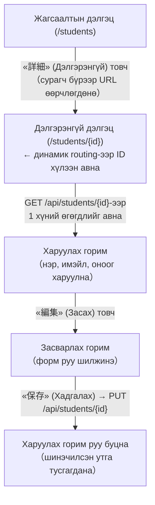
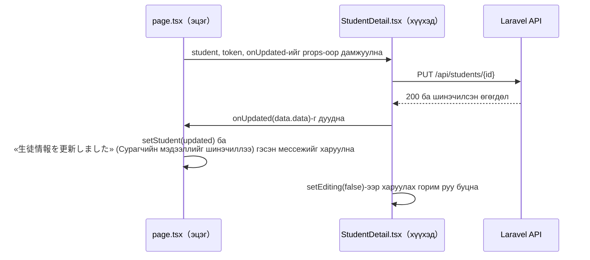

# 24-р цаг｜Дэлгэрэнгүй дэлгэц хийх - хэрэгжүүлэх алхмууд

> 🇯🇵 Эх хувь (япон хэлээр): [2026_07_16_実装.md](<../../../2年生_システム開発実践/前期/2026_07_16/2026_07_16_実装.md>) <!-- original-ja-link -->

## Өнөөдрийн зорилго

- Жагсаалтын дэлгэцийн «詳細» (Дэлгэрэнгүй) товчноос зөвхөн тэр 1 сурагчийн мэдээллийг харуулах дэлгэц рүү шилжиж чаддаг болох
- Дэлгэрэнгүй дэлгэцийн «編集» (Засах) товчоор тэр дор нь форм руу шилжиж шинэчилж чаддаг болох
- Laravel талд шинэчлэх API endpoint (`PUT /api/students/{id}`)-ийг бэлдэж чаддаг болох

> **Байр суурь:** Жагсаалтын дэлгэц (`GET /api/students`) «бүх хүний мэдээллийг нэг дор харах» дэлгэц байсан бол дэлгэрэнгүй дэлгэц нь «ID-гаар заасан зөвхөн 1 хүний мэдээллийг харах, засах» дэлгэц юм. CRUD-ийн **Read (зөвхөн 1 бичлэг харах)** ба **Update (шинэчлэх)** нь нэг дэлгэц дотор солигддог бүтэцтэй болно.

---

## Ерөнхий зураг: юу хийх вэ



### Яагаад энэ дарааллаар хийх вэ

> 💡 **Жишээлбэл… дэлгүүрийн «хувийн захиалгын карт»**
>
> Жагсаалтын дэлгэцийг «өнөөдрийн захиалгын жагсаалт» гэвэл дэлгэрэнгүй дэлгэц нь зөвхөн 1 үйлчлүүлэгчийн «хувийн захиалгын карт» юм. Картыг шууд өөрчлөхийн (засварлахын) тулд эхлээд «энэ картыг гаргаж өгөх» цонх (`GET /api/students/{id}`) болон «өөрчлөлтийг хүлээн авах» цонх (`PUT /api/students/{id}`) дэлгүүр талд (Laravel) байхгүй бол эхлэх боломжгүй.

Backend-ийн шинэчлэх API байхгүй бол frontend-ийн засварлах формыг хийсэн ч хадгалах газар байхгүй тул ажиллагааг шалгаж чадахгүй. Тиймээс **backend (API) → жагсаалтаас орох зам → дэлгэрэнгүй дэлгэц (харуулах) → засварлах горим** гэсэн дарааллаар бага багаар хийж, тухай бүр ажиллуулж үзэнгээ урагшилна.

### Файлын бүтэц (энэ удаа өөрчлөх файлууд)

| Тэмдэг | Утга |
|---|---|
| 🆕 Шинэ | Файлыг шинээр үүсгэнэ |
| ➕ Нэмэх | Байгаа файлд код нэмж бичнэ |
| 👀 Шалгах | Өөрчлөх шаардлагагүй. Аль хэдийн бэлэн эсэхийг шалгахад л болно |

```
Laravel/
├── app/Http/Requests/UpdateStudentRequest.php      🆕 Шинэ
├── app/Http/Controllers/Api/StudentController.php  ➕ update() нэмэх
└── routes/api.php                                  👀 Зөвхөн шалгах

school-frontend/
├── components/students/StudentList.tsx             ➕ Дэлгэрэнгүй холбоос нэмэх
├── components/students/StudentDetail.tsx           🆕 Шинэ（харуулах⇔засах）
└── app/students/[id]/page.tsx                       🆕 Шинэ → сүүлийн хэсэгт ➕ нэмж бичнэ（динамик routing）
```

---

## Step 1｜Backend: шинэчлэх API нэмэх

Жагсаалт, дэлгэрэнгүй авах, устгах API-ууд аль хэдийн байгаа ч «1 бичлэгийг өөрчлөх» цонх хараахан байхгүй. Үүнийг хамгийн түрүүнд хийнэ.


### 1-3. `routes/api.php`-г шалгах

**👀 Зөвхөн шалгах (ихэнхдээ өөрчлөх шаардлагагүй)** — `Route::apiResource('students', StudentController::class)` нь анхнаасаа `update`-ийг агуулдаг. `->only([...])`-ээр хязгаарласан тохиолдолд **л** `update`-ийг нэмээрэй.

```php
Route::middleware('auth:sanctum')->group(function () {
    Route::post('/logout', [AuthController::class, 'logout']);
    Route::get('/me', [AuthController::class, 'me']);
    Route::apiResource('students', StudentController::class);
    
    // only болсон эсэхийг л шалгана
    // Route::apiResource('students', StudentController::class)->only(['index', 'show']);
});
```

### 1-4. Ажиллагааг шалгах

```bash
cd Laravel && php artisan serve
```

Нэвтэрч токен авсны дараа `curl`-ээр шинэчлэх API-г шууд дуудаж үзнэ.

⚠️ Windows (PowerShell) ашиглаж буй хүмүүст анхааруулга
PowerShell дээр curl-ийг шууд ашиглавал алдаа гарна. Заавал эхэнд нь curl.exe гэж бичих, эсвэл терминалд cmd гэж оруулж «Command Prompt» руу шилжсэний дараа ажиллуулаарай. Мөн өгөгдөл доторх давхар хашилтыг (\") escape хийх шаардлагатай.
```bash
curl -X PUT http://localhost:8000/api/students/1 \
  -H "Authorization: Bearer <авсан токен>" \
  -H "Content-Type: application/json" \
  -H "Accept: application/json" \
  -d '{"name":"テスト太郎","email":"test-taro@example.com","score":80}'
```

| Шалгах зүйл | Үйлдэл | Хүлээгдэж буй үр дүн |
|---|---|---|
| Амжилттай шинэчлэх | Дээрх curl-ийг ажиллуулах | 200 буцаж, шинэчилсэн нэр, имэйл, оноо JSON-д агуулагдана |
| Validation | `score`-д `200` оруулж ажиллуулах | 422 буцна |
| Нэвтрэлт заавал | `Authorization` header-ийг хасаж ажиллуулах | 401 буцна |
| Байхгүй ID | `/api/students/9999` руу ажиллуулах | 404 буцна |

---

## Step 2｜Frontend: жагсаалтаас дэлгэрэнгүй рүү орох зам

`school-frontend/components/students/StudentList.tsx`-г засна.

### Яагаад хэрэгтэй вэ

Жагсаалтын мөр бүрээс «зөвхөн энэ сурагчийн URL» руу шилжих боломжгүй бол дэлгэрэнгүй дэлгэц хийсэн ч тийш очих арга байхгүй. **Сурагчийн ID-г шууд URL-ийн нэг хэсэг болгон шигтгэх** нь гол санаа юм.

**➕ Нэмэх (байгаа файлын эхэнд)** — `import`-ийг нэмнэ.

```tsx
// ▼ StudentList.tsx-ийн эхэнд нэмнэ
"use client";

import Link from "next/link";
```

**➕ Нэмэх (байгаа файл)** — `bodyCell`-ийн доохон талд дэлгэрэнгүй холбоосын хэв маягийг нэмнэ.

```tsx
// Style тогтмолууд（давтан ашиглах style-уудыг нэгтгэнэ）
const thStyle = { padding: "10px 16px", textAlign: "left", fontWeight: "bold", fontSize: "0.9em" };
const tdStyle = { padding: "12px 16px", fontSize: "0.95em" };

// ▼ Доохон талд нэмнэ（дэлгэрэнгүй холбоосын хэв маяг）
const detailLinkStyle = {
  display: "inline-flex",
  alignItems: "center",
  justifyContent: "center",
  minWidth: 104,
  padding: "0.85rem 1.25rem",
  borderRadius: 999,
  background: "#163D7A",
  color: "#fff",
  fontWeight: 700,
  fontSize: "0.95rem",
  letterSpacing: "0.01em",
  boxShadow: "0 10px 24px rgba(22, 61, 122, 0.18)",
};
```

**🔁 Солих (байгаа файл)** — `StudentRow`-ийн сүүлийн `<td>` (үйлдлийн товчны нүд)-ийг доорхоор солино.

```tsx
// StudentRow: хүснэгтийн 1 мөр
function StudentRow({ student, onDelete }) {
  function handleDelete() {
    // Баталгаажуулах цонх харуулсны дараа устгана
    if (window.confirm(`${student.name} を削除しますか？`)) {
      onDelete(student.id); // Эцэгт «энэ ID-г устгаарай» гэж дамжуулна
    }
  }

  return (
    <tr style={{ borderBottom: "1px solid #eee" }}>
      <td style={tdStyle}>{student.id}</td>
      <td style={tdStyle}>{student.name}</td>
      <td style={tdStyle}>{student.email}</td>
      <td style={tdStyle}>{student.score}</td>
      <td style={tdStyle}>
      <div style={{ display: "flex", gap: "0.5rem", flexWrap: "wrap" }}>
        <Link href={`/students/${student.id}`} style={detailLinkStyle}>
          詳細
        </Link>
        <button
          onClick={handleDelete}
          style={{ background: "#D32F2F", color: "white", border: "none", borderRadius: "4px", padding: "4px 12px", cursor: "pointer", fontSize: "0.85em" }}
        >
          削除
        </button>
        </div >
      </td>
    </tr>
  );
}
```

### Ажиллагааг шалгах

```bash
cd school-frontend && npm run dev
```

| Шалгах зүйл | Үйлдэл | Хүлээгдэж буй үр дүн |
|---|---|---|
| Орох зам харагдах | `/students`-г нээх | Мөр бүрт «詳細» (Дэлгэрэнгүй) товч харагдана |
| Шилжих | «詳細» (Дэлгэрэнгүй) товч дээр дарах | `/students/{тэр мөрийн ID}` руу шилжинэ (энэ үед 404 байхад болно. Step 3-т хийнэ) |

---

## Step 3｜Frontend: дэлгэрэнгүй дэлгэц (харуулах горим)

**🆕 Шинэ файл** — `school-frontend/app/students/[id]/page.tsx`-ийг шинээр үүсгэнэ (`[id]` нэртэй хавтсыг ч шинээр үүсгэнэ).

### Яагаад `[id]` гэсэн хавтасны нэр өгөх вэ

Next.js-д хавтасны нэрийг `[id]` шиг дөрвөлжин хаалтад хийвэл URL-ийн тэр хэсгийг (`/students/3`-ийн `3`) хуудас дотроо хүлээн авч чаддаг **динамик routing** болно.

```tsx
"use client";

import { useState, useEffect } from "react";
import { useRouter, useParams } from "next/navigation";
import Link from "next/link";


export default function StudentDetailPage() {
  const router = useRouter();
  const params = useParams(); // URL-ийн {id} хэсгийг хүлээн авна
  const [student, setStudent] = useState(null);
  const [userName, setUserName] = useState("");
  const [loading, setLoading] = useState(true);
  const [notFound, setNotFound] = useState(false);
  const [token, setToken] = useState(null); // ★ Алдааны шалтгаан болж байсан «token»-ий хайрцгийг энд нэмлээ!

  // ★ useEffect: хуудас харагдах үед зөвхөн 1 удаа ажиллана
  useEffect(() => {
    const savedToken = localStorage.getItem("token");

    // Токен байхгүй бол нэвтрэх хуудас руу буцаана
    if (!savedToken) {
      router.push("/login");
      return;
    }

    setToken(savedToken); // ★ Авсан токеныг төлөвт (state) найдвартай хадгална
    setUserName(localStorage.getItem("userName") || "ユーザー");
    loadStudent(savedToken);
  }, []); // [] = зөвхөн эхний 1 удаа ажиллана

  // Тодорхой 1 сурагчийн өгөгдлийг API-аас авна
  async function loadStudent(currentToken) {
    setLoading(true);
    setNotFound(false);
  
    try {
      // URL параметр болох params.id-г ашиглан Laravel API руу хүсэлт илгээнэ
      const res = await fetch(`http://localhost:8000/api/students/${params.id}`, {
        headers: {
          "Accept": "application/json",
          "Authorization": `Bearer ${currentToken}`, // ★ Токеныг header-т хавсаргана
        },
      });

      // 401 = токен хүчингүй → нэвтрэх хуудас руу буцаана
      if (res.status === 401) {
        router.push("/login");
        return;
      }

      // 404 = сурагч олдсонгүй
      if (res.status === 404) {
        setStudent(null);
        setNotFound(true);
        return;
      }

      const data = await res.json();
      setStudent(data.data); // Laravel API нь { data: {...} } хэлбэрээр буцаана
    } catch (error) {
      console.error("データの取得に失敗しました", error);
    } finally {
      setLoading(false);
    }
  }

  // Системээс гарах
  async function handleLogout() {
    const currentToken = localStorage.getItem("token");

    await fetch("http://localhost:8000/api/logout", {
      method: "POST",
      headers: {
        "Accept": "application/json",
        "Authorization": `Bearer ${currentToken}`,
      },
    });

    localStorage.removeItem("token");
    localStorage.removeItem("userName");
    router.push("/login");
  }

  // ★ Токен бэлэн болох эсвэл ачаалал дуусах хүртэл хүлээнэ
  if (!token || loading) {
    return (
      <div style={{ textAlign: "center", padding: "80px", color: "#888" }}>
        生徒データを読み込んでいます...
      </div>
    );
  }

  return (
    <div style={{ background: "#f4f6f8", minHeight: "100vh" }}>

      {/* Header（жагсаалтын дэлгэцтэй ижил нийтлэг харагдах байдал） */}
      <header style={{
        background: "#1565C0", color: "white",
        padding: "16px 32px",
        display: "flex", alignItems: "center"
      }}>
        <h1 style={{ fontSize: "1.2em" }}>生徒管理アプリ（Next.js API版）</h1>
        <div style={{ marginLeft: "auto", display: "flex", alignItems: "center", gap: "12px" }}>
          <span style={{ fontSize: "0.9em" }}>● ログイン中：{userName}</span>
          <button
            onClick={handleLogout}
            style={{ background: "#D32F2F", color: "white", border: "none", borderRadius: "6px", padding: "6px 14px", cursor: "pointer" }}
          >
            ログアウト
          </button>
        </div>
      </header>

      {/* Үндсэн агуулга */}
      <main style={{ padding: "32px", maxWidth: "640px", margin: "0 auto", display: "grid", gap: "20px" }}>
        
        <Link href="/students" style={{ color: "#1565C0", fontWeight: "bold", textDecoration: "none" }}>
          ← 一覧に戻る
        </Link>


        {/* ★ Сурагч олдоогүй эсвэл өгөгдөл хоосон үеийн харуулах хэсэг */}
        {notFound || !student ? (
          <div style={{
            borderRadius: "8px",
            padding: "40px 24px",
            textAlign: "center",
            background: "white",
            border: "1px solid #ddd",
          }}>
            <p style={{ margin: 0, color: "#888" }}>生徒が見つかりません</p>
          </div>
        ) : (
          /* ★ token-ийг хүүхэд компонент руу зөв дамжуулж чаддаг боллоо */
          <section style={{
              background: "white", border: "1px solid #ddd", borderRadius: "8px",
              padding: "24px", boxShadow: "0 4px 12px rgba(0,0,0,0.05)"
            }}>
              <h2 style={{ margin: "0 0 20px 0", fontSize: "1.4em", borderBottom: "2px solid #1565C0", paddingBottom: "8px" }}>
                {student.name}
              </h2>
              
              <dl style={{ display: "grid", gap: "16px", margin: 0 }}>
                <div>
                  <dt style={{ fontSize: "0.9em", color: "#666", marginBottom: "4px" }}>メールアドレス</dt>
                  <dd style={{ margin: 0, fontWeight: "bold", fontSize: "1.1em" }}>{student.email}</dd>
                </div>
                <div>
                  <dt style={{ fontSize: "0.9em", color: "#666", marginBottom: "4px" }}>点数</dt>
                  <dd style={{ margin: 0, fontWeight: "bold", fontSize: "1.1em" }}>{student.score} 点</dd>
                </div>
              </dl>
            </section>
        )}

      </main>

    </div>
  );
}
```

### Ажиллагааг шалгах

| Шалгах зүйл | Үйлдэл | Хүлээгдэж буй үр дүн |
|---|---|---|
| Харуулах | Нэвтэрсний дараа жагсаалтын «詳細» (Дэлгэрэнгүй)-ээс шилжих | Зөвхөн тэр сурагчийн нэр, имэйл, оноо харагдана |
| Байхгүй ID | `/students/99999`-г шууд нээх | «生徒が見つかりません» (Сурагч олдсонгүй) гэж харагдана |
| Нэвтрээгүй | Системээс гарсан төлөвт `/students/1`-г нээх | `/login` руу redirect хийгдэнэ |

---

## Step 4｜Frontend: засварлах горим нэмэх

Зөвхөн харуулдаг байсан дэлгэрэнгүй дэлгэцэд «編集» (Засах) товчоор солигддог форм нэмнэ. 17〜21-р цагт хийсэн «формоор оролт хүлээн авч илгээх» санааг шууд ашиглаж болно.

### 4-1. `school-frontend/components/students/StudentDetail.tsx`-ийг шинээр үүсгэх

**🆕 Шинэ файл** — `editing`-ийг `useState`-ээр хадгалж, «одоо харуулах горим уу, засварлах горим уу» гэдгийг сольдог.

```tsx
"use client";

import { useState } from "react";

// Оруулах формын нийтлэг style
const inputStyle = {
  width: "100%",
  borderRadius: "6px",
  border: "1px solid #ddd",
  padding: "10px 12px",
  fontSize: "1rem",
  outline: "none",
  background: "#fff",
  boxSizing: "border-box", // Хүрээний шугам гадагш гарахгүй байхаар тогтооно
};

export default function StudentDetail({ student, token, onUpdated }) {
  const [editing, setEditing] = useState(false); // false = харуулах горим, true = засварлах горим
  const [name, setName] = useState(student.name);
  const [email, setEmail] = useState(student.email);
  const [score, setScore] = useState(String(student.score));
  const [error, setError] = useState("");
  const [saving, setSaving] = useState(false);

  function startEditing() {
    // Формыг одоогийн утгуудаар эхлүүлээд засварлах горим руу шилжинэ
    setName(student.name);
    setEmail(student.email);
    setScore(String(student.score));
    setError("");
    setEditing(true);
  }

  function cancelEditing() {
    setError("");
    setEditing(false); // Оруулсан агуулгыг хаяад харуулах горим руу буцна
  }

  async function handleSubmit(e) {
    e.preventDefault();
    setError("");

    if (!name || !email || !score) {
      setError("すべての項目を入力してください");
      return;
    }

    const scoreNumber = Number(score);
    if (Number.isNaN(scoreNumber) || scoreNumber < 0 || scoreNumber > 100) {
      setError("点数は0〜100の数値を入力してください");
      return;
    }

    setSaving(true);

    try {
      const res = await fetch(`http://localhost:8000/api/students/${student.id}`, {
        method: "PUT",
        headers: {
          "Content-Type": "application/json",
          "Accept": "application/json",
          "Authorization": `Bearer ${token}`,
        },
        body: JSON.stringify({ name, email, score: scoreNumber }),
      });

      if (res.status === 401) {
        window.location.href = "/login";
        return;
      }

      if (res.ok) {
        const data = await res.json();
        onUpdated(data.data); // Эцэг（page.tsx）рүү хамгийн сүүлийн өгөгдлийг дамжуулж шинэчилнэ
        setEditing(false);
        return;
      }

      if (res.status === 422) {
        const data = await res.json();
        const details = Object.values(data.errors ?? {}).flat().join(" / ");
        setError(details || "入力内容をご確認ください");
        return;
      }

      setError("更新に失敗しました");
    } catch (err) {
      setError("更新に失敗しました");
    } finally {
      setSaving(false);
    }
  }

  // 【1】Харуулах горим（засах товч дарагдаагүй үед）
  if (!editing) {
    return (
      <section style={{
        background: "white", border: "1px solid #ddd", borderRadius: "8px",
        padding: "24px", boxShadow: "0 4px 12px rgba(0,0,0,0.05)"
      }}>
        <h2 style={{ margin: "0 0 20px 0", fontSize: "1.4em", borderBottom: "2px solid #1565C0", paddingBottom: "8px" }}>
          {student.name}
        </h2>
        
        <dl style={{ display: "grid", gap: "16px", margin: 0 }}>
          <div>
            <dt style={{ fontSize: "0.9em", color: "#666", marginBottom: "4px" }}>メールアドレス</dt>
            <dd style={{ margin: 0, fontWeight: "bold", fontSize: "1.1em" }}>{student.email}</dd>
          </div>
          <div>
            <dt style={{ fontSize: "0.9em", color: "#666", marginBottom: "4px" }}>点数</dt>
            <dd style={{ margin: 0, fontWeight: "bold", fontSize: "1.1em" }}>{student.score} 点</dd>
          </div>
        </dl>

        <div style={{ marginTop: "20px" }}>
          <button 
            onClick={startEditing}
            style={{
              background: "#1565C0", color: "white", border: "none", 
              borderRadius: "6px", padding: "8px 20px", cursor: "pointer", fontWeight: "bold"
            }}
          >
            編集する
          </button>
        </div>
      </section>
    );
  }

  // 【2】Засварлах горим（засах товч дарагдсан үед）
  return (
    <section style={{
      background: "white", border: "1px solid #ddd", borderRadius: "8px",
      padding: "24px", boxShadow: "0 4px 12px rgba(0,0,0,0.05)"
    }}>
      <h2 style={{ margin: "0 0 20px 0", fontSize: "1.3rem", color: "#1565C0", fontWeight: "bold" }}>
        生徒情報を編集
      </h2>

      <form onSubmit={handleSubmit} style={{ display: "grid", gap: "16px" }}>
        <label style={{ display: "grid", gap: "6px" }}>
          <span style={{ fontSize: "0.9em", fontWeight: "bold", color: "#444" }}>名前</span>
          <input
            type="text"
            value={name}
            onChange={(event) => setName(event.target.value)}
            style={inputStyle}
          />
        </label>

        <label style={{ display: "grid", gap: "6px" }}>
          <span style={{ fontSize: "0.9em", fontWeight: "bold", color: "#444" }}>メールアドレス</span>
          <input
            type="email"
            value={email}
            onChange={(event) => setEmail(event.target.value)}
            style={inputStyle}
          />
        </label>

        <label style={{ display: "grid", gap: "6px" }}>
          <span style={{ fontSize: "0.9em", fontWeight: "bold", color: "#444" }}>点数</span>
          <input
            type="number"
            value={score}
            onChange={(event) => setScore(event.target.value)}
            min="0"
            max="100"
            style={inputStyle}
          />
        </label>

        <div style={{ display: "flex", gap: "12px", marginTop: "8px" }}>
          <button
            type="submit"
            disabled={saving}
            style={{
              background: saving ? "#aaa" : "#2E7D32", color: "white", border: "none",
              borderRadius: "6px", padding: "8px 20px", cursor: saving ? "default" : "pointer", fontWeight: "bold"
            }}
          >
            {saving ? "保存中..." : "保存"}
          </button>
          
          <button
            type="button"
            onClick={cancelEditing}
            disabled={saving}
            style={{
              background: "#757575", color: "white", border: "none",
              borderRadius: "6px", padding: "8px 20px", cursor: saving ? "default" : "pointer", fontWeight: "bold"
            }}
          >
            キャンセル
          </button>
        </div>
      </form>

      {/* Алдааны мессеж харуулах */}
      {error && (
        <p style={{
          margin: "16px 0 0 0", color: "#D32F2F", fontWeight: "bold",
          background: "#FFEBEE", borderRadius: "6px", padding: "10px 12px", fontSize: "0.9em"
        }}>
          ⚠ {error}
        </p>
      )}
    </section>
  );
}
```

### 4-2. app/students/[id]/page.tsx-ийг засаж StudentDetail-ийг оруулах

Step 3-т хийсэн энэ файлд доорх 4 газарт нэмэх, солих өөрчлөлт хийнэ.

**➕ Нэмэх (import)**

```tsx
import StudentDetail from "@/components/students/StudentDetail";
```

**➕ Нэмэх (notFound state-ийн доор 1 мөр нэмнэ)** — Шинэчилсний дараах мессежийг харуулах state юм.

```tsx
  const [message, setMessage] = useState("");
```

**➕ Нэмэх (loadStudent дотор, setNotFound(false);-ийн яг дараа 1 мөр нэмнэ)**

```tsx
      setLoading(true);
      setNotFound(false);
      // Зөвхөн үүнийг нэмнэ↓↓
      setMessage("");
```

**➕ Нэмэх (`<Link href="/students" ...>`-ийн яг дараа)** — Мессеж харуулах блок нэмнэ.

```tsx
        {message ? (
          <div
            style={{
              borderRadius: 18,
              padding: "0.9rem 1rem",
              background: "rgba(255, 255, 255, 0.82)",
              border: "1px solid rgba(22, 61, 122, 0.08)",
              color: "#163D7A",
              fontWeight: 700,
            }}
          >
            {message}
          </div>
        ) : null}
```

**🔁 Солих** — Step 3-т хийсэн зөвхөн харуулдаг `<section>...</section>`-ийг `StudentDetail`-ийн дуудлагаар солино.

```tsx
        {/* ★ Сурагч олдоогүй эсвэл өгөгдөл хоосон үеийн харуулах хэсэг */}
        {notFound || !student ? (
          <div style={{
            borderRadius: "8px",
            padding: "40px 24px",
            textAlign: "center",
            background: "white",
            border: "1px solid #ddd",
          }}>
            <p style={{ margin: 0, color: "#888" }}>生徒が見つかりません</p>
          </div>
        ) : (
          /* ★ token-ийг хүүхэд компонент руу зөв дамжуулж чаддаг боллоо */
          <StudentDetail
            student={student}
            token={token}
            onUpdated={(updated) => {
              setStudent(updated);
              setMessage("生徒情報を更新しました");
            }}
          />
        )}
```

«保存» (Хадгалах) дарах үед хүүхэд (`StudentDetail.tsx`), эцэг (`page.tsx`) болон Laravel-ийн хооронд өгөгдөл хэрхэн урсахыг диаграмаар харуулбал дараах байдалтай.



### Ажиллагааг шалгах

```bash
cd school-frontend && npm run dev
```

| Шалгах зүйл | Үйлдэл | Хүлээгдэж буй үр дүн |
|---|---|---|
| Засварлах горим руу шилжих | «編集» (Засах) товчийг дарах | Одоогийн утгууд орсон байдлаар форм руу шилжинэ |
| Хадгалах | Утгыг өөрчлөөд «保存» (Хадгалах) | Харуулах горим руу буцаж, шинэчилсэн утга болон «生徒情報を更新しました» (Сурагчийн мэдээллийг шинэчиллээ) харагдана |
| Цуцлах | Утгыг өөрчлөөд «キャンセル» (Цуцлах) | Өөрчлөлт хаягдаж, анхны утгаараа харуулах горим руу буцна |
| Онооны validation | Оноонд `200` оруулж хадгалах | Алдааны мессеж харагдаж, засварлах горимдоо үлдэнэ |
| Имэйл давхардал | Өөр сурагчийн ашиглаж буй имэйлийг оруулж хадгалах | Backend-ийн 422 алдааны мессеж харагдана |

---

## Дүгнэлт

| Ойлголт | Энэ удаа харгалзах хэсэг |
|---|---|
| Read (зөвхөн 1 бичлэг харах) | `GET /api/students/{id}`, `app/students/[id]/page.tsx` |
| Update (шинэчлэх) | `PUT /api/students/{id}`, `StudentDetail.tsx`-ийн хадгалах боловсруулалт |
| Динамик routing | `app/students/[id]/page.tsx`, `useParams()` |
| Харуулах болон засварлах горим хооронд шилжих | `StudentDetail.tsx`-ийн `editing` state |

## Дуусгасныг шалгах жагсаалт (Definition of Done)

- [ ] `/students`-ийн мөр бүрт «詳細» (Дэлгэрэнгүй) товч байгаа бөгөөд дарахад `/students/{id}` руу шилжинэ
- [ ] `/students/{id}` дээр нэр, имэйл, оноо харагдана
- [ ] «編集» (Засах) товчоор форм руу шилжиж, утгыг өөрчлөөд хадгалбал DB болон дэлгэцэд тусгагдана
- [ ] Validation алдаа (заавал бөглөх талбар, онооны хязгаар, имэйл давхардал) дэлгэцэд харагдана
- [ ] Байхгүй ID руу хандахад «生徒が見つかりません» (Сурагч олдсонгүй) гэж харагдана
- [ ] Нэвтрээгүй хандалтыг `/login` руу redirect хийнэ

## Асаах командууд

```bash
# Backend
cd Laravel && php artisan serve   # http://localhost:8000

# Frontend
cd school-frontend && npm run dev # http://localhost:3000
```

Туршилтын бүртгэл: `test@example.com` / `password`
