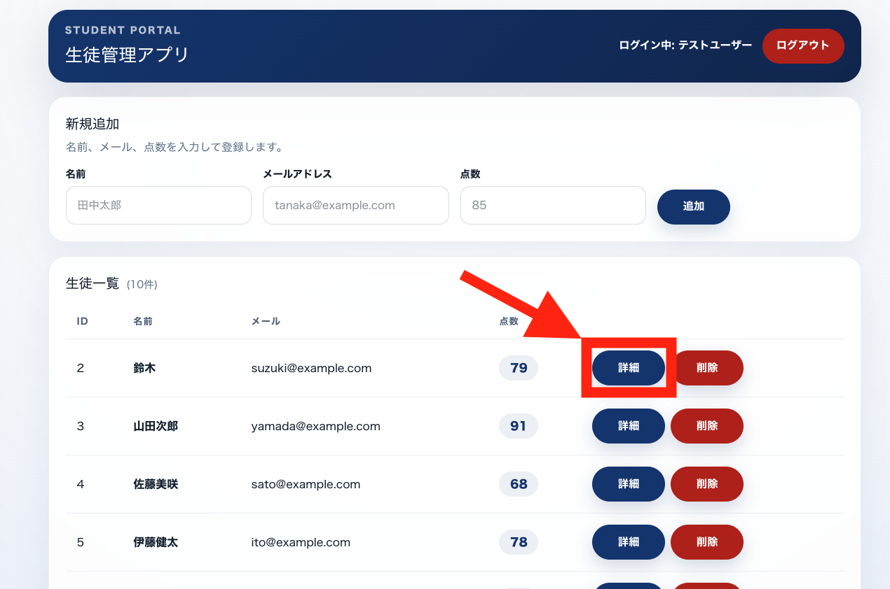
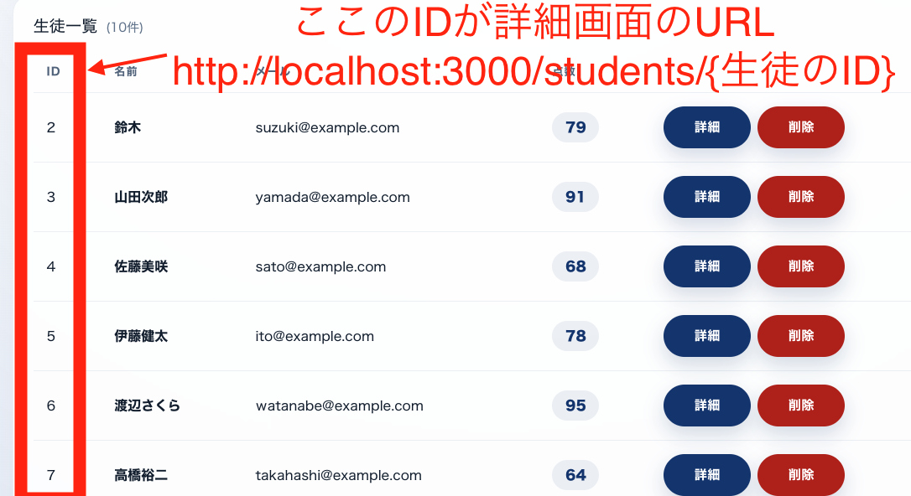
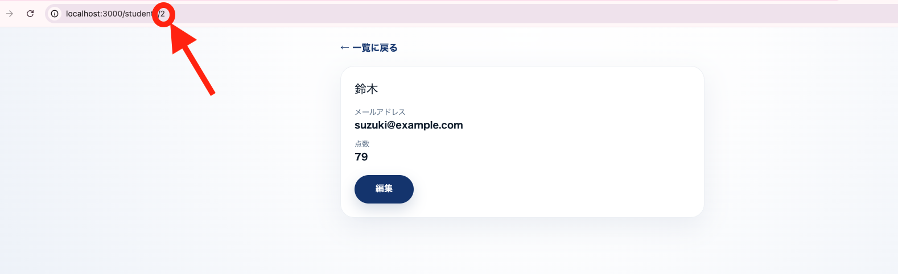
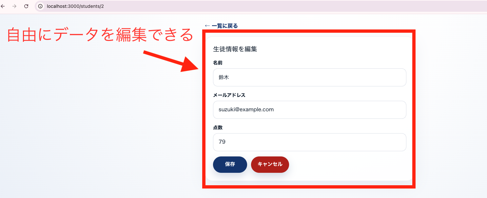
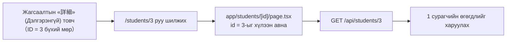

# 24-р цаг｜Дэлгэрэнгүй дэлгэц хийх

> 🇯🇵 Эх хувь (япон хэлээр): [2026_07_16_課題.md](<../../../2年生_システム開発実践/前期/2026_07_16/2026_07_16_課題.md>) <!-- original-ja-link -->

---

# Энэ хүртэл хийж чадсан бол дараа нь дэлгэрэнгүй дэлгэц хийцгээе

Одоогийн байдлаар жагсаалтын дэлгэц дээр нэр, имэйл, оноог шууд харах боломжтой ч сурагч бүрийн мэдээллийг тайван шалгах, эсвэл тэндээс засварлах дэлгэц байхгүй. Жагсаалтын «詳細» (Дэлгэрэнгүй) товчийг дарахад зөвхөн тэр сурагчийн мэдээллийг харуулах дэлгэц хийнэ.

## Юу хийх вэ

Жагсаалтын дэлгэцийн мөр бүрт байгаа «詳細» (Дэлгэрэнгүй) товчийг дарахад зөвхөн тэр сурагчийн мэдээлэл харагдах дэлгэц рүү шилждэг болгоно.

Гол санаа нь **жагсаалтын аль мөрийн «詳細» (Дэлгэрэнгүй)-г дарснаас хамаарч шилжих URL өөрчлөгддөг** явдал юм. Сурагчийн ID нь шууд URL-ийн нэг хэсэг болно.

Товчийг дарахад доорх зураг шиг зөвхөн тэр сурагчийн нэр, имэйл хаяг, оноо харагдах дэлгэц рүү шилжиж чадвал болно.

Мөн дэлгэрэнгүй дэлгэцээс «編集» (Засах) товчийг дарахад тэр дор нь форм руу шилжиж агуулгыг өөрчилж болдог болгоно (21-р цагт хийсэн өгөгдөл шинэчлэх үйлдэлтэй ижил зарчимтай).

## Дэлгэрэнгүй дэлгэц гэж юу вэ?

Дэлгэрэнгүй дэлгэц нь CRUD-ийн **Read (зөвхөн 1 бичлэг харах)**-тэй тохирно. Жагсаалтын дэлгэц «бүх хүний мэдээллийг нэг дор харах» дэлгэц байсан бол дэлгэрэнгүй дэлгэц нь «ID-гаар заасан зөвхөн 1 хүний мэдээллийг харах» дэлгэц юм.

- Жагсаалтын дэлгэц: `GET /api/students` → бүх хүний өгөгдөл буцаж ирнэ
- Дэлгэрэнгүй дэлгэц: `GET /api/students/{id}` → заасан ID-тай зөвхөн 1 сурагчийн өгөгдөл буцаж ирнэ

Жишээлбэл ID нь 3 байгаа сурагчийн «詳細» (Дэлгэрэнгүй)-г дарахад URL дахь ID хэрхэн дамжигдахыг диаграмаар харуулбал дараах байдалтай.

Мөн дэлгэрэнгүй дэлгэцээс засаад хадгалах хэсэг нь CRUD-ийн **Update (шинэчлэх)**-тэй тохирно. Харуулах (Read) ба шинэчлэх (Update) нь нэг дэлгэц дотор солигддог бүтэцтэй болно.

## Дэлгэцэд шаардлагатай элементүүд

- Сурагчийн **нэрийг** харуулах
- Сурагчийн **имэйл хаягийг** харуулах
- Сурагчийн **оноог** харуулах
- «**編集**» (Засах) товч (дарахад форм руу шилжинэ)
- Засварлах формд нэр, имэйл хаяг, оноо оруулах талбарууд болон «**保存**» (Хадгалах), «**キャンセル**» (Цуцлах) товчнууд
- «**一覧に戻る**» (Жагсаалт руу буцах) холбоос

## Хэрэгжүүлэх зөвлөгөө (өмнө сурсан зүйлстэй холбоотой)

- Жагсаалтын дэлгэцийн «詳細» (Дэлгэрэнгүй) товчийг сурагч бүрт `/students/{сурагчийн ID}` гэсэн холбоос болгоно (`` <Link href={`/students/${student.id}`}> `` шиг ID-г оруулсан URL үүсгэнэ)
- Next.js-д URL-ийн нэг хэсгийг (ID) хүлээн авч чаддаг **динамик routing**-ийг ашиглана. `app/students/[id]/page.tsx` шиг хавтас, файлын бүтэц үүсгэвэл URL-ийн `{id}` хэсгийн утгыг хуудас дотроо хүлээн авч чадна
- Хуудас харагдсаны дараа хүлээн авсан ID-гаа ашиглан `` fetch(`http://localhost:8000/api/students/${id}`) `` шиг Laravel API руу хүсэлт илгээж, зөвхөн тэр 1 сурагчийн өгөгдлийг авна
- Laravel талд `routes/api.php`-ийн `Route::apiResource('students', StudentController::class)`-ээр үнэндээ `show($id)` (1 бичлэг авах) болон `update($id)` (шинэчлэх)-ийн route-ууд аль хэдийн үүссэн байна. `StudentController`-т энэ 2 метод хэрэгжсэн эсэхийг шалгаарай
- «編集» (Засах) товчийг дарахад харагдах байдлыг солихыг хүсэж байгаа тул `useState`-ээр «одоо харуулах горимд байна уу, засварлах горимд байна уу» гэдгийг хадгалбал 17〜21-р цагт хийсэн формын санааг шууд ашиглаж болно
- Хадгалах товчийг дарахад `fetch`-ээр `PUT` (эсвэл `PATCH`) ашиглан `http://localhost:8000/api/students/{id}` руу илгээнэ. Токеныг `Authorization: Bearer ${token}`-ээр хавсаргахаа бүү мартаарай
