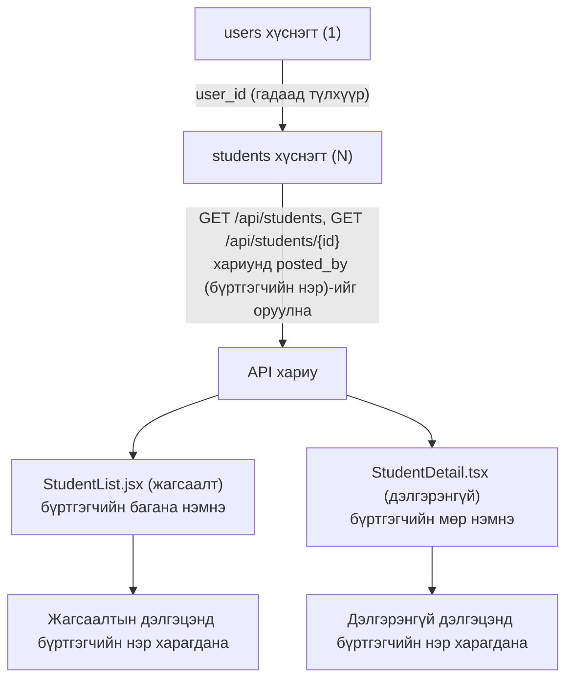
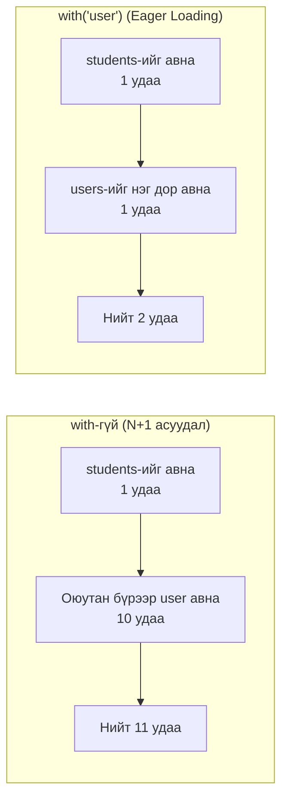

# 25-р цаг｜Users ⇔ Students-ийг холбож, бүртгэгчийг харуулах - Хэрэгжүүлэх алхмууд

> 🇯🇵 Эх хувь (япон хэлээр): [2026_07_23_実装 .md](<../../../2年生_システム開発実践/前期/2026_07_23/2026_07_23_実装 .md>) <!-- original-ja-link -->

## Өнөөдрийн зорилго

- `students` хүснэгтэд "энэ өгөгдлийг хэн бүртгэсэн бэ" гэдгийг илэрхийлэх `user_id`-г нэмэх
- `User` болон `Student`-ийг Eloquent-ийн холбоогоор (relation) холбох (нэг хэрэглэгч олон оюутантай байна)
- Оюутны жагсаалт болон дэлгэрэнгүй API-ийн хариунд "бүртгэгчийн нэр (`posted_by`)"-ийг оруулах
- Шинэ оюутан бүртгэхдээ нэвтэрсэн хэрэглэгчтэй автоматаар холбож хадгалах
- Жагсаалтын дэлгэц болон дэлгэрэнгүй дэлгэцийн аль алинд нь "бүртгэгч"-ийг харуулах

> **Энэ хичээлийн байр суурь:** Өнөөг хүртэл `students` хүснэгтэд "хэн бүртгэсэн бэ" гэсэн мэдээлэл байгаагүй. `users` хүснэгттэй гадаад түлхүүрийн холбоо нэмж, тэр мэдээллийг API-гаар дамжуулан frontend хүртэл хүргэж, дэлгэцэнд харуулах гэсэн бүхэл урсгалыг бүтээнэ.

---

## Ерөнхий зураглал: юу бүтээх вэ



> 💡 **Жишээгээр тайлбарлавал… номын сангийн ном олголтын карт**
>
> `students` хүснэгтийн бичлэг бүрийг "ном" гэж үзвэл, `user_id` нь "энэ номыг хэн зээлсэн (бүртгэсэн) бэ" гэж бичсэн ном олголтын карт юм. Карт байхгүй бол номыг хараад "хэн хариуцаж байгаа" нь мэдэгдэхгүй. Эхлээд номонд (`students`) карт хавчуулах газар (`user_id` багана) гаргаж, дараа нь "нэг уншигч олон ном зээлж болно" гэсэн харилцааг кодоор (Eloquent) илэрхийлж, эцэст нь тэр мэдээллийг дэлгэцэнд гаргана.

Eloquent-д дараах байдлаар харгалзана.

| Класс | Метод | Утга |
|---|---|---|
| `User` | `students()` | Нэг хэрэглэгч олон оюутантай (`hasMany`) |
| `Student` | `user()` | Нэг оюутан нэг хэрэглэгчид харьяалагдана (`belongsTo`) |

### Яагаад энэ дарааллаар бүтээх вэ

Backend дээр `user_id` болон холбоог бэлдэж, API `posted_by`-г буцаадаг болохгүй бол frontend харуулах өгөгдөл өөрөө байхгүй. Тиймээс **backend (migration → model → Controller/Seeder) → frontend (жагсаалт → дэлгэрэнгүй)** гэсэн дарааллаар, жижиг хэсгээр бүтээж, тухай бүрт нь ажиллуулж шалгасаар явна.

### Файлын бүтэц (энэ удаа өөрчлөх файлууд)

| Тэмдэг | Утга |
|---|---|
| 🆕 Шинэ | Файлыг шинээр үүсгэнэ |
| ➕ Нэмэх | Одоо байгаа файлд код нэмж бичнэ |
| 🔁 Солих | Одоо байгаа боловсруулалтыг дахин бичнэ |
| 👀 Шалгах | Өөрчлөх шаардлагагүй. Аль хэдийн хийгдсэн эсэхийг шалгахад л болно |

```
Laravel/
├── database/migrations/xxxx_add_user_id_to_students_table.php  🆕 Шинэ (user_id багана нэмнэ)
├── app/Models/User.php                                     ➕ students() холбоо нэмнэ
├── app/Models/Student.php                                  ➕ user() холбоо нэмнэ
├── app/Http/Controllers/Api/StudentController.php          🔁 index(), store()-г засна
├── app/Http/Resources/StudentResource.php                  ➕ posted_by нэмнэ
└── database/seeders/StudentSeeder.php                       🔁 Оюутныг хэрэглэгчээр дамжуулан үүсгэнэ

school-frontend/
├── components/students/StudentList.tsx     ➕ Бүртгэгчийн багана нэмнэ (толгой хэсэг, нүд)
└── components/students/StudentDetail.tsx   ➕ Бүртгэгчийн мөр нэмнэ
```

---

## Step 1｜Backend: migration-аар `user_id` нэмэх

**🆕 Шинэ файл** — Одоо байгаа `create_students_table` migration-ийг шууд засахгүй. Нэгэнт ажиллуулсан migration-ийг дахин бичих нь осол гаргах шалтгаан болдог тул `user_id` багана нэмэх тусгай migration-ийг шинээр үүсгэнэ.

```bash
cd Laravel
php artisan make:migration add_user_id_to_students_table --table=students
```

`Laravel/database/migrations/` дотор дараах маягийн нэртэй файл үүснэ (эхэнд нь үүсгэсэн огноо, цаг байна).

```
2026_07_16_000001_add_user_id_to_students_table.php
```

Үүссэн файлын агуулгыг дараах байдлаар бичнэ.

```php
<?php
// ▼ database/migrations/2026_07_16_000001_add_user_id_to_students_table.php

use Illuminate\Database\Migrations\Migration;
use Illuminate\Database\Schema\Blueprint;
use Illuminate\Support\Facades\Schema;

return new class extends Migration
{
    public function up(): void
    {
        // Одоо байгаа students хүснэгтэд user_id багана нэмнэ
        Schema::table('students', function (Blueprint $table) {
            $table->foreignId('user_id') // users.id-г заах гадаад түлхүүрийн багана үүсгэнэ
                ->after('id')             // id баганын яг ард байрлуулна (харахад ойлгомжтой байлгах үүднээс)
                ->constrained()           // Лавлах баганыг (users хүснэгтийн id) автоматаар тодорхойлж, гадаад түлхүүрийн хязгаарлалт тавина
                ->cascadeOnDelete();      // Хэрэглэгч устгагдвал тэр хэрэглэгчийн оюутны өгөгдлийг мөн хамт устгана
        });
    }

    public function down(): void
    {
        // migrate:rollback хийхэд нэмсэн гадаад түлхүүр болон баганыг буцаана
        Schema::table('students', function (Blueprint $table) {
            $table->dropForeign(['user_id']); // Эхлээд гадаад түлхүүрийн хязгаарлалтыг авна
            $table->dropColumn('user_id');    // Баганыг өөрийг нь устгана
        });
    }
};
```

- `Schema::table('students', ...)` … Одоо байгаа хүснэгтэд "багана нэмэх" өөрчлөлт учраас `create` биш `table`-г ашиглана
- `foreignId('user_id')` … `users.id`-г заах гадаад түлхүүрийн багана үүсгэнэ
- `->after('id')` … `user_id` баганыг `id`-ийн яг ард байрлуулна (харахад ойлгомжтой байлгах үүднээс)
- `->constrained()` … Лавлах баганыг (`users` хүснэгтийн `id`) автоматаар тодорхойлж, гадаад түлхүүрийн хязгаарлалт тавина
- `->cascadeOnDelete()` … Хэрэглэгч устгагдвал тэр хэрэглэгчийн оюутны өгөгдлийг мөн хамт устгана
- `down()` … `migrate:rollback` хийхэд нэмсэн гадаад түлхүүр болон баганыг буцааж болохоор бэлдэж өгнө

> ⚠️ `user_id`-г дундаас нь нэмэх үед одоо байгаа өгөгдөлд холбогдох хэрэглэгч байхгүй. Хөгжүүлэлтийн шатанд байгаа бол `php artisan migrate:fresh --seed`-ээр хүснэгтүүдийг дахин үүсгэж, seeder-ээр эхнээсээ хэрэглэгчтэй холбогдсон өгөгдлийг дахин оруулах нь хамгийн хялбар (production-тэй адил өгөгдлийг хадгалж үлдээх бол эхлээд `nullable()`-тайгаар нэмээд backfill хийж, дараагийн migration-аар `NOT NULL` хязгаарлалт тавих гэсэн 2 үе шаттай арга хэрэгтэй).

---

## Step 2｜Backend: model-д холбоо тодорхойлох

### 2-1. `app/Models/User.php`

**➕ Нэмэх** — `HasMany`-ийн `use` мөр болон `students()` методыг нэмнэ.

```php
use Illuminate\Database\Eloquent\Relations\HasMany; // ← Холбооны төрлийг (HasMany) ашиглах боломжтой болгоно

// ...

// Нэг хэрэглэгч олон оюутантай гэсэн харилцааг (нэгээс олон) илэрхийлэх метод
// Үүнийг тодорхойлбол $user->students-ээр "энэ хэрэглэгчийн бүртгэсэн оюутны жагсаалт"-ыг авч болно
public function students(): HasMany
{
    // hasMany(Student::class) … "Student model-ийг олноор агуулдаг" гэсэн утгатай
    return $this->hasMany(Student::class);
}
```

### 2-2. `app/Models/Student.php`

**➕ Нэмэх** — `BelongsTo`-ийн `use` мөр болон `user()` методыг нэмнэ.

```php
use Illuminate\Database\Eloquent\Relations\BelongsTo; // ← Холбооны төрлийг (BelongsTo) ашиглах боломжтой болгоно

// ...

// Нэг оюутан нэг хэрэглэгчид харьяалагдана гэсэн харилцааг (олноос нэг) илэрхийлэх метод
// Үүнийг тодорхойлбол $student->user-ээр "энэ оюутныг бүртгэсэн хэрэглэгч"-ийг авч болно
public function user(): BelongsTo
{
    // belongsTo(User::class) … "User model-д харьяалагддаг" гэсэн утгатай
    // ※ Энэ хүснэгтийн user_id баганыг харж, харгалзах users бичлэгийг хайж олно
    return $this->belongsTo(User::class);
}
```

Ингэснээр `$user->students` (олон оюутныг авах) болон `$student->user` (тэр оюутны бүртгэгчийг авах) гэсэн хоёр чиглэлээс хандах боломжтой болно.

---

## Step 3｜Backend: Controller-оос бүртгэгчийн нэрийг буцаах

### 3-1. `index()`-г засах

**🔁 Солих** — `Student::all()` шиг энгийнээр авахын оронд `with('user')`-ээр холбогдох өгөгдлийг хамт ачаалж (Eager Loading), `StudentResource`-ээр дамжуулан хариу болгон хувиргана. `show()` аль хэдийн `StudentResource`-г ашиглаж байгаа тул `index()`-г ч мөн адил хэлбэрт оруулбал бүртгэгчийг гаргах аргыг нэг газарт (`StudentResource`) төвлөрүүлж чадна.

```php
public function index()
{
    // Оюутны өгөгдлийг авахдаа бүртгэгчийн (user) мэдээллийг мөн хамт ачаалж авна
    // → Ингэхгүй бол оюутны тоогоор "бүртгэгчийн нэрийг авах" SQL ажиллана (N+1 асуудал)
    $students = Student::with('user')->get();

    // Авсан оюутны өгөгдлийг хариуны хэлбэрт (StudentResource) хувиргаж буцаана
    return StudentResource::collection($students);
}
```

> 💡 **N+1 асуудал гэж юу вэ?**
>
> `with('user')`-г хэрэглэхгүйгээр `Student::all()` эсвэл `Student::get()` гэж бичвэл дараах SQL-ууд ажиллана.
>
> 1. `students` хүснэгтээс бүх оюутныг авах SQL (1 удаа)
> 2. Дэлгэц эсвэл хариунд **оюутан бүрээр** `$student->user->name`-д хандах болгонд "энэ оюутны бүртгэгчийг (user) 1 ширхэг авах" SQL (оюутны тоогоор = N удаа)
>
> Өөрөөр хэлбэл 10 оюутан байвал "оюутны жагсаалт авах 1 удаа" + "бүртгэгч авах 10 удаа" = **нийт 11 удаа** SQL ажиллана. Оюутны тоо 100, 1000 болж өсөх тусам SQL-ийн тоо ч мөн адил пропорциональ өсөж, API улам удаан болно. Энэ бол **N+1 асуудал** (нэг удаагийн асуулгаар авч болох өгөгдлийг авахын тулд N бичлэгт зориулан нийт N нэмэлт асуулга ажиллуулах асуудал) юм.
>
> Эхэнд нь `with('user')`-г нэмбэл Laravel
>
> 1. `students` хүснэгтийг авах SQL (1 удаа)
> 2. Тэнд гарсан `user_id`-уудыг нэгтгээд харгалзах `users`-ийг нэг дор авах SQL (1 удаа)
>
> гэсэн **нийт 2 удаа**-д багтааж өгнө (үүнийг **Eager Loading** = урьдчилан нэг дор ачаалах гэж нэрлэдэг). Оюутны тоо хэд болж өссөн ч SQL ажиллах тоо үргэлж 2 хэвээр байна. "Дараа нь нэг нэгээр нь авах (N+1)" биш "эхэнд нь нэг дор авч бэлдэх (Eager Loading)" нь гол санаа юм.
>
> 10 оюутантай үеийн SQL-ийн тоог харьцуулбал дараах байдалтай байна.



> ⚠️ Буцаах утгын төрлийг `: JsonResponse` гэж бичмээр санагдаж магадгүй, гэхдээ тэгвэл `use Illuminate\Http\JsonResponse;` import хэрэгтэй болно. Бусад `store()`/`show()`/`update()`/`destroy()` ч төрөл бичээгүй тул тэдэнтэй нийцүүлж төрөлгүй хэвээр үлдээнэ.

### 3-2. `app/Http/Resources/StudentResource.php`-д `posted_by` нэмэх

**➕ Нэмэх** — Зөвхөн `index()`-г засаад хариунд `posted_by` гарахгүй. Бодитоор JSON руу хувиргаж байгаа нь `StudentResource` учраас энд нэмнэ. `show()` (дэлгэрэнгүй API) ч мөн адил `StudentResource`-ээр дамждаг тул нэг засвараар жагсаалт, дэлгэрэнгүй хоёуланд нь тусна.

```php
public function toArray($request): array
{
    // Энэ оюутны өгөгдлийг бүртгэсэн бүртгэгчийн (хэрэглэгчийн) нэрийг урьдчилан хувьсагчид авч хадгална
    $postedByName = $this->user->name;

    return [
        'id'         => $this->id,
        'name'       => $this->name,
        'email'      => $this->email,
        'score'      => $this->score,
        'evaluation' => $this->score >= 80 ? 'A' : 'B',
        'created_at' => $this->created_at->format('Y/m/d'),
        'posted_by'  => $postedByName, // ★ Нэмсэн: бүртгэгчийн нэр
    ];
}
```

### 3-3. `store()`-г засах

**🔁 Солих** — `Student::create()`-ийн оронд нэвтэрсэн хэрэглэгчээр дамжуулан үүсгэснээр `user_id` автоматаар тохируулагдана. Validation нь одоо байгаагаараа `$request->validate(...)`-г ашиглаж, үр дүнг нь (`$validated`) шууд оюутан үүсгэхэд дамжуулна.

```php
public function store(Request $request)
{
    // Validation: илгээсэн өгөгдлийн хэлбэрийг шалгана
    $validated = $request->validate([
        'name'  => 'required|max:100',          // Заавал, 100 тэмдэгтээс ихгүй
        'email' => 'required|email|unique:students', // Заавал, имэйлийн хэлбэр, давхардахгүй
        'score' => 'required|integer|min:0|max:100', // Заавал, бүхэл тоо, 0–100
    ]);

    // $request->user() … Одоо нэвтэрсэн байгаа хэрэглэгч (Sanctum баталгаажуулж өгсөн)
    // ->students()->create(...) … Тэр хэрэглэгчийн оюутан болгон шинээр үүсгэнэ
    //   → Eloquent автоматаар user_id-д нэвтэрсэн хэрэглэгчийн ID-г оруулж өгнө
    $student = $request->user()->students()->create($validated);

    // 201 Created (амжилттай үүсгэсэн) статус кодоор буцаана
    return response()->json([
        'status' => 'ok',
        'data'   => $student,
    ], 201);
}
```

`$request->user()` бол Sanctum-аар баталгаажсан хэрэглэгч (= одоо нэвтэрсэн байгаа багш) юм. `->students()->create(...)` гэж бичснээр Eloquent автоматаар `user_id`-д тэр хэрэглэгчийн ID-г бөглөж өгнө. `Student::create($request->all())` шиг "бүх параметр"-ийг дамжуулахгүй, зөвхөн validation-д тэнцсэн `$validated`-ийг дамжуулж байгааг бас анхаараарай.

---

## Step 4｜Backend: seeder-ийг ч мөн хэрэглэгчээр дамжуулдаг болгох

Энэ төсөлд `StudentSeeder.php` гэсэн файл байхгүй, харин `database/seeders/DatabaseSeeder.php` дотор шууд `Student::factory(10)->create()` гэж оюутны өгөгдөл үүсгэж байна.

```php
// database/seeders/DatabaseSeeder.php (одоогийн агуулга)
public function run(): void
{
    \App\Models\Student::factory(10)->create(); // 10 оюутны өгөгдөл үүсгэнэ
}
```

Ийм хэвээр бол оюутны өгөгдөлд `user_id` орохгүй (угаасаа холбох хэрэглэгч ч байхгүй) тул **① эхлээд тест хэрэглэгч үүсгэх → ② тэр хэрэглэгчээр дамжуулан оюутан үүсгэх** гэсэн 2 үе шаттай болгож дахин бичнэ. Шинэ файл үүсгэх шаардлагагүй, `DatabaseSeeder.php`-г шууд засахад л болно.

**🔁 Солих**

```php
// database/seeders/DatabaseSeeder.php (зассаны дараа)
public function run(): void
{
    // ① Нэвтрэхэд зориулж нэг тест хэрэглэгч үүсгэнэ
    // User::factory() … UserFactory-д тодорхойлсон туршилтын (dummy) өгөгдлөөр үүсгэнэ
    //   password нь UserFactory талд аль хэдийн "password"-ийг hash хийсэн утга болсон байгаа тул
    //   энд зөвхөн name болон email-ийг дарж бичвэл test@example.com / password-оор нэвтэрч болно
    $user = \App\Models\User::factory()->create([
        'name'  => 'テストユーザー',
        'email' => 'test@example.com',
    ]);

    // ② Оюутны өгөгдөл үүсгэхдээ ->for($user)-ийг дундуур нь оруулбал
    //   Student::user() холбоогоор (belongsTo) дамжин user_id-д автоматаар $user->id орно
    \App\Models\Student::factory(10)->for($user)->create();
}
```

`Student::factory(10)->for($user)`-ийн `for()` нь "энэ model-той ($user) холбож үүсгэнэ" гэсэн утгатай Factory-ийн боломж юм. `Student` model-д `user()` (`belongsTo(User::class)`) аль хэдийн тодорхойлогдсон тул Laravel автоматаар `user_id`-г `$user->id` болгож тохируулна. `$user->students()->create(...)`-г нэг нэгээр нь дуудсантай ижил үр дүнг Factory-ээр нэг дор гаргаж байна гэж ойлгоорой.

### Ажиллагааг шалгах (backend)

```bash
cd Laravel
php artisan migrate:fresh --seed
php artisan serve
```

Нэвтэрч токен авсныхаа дараа жагсаалтын API-г дуудаж, `posted_by` орсон эсэхийг шалгана.

```bash
curl http://localhost:8000/api/students \
  -H "Authorization: Bearer <авсан токен>" \
  -H "Accept: application/json"
```

| Шалгах зүйл | Үйлдэл | Хүлээгдэж буй үр дүн |
|---|---|---|
| Холбоо | Жагсаалтын API-г ажиллуулна | Оюутан бүрийн JSON-д `posted_by` (бүртгэсэн хэрэглэгчийн нэр) орсон байна |
| Шинээр бүртгэх | `POST /api/students`-ээр оюутан нэмнэ | DB-ийн `students.user_id`-д нэвтэрсэн хэрэглэгчийн ID орсон байна |
| Каскад устгал | Тухайн хэрэглэгчийг DB-ээс устгана (хөгжүүлэлтийн DB дээр шалгана) | Тэр хэрэглэгчийн бүртгэсэн оюутны өгөгдөл ч мөн хамт устгагдана |
| N+1-ээс сэргийлэх | `index()`-д асуулгын лог оруулж шалгана | `students`-ийг авахад 1, `users`-ийг авахад 1 орчим асуулга илгээгдэнэ (оюутан бүрд тусдаа асуулга илгээхгүй) |

---

## Step 5｜Frontend: жагсаалтын дэлгэцэнд бүртгэгчийн багана нэмэх

`school-frontend/components/StudentList.jsx`-г засна. Энэ төсөл TypeScript-ийн төрөл ашиглахгүй энгийн JSX (`.jsx`)-ээр бичигдсэн тул `type Student` шиг төрлийн тодорхойлолт хаана ч байхгүй. Backend `posted_by`-г буцааж байгаа л бол frontend талд `student.posted_by` гэж шууд бичээд утгыг авч болно. Төрлийг шалгах, засах алхам шаардлагагүй.

**➕ Нэмэх (хүснэгтийн толгой хэсэг)** — `点数` (оноо) баганын ард "投稿者" (бүртгэгч) толгойг нэмнэ.

```jsx
<thead>
  <tr style={{ background: "#f5f5f5" }}>
    <th style={thStyle}>ID</th>
    <th style={thStyle}>名前</th>
    <th style={thStyle}>メール</th>
    <th style={thStyle}>点数</th>
    <th style={thStyle}>投稿者</th> {/* ★ Нэмсэн: энэ оюутныг бүртгэсэн хэрэглэгчийн нэрийн багана */}
    <th style={thStyle}></th>
  </tr>
</thead>
```

**➕ Нэмэх (`StudentRow` дотор)** — Онооны нүдний ард бүртгэгчийн нэрийг харуулах нүд нэмнэ.

```jsx
<td style={tdStyle}>{student.score}</td>
{/* ★ Нэмсэн: толгой хэсэгт бэлдсэн "投稿者" баганад харгалзах нүд. Дотор нь зөвхөн бүртгэгчийн нэрийн текст байхад болно */}
<td style={tdStyle}>{student.posted_by}</td>
<td style={tdStyle}>
  <div style={{ display: "flex", gap: "0.5rem", flexWrap: "wrap" }}>
    {/* Дэлгэрэнгүй, устгах товч (одоо байгаагаараа) */}
  </div>
</td>
```

Толгой хэсэг болон нүдний баганын тоо зөрөхгүйн тулд хоёуланг нь хамт нэмэх нь гол анхаарах зүйл юм.

---

## Step 6｜Frontend: дэлгэрэнгүй дэлгэцэнд бүртгэгчийн мөр нэмэх

`school-frontend/components/students/StudentDetail.tsx`-г засна. Энэ файл `.tsx` өргөтгөлтэй боловч `props`-д төрлийн тайлбар (type annotation) байхгүй (`export default function StudentDetail({ student, token, onUpdated })` гэж бичигдсэн) тул төрлийг шалгах, засах алхам шаардлагагүй. Backend `posted_by`-г буцааж байвал `student.posted_by`-ээр шууд хандаж болно.

**➕ Нэмэх (харуулах горимын `<dl>` дотор)** — "点数" (оноо) мөрийн ард "投稿者" (бүртгэгч) мөрийг нэмнэ. Одоо байгаа `<dt>`/`<dd>`-тэй ижил загварт (style) нийцүүлнэ.

```tsx
<dl style={{ display: "grid", gap: "16px", margin: 0 }}>
  <div>
    <dt style={{ fontSize: "0.9em", color: "#666", marginBottom: "4px" }}>メールアドレス</dt>
    <dd style={{ margin: 0, fontWeight: "bold", fontSize: "1.1em" }}>{student.email}</dd>
  </div>
  <div>
    <dt style={{ fontSize: "0.9em", color: "#666", marginBottom: "4px" }}>点数</dt>
    <dd style={{ margin: 0, fontWeight: "bold", fontSize: "1.1em" }}>{student.score} 点</dd>
  </div>
  <div>
    {/* ★ Нэмсэн: энэ оюутны өгөгдлийг хэн бүртгэснийг харуулах мөр (зөвхөн харуулах зориулалттай, засварлах формд нэмэхгүй) */}
    <dt style={{ fontSize: "0.9em", color: "#666", marginBottom: "4px" }}>投稿者</dt>
    <dd style={{ margin: 0, fontWeight: "bold", fontSize: "1.1em" }}>{student.posted_by}</dd>
  </div>
</dl>
```

Засварлах горим (форм) талд нэр, имэйл, оноог л засах одоогийн байдлаар нь үлдээхэд асуудалгүй. "投稿者" (бүртгэгч) нь хэн бүртгэснийг харуулах зөвхөн үзүүлэх зориулалттай мэдээлэл учраас засварлах формд нэмэхгүй.

### Ажиллагааг шалгах (frontend)

```bash
cd school-frontend && npm run dev
```

Backend-ийг (`php artisan serve`) эхэлж ажиллуулаад, нэвтэрсэн төлөвт шалгана.

| Шалгах зүйл | Үйлдэл | Хүлээгдэж буй үр дүн |
|---|---|---|
| Жагсаалт харуулах | `/students`-г нээнэ | Мөр бүрийн "点数" (оноо)-ийн баруун талд "投稿者" (бүртгэгч) багана байж, бүртгэсэн хэрэглэгчийн нэр харагдана |
| Дэлгэрэнгүй харуулах | Аль нэг мөрийн "詳細" (дэлгэрэнгүй)-ийг нээнэ | Нэр, имэйл, онооноос гадна "投稿者" (бүртгэгч) харагдана |
| Төрлийн алдаагүй | `npx tsc --noEmit`-г ажиллуулна | Алдаа гарахгүй (`posted_by` одоо байгаа төрөлд багтсан тул) |
| Байршил эвдрэхгүй | Жагсаалтын толгой хэсэг болон нүдний баганын тоог харьцуулна | Толгойн тоо болон нүдний тоо таарч, хүснэгт зөрөөгүй байна |

---

## Дүгнэлт

| Ойлголт | Энэ удаа хэрэгжүүлсэн газар |
|---|---|
| Нэгээс олон холбоо | `students.user_id`, `User::students()`, `Student::user()` |
| Eager Loading (N+1-ээс сэргийлэх) | `StudentController@index`-ийн `Student::with('user')` |
| Нэвтэрсэн хэрэглэгчтэй автоматаар холбох | `StudentController@store`-ийн `$request->user()->students()->create(...)` |
| API хариунд бүртгэгчийн мэдээлэл нэмэх | `posted_by` талбар |
| Frontend-д харуулах | `StudentList.tsx`／`StudentDetail.tsx` |

## Дуусгалтын шалгах жагсаалт (Definition of Done)

- [ ] `students` хүснэгтэд `user_id` багана байгаа бөгөөд `users.id` руу заасан гадаад түлхүүрийн хязгаарлалт тавигдсан
- [ ] `User::students()` / `Student::user()` хоёр чиглэлийн холбоо тодорхойлогдсон
- [ ] `GET /api/students`-ийн хариунд `posted_by` (бүртгэгчийн нэр) орсон
- [ ] `POST /api/students`-ээр оюутан үүсгэхэд нэвтэрсэн хэрэглэгчтэй автоматаар холбогддог
- [ ] Seeder-ийг дахин ажиллуулсан ч `posted_by`-д тест хэрэглэгчийн нэр ордог
- [ ] `/students`-ийн жагсаалтын хүснэгтэд "投稿者" (бүртгэгч) багана байж, бүртгэсэн хэрэглэгчийн нэр харагддаг
- [ ] `/students/{id}`-ийн дэлгэрэнгүй дэлгэцэнд "投稿者" (бүртгэгч) мөр байж, бүртгэсэн хэрэглэгчийн нэр харагддаг
- [ ] Засварлах формд бүртгэгчийн талбар нэмээгүй (зөвхөн харуулах зориулалттай тул)
- [ ] `npx tsc --noEmit` алдаагүй давдаг

## Ажиллуулах командууд

```bash
# Backend
cd Laravel && php artisan serve   # http://localhost:8000

# Frontend
cd school-frontend && npm run dev # http://localhost:3000
```

Тест бүртгэл: `test@example.com` / `password`
