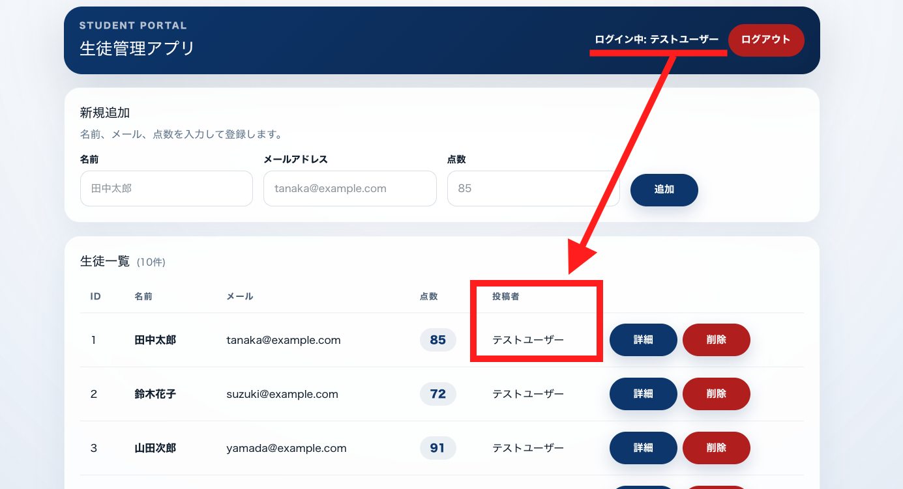
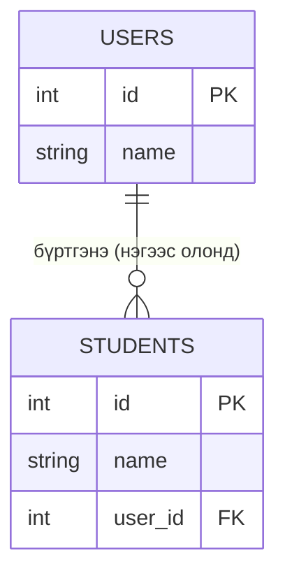

# 25-р цаг｜Users ⇔ Students-ийг холбох

> 🇯🇵 Эх хувь (япон хэлээр): [2026_07_23_課題.md](<../../../2年生_システム開発実践/前期/2026_07_23/2026_07_23_課題.md>) <!-- original-ja-link -->

---

# Энд хүртэл хийж чадсан хүмүүс дараа нь Users хүснэгт болон Students хүснэгтийг холбоорой

[Реляцын өгөгдлийн сангийн тухай](./リレーショナルデータベース入門.md)

Одоогийн байдлаар `students` хүснэгтэд тухайн оюутны өгөгдлийг хэн бүртгэсэн тухай мэдээлэл байхгүй. Хүн бүр ижил жагсаалтыг харж болох ч "энэ өгөгдлийг би (нэвтэрсэн хэрэглэгч) бүртгэсэн" гэдгийг мэдэх боломжгүй байна.

`users` хүснэгт болон `students` хүснэгтийг хооронд нь холбож (relation), жагсаалт болон дэлгэрэнгүй дэлгэцэд тухайн оюутныг бүртгэсэн хэрэглэгчийн нэрийг "бүртгэгч" гэж харуулна.

## Юу бүтээх вэ

Шинэ оюутан бүртгэхэд тухайн оюутны өгөгдөл одоо нэвтэрсэн хэрэглэгчтэй автоматаар холбогдоно. Мөн жагсаалтын дэлгэц болон дэлгэрэнгүй дэлгэцийн аль алинд нь тухайн оюутныг бүртгэсэн хэрэглэгчийн нэрийг (бүртгэгч) харуулна.

Гол санаа нь **нэвтэрсэн хэрэглэгчийн нэр (баруун дээд буланд) болон жагсаалтын "投稿者" (бүртгэгч) баганад харагдах нэр таарч байх** явдал юм. Энэ удаагийн тест хэрэглэгчийн хувьд аль ч оюутны мөрийг харсан "投稿者：テストユーザー" (бүртгэгч: тест хэрэглэгч) гэж харагдах ёстой (одоогийн seed өгөгдлийг бүгдийг нэг хэрэглэгч бүртгэсэн гэж тооцож байгаа тул).

## Холбоо (relation) гэж юу вэ?

`users` болон `students` нь одоогоор хоорондоо холбоогүй тусдаа хүснэгтүүд байна. Энэ удаа тэдгээрийг "нэг хэрэглэгч олон оюутан бүртгэж болно" гэсэн харьцаагаар холбоно.

- `users` хүснэгт: 1 бичлэг = 1 хэрэглэгч (багш)
- `students` хүснэгт: 1 бичлэг = 1 оюутан

Энэ хоёр хүснэгтийг холбохын тулд `students` хүснэгтэд аль хэрэглэгч бүртгэснийг заах багана (**гадаад түлхүүр**) нэмнэ. Ингэснээр

- Нэг хэрэглэгч олон оюутантай байж болно (**нэгээс олонд** харьцаа)
- Нэг оюутны өгөгдөл заавал нэг хэрэглэгчид харьяалагдана

гэсэн харилцааг өгөгдлийн сан дээр илэрхийлж чадна. Зургаар үзүүлбэл дараах байдалтай (`user_id` нь гадаад түлхүүр).

Laravel-д энэ гадаад түлхүүрт үндэслэн `User` model болон `Student` model-д холбоо тодорхойлсноор "энэ хэрэглэгчийн бүртгэсэн оюутнуудын жагсаалт" эсвэл "энэ оюутныг бүртгэсэн хэрэглэгч"-ийг хялбархан авах боломжтой болно.

## Дэлгэцэнд шаардлагатай элементүүд

- Оюутны жагсаалтын дэлгэцийн (`/students`) мөр бүрд **бүртгэгч**-ийг (бүртгэсэн хэрэглэгчийн нэр) харуулах багана
- Оюутны дэлгэрэнгүй дэлгэцэд (`/students/{id}`) мөн адил **бүртгэгч**-ийг харуулах хэсэг
- Шинэ оюутан бүртгэхэд тэр оюутны өгөгдөл "одоо нэвтэрсэн байгаа хэрэглэгч"-тэй автоматаар холбогдох (өөр хэрэглэгч бүртгэсэн мэт болохгүй байх)

## Хэрэгжүүлэх зөвлөмж (өмнө нь сурсан зүйлстэй холбоотой)

- Өгөгдлийн сангийн талд `students` хүснэгтэд `users` хүснэгтийг заах гадаад түлхүүрийн багана (жишээ нь: `user_id`) нэмнэ. Аль хэдийн ажиллаж байгаа хүснэгтийн migration-ийг шууд дахин бичихийн оронд багана нэмэх **шинэ migration** үүсгэх нь аюулгүй
- Гадаад түлхүүр нэмбэл "заасан хэрэглэгч устгагдвал яах вэ" гэдгийг ч мөн шийдэх шаардлагатай (устгалтай уялдуулан оюутны өгөгдлийг ч мөн устгах гэх мэт)
- Laravel-д `User` model-д "нэг хэрэглэгч олон оюутантай" гэсэн холбоог (`hasMany`), `Student` model-д "нэг оюутан нэг хэрэглэгчид харьяалагдана" гэсэн холбоог (`belongsTo`) тодорхойлно
- Оюутны жагсаалтыг буцаах API-д (`index()`) оюутны өгөгдөлтэй хамт түүнийг бүртгэсэн хэрэглэгчийн мэдээллийг авч, хариунд бүртгэгчийн нэрийг оруулна. Хэрэглэгчийн мэдээллийг бичлэг бүрээр тусад нь авбал SQL асуулгын тоо шаардлагагүйгээр өсөхийг анхаараарай (`with()` ашиглан урьдчилан ачаалах нь тустай)
- Шинэ оюутан бүртгэх API-д (`store()`) `$request->user()`-ээр (одоо нэвтэрсэн хэрэглэгч) дамжуулан өгөгдөл үүсгэснээр гадаад түлхүүрт тухайн хэрэглэгчийн ID автоматаар оноогдоно
- Frontend талд API хариуны төрөлд (`type Student`) бүртгэгчийн нэрийн талбар нэмж, жагсаалтын хүснэгт болон дэлгэрэнгүй дэлгэц тус бүрд харуулах JSX нэмнэ

## Хэрэгжүүлэх дараалал

**1. DB талд гадаад түлхүүр нэмэх**

`students` хүснэгтэд `user_id` багана нэмнэ. Одоо байгаа migration-ийг дахин бичихгүй, шинэ migration файл үүсгэж нэмэх нь аюулгүй (production дээр ажиллаж байгаа хүснэгтийн бүтцийг дараа нь өөрчлөх үеийн стандарт арга).

**↓**

**2. Устгах үеийн үйлдлийг шийдэх**

Гадаад түлхүүр тохируулахдаа түүнд заагдсан `users` хүснэгтийн хэрэглэгч устгагдвал яахыг мөн тохируулах шаардлагатай (`onDelete('cascade')`-ээр оюутны өгөгдлийг хамт устгах гэх мэт).

**↓**

**3. Model-д холбоо тодорхойлох**

- `User` model → `hasMany(Student::class)` (нэг хэрэглэгч олон оюутантай байж болно)
- `Student` model → `belongsTo(User::class)` (нэг оюутан нэг хэрэглэгчид харьяалагдана)

**↓**

**4. Жагсаалтын API-г засах (`index()`)**

Оюутны өгөгдлийг авахдаа бүртгэгчийн (хэрэглэгчийн) мэдээллийг хамт авна. Энд бичлэг бүрээр тусад нь query явуулбал N+1 асуудлын улмаас SQL асуулгын тоо шаардлагагүйгээр өсөх тул `with('user')` шиг Eager Loading ашиглана.

**↓**

**5. Бүртгэх API-г засах (`store()`)**

Шинэ оюутан үүсгэхдээ `$request->user()`-ээс авсан одоо нэвтэрсэн хэрэглэгчээр дамжуулан бичлэг үүсгэнэ. Ингэснээр `user_id`-д тухайн хэрэглэгчийн ID автоматаар оноогдож, хэн нэгэн бусдын ID-г дур мэдэн заах зэрэг зохисгүй үйлдлээс сэргийлнэ.

**↓**

**6. Frontend талыг засах**

`type Student` төрлийн тодорхойлолтод бүртгэгчийн нэрийн талбар нэмнэ → жагсаалтын хүснэгтийн мөр болон дэлгэрэнгүй дэлгэцийн JSX-д "投稿者：〇〇" (бүртгэгч: 〇〇)-г харуулах хэсгийг нэмнэ.
