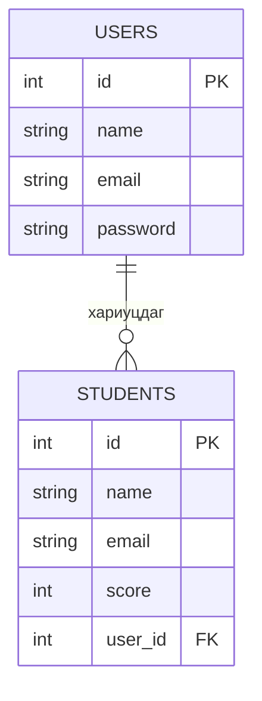

> 🇯🇵 Эх хувь (япон хэлээр): [リレーショナルデータベース入門.md](<../../../2年生_システム開発実践/前期/2026_07_23/リレーショナルデータベース入門.md>) <!-- original-ja-link -->

## Энэ нийтлэлээс юу мэдэх вэ

- Хүснэгт, мөр, багана
- Үндсэн түлхүүр
- Гадаад түлхүүр болон хүснэгтүүдийн хоорондын холбоо
- Хүснэгтүүдийг салгах шалтгаан

## Өгөгдлийн сан = цэгцтэй хүснэгтүүдийн цуглуулга

Цаасан дээр энд тэнд тэмдэглэхийн оронд өгөгдлийг хүснэгт хэлбэрээр цэгцэлж хадгалдаг системийг "өгөгдлийн сан" гэнэ. RDB (реляц өгөгдлийн сан) нь олон хүснэгтийг хооронд нь холбон (= хамаарал үүсгэн) ашиглаж болдгоороо онцлогтой.

## Хүснэгт, мөр, багана

Энэ аппликейшнд өөр өөр үүрэгтэй 2 хүснэгт бий. Хүснэгт тус бүрийн жишээн дээр тэдгээрийн хэсгүүдийг хэрхэн нэрлэдгийг харцгаая.

### 🎓 students хүснэгт (оюутны өгөгдөл)

| id | name | email | score |
|----|------|-------|-------|
| 1  | 田中太郎 | tanaka@example.com | 80 |
| 2  | 佐藤花子 | sato@example.com | 95 |

- **Хүснэгт**: энэ хүснэгт өөрөө (зориулалтаас нь хамааран олон хүснэгт үүсгэнэ)
- **Багана (column)**: `id` `name` `email` `score` гэх мэт хүснэгтийн босоо чиглэлийн талбарууд
- **Мөр (record)**: 1 бичлэгийн өгөгдөл (энд 1 оюутны мэдээлэл)

### 🔑 users хүснэгт (багш, админы нэвтрэх мэдээлэл)

| id | name | email | password |
|----|------|-------|----------|
| 1  | 小山先生 | koyama@example.com | $2y$10$abcdefGhIjKlmn...(ハッシュ化済み) |
| 2  | 田中先生 | tanaka-t@example.com | $2y$10$OpQrStUvWxYz...(ハッシュ化済み) |

- **Хүснэгт**: `users` (нэвтрэхэд зориулсан бүртгэлийн мэдээлэл. students-ээс өөр үүрэгтэй)
- **Багана (column)**: `id` `name` `email` `password`
- **Мөр (record)**: 1 бичлэгийн өгөгдөл (энд 1 багш эсвэл админы нэвтрэх мэдээлэл)

> 💡 `password`-ийг оруулсан тэр чигээр нь (энгийн текстээр) хадгалахгүй, харин хэшлэх хэмээх буцаах боломжгүй хувиргалт хийсний дараа хадгална. Ингэснээр өгөгдлийн сангийн агуулга алдагдсан ч анхны нууц үгийг мэдэх боломжгүй болгоно.

## Үндсэн түлхүүр: өгөгдлийг давтагдашгүйгээр ялгах ID

Зөвхөн `name`-ээр (нэрээр) хайвал ижил овог нэртэй хүмүүсийг ялгаж чадахгүй. Тиймээс бусад мөрийнхтэй хэзээ ч давхцахгүй дугаар буюу **үндсэн түлхүүр** ашиглана. Дээрх хүснэгтийн `id` нь үндсэн түлхүүр бөгөөд "id = 1 өгөгдлийг өгөөч" гэвэл 田中太郎-ийн ганц бичлэгийг шүүж авна. Үндсэн түлхүүрийг иргэний регистрийн дугаар эсвэл гишүүний дугаар шиг зүйл гэж төсөөлбөл ойлгоход амар.

## Гадаад түлхүүр: хүснэгтүүдийн хоорондын холбоо

Олон хүснэгтийг ID-аар холбож чаддаг нь RDB-ийн мөн чанар (= "relational" гэдэг нэрний гарал үүсэл) юм.

Энэ аппликейшнд нэвтрэхэд зориулсан `users` хүснэгт (багш, админы бүртгэл) болон оюутны өгөгдлийн `students` хүснэгт гэсэн 2 хүснэгт бий. Одоогоор энэ 2 хүснэгт ID-аар холбогдоогүй, бие даасан хүснэгтүүд юм.

Хэрэв "аль багш (user) аль оюутныг (student) бүртгэсэн, хариуцаж байгаа вэ" гэдгийг бүртгэх хэрэгтэй болбол `students` хүснэгтэд `user_id` гэсэн багана нэмж холбоно.

`USERS.id`-г (үндсэн түлхүүр) `STUDENTS.user_id` (гадаад түлхүүр) лавлахаар тохируулбал нэг багш (user) олон оюутныг (student) хариуцаж болох нэгээс олонд хамаарах холбоог илэрхийлж чадна.

## Яагаад хүснэгтүүдийг салгадаг вэ

Хүснэгтүүдийг салгалгүй нэг хүснэгтэд нэгтгэвэл нэг багшийн нэр, имэйл хаяг түүний хариуцдаг оюутан бүрийн мөрд давтагдана.

| student_id | student_name | staff_name | staff_email |
|-----------|-------|-------------|---------------|
| 101 | 田中花子 | 小山先生 | koyama@example.com |
| 103 | 田中次郎 | 小山先生 | koyama@example.com |

Ийм байвал 小山 багш имэйл хаягаа өөрчлөхөд холбогдох бүх мөрийг хайж засах шаардлагатай болж, зарим мөрийг засалгүй орхиход амархан. users болон students гэсэн хоёр хүснэгтэд салгаж, ID-аар холбовол 小山 багшийн мэдээлэл ганцхан газарт хадгалагдах бөгөөд зөвхөн тэнд нь засахад хангалттай. Энэ "давхардлаас зайлсхийж хүснэгтүүдийг салгах" зарчмыг **нормчлол (normalization)** гэж нэрлэдэг.

## Дүгнэлт

- Өгөгдлийн сан гэдэг нь өгөгдлийг цэгцэлж хадгалдаг систем
- RDB нь өгөгдлийг "хүснэгт" хэлбэрээр удирддаг бөгөөд хүснэгт нь "багана (зүйл)" болон "мөр (1 бичлэгийн өгөгдөл)"-ээс бүрддэг
- Үндсэн түлхүүр нь бичлэг бүрийг давхардалгүйгээр ялгах тэмдэг (ID)
- Гадаад түлхүүр нь өөр хүснэгтийн үндсэн түлхүүрийг зааж, хүснэгтүүдийг хооронд нь холбох арга
- Хүснэгтүүдийг салгаж холбосноор ижил мэдээллийн давхардлаас сэргийлж, өгөгдлийг цэгцлэхэд хялбар болгоно

Цаашид "SQL", "индекс", "транзакц" зэрэг ойлголт гарч ирнэ. Харин эхлээд энэ суурь ойлголтыг төсөөлж чадвал хангалттай.
