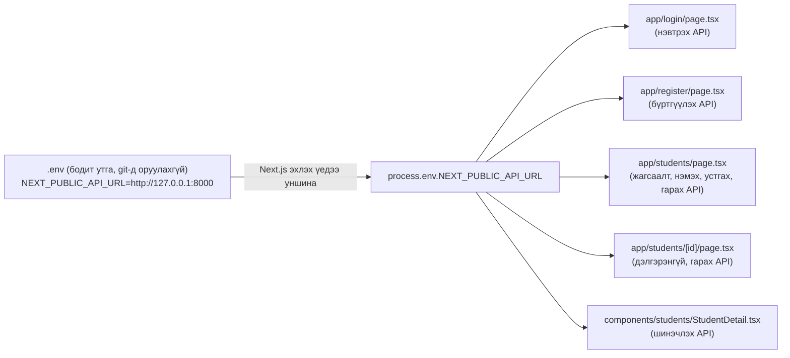
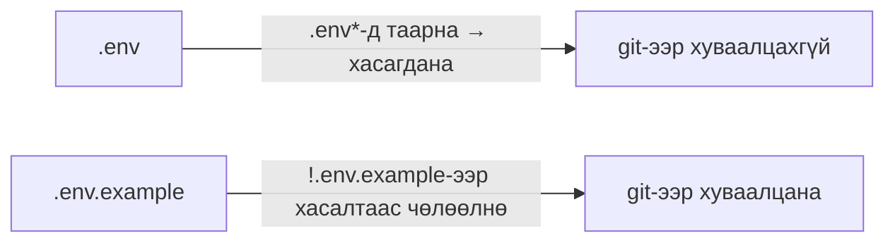

# 26-р цаг｜API-ийн URL-ийг орчны хувьсагч (.env) руу салгах - Хэрэгжүүлэх алхмууд

> 🇯🇵 Эх хувь (япон хэлээр): [2026_07_30_実装.md](<../../../2年生_システム開発実践/前期/2026_07_30/2026_07_30_実装.md>) <!-- original-ja-link -->

## Өнөөдрийн зорилго

- `school-frontend`-ийн хуудас бүрд шууд бичигдсэн `http://localhost:8000` / `http://127.0.0.1:8000`-г нэг газарт нэгтгэх
- `.env` файл үүсгэж, API-ийн URL-ийг `NEXT_PUBLIC_API_URL` орчны хувьсагч болгон удирдах
- `.env.example` (утга оруулаагүй загвар)-ийг git-ээр хуваалцаж, `.env` (бодит утга)-ийг git-ийн удирдлагаас хасах
- fetch ашиглаж байгаа бүх газрыг `process.env.NEXT_PUBLIC_API_URL`-ээр дамждаг болгож дахин бичих

> **Энэ хичээлийн байр суурь:** Өнөөг хүртэл `fetch("http://127.0.0.1:8000/api/students")` гэх мэтээр API-ийн URL-ийг файл бүрд шууд бичиж байсан. Ингэж бичвэл хөгжүүлэлтийн болон бодит ашиглалтын орчинд URL өөр байх үед олон файлд өөрчлөлт оруулах шаардлагатай болж, заримыг нь засахаа мартсанаас алдаа гарах шалтгаан болдог. Энэ удаа "өөрчлөгдөж болох утгыг (URL, API түлхүүр гэх мэт) кодод шууд бичихгүй, орчны хувьсагч болгон гадагш гаргах" гэсэн зарчмыг сурна.

---

## Ерөнхий зураглал: юу бүтээх вэ



> 💡 **Жишээгээр тайлбарлавал… хаягийг нэг газарт нэгтгэсэн холбоо барих мэдээллийн дэвтэр**
>
> Өнөөг хүртэл найздаа захидал илгээх болгондоо "Танакагийн гэр ◯◯ хороолол 3-1" гэж хаягийг нь өөрөө дахин дахин бичиж байсантай адил. Хэрэв Танака нүүвэл бичсэн бүх захидлаа дахин бичих хэрэгтэй болно. `.env` нь "холбоо барих мэдээллийн дэвтэр" шиг зүйл бөгөөд хаягийг (API-ийн URL) зөвхөн нэг газарт бичиж, захидал бүрээс (файл бүрийн fetch дуудлагаас) "дэвтэрт байгаа Танакагийн хаяг"-ийг ашигладаг болгоно. Нүүсэн ч (URL өөрчлөгдсөн ч) дэвтрийг нэг удаа засахад л хангалттай.

### Яагаад `.env` болон `.env.example`-ийг салгадаг вэ

Энэ аппликейшнд `.env`-д нууц утга байхгүй, гэхдээ ерөнхийдөө холбогдох DB-ийн нууц үг, API түлхүүр гэх мэт бусдад харуулахыг хүсэхгүй утгууд ордог. Тиймээс `.env`-ийг өөрийг нь `.gitignore`-оор хасаж, git-ээр хуваалцахгүй. Нөгөө талаар "ямар хувьсагчийн нэр хэрэгтэй вэ" гэдгийг багтайгаа хуваалцахыг хүсдэг тул утгыг нь хоосон (эсвэл туршилтын утга) болгосон `.env.example`-ийг л commit хийнэ. Төсөлд шинээр нэгдсэн хүн `.env.example`-ийг хуулж `.env` үүсгээд, өөрийн орчинд тааруулж утгыг оруулна.

### Файлын бүтэц (энэ удаа өөрчлөх файлууд)

| Тэмдэг | Утга |
|---|---|
| 🆕 Шинэ | Файлыг шинээр үүсгэнэ |
| ➕ Нэмэх | Одоо байгаа файлд код нэмж бичнэ |
| 🔁 Солих | Одоо байгаа үйлдлийг өөрчилж бичнэ |

```
school-frontend/
├── .env                                       🆕 Шинэ (бодит утга, git-д оруулахгүй)
├── .env.example                               🆕 Шинэ (загвар, git-д оруулна)
├── .gitignore                                 ➕ Зөвхөн .env.example-ийг хасалтаас чөлөөлнө
├── app/login/page.tsx                         🔁 fetch-ийн URL-ийг орчны хувьсагчаар солино
├── app/register/page.tsx                      🔁 fetch-ийн URL-ийг орчны хувьсагчаар солино
├── app/students/page.tsx                      🔁 fetch-ийн URL-ийг орчны хувьсагчаар солино (4 газар)
├── app/students/[id]/page.tsx                 🔁 fetch-ийн URL-ийг орчны хувьсагчаар солино (2 газар)
└── components/students/StudentDetail.tsx      🔁 fetch-ийн URL-ийг орчны хувьсагчаар солино
```

---

## Step 1｜`.env` үүсгэх

**🆕 Шинэ файл** — `school-frontend`-ийн шууд доор `.env`-ийг үүсгэнэ.

```bash
# ▼ school-frontend/.env
NEXT_PUBLIC_API_URL=http://127.0.0.1:8000
```

- Түлхүүрийн нэрийн эхэнд `NEXT_PUBLIC_` угтвар нэмэх нь чухал. Next.js нь зөвхөн `NEXT_PUBLIC_` угтвартай орчны хувьсагчийг хөтчийн талд (клиент компонентод) ч унших боломжтойгоор build хийх үед кодод оруулдаг. Энэ удаа өөрчлөх `fetch` дуудлагууд бүгд `"use client"` бүхий компонент дотор байгаа тул энэ угтвар заавал хэрэгтэй.
- `NEXT_PUBLIC_` угтваргүй орчны хувьсагчийг (жишээлбэл, DB-ийн нууц үг) зөвхөн сервер талын кодоос унших боломжтой. Хөтчид харагдуулахыг хүсэхгүй утгад энэ угтварыг нэмж болохгүй.

---

## Step 2｜`.env.example` үүсгэх

**🆕 Шинэ файл** — Багтайгаа хуваалцах загвар болгож ижил агуулгатай файл үүсгэнэ. Энэ удаа нууц мэдээлэл агуулаагүй URL учраас ижил утгыг тэр чигт нь бичнэ.

```bash
# ▼ school-frontend/.env.example
NEXT_PUBLIC_API_URL=http://127.0.0.1:8000
```

> ⚠️ Нууц үг, API түлхүүр шиг үнэхээр нууц утгатай ажиллах бол `.env.example`-д бодит утгыг бичихгүй, `DB_PASSWORD=` шиг хоосон үлдээх эсвэл `your-api-key-here` шиг туршилтын утга бичнэ.

---

## Step 3｜`.gitignore`-д зөвхөн `.env.example`-ийг хасахгүй байхаар тохируулах

`create-next-app`-аас анх бэлдэж өгдөг `.gitignore` файлд дараах байдлаар `.env*` гэсэн орлуулагч тэмдэгт (wildcard) бүхий дүрэм байдаг.

```
# env files (can opt-in for committing if needed)
.env*
```

Энэ дүрэм зөвхөн `.env` биш, `.env.example`-ийг оролцуулаад "`.env`-ээр эхэлсэн бүх файл"-ыг хасдаг. Нууц мэдээллийг санамсаргүй commit хийхээс сэргийлэх хамгаалалт гэдэг утгаараа зөв тохиргоо боловч ингэвэл хуваалцах ёстой `.env.example` хүртэл git-ийн удирдлагаас гарчихна. Тиймээс зөвхөн `.env.example`-ийг онцгой тохиолдол болгон хасахгүй байх тохиргооны 1 мөр нэмнэ.

**➕ Нэмэх**

```
# env files (can opt-in for committing if needed)
.env*
!.env.example
```

Эхэнд нь `!` залгавал "энэ хэв загварыг хасахгүй (= git-ээр удирдана)" гэсэн утгатай болно. `.env*`-ээр эхлээд бүгдийг хасаад, дараа нь `!.env.example`-ээр зөвхөн `.env.example`-ийг сэргээх гэсэн дараалал чухал (эсрэг дараалалтай бол ажиллахгүй).

Энэ тохиргооны дагуу хоёр файлыг дараах байдлаар боловсруулна.



---

## Step 4｜fetch-ийн URL-ийг орчны хувьсагчаар солих

Одоогоор `.env`-ийг бэлдсэн боловч кодод `http://127.0.0.1:8000` хаягийг шууд ашигласан хэвээр байна. Файл бүрийн fetch дуудлагыг `process.env.NEXT_PUBLIC_API_URL` ашигласан template literal болгож өөрчилнө.

### 4-1. `app/login/page.tsx`

**🔁 Солих**

```tsx
// Before
const res = await fetch("http://127.0.0.1:8000/api/login", {

// After
const res = await fetch(`${process.env.NEXT_PUBLIC_API_URL}/api/login`, {
```

### 4-2. `app/register/page.tsx`

**🔁 Солих**

```tsx
// Before
const res = await fetch("http://127.0.0.1:8000/api/register", {

// After
const res = await fetch(`${process.env.NEXT_PUBLIC_API_URL}/api/register`, {
```

### 4-3. `app/students/page.tsx` (4 газар)

**🔁 Солих** — Жагсаалт авах, оюутан нэмэх, оюутан устгах, гарах гэсэн 4 fetch-ийг тус тусад нь дахин бичнэ.

```tsx
// Жагсаалт авах (Before → After)
const res = await fetch("http://127.0.0.1:8000/api/students", {
const res = await fetch(`${process.env.NEXT_PUBLIC_API_URL}/api/students`, {

// Оюутан нэмэх (Before → After)
const res = await fetch("http://127.0.0.1:8000/api/students", {
const res = await fetch(`${process.env.NEXT_PUBLIC_API_URL}/api/students`, {

// Оюутан устгах (Before → After)
const res = await fetch(`http://127.0.0.1:8000/api/students/${id}`, {
const res = await fetch(`${process.env.NEXT_PUBLIC_API_URL}/api/students/${id}`, {

// Гарах (Before → After)
await fetch("http://127.0.0.1:8000/api/logout", {
await fetch(`${process.env.NEXT_PUBLIC_API_URL}/api/logout`, {
```

### 4-4. `app/students/[id]/page.tsx` (2 газар)

**🔁 Солих** — Энэ файл анхнаасаа `http://localhost:8000` (`127.0.0.1` биш `localhost` гэсэн бичлэг)-ээр бичигдсэн байсан. Бичлэг нь жигд биш байгаа нь өөрөө "URL-ийг нэг газарт нэгтгэх" хэрэгтэйг харуулж байна.

```tsx
// Дэлгэрэнгүй авах (Before → After)
const res = await fetch(`http://localhost:8000/api/students/${params.id}`, {
const res = await fetch(`${process.env.NEXT_PUBLIC_API_URL}/api/students/${params.id}`, {

// Гарах (Before → After)
await fetch("http://localhost:8000/api/logout", {
await fetch(`${process.env.NEXT_PUBLIC_API_URL}/api/logout`, {
```

### 4-5. `components/students/StudentDetail.tsx`

**🔁 Солих**

```tsx
// Before
const res = await fetch(`http://localhost:8000/api/students/${student.id}`, {

// After
const res = await fetch(`${process.env.NEXT_PUBLIC_API_URL}/api/students/${student.id}`, {
```

> 💡 Анхны утгыг `"http://..."` шиг давхар хашилттай энгийн тэмдэгт мөрөөр бичсэн газруудыг ч `${...}`-г оруулахын тулд урвуу хашилттай (\` \`) template literal болгон өөрчлөх шаардлагатай. Аль хэдийн template literal ашигласан газруудад (`` `http://127.0.0.1:8000/api/students/${id}` `` гэх мэт) урвуу хашилтыг хэвээр үлдээж, доторх тэмдэгт мөрийн хэсгийг л солино.

---

## Ажиллагааг шалгах

```bash
# Backend
cd Laravel && php artisan serve   # http://localhost:8000

# Frontend
cd school-frontend && npm run dev # http://localhost:3000
```

> ⚠️ `.env`-ийг шинээр үүсгэсэн эсвэл утгыг нь өөрчилсөн бол `npm run dev`-ийг зогсоож, дахин эхлүүлээрэй. Next.js орчны хувьсагчийг build хийх болон эхлүүлэх үед уншдаг тул серверийг ажиллуулж байхдаа `.env`-ийг өөрчилсөн ч hot reload-оор өөрчлөлт тусахгүй.

| Шалгах зүйл | Үйлдэл | Хүлээгдэж буй үр дүн |
|---|---|---|
| Кодонд шууд бичсэн URL үлдээгүй эсэх | `grep -rn "localhost:8000\|127.0.0.1:8000" app components`-г ажиллуулна | Юу ч гарахгүй (бүгд `process.env`-ээр дамждаг болж солигдсон) |
| Нэвтрэх | `/login`-оос нэвтэрнэ | Өмнөх шигээ нэвтэрч чадаж, `/students` руу шилжинэ |
| Жагсаалт, дэлгэрэнгүй, нэмэх, устгах | `/students` дээр цуврал үйлдлүүдийг хийнэ | Бүгд өмнөх шигээ ажиллана (URL-ийн бичлэг л өөрчлөгдсөн бөгөөд ажиллагаа өөрчлөгдөхгүй) |
| Орчны хувьсагчийг солих | `.env`-ийн утга дахь портыг түр хугацаанд өөр порт (жишээлбэл, байхгүй порт) болгон өөрчилж, дахин эхлүүлнэ | API-д холбогдож чадахгүй = `.env`-ийн утгыг ашиглаж байгааг баталгаажуулна (шалгасны дараа анхны утгыг нь сэргээнэ) |
| git-д хэрхэн харагдах | `git status`-ийг ажиллуулна | `.env` харагдахгүй (хасагдсан), `.env.example` нь хянагдаагүй (untracked) файл болж харагдана |

---

## Дүгнэлт

| Ойлголт | Энэ удаа хэрэгжүүлсэн газар |
|---|---|
| Орчны хувьсагч руу салгах | `.env`-ийн `NEXT_PUBLIC_API_URL` |
| Клиент талд орчны хувьсагчийг унших нөхцөл | `NEXT_PUBLIC_` угтвар |
| Нууц мэдээллийг git-д оруулахгүй байх арга | `.gitignore`-ийн `.env*` |
| Зөвхөн загварыг багтайгаа хуваалцах арга | `.env.example` ＋ `!.env.example`-ээр хасалтаас чөлөөлөх |
| Орчны хувьсагчийн өөрчлөлт хүчин төгөлдөр болох үе | `.env`-ийг өөрчилсний дараа хөгжүүлэлтийн серверийг дахин эхлүүлэх шаардлагатай |

## Дуусгалтын шалгах жагсаалт (Definition of Done)

- [ ] `school-frontend/.env`-д `NEXT_PUBLIC_API_URL=http://127.0.0.1:8000` тохируулагдсан
- [ ] `school-frontend/.env.example` үүсгэгдэж, ижил хувьсагчийн нэр загвар болгон бичигдсэн
- [ ] `.gitignore`-д `!.env.example` нэмэгдэж, зөвхөн `.env.example`-ийг git-ээр удирдаж чаддаг болсон
- [ ] `app/login/page.tsx` / `app/register/page.tsx` / `app/students/page.tsx` / `app/students/[id]/page.tsx` / `components/students/StudentDetail.tsx`-ийн fetch бүгд `process.env.NEXT_PUBLIC_API_URL`-ээр дамждаг болсон
- [ ] `grep -rn "localhost:8000\|127.0.0.1:8000" app components`-ээр юу ч олдохгүй
- [ ] `npm run dev`-ийг дахин эхлүүлсэн төлөвт нэвтрэх → жагсаалт → дэлгэрэнгүй → нэмэх → устгах нь өмнөх шигээ ажилладаг
- [ ] `git status`-д `.env` харагдахгүй, зөвхөн `.env.example` удирдлагын хүрээнд орсон

## Ажиллуулах командууд

```bash
# Backend
cd Laravel && php artisan serve   # http://localhost:8000

# Frontend
cd school-frontend && npm run dev # http://localhost:3000
```
