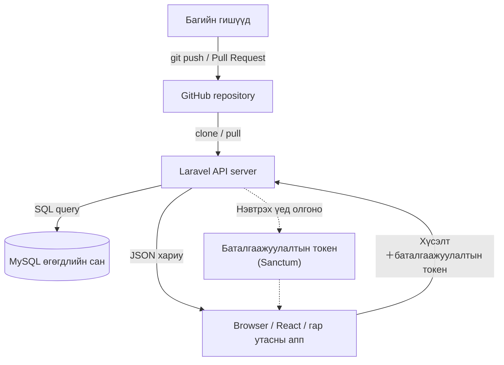
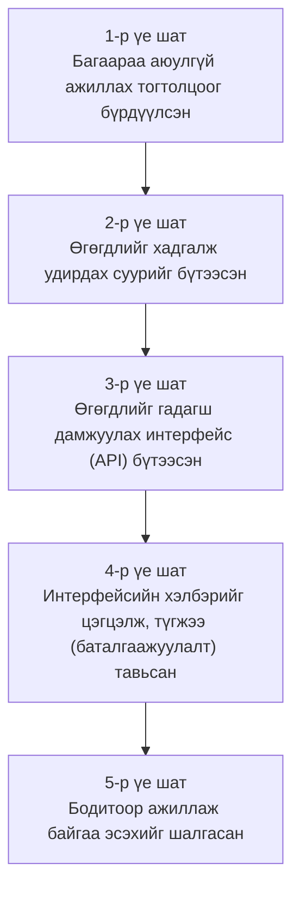

# Хөгжүүлэлтийн урсгал: тэгээс эхлэн API бүтээх хүртэл

> 🇯🇵 Эх хувь (япон хэлээр): [開発の流れ_まとめ.md](<../../2年生_システム開発実践/前期/開発の流れ_まとめ.md>) <!-- original-ja-link -->

---

## Оршил

Энэ материалд "юу хийсэн бэ" гэдгээс гадна "**яагаад ийм дарааллаар хийсэн бэ**" гэдгийг тайлбарлана.

---

## Ерөнхий зураглал: юу бүтээсэн бэ

### Бүтээж дуусгасан системийн ерөнхий зураг



### 5 үе шат

| Үе шат | Сэдэв | Түлхүүр үг | Хичээл |
|---------|--------|-----------|---------|
| 1 | Багийн хөгжүүлэлтэд бэлтгэх | Branch, PR, review | 04/30 |
| 2 | Аппын суурийг бүтээх | Laravel, DB, migration | 05/06 |
| 3 | Өгөгдөлд хандах интерфейс бүтээх | REST API, JSON, чиглүүлэлт | 05/14 |
| 4 | Хэлбэр болон хамгаалалтыг сайжруулах | Resource, validation, Sanctum | 05/21 |
| 5 | Ажиллаж байгаа эсэхийг шалгах | curl, browser-ийн тест | 05/28 |

---

## 1-р үе шат: Багийн хөгжүүлэлтэд бэлтгэх

### Юу хийсэн бэ

Git-ийн branch, merge, Pull Request (PR), code review-г сурч,
аппыг багаараа GitHub-д байршуулж, бүгд ажиллуулж чадах төлөвт оруулсан.

### Яагаад хэрэгтэй байсан бэ

> 💡 **Жишээгээр тайлбарлавал… барилгын талбайн зураг төслийн удирдлага**
>
> Том барилгыг олон гүйцэтгэгч хамтран барихад бүгд "ижил зургийн эх хувь" дээр
> шууд бичвэл эмх замбараагүй болно. Тиймээс гүйцэтгэгч бүр "өөрийн хуулбар (branch)"
> дээр бичиж, дууссаны дараа нэгтгэн тулгаж шалгасны (review) дараа эх хувьд тусгана.

Багийн хөгжүүлэлтэд олон хүн нэг файлыг зэрэг засварладаг.
Branch үүсгэснээр "үндсэн кодыг эвдэлгүйгээр шинэ функц хөгжүүлэх" боломжтой.
PR бол "энэ кодыг үндсэн кодонд оруулж болох уу?" гэсэн хүсэлт бөгөөд
review бол тэр код зөв эсэх, уншихад ойлгомжтой эсэхийг багаараа шалгах үйл явц юм.

> ⚠️ **Үүнгүй бол…** хэн нэгний код өөр хэн нэгний кодыг дарж бичээд устгачихна.
> "Саяхан болтол ажиллаж байсан чинь ажиллахаа больчихлоо" гэдэг байнга гарна.

### Энэ үе шатанд хийж чаддаг болсон зүйлс

- `git switch -c feature/xxxx`-ээр branch үүсгэж ажиллаж чадна
- `git push origin feature/xxxx`-ээр багтайгаа хуваалцаж чадна
- GitHub дээр PR үүсгэж review хүсэж чадна
- Кодын шалгалтаар ирсэн санал, тайлбарын дагуу кодыг засаж чадна

### Дэлгэрэнгүй алхмууд

→ [`2026_04_30/2026_04_30.md`](2026_04_30/2026_04_30.md)

---

## 2-р үе шат: Аппын суурийг бүтээх

### Юу хийсэн бэ

Laravel төсөл үүсгэж, өгөгдлийн сан (`school_api`) бэлдээд,
`students` хүснэгтийг тодорхойлж үүсгэсэн. Тестийн 10 бичлэг оруулаад серверийг ажиллуулсан.

### Яагаад хэрэгтэй байсан бэ

> 💡 **Жишээгээр тайлбарлавал… хоолны газрын гал тогоо байгуулах**
>
> Үйлчлүүлэгчдэд хоол (API-ийн хариу) гаргахын тулд
> эхлээд гал тогоо (Laravel) болон хүнсний бүтээгдэхүүн хадгалах газар (өгөгдлийн сан) хэрэгтэй.
> Гал тогооны зураг төслийг (migration) урьдчилан бэлдвэл
> багийн хэн ч ижил орчныг дахин үүсгэж чадна.

Laravel бол "байнга ашигладаг функцууд (routing, DB-тэй ажиллах, баталгаажуулалт гэх мэт) анхнаасаа багтсан хайрцаг" юм.
Migration бол өгөгдлийн сангийн зураг төсөл бөгөөд `php artisan migrate`-г ажиллуулахад л
багийн бүх гишүүн ижил хүснэгтийн бүтцийг өөрийн компьютер дээр дахин үүсгэж чадна.
Seeder нь тестийн өгөгдлийг автоматаар үүсгэж, өгөгдлийг гараар оруулах ажлыг хөнгөвчилнө.

> ⚠️ **Үүнгүй бол…** API-ийн код бичсэн ч өгөгдөл хадгалах газар байхгүй тул
> хүсэлт болгонд өгөгдөл алга болно.

### Энэ үе шатанд хийж чаддаг болсон зүйлс

- `composer create-project laravel/laravel`-ээр төсөл үүсгэж чадна
- `.env`-д DB-тэй холбогдох мэдээллийг тохируулж чадна
- `php artisan make:model Student -mf`-ээр model, migration, factory-г нэг дор үүсгэж чадна
- `php artisan migrate`-ээр хүснэгт үүсгэж чадна
- `php artisan db:seed`-ээр тестийн өгөгдөл оруулж чадна
- `php artisan serve`-ээр local server ажиллуулж чадна

### Дэлгэрэнгүй алхмууд

→ [`2026_05_06/20260506.md`](2026_05_06/20260506.md)

---

## 3-р үе шат: Өгөгдөлд хандах интерфейс бүтээх

### Юу хийсэн бэ

REST API-ийн үндсэн ойлголтуудыг (URL × HTTP method, JSON хариу, статус код) сурч,
`StudentController` үүсгээд `GET /api/students` зэрэг 5 endpoint хэрэгжүүлсэн.

### Яагаад хэрэгтэй байсан бэ

> 💡 **Жишээгээр тайлбарлавал… автомат худалдааны машины товч**
>
> Автомат худалдааны машинд "Кола", "Цай", "Ус" гэх мэт товчнууд байдаг бөгөөд
> дарахад харгалзах бүтээгдэхүүн гарч ирнэ.
> API-ийн endpoint ч мөн адил бөгөөд
> "`GET /api/students` (бүгдийг нь өгөөч)", "`DELETE /api/students/3` (3-р дугаарыг устга)"
> гэх мэтээр URL × HTTP method-ийн хослолоор юу хийхийг тодорхойлдог.

1-р курст бүтээсэн Blade апп HTML хуудас буцааж байсан.
API нь үүний оронд зөвхөн JSON өгөгдөл буцаана.
JSON болгосноор React, Vue, гар утасны апп гэх мэт
**өөр өөр дэлгэцээс ижил өгөгдлийг дахин ашиглах** боломжтой болно.

> ⚠️ **Үүнгүй бол…** frontend болон server хоорондоо харилцаж чадахгүй.
> React-ээс API дуудсан ч "хаашаа илгээхээ мэдэхгүй" төлөвт орно.

### Энэ үе шатанд хийж чаддаг болсон зүйлс

- REST API-ийн URL-ийн загварчлалыг (нөөцийн нэр, HTTP арга) ойлгож чадна
- `php artisan make:controller Api/StudentController --api`-ээр API controller үүсгэж чадна
- `routes/api.php`-д routing нэмж чадна
- `response()->json()`-ээр JSON хариу буцааж чадна
- HTTP статус кодын (200, 201, 404, 422) утгыг мэднэ

### Дэлгэрэнгүй алхмууд

→ [`2026_05_14/20260514.md`](2026_05_14/20260514.md)

---

## 4-р үе шат: Хэлбэр болон хамгаалалтыг сайжруулах

### Юу хийсэн бэ

`StudentResource`-ээр хариуны хэлбэрийг жигд болгож, оруулсан өгөгдлийг шалгах validation нэмсэн.
Laravel Sanctum-аар баталгаажуулалтын функцийг (нэвтрэх, токен олгох, гарах) хэрэгжүүлсэн.

### Яагаад хэрэгтэй байсан бэ

> 💡 **Жишээгээр тайлбарлавал… шуудан хүргэлтийн падааны маягт＋нэвтрэх үнэмлэх**
>
> Шуудан хүргэлтэд "илгээгч, хүлээн авагч, барааны нэр" тогтсон газарт бичигдсэн байдаг.
> Маягт нь нэгдсэн учраас хүлээн авагч тал төөрөлгүйгээр боловсруулж чадна.
> `StudentResource` бол хариуны хэлбэрийг тогтоодог "падааны маягт" юм.
>
> Sanctum-ийн токен бол "нэвтрэх үнэмлэх" юм.
> Нэвтрэх үед олгосон нэвтрэх үнэмлэхтэй (токентой) хүн л
> барилга (API) руу орж чадна.

3-р үе шатанд API ажилладаг болсон ч хэн ч хандаж болох төлөвт байсан.
Баталгаажуулалт байхгүй бол танихгүй хүн өгөгдлийг дураараа авч, устгаж чадна.
Мөн API-ийн хариуны хэлбэр жигд бус байвал frontend өгөгдөлтэй ажиллахад хэцүү болно.

> ⚠️ **Үүнгүй бол…** интернэт дэх хэн ч өгөгдлийг өөрчилж, устгаж чадна.
> Нууц үг, имэйл хаяг зэрэг хувийн мэдээлэл ил харагдах аюул ч бий.

### Энэ үе шатанд хийж чаддаг болсон зүйлс

- `php artisan make:resource StudentResource`-ээр хариу хэлбэржүүлэх класс үүсгэж чадна
- `$request->validate()`-ээр validation бичиж чадна
- `composer require laravel/sanctum`-ээр баталгаажуулалтын package суулгаж чадна
- `POST /api/login`-оор токен авч чадна
- `auth:sanctum` middleware-ээр баталгаажуулалт шаардлагатай route-уудыг хамгаалж чадна

### Дэлгэрэнгүй алхмууд

→ [`2026_05_21/20260521.md`](2026_05_21/20260521.md)

---

## 5-р үе шат: Ажиллаж байгаа эсэхийг шалгах

### Юу хийсэн бэ

`curl` командаар API руу хүсэлт илгээж ажиллагааг шалгаад,
цаашлаад browser-оор ажиллуулж болох тестийн дэлгэц (`/api-test`) бүтээж
нэвтрэх → оюутны жагсаалт авах → нэмэх → устгах хүртэлх үйлдлүүдийг дарааллаар нь шалгасан.

### Яагаад хэрэгтэй байсан бэ

> 💡 **Жишээгээр тайлбарлавал… бэлэн болсон автомат худалдааны машинд үнэхээр мөнгө хийж үзэх**
>
> Автомат худалдааны машиныг зохион бүтээж үйлдвэрлэсэн ч үнэхээр мөнгө хийж товч дарж үзэх хүртлээ
> "бүтээгдэхүүн үнэхээр гарч ирэх эсэх" нь мэдэгдэхгүй.
> API ч мөн адил, зөвхөн код бичсэнээр зөв ажиллах эсэх нь мэдэгдэхгүй.
> Бодитоор хүсэлт илгээж, хүлээж байсан JSON буцаж ирж байгаа эсэхийг шалгах хэрэгтэй.

`curl` бол "terminal-аас HTTP хүсэлт илгээдэг команд" юм.
Browser нээхгүйгээр API-ийн ажиллагааг шууд шалгаж чадна.
Браузер дахь тестийн дэлгэц нь curl-тай ижил үйлдлийг график интерфейсээр хийх боломжтой хуудас бөгөөд
"React-ээс харвал ийм байдалтай харагдана" гэдгийг төсөөлж шалгахад ч тусална.

> ⚠️ **Үүнгүй бол…** bug-ийг анзааралгүйгээр production орчинд гаргачихна.
> "Хөгжүүлэлтийн орчинд ажиллаж байсан чинь production дээр эвдэрчихлээ" гэдгээс сэргийлэхийн тулд ч ажиллагааг шалгах нь заавал хэрэгтэй.

### Энэ үе шатанд хийж чаддаг болсон зүйлс

- `curl`-ээр GET, POST, DELETE хүсэлт илгээж чадна
- `Authorization: Bearer <token>` header-ээр баталгаажуулалттай хүсэлт илгээж чадна
- Browser-оос API-ийн нэвтрэх, жагсаалт авах, нэмэх, устгах үйлдлийг хийж чадна
- HTTP статус код болон хариуны JSON-ийг уншиж "зөв ажиллаж байгаа эсэх"-ийг дүгнэж чадна

### Дэлгэрэнгүй алхмууд

→ [`2026_05_28/20260528.md`](2026_05_28/20260528.md)

---

## Дүгнэлт: 5 үе шат хоорондоо холбогдсон

5 үе шатыг эргэн харвал тус бүр нь өмнөх үе шатандаа тулгуурлаж байгааг харж болно.



Аль ч үе шат "дараагийн үе шатад хэрэгтэй байсан" гэсэн үг.
Эдгээрийг өөр дарааллаар хийх боломжгүй.

### Дараагийн алхам

Энэ API аль хэдийн **React зэрэг frontend-ээс дуудаж болох төлөвт** байна.
```javascript
fetch('/api/students', { headers: { Authorization: 'Bearer ' + token } })
```
гэж бичихэд л browser дээр өгөгдлийг авч харуулж чадна.

Цаашдын сургалтаар "энэ API-г ашиглан дэлгэц бүтээх" frontend хөгжүүлэлт рүү шилжинэ.
