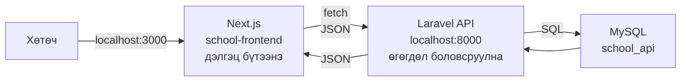
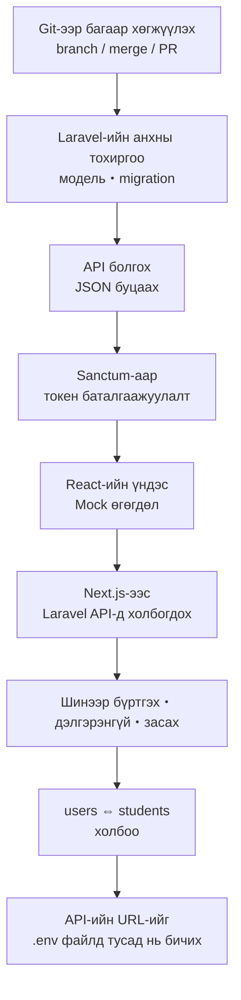
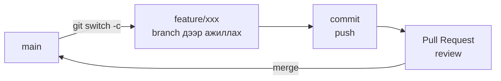
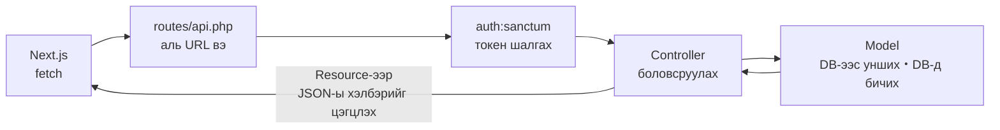
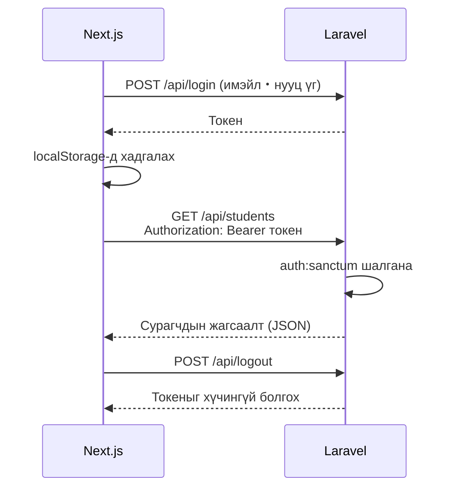
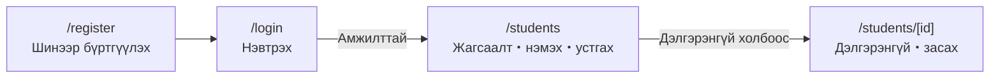
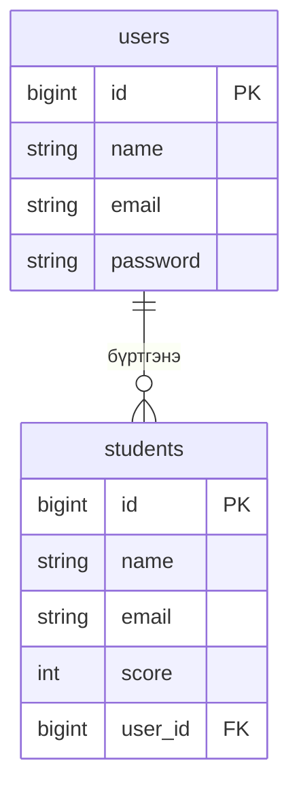
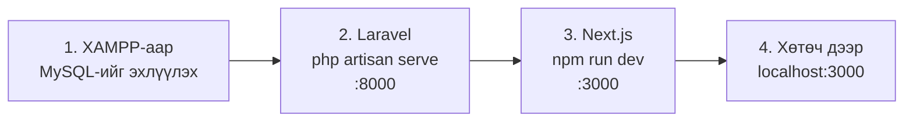

# Эхний улирлын давталт (сэргээн санах)

> 🇯🇵 Эх хувь (япон хэлээр): [2026_10_02_資料1.md](<../../../2年生_システム開発実践/後期/2026_10_02/2026_10_02_資料1.md>) <!-- original-ja-link -->

Хоёрдугаар улиралд орохын өмнө эхний улиралд хийсэн **сурагчийн бүртгэлийн апп**-ынхаа ерөнхий бүтцийг эргэн санацгаая.
Эхний улиралд дэлгэц (frontend) болон өгөгдөл боловсруулалт (backend)-ыг **тусдаа апп** болгон хийж, API-аар холбосон.



- **Next.js**: дэлгэц бүтээх үүрэгтэй. Товч дарагдахад Laravel руу хүсэлт (request) илгээнэ
- **Laravel**: хүсэлтийг хүлээн авч, өгөгдлийн сангаас өгөгдөл уншиж, түүнд бичээд, үр дүнг **JSON** хэлбэрээр буцаах үүрэгтэй
- **MySQL**: өгөгдлийг хадгалах үүрэгтэй

---

## 1. Эхний улирлын явц

Эхний улиралд аппаа дараах дарааллаар хөгжүүлж ирсэн.



| Хичээл | Агуулга | Материал |
|----|------|------|
| 4/30 | Git-ээр багаар хөгжүүлэх (branch・merge・Pull Request) | [Материал](../../前期/2026_04_30/2026_04_30.md) |
| 5/6 | Laravel төслийн анхны тохиргоо | [Материал](../../前期/2026_05_06/20260506.md) |
| 5/14 | Blade аппыг API болгох | [Материал](../../前期/2026_05_14/20260514.md) |
| 5/21 | Resource controller・Sanctum-аар токен баталгаажуулалт | [Материал](../../前期/2026_05_21/20260521.md) |
| 5/28 | Хөтөч дээр токен баталгаажуулалтыг шалгах | [Материал](../../前期/2026_05_28/20260528.md) |
| 6/11 | React-ийн үндэс (компонент・JSX・props・useState) | [Материал](../../前期/2026_06_11/2026_06_11.md) |
| 7/2 | Next.js-ийн танилцуулга → Laravel API-тай холбох | [Материал](../../前期/2026_07_02/2026_07_02.md) |
| 7/9 | Шинэ хэрэглэгч бүртгэх ＋ токен・CRUD・MVC-ийн давталт | [Материал](../../前期/2026_07_09/2026_07_09.md) |
| 7/16 | Дэлгэрэнгүй дэлгэц・засах функц | [Материал](../../前期/2026_07_16/2026_07_16_実装.md) |
| 7/23 | users ⇔ students-ийн холбоо | [Материал](../../前期/2026_07_23/2026_07_23_実装%20.md) |
| 7/30 | API-ийн URL-ийг .env файлд тусад нь бичих | [Материал](../../前期/2026_07_30/2026_07_30_実装.md) |

---

## 2. Git-ээр багаар хөгжүүлэх

Багаараа нэг repository дээр ажиллахдаа **branch** үүсгэж ажиллаад, **Pull Request (PR)**-ээр review хийсний дараа main руу нэгтгэдэг байсан (GitHub Flow).



- **main-д шууд гар хүрэхгүй**: үргэлж ажиллаж байгаа төлөвт байлгана
- 2 хүн нэг мөрийг өөрчилбөл **conflict** үүснэ → файлыг нээж гараар засаад commit хийнэ

---

## 3. Laravel API

### MVC (ресторанаар жишээлбэл)

| Үүрэг | Файлын жишээ | Жишээлбэл |
|------|------------|-----------|
| **Model** | `app/Models/Student.php` | Гал тогоо・хөргөгч (өгөгдөлтэй ажиллана) |
| **Controller** | `app/Http/Controllers/Api/StudentController.php` | Зөөгч (захиалга авч, хүргэнэ) |
| **View** | → API болгоод **Next.js руу нүүлгэсэн** | Хоол таваглах (харагдах байдал) |

API болгосноор Laravel дэлгэц бүтээхээ больж, зөвхөн **JSON (зөвхөн өгөгдөл)** буцаадаг болсон.

### Хүсэлтийн туулах зам



### Хийсэн API

`Route::apiResource('students', ...)` гэсэн 1 мөрөөр CRUD-ийн 5 замыг нэг дор үүсгэсэн.

| CRUD | Метод | URL | Controller | Баталгаажуулалт |
|------|---------|-----|-----------|:----:|
| — | POST | `/api/register` | `AuthController@register` | Шаардлагагүй |
| — | POST | `/api/login` | `AuthController@login` | Шаардлагагүй |
| — | POST | `/api/logout` | `AuthController@logout` | 🔒 |
| Read | GET | `/api/students` | `index` (жагсаалт) | 🔒 |
| Create | POST | `/api/students` | `store` (нэмэх) | 🔒 |
| Read | GET | `/api/students/{id}` | `show` (дэлгэрэнгүй) | 🔒 |
| Update | PUT | `/api/students/{id}` | `update` (шинэчлэх) | 🔒 |
| Delete | DELETE | `/api/students/{id}` | `destroy` (устгах) | 🔒 |

🔒 нь `auth:sanctum` дотор байгаа тул **токенгүй бол 401 алдаа** гарна.

---

## 4. Токен баталгаажуулалт

Нэвтрэхэд Laravel **токен** (зугаа цэнгэлийн паркийн бугуйвч шиг зүйл) олгоно.
Next.js түүнийг хадгалж аваад, API дуудах болгондоо үзүүлнэ.



Болохгүй байвал хөтчийн **Developer Tools**-оор шалгана.

- `Application` таб → `Local Storage`: токен хадгалагдсан эсэх
- `Network` таб: хүсэлтэд `Authorization: Bearer ...` хавсаргагдсан эсэх

---

## 5. Next.js-ийн дэлгэц

`app/` доторх фолдерууд шууд **URL** болсон.



| URL | Файл | Ашиглах API |
|-----|---------|--------|
| `/login` | `app/login/page.tsx` | `POST /api/login` |
| `/register` | `app/register/page.tsx` | `POST /api/register` |
| `/students` | `app/students/page.tsx` | Жагсаалт・нэмэх・устгах・гарах |
| `/students/[id]` | `app/students/[id]/page.tsx` ＋ `components/students/StudentDetail.tsx` | Дэлгэрэнгүй・шинэчлэх |

`[id]` шиг фолдерын нэрийг `[ ]`-ээр хүрээлбэл `/students/1`, `/students/2` … гэх мэтээр **URL-ын нэг хэсгийг хувьсагч болгон хүлээн авч болно**.

React-ийн үндсийг ч бас эргэн санацгаая.

| Нэр | Үүрэг |
|------|------|
| **Компонент** | Дэлгэцийн эд анги (`LoginForm`, `StudentList` гэх мэт) |
| **props** | Эцэг компонентоос дэд компонент руу өгөгдөл дамжуулна |
| **useState** | Дэлгэц дотор өөрчлөгдөх утгыг (оруулсан утга・жагсаалтын өгөгдөл гэх мэт) хадгална |
| **useEffect** | Дэлгэц гарч ирэх зэрэг үед API дуудаж өгөгдөл авна |

---

## 6. Хүснэгт ба холбоо

Сурагчийг "хэн бүртгэсэн" гэдгийг мэдэхийн тулд `students`-д `user_id` (гадаад түлхүүр)-ийг нэмсэн.



- Нэг хэрэглэгч олон сурагч бүртгэж чадна (**нэгээс олонд**)
- Модельд `hasMany` / `belongsTo` бичвэл `$student->user->name`-ээр бүртгэсэн хүний нэрийг авч болно

---

## 7. 2 .env

Laravel болон Next.js тус бүр **өөр өөрийн `.env`**-тэй.

| Файл | Юу бичигдсэн | Жишээ |
|---------|--------------|----|
| Laravel-ийн `.env` | Өгөгдлийн сангийн холболтын мэдээлэл | `DB_DATABASE=school_api` |
| Next.js-ийн `.env` | API-ийн URL | `NEXT_PUBLIC_API_URL=http://127.0.0.1:8000` |

- `.env`-ийг **Git-д оруулахгүй** (нууц үг зэрэг орж болзошгүй тул)
- Оронд нь утгыг хоосон болгосон `.env.example`-ийг хуваалцана
- `.env`-ийг өөрчилсний дараа **хөгжүүлэлтийн серверийг дахин эхлүүлнэ**

---

## 8. Аппыг ажиллуулах дараалал

Энэ гурван бүрэлдэхүүн бүгд ажиллаж байж апп ажиллана. Дараах дарааллаар эхлүүлнэ.



Терминалыг **2** нээнэ.

```bash
# Терминал ① backend
cd Laravel
php artisan serve        # → http://localhost:8000

# Терминал ② frontend
cd school-frontend
npm run dev              # → http://localhost:3000
```

---

## Шалгах асуулт

Тайлбарлаж чадах эсэхээ шалгацгаая.

- [ ] Next.js болон Laravel тус бүр юуг хариуцдаг вэ?
- [ ] `GET /api/students` болон `POST /api/students`-ийн ялгаа юу вэ?
- [ ] Токен хавсаргахгүйгээр `/api/students`-ийг дуудвал юу буцаж ирэх вэ?
- [ ] `students` хүснэгтийн `user_id` юуны тулд байдаг вэ?
- [ ] `.env`-ийг Git-д яагаад оруулдаггүй вэ? Оронд нь юуг хуваалцдаг вэ?
- [ ] Аппыг ажиллуулахын тулд юуг, ямар дарааллаар эхлүүлэх вэ?
