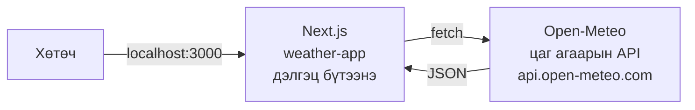
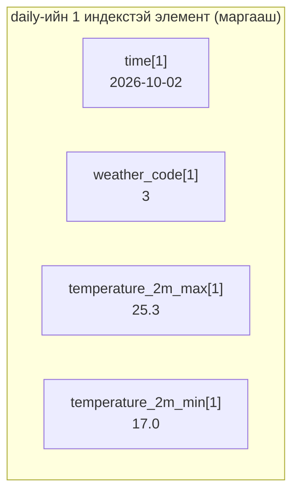
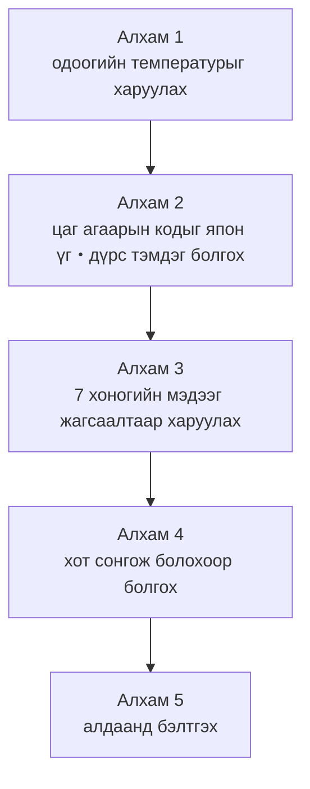
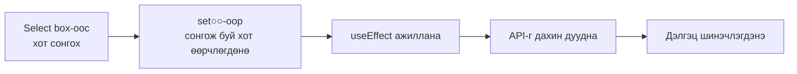

# Ахисан даалгавар: Цаг агаарын API-аар цаг агаарын мэдээний апп хийцгээе

> 🇯🇵 Эх хувь (япон хэлээр): [2026_10_02_資料2.md](<../../../2年生_システム開発実践/後期/2026_10_02/2026_10_02_資料2.md>) <!-- original-ja-link -->

**Сурагчийн бүртгэлийн аппаа дуусгасан хүмүүс** энэ даалгавар руу шилжээрэй.
Эхний улиралд "өөрсдийн хийсэн Laravel API"-аас JSON хүлээн авч дэлгэцэнд гаргасан.
Энэ удаа **интернэтэд нээлттэй байгаа цаг агаарын API (Open-Meteo)**-аас JSON хүлээн авч, **шинэ Next.js төсөл** дээр цаг агаарын мэдээний апп хийнэ.



### Бэлэн болсон үеийн дүр төрх

```
┌─────────────────────────────────────────┐
│ 天気予報（東京）              [ 東京 ▼ ]  │  ← хот сонгож болно
├─────────────────────────────────────────┤
│        ☀️                                │
│      晴れ   28℃                          │  ← одоогийн цаг агаар
│      風速 0.7 km/h                       │
├─────────────────────────────────────────┤
│ 10/1(木)  ☀️ 晴れ    29℃ / 18℃  ☔ 0%    │
│ 10/2(金)  ☁️ くもり  25℃ / 17℃  ☔ 20%   │  ← 7 хоногийн урьдчилсан мэдээ
│ 10/3(土)  🌧️ 雨      21℃ / 16℃  ☔ 80%   │
│   …                                     │
└─────────────────────────────────────────┘
```

### Өнөөдрийн зорилго

- **Next.js төслийг эхнээс нь үүсгэж** чаддаг болох
- Нээлттэй **гадаад API**-г дуудаж, JSON-ыг дэлгэцэнд харуулж чаддаг болох
- JSON дотроос **хэрэгтэй утгыг гаргаж авч** чаддаг болох
- Сонгосон утга (хот) өөрчлөгдөхөд **API-г дахин дуудаж** чаддаг болох

> Энэ материалд **хариултын код оруулаагүй.**
> Эхний улирлын сурагчийн бүртгэлийн аппын (`school-frontend`) кодыг лавлаж, өөрөө бодож бичээд үзээрэй.

---

## 1. Ашиглах API: Open-Meteo

[Open-Meteo](https://open-meteo.com/) бол үнэгүй ашиглаж болох цаг агаарын API юм.

- **Бүртгэл・API түлхүүр шаардлагагүй** (URL-ыг нээхэд л ашиглаж болно)
- Байршлыг **өргөрөг (latitude)・уртраг (longitude)**-аар заана
- **Хамгийн ихдээ 16 хоногийн** урьдчилсан мэдээ авч болно (энэ удаа 7 хоногийнхыг ашиглана)

Сурагчийн бүртгэлийн апптай харьцуулж үзье.

| | Сурагчийн бүртгэлийн апп | Цаг агаарын мэдээний апп |
|---|---|---|
| API-г хэн хийсэн | Өөрөө (Laravel) | Open-Meteo |
| URL | `http://localhost:8000/api/students` | `https://api.open-meteo.com/v1/forecast?...` |
| Баталгаажуулалт | Токен шаардлагатай (🔒) | **Шаардлагагүй** |
| Ашиглах метод | GET / POST / PUT / DELETE | Зөвхөн GET (зөвхөн унших) |

> Энэ бол үнэгүй нээлттэй API. **Товчийг дахин дахин дарах, давталтаар олон удаа дуудахаас зайлсхийгээрэй.**

---

## 2. Эхлээд API-г хөтөч дээр харж үзэх

Код бичихээс өмнө **ямар JSON буцаж ирэхийг** шалгах нь чухал.
Дараах URL-ыг хөтчийн хаягийн мөрөнд хуулж буулгаад нээгээрэй (Токиогийн цаг агаар).

```
https://api.open-meteo.com/v1/forecast?latitude=35.68&longitude=139.77&current=temperature_2m,weather_code,wind_speed_10m&daily=weather_code,temperature_2m_max,temperature_2m_min,precipitation_probability_max&timezone=Asia%2FTokyo
```

> Chrome дээр "Pretty print" гэдгийг чагталбал JSON уншихад хялбар болно.

### URL-ыг хэрхэн унших вэ

`?`-ийн дараа **query parameter** (API-аас авах өгөгдлийн заалтууд) байна. Тэдгээрийг `&`-ээр тусгаарлан бичнэ.

| Параметр | Утга |
|-----------|------|
| `latitude=35.68` | Өргөрөг |
| `longitude=139.77` | Уртраг |
| `current=temperature_2m,weather_code,wind_speed_10m` | **Одоогийн** температур・цаг агаарын код・салхины хурдыг авмаар байна |
| `daily=weather_code,temperature_2m_max,...` | **Өдөр бүрийн** цаг агаарын код・хамгийн их температур・хамгийн бага температур・хур тунадас орох магадлалыг авмаар байна |
| `timezone=Asia%2FTokyo` | Японы цагаар буцааж өгөөч (`%2F` нь `/` гэсэн үг) |

> `current=` эсвэл `daily=`-ийн араас зүйл хасах, нэмэхэд буцаж ирэх JSON ч өөрчлөгдөнө. Туршаад үзээрэй.
> Ямар зүйлс байдгийг [Open-Meteo-ийн баримт бичиг](https://open-meteo.com/en/docs)-ээс хайж болно.

### Буцаж ирэх JSON (хэсэг)

```json
{
  "current": {
    "time": "2026-10-01T17:00",
    "temperature_2m": 28.2,
    "weather_code": 0,
    "wind_speed_10m": 0.7
  },
  "daily": {
    "time": ["2026-10-01", "2026-10-02", "2026-10-03", ...],
    "weather_code": [0, 3, 61, ...],
    "temperature_2m_max": [29.1, 25.3, 21.0, ...],
    "temperature_2m_min": [18.2, 17.0, 16.4, ...],
    "precipitation_probability_max": [0, 20, 80, ...]
  }
}
```

### Хаана юу байгаа вэ?

| Харуулах зүйл | JSON-ы хаана? |
|--------------|-------------|
| Одоогийн температур | `current.temperature_2m` |
| Одоогийн цаг агаарын код | `current.weather_code` |
| Одоогийн салхины хурд | `current.wind_speed_10m` (km/h) |
| Огноо (7 хоногийн) | `daily.time` ← **массив** |
| Өдөр бүрийн цаг агаарын код | `daily.weather_code` ← **массив** |
| Өдөр бүрийн хамгийн их・хамгийн бага температур | `daily.temperature_2m_max`・`daily.temperature_2m_min` ← **массив** |
| Өдөр бүрийн хур тунадас орох магадлал (%) | `daily.precipitation_probability_max` ← **массив** |

Энд гол санаа нь:

- `current`-д **нэг утга** байна
- `daily` нь **зүйл бүрээрээ массив** бөгөөд **ижил дугаартай (index) утгууд нь нэг өдрийн** өгөгдөл



### Цаг агаарын код (weather_code)

Цаг агаар нь "晴れ" (цэлмэг) гэх мэт үгээр биш, **тоогоор (WMO код)** буцаж ирнэ.
Дэлгэцэнд гаргахдаа өөрөө япон хэл рүү хөрвүүлнэ.

| Код | Цаг агаар | Дүрс тэмдгийн жишээ |
|-------|------|-----------|
| 0 | 晴れ (цэлмэг) | ☀️ |
| 1, 2 | 晴れ時々くもり (цэлмэг, үе үе үүлэрхэг) | 🌤️ |
| 3 | くもり (үүлэрхэг) | ☁️ |
| 45, 48 | 霧 (манан) | 🌫️ |
| 51〜57 | 霧雨 (шиврээ бороо) | 🌦️ |
| 61〜67 | 雨 (бороо) | 🌧️ |
| 71〜77 | 雪 (цас) | ❄️ |
| 80〜82 | にわか雨 (аадар бороо) | 🌦️ |
| 85, 86 | にわか雪 (түр зуурын цас) | 🌨️ |
| 95〜99 | 雷雨 (аянгатай бороо) | ⛈️ |

---

## 3. Next.js төсөл үүсгэх

Сурагчийн бүртгэлийн аппаас (`school-frontend`) **тусдаа фолдерт** үүсгэнэ.
`school-frontend` дотор үүсгэхгүй байхаар анхаараарай.

```bash
npx create-next-app@latest weather-app
```

Асуултуудад эхний улиралтай адилхан хариулна.

```
Would you like to use TypeScript?             → Yes
Would you like to use ESLint?                 → Yes
Would you like to use Tailwind CSS?           → Yes
Would you like your code inside a src/ dir?   → No
Would you like to use App Router?             → Yes
Would you like to use Turbopack?              → No
Would you like to customize the import alias? → No
```

```bash
cd weather-app
npm run dev
```

http://localhost:3000 хаягийг нээгээд Next.js-ийн жишээ дэлгэц гарвал амжилттай гэсэн үг.

### Үүсгэсний дараа шууд хийх зүйлс

| Файл | Хийх зүйл | Лавлах |
|---------|---------|------|
| `app/layout.tsx` | `lang="en"`-ийг `lang="ja"` болгож, `title`-ийг "天気予報アプリ" (цаг агаарын мэдээний апп) болгож өөрчилнө | `school-frontend/app/layout.tsx` |
| `app/globals.css` | `@import "tailwindcss";`-ээс бусдыг устгаж, `body`-ийн дэвсгэр өнгө・текстийн өнгийг өөрөө тогтооно | — |
| `app/page.tsx` | Жишээний агуулгыг бүгдийг устгаад цаг агаарын мэдээний дэлгэцийг бичиж эхэлнэ | — |

> **globals.css-ийг засах шалтгаан**
> Анхны `globals.css` нь компьютер dark mode-д байвал **текст цагаан** болох тохиргоотой.
> Цагаан карт дээр текст байрлуулахад харагдахгүй болох тул өнгөө өөрөө тогтоогоорой.

> Энэ удаа API түлхүүр шаардлагагүй тул `.env` үүсгэх шаардлагагүй.
> Мөн Laravel ашиглахгүй тул XAMPP болон `php artisan serve`-ийг эхлүүлэх шаардлагагүй.

---

## 4. Хийх дараалал

Бүгдийг нэг дор хийх гэж оролдолгүй, **алхам бүрийг ажиллуулж шалгаж** байж урагшилцгаая.



### Алхам 1: Одоогийн температурыг харуулах

**Хийх зүйл**
- `app/page.tsx` дээр хуудас харагдах үед API дуудаж, Токиогийн **одоогийн температур・цаг агаарын код・салхины хурдыг** харуулна

**Зөвлөгөө**
- 1-р мөрөнд `"use client";` гэж бичнэ (`useState`・`useEffect` ашиглах тул)
- Сурагчийн бүртгэлийн аппын `app/students/page.tsx` доторх **`useEffect` болон `loadStudents`**-ийн бүтэц шууд жишээ болно
- Энэ удаа **токен (`Authorization` header) шаардлагагүй**. URL-ыг `fetch` хийхэд л болно
- Эхэндээ URL-д зөвхөн `current=` байхад хангалттай (`daily=`-ийг алхам 3-т нэмнэ)
- Хүлээн авахаас өмнө өгөгдөл хоосон (`null`) байгаа тул "読み込み中..." (ачаалж байна...)-г эхлээд харуулна
- TypeScript дээр `useState(null)` гэж бичвэл дараа нь `weather.current` дээр алдаа гарна → `useState<any>(null)` гэж бичнэ

**✅ Шалгах**: температур・цаг агаарын код (тоо)・салхины хурд харагдсан

### Алхам 2: Цаг агаарын кодыг япон үг болон дүрс тэмдэг болгох

**Хийх зүйл**
- Цаг агаарын кодыг хүлээн авч "晴れ" гэх мэт япон үг болон emoji дүрс тэмдгийг буцаах **функц** хийнэ
- Одоогийн цаг агаарыг цагаан карт дотор **дүрс тэмдэг・цаг агаар・температур・салхины хурд**-аар харуулна

**Зөвлөгөө**
- Функцийг `export default function ...`-ийн **гадна (дээр)** хийвэл зүгээр
- 2-р хэсгийн цаг агаарын кодын хүснэгтийг харж, `if`-ээр жижиг кодоос эхлэн дарааллаар шалгана
- Япон үг болон дүрс тэмдэг гэсэн 2 зүйлийг буцаамаар байвал `{ label: "晴れ", icon: "☀️" }` шиг **объект** буцаана
- Температур `28.2` шиг бутархай тоогоор ирнэ → `Math.round()`-аар бүхэлтгэвэл уншихад хялбар

**✅ Шалгах**: дүрс тэмдэг болон "晴れ" гэх мэт япон үг харагдсан

### Алхам 3: 7 хоногийн урьдчилсан мэдээг жагсаалтаар харуулах

**Хийх зүйл**
- URL-д `daily=...`-ийг нэмж, 7 хоногийн урьдчилсан мэдээг жагсаалтаар харуулна
- 1 мөрөнд "огноо・дүрс тэмдэг・цаг агаар・хамгийн их температур・хамгийн бага температур・хур тунадас орох магадлал"-ыг байрлуулна

**Зөвлөгөө**
- Жагсаалтаар харуулахдаа сурагчдын жагсаалттай адил `map` ашиглана. `key`-д давхцахгүй утга (огноо) ашиглана
- `daily.time`-ийг `map`-аар гүйлгэвэл 2 дахь аргументаар **дугаар `i`** авна → `(date, i) => ...`
- Тэр `i`-г ашиглан `daily.weather_code[i]` шиг **ижил дугаараар** бусад массиваас гаргаж авна
- `2026-10-02` огноог `10/2(金)` хэлбэрт оруулмаар байвал `new Date(date)` үүсгээд `getMonth()` (**0-ээс эхэлдэг** тул +1)・`getDate()`・`getDay()` (0 нь ням гараг)-г ашиглана

**✅ Шалгах**: 7 хоногийн урьдчилсан мэдээ жагсаж харагдсан

### Алхам 4: Хот сонгож болохоор болгох

**Хийх зүйл**
- Select box-оос хот сонгоход тухайн хотын цаг агаар・урьдчилсан мэдээ рүү шилждэг болгоно

Хотуудын өргөрөг・уртрагийг дараах хүснэгтээс ашиглаарай.

| Хот | Өргөрөг (latitude) | Уртраг (longitude) |
|-----|---------------|----------------|
| 東京 (Токио) | 35.68 | 139.77 |
| 大阪 (Осака) | 34.69 | 135.50 |
| 札幌 (Саппоро) | 43.06 | 141.35 |
| 那覇 (Наха) | 26.21 | 127.68 |

**Зөвлөгөө**
- Хотуудын жагсаалтыг `{ name: "東京", latitude: 35.68, longitude: 139.77 }` шиг объектуудын **массив** болгож бэлдэнэ
- "Сонгож буй хот"-ыг `useState`-ээр хадгална
- URL-ын `latitude=` болон `longitude=` хэсгийг сонгож буй хотын утгаар солино (template string `` `...${ }...` `` хэрэгтэй)
- `useEffect`-ийн dependency array-г эргэн санаарай



| Dependency array-ийн бичлэг | Хэзээ ажиллах вэ? |
|----------------|----------------|
| `[]` | Хуудас харагдах үед **зөвхөн 1 удаа** (сурагчдын жагсаалтад ашигласан) |
| `[city]` | Эхний 1 удаа ＋ **city өөрчлөгдөх бүрт** |

**✅ Шалгах**: хотыг солиход цаг агаар болон урьдчилсан мэдээ өөрчлөгдсөн (Саппоро болон Нахагийн температурыг харьцуулж үзээрэй)

### Алхам 5: Алдаанд бэлтгэх

**Хийх зүйл**
- API амжилтгүй болоход дэлгэц цэвэр цагаан болохгүй, **алдааны мессеж** харагддаг болгоно

**Зөвлөгөө**
- Сурагчийн бүртгэлийн аппад ч `res.ok`-оор амжилтгүй эсэхийг шалгаж байсан
- Интернэтэд холбогдоогүй үед `fetch` өөрөө амжилтгүй болно → `try` / `catch`-ээр барьж авна
- Амжилттай ч, амжилтгүй ч "読み込み中" (ачаалж байна) төлөвийг дуусгана → `finally`

**✅ Шалгах**: URL-ын `latitude=`-ийг санаатайгаар `latitude=999` болгоход алдааны мессеж харагдсан (шалгасны дараа буцааж засна)

---

## 5. Болохгүй байвал

| Шинж тэмдэг | Шалгах зүйл |
|------|-------------|
| `useState is not defined` | 1-р мөрөнд `"use client";`, түүний доор `import { useState, useEffect } from "react";` байгаа эсэх |
| `Cannot read properties of null` | Өгөгдөл ирэхээс өмнө харуулах гэж байна → "読み込み中" (ачаалж байна)-ийн шалгалтаас **доор** ашиглаж байгаа эсэх |
| `Cannot read properties of undefined` | JSON-оос утга гаргаж авах арга буруу／URL-д `daily=` нэмэхээ мартаагүй эсэх → 2-р хэсгийн хүснэгттэй харьцуулна |
| Цаг болон огноо 9 цагаар зөрнө | URL-д `timezone=Asia%2FTokyo` нэмсэн эсэх |
| Текст харагдахгүй (цагаан) | `globals.css`-ийн dark mode тохиргоог устгасан эсэх |
| Утга буруу・харагдахгүй | Developer Tools-ийн `Network` табаас API-ийн хариуг (JSON) шалгана |

---

## 6. Цааш сорилт (дуусгасан хүмүүс)

- [ ] **Компонентуудад хуваах**: "Одоогийн цаг агаар" болон "урьдчилсан мэдээний жагсаалт"-ыг `components/` доторх тусдаа файлуудад хувааж, `props`-оор өгөгдөл дамжуулна
- [ ] **Хот нэмэх**: өөрийн төрсөн нутгийг нэмнэ (Google Maps дээр байршил дээр хулганы баруун товчийг дарахад өргөрөг, уртраг нь гарч ирнэ)
- [ ] **Хотын нэрээр хайх**: оруулах талбарт хотын нэр бичиж хайдаг болгоно ([Geocoding API](https://open-meteo.com/en/docs/geocoding-api)-аар хотын нэр → өргөрөг・уртраг руу хөрвүүлж болно. Энэ ч бас түлхүүр шаардлагагүй)
- [ ] **Цаг тутмын мэдээ**: URL-д `hourly=temperature_2m&forecast_days=1`-ийг нэмж, өнөөдрийн цаг тутмын температурыг харуулна
- [ ] **Одоогийн байршлын цаг агаар**: `navigator.geolocation.getCurrentPosition()`-ээр өөрийн өргөрөг・уртрагийг авч, тухайн газрын цаг агаарыг харуулна
- [ ] **Харагдах байдлыг өөрчлөх**: цаг агаараас хамаарч дэвсгэр өнгийг өөрчилнө (цэлмэг бол улбар шар, бороотой бол цэнхэр гэх мэт)／Tailwind CSS-ээр бичиж үзнэ

> Илүү зав гарвал [Материал 3](./2026_10_02_資料3.md)-аар **Gemini ашиглан өөрийн цаг агаарын дүрс тэмдэг хийх**・**Vercel дээр үнэгүй deploy хийх** сорилтыг туршаарай.

---

## Шалгах асуулт

- [ ] Сурагчийн бүртгэлийн аппын API болон Open-Meteo-ийн API-ийн ялгаа юу вэ? (хийсэн хүн・баталгаажуулалт)
- [ ] URL-ын `?`-ийн араас байгаа `latitude=35.68&longitude=139.77` юуг илэрхийлж байна вэ?
- [ ] `daily` дотроос нэг өдрийн өгөгдлийг хэрхэн олох вэ?
- [ ] Цаг агаарын код `3` ямар цаг агаар вэ? Түүнийг дэлгэцэнд "くもり" (үүлэрхэг) гэж гаргахын тулд яах вэ?
- [ ] `useEffect(() => { ... }, [city])` хэзээ ажиллах вэ?
- [ ] `try` / `catch` / `finally`-ийн `finally` хэзээ ажиллах вэ?
