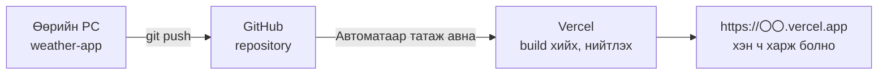

# Ахисан даалгавар: Цаг агаарын мэдээний аппаа сайжруулцгаая

> 🇯🇵 Эх хувь (япон хэлээр): [2026_10_02_資料3.md](<../../../2年生_システム開発実践/後期/2026_10_02/2026_10_02_資料3.md>) <!-- original-ja-link -->

[Материал 2](./2026_10_02_資料2.md)-ын цаг агаарын мэдээний аппаа (`weather-app`) **дуусгасан хүмүүс** энэ материал руу шилжээрэй.

| | Хийх зүйл |
|---|---|
| 1. | Gemini ашиглан өөрийн цаг агаарын дүрс тэмдэг хийж, emoji-ийн оронд харуулна |
| 2. | Vercel дээр үнэгүй deploy хийж, гар утаснаас ч харж болохоор болгоно |

---

## 1. Gemini ашиглан өөрийн цаг агаарын дүрс тэмдэг хийх

Open-Meteo **дүрс тэмдгийн зураг илгээдэггүй** (буцаж ирэх нь зөвхөн цаг агаарын кодын тоо).
Тиймээс **Gemini-ээр зураг үүсгэж**, `public/` фолдерт хийгээд цаг агаарын кодод тохируулан харуулж үзье.


### 1-1. Gemini-ээр зураг хийх

[Gemini](https://gemini.google.com/)-г нээж, цаг агаар бүрээр зураг хийлгэнэ.

| Цаг агаар | Файлын нэрийн жишээ |
|-----|-------------|
| Цэлмэг | `sunny.png` |
| Цэлмэг, үе үе үүлэрхэг | `partly-cloudy.png` |
| Үүлэрхэг | `cloudy.png` |
| Манан | `fog.png` |
| Бороо (шиврээ болон аадар бороо орно) | `rainy.png` |
| Цас | `snowy.png` |
| Аянгатай бороо | `thunder.png` |

Prompt (хүсэлтийн текст)-ын жишээ:

```
Цаг агаарын мэдээний аппад ашиглах "цэлмэг" дүрс тэмдэг хийж өгнө үү.
Энгийн, хөөрхөн зураг, дөрвөлжин, цагаан дэвсгэртэй, ямар ч бичиг оруулахгүй байна уу.
```

> **Гол санаа**
> - Эхнийх нь бэлэн болмогц "**Ижил хэв маягаар** 'үүлэрхэг' дүрс тэмдгийг бас хийж өгнө үү" гэж үргэлжлүүлэн хүсвэл зургийн хэв маяг нэгдмэл болно
> - Бэлэн болсон зургийг татаж аваад дээрх хүснэгтийн нэрээр сольж нэрлэнэ
> - Файлын нэрийг **хагас өргөнтэй (half-width) латин үсэг, тоо**-оор өгнө (япон хэлээр файлын нэр өгөхөөс зайлсхийнэ)

### 1-2. public фолдерт хийх

```
weather-app/
└── public/
    └── icons/          ← үүсгэнэ
        ├── sunny.png
        ├── cloudy.png
        └── ...
```

`public/`-д хийсэн файлыг **`/`-ээр эхэлсэн зам**-аар харуулж болно.
Жишээлбэл `public/icons/sunny.png`-ийг ``-ээр харуулж болно.

> Хөтөч дээр http://localhost:3000/icons/sunny.png хаягийг нээж, зураг гарч байгаа эсэхийг эхлээд шалгаарай.

### 1-3. Цаг агаарын кодод тохируулан харуулах

**Хийх зүйл**
- Материал 2-ын алхам 2-т хийсэн функцээ өөрчилж, япон үг болон emoji-оос гадна **зургийн зам** (`/icons/sunny.png` гэх мэт)-ыг бас буцаадаг болгоно
- Одоогийн цаг агаар болон 7 хоногийн урьдчилсан мэдээнд emoji-ийн оронд ``-ээр зураг харуулна

**Зөвлөгөө**
- Буцаах объектод `image: "/icons/sunny.png"` гэх мэт зүйл нэмнэ
- Зургийн хэмжээг ``-ийн `width` эсвэл `style`-аар тогтооно (урьдчилсан мэдээний жагсаалтад арай жижиг)
- `alt`-д "晴れ" (цэлмэг) гэх мэт япон үг оруулбал зураг ачаалагдахгүй үед ч цаг агаарыг мэдэж болно

**✅ Шалгах**: хотыг солиход цаг агаарт тохирсон өөрийн дүрс тэмдэг харагдсан

---

## 2. Vercel дээр үнэгүй deploy хийх

Одоогийн апп `localhost:3000` учир **зөвхөн өөрийн компьютер дээрээ л харж болно.**
[Vercel](https://vercel.com/) (Next.js-ийг хөгжүүлдэг компанийн үйлчилгээ)-ийг ашиглавал интернэтэд үнэгүй нийтэлж болно.
Нийтэлбэл `https://weather-app-xxxx.vercel.app` гэх мэт URL авч, **гар утас болон найзын компьютероос ч харж болдог** болно.



> **Deploy** гэдэг нь хийсэн аппаа сервер дээр байрлуулж, интернэтээс ашиглаж болохоор болгохыг хэлнэ.

### 2-1. Өөрийн компьютер дээр build хийж болох эсэхийг шалгах

Vercel дээр ч мөн адил `npm run build` ажиллана. Эхлээд өөрийн компьютер дээр алдаа гарах эсэхийг шалгаарай.

```bash
# npm run dev-ийг Ctrl + C-ээр зогсоосны дараа
npm run build
```

- Төгсгөлд нь `✓ Compiled successfully` гэх мэт гарч, алдаагаар зогсохгүй бол OK
- **Улаан алдаа** гарвал мессежид бичигдсэн файл болон мөрийг засаад дахин `npm run build`
- Шалгасны дараа дахин `npm run dev`-ээр хөгжүүлэлтээ үргэлжлүүлж болно

### 2-2. GitHub руу push хийх

`create-next-app`-аар хийсэн төсөл **анхнаасаа Git repository** болсон байдаг.

1. GitHub дээр **шинэ repository** үүсгэнэ (нэр нь `weather-app`, **README зэргийг нэмэхгүй**)
2. Үүсгэсэн repository-ийн хуудсан дээр гарч ирэх командуудыг харж `git remote add origin ...`-ээр холбоно
3. `git add` → `git commit` → `git push`-ээр энэ хүртэлх кодоо push хийнэ

> Git-ийн хэрэглээг эхний улирлын 4/30-ны материалаас эргэн харцгаая.
> `public/icons/`-ийн зургууд хамт push хийгдсэн эсэхийг GitHub-ийн дэлгэц дээр шалгана.

### 2-3. Vercel дээр нийтлэх

1. https://vercel.com/ хаягийг нээж, **Sign Up** → төлөвлөгөөнөөс **Hobby (үнэгүй)**-г сонгоно
2. **Continue with GitHub**-ээр GitHub бүртгэлээрээ нэвтэрнэ
3. **Add New...** → **Project**-ийг сонгоно
4. Жагсаалтаас `weather-app`-ийн **Import**-ийг дарна (гарч ирэхгүй бол GitHub руу хандах эрх олгоно)
5. Тохиргоог **тэр чигт нь үлдээхэд OK** (Next.js бол автоматаар тодорхойлно) → **Deploy**-г дарна
6. 1〜2 минут хүлээгээд баяр хүргэсэн дэлгэц гарвал бэлэн! Гарч ирсэн URL-ыг нээж үзээрэй

> Энэ удаа API түлхүүр ашиглаагүй тул Vercel дээр орчны хувьсагч тохируулах шаардлагагүй.

### 2-4. Засаад push хийхэд л шинэчлэгдэнэ

Нэг удаа холбочихвол дараа нь **GitHub руу `git push` хийх бүрт Vercel автоматаар дахин deploy хийж** өгнө.


> **Анхааруулга**
> - Нийтэлсэн URL-ыг **хэн ч харж болно**. Нэр зэрэг хувийн мэдээллийг дэлгэцэнд оруулахгүй байгаарай
> - Hobby төлөвлөгөө нь **хувийн болон сургалтын зориулалттай** (мөнгө олох сайтад ашиглаж болохгүй)
> - Deploy амжилтгүй болбол Vercel-ийн дэлгэцийн **Build Logs**-д алдаа гарсан байна. Өөрийн компьютер дээрх `npm run build`-д ижил алдаа гарах эсэхийг шалгаарай

**✅ Шалгах**: гар утаснаасаа Vercel-ийн URL-ыг нээхэд цаг агаарын мэдээ харагдсан
