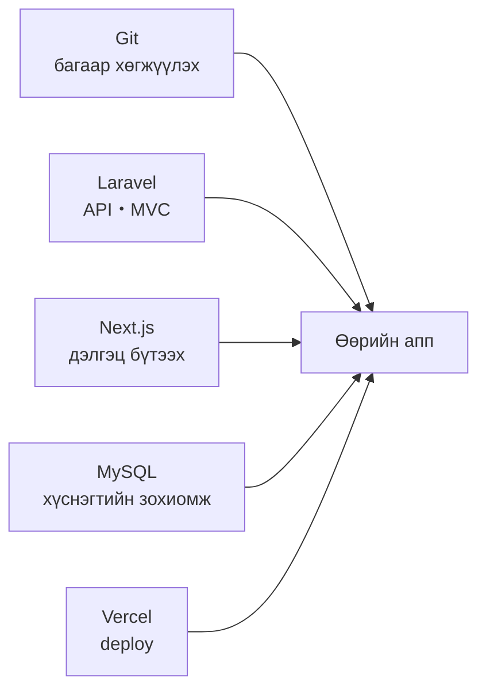
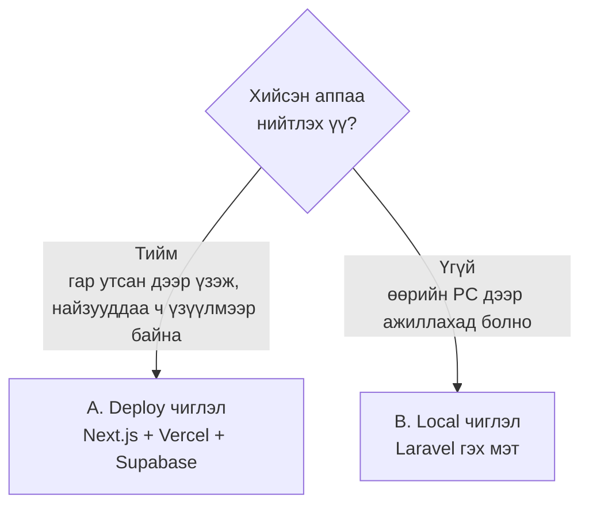
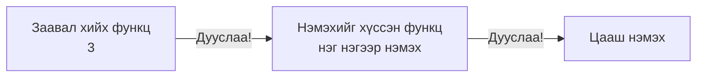
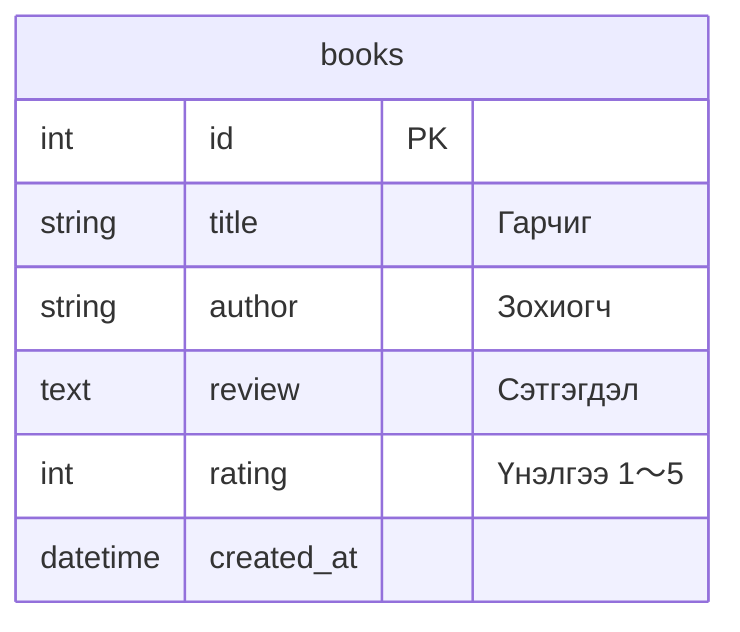
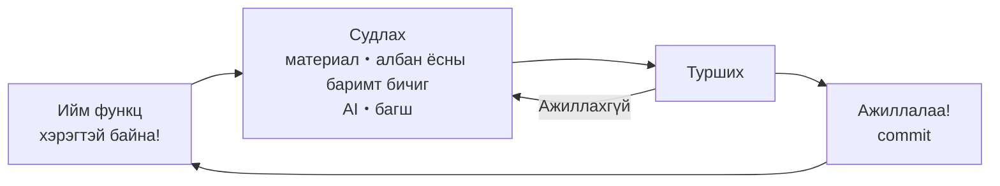
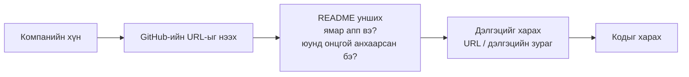
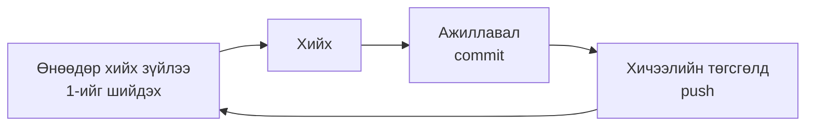

# Чөлөөт бүтээл: Үндсэн мэдлэгээ эзэмшсэн тул одоо хийхийг хүссэн зүйлээ бүтээнгээ суралцана

> 🇯🇵 Эх хувь (япон хэлээр): [2026_10_09_資料1.md](<../../../2年生_システム開発実践/後期/2026_10_09/2026_10_09_資料1.md>) <!-- original-ja-link -->

## Өнөөдрийн зорилго
- Хийхийг хүссэн аппаа шийдэж чаддаг болох
- Бэлэн болсон аппаа ажилд орох үйл явцад **портфолио болгон илгээж чаддаг** байхыг зорих
- Өөрт тохирсон чиглэлийг (deploy хийх / зөвхөн local) сонгож чаддаг болох
- Хөгжүүлэлт эхлэх бэлтгэлийг (repository үүсгэх・төсөл үүсгэх) хийж чаддаг болох
- "Бүтээнгээ суралцах", "өөрийн чухалчилдаг зүйлдээ анхаарах" гэсэн 2 зүйлийг ухамсарлаж ажиллах

---

## 1. Чөлөөт бүтээл гэж юу вэ

Энэ хүртэл сурсан зүйлээ хэрэглэж, **өөрийн дуртай зүйлээ** хийнэ.
Сэдэв чөлөөтэй. Хобби・клуб・цагийн ажил・өдөр тутамд "байвал хэрэгтэй" зүйлсээ бодит болгоцгооё.

> 🎯 **Зорилго: ажилд орох үйл явцад компанид портфолио болгон илгээж болох апп болгох**
> Аль чиглэлийг сонгосон ч бэлэн болсон аппаа **"өөрийн хөгжүүлсэн зүйл" болгон компанид үзүүлж болохоор** болгоно.
> Хэрхэн илгээхийг [5. Портфолио болгон илгээх](#5-портфолио-болгон-илгээх)-ээс хараарай.



### Яагаад өөрөө хийхийг хүссэн зүйлээ хийх вэ?

Үндсийг энэ хүртэлх хичээлээр сурсан. Эндээс хойш түүнийгээ **хэрэглэх** шат юм.
Багшийн өгсөн даалгавар биш, **өөрөө хийхийг хүссэн зүйлээ шийдэж хийх** нь 3 шалтгаантай.

#### ① Өөрийн хийхийг хүссэн зүйл бол урам зориг удаан хадгалагдана

Апп дуусгах хүртэл алдаа болон "ойлгохгүй байна" гэх зүйлс маш их гарна.
**Өөрийн үнэхээр хүсэж буй зүйл** бол "дуусгамаар байна!" гэсэн сэтгэлээр эцэс хүртэл хичээж чадна.

#### ② AI код бичиж чаддаг цаг үе тул "юу хийх вэ" гэдгийг нь хардаг

Одоо AI-аас хүсвэл код бичүүлж болдог цаг үе.
Тиймээс ч **"юу хийх вэ", "юуг хялбар болгох гэж байна вэ", "яагаад үүнийг хийсэн бэ"** гэдэг нь чухал болж байна.
Зөвхөн код бичиж чаддаг эсэхийг бус, **өөрөө асуудал олж, түүнийг бодит болгох чадварыг** хардаг.

#### ③ Портфолио болгон компанид илгээж болно

Бэлэн болсон аппаа ажилд орох үйл явцад **портфолио болгон компанид илгээж** болно.
Гэхдээ бүгд адилхан зүйл хийвэл компанийн хүмүүсийн сэтгэлд үлдэхгүй.
**Ажилд орохыг хүсэж буй компанийн хүмүүсийг "өө!" гэж гайхшируулахуйц, зөвхөн өөрийн гэсэн бүтээгдэхүүн** хийцгээе.

### Сэдвийн жишээ

| Төрөл | Жишээ |
|---------|-----|
| Тэмдэглэх | Уншсан номын тэмдэглэл, фитнессийн тэмдэглэл, гэр бүлийн төсөв, тоглоомын үр дүнгийн тэмдэглэл |
| Цуглуулах・үзүүлэх | Дуртай уран бүтээлчийн мэдээллийн цуглуулга, санал болгох хоолны газруудын жагсаалт, бүтээлийн галерей |
| Хэрэгтэй | Клубын ирцийн хүснэгт, даалгаврын хугацааны удирдлага, хоолны цэсний рулет |
| API ашиглах | Цаг агаар＋хувцаслалтын зөвлөгөө, Покемоны нэвтэрхий толь, кино хайлт |

---

## 2. Чиглэл сонгох

Хийсэн аппаа **интернэтэд нийтлэх эсэхээс** хамаарч чиглэлээ сонгоно.



| | A. Deploy чиглэл | B. Local чиглэл |
|---|---|---|
| Материал | [Материал 2](./2026_10_09_資料2.md) | [Материал 3](./2026_10_09_資料3.md) |
| Ашиглах зүйл | Next.js + **Vercel** + **Supabase** | Laravel + MySQL (+ Next.js) |
| Хаана харж болох | Интернэт (`https://〇〇.vercel.app`) | Өөрийн PC (`localhost`) |
| Өгөгдлийн сан | Supabase (интернэт дээрх өгөгдлийн сан) | MySQL (өөрийн PC) |
| Шинээр сурах зүйл | Supabase-ийг хэрхэн ашиглах | Цөөн (эхний улиралд сурсан зүйлээ хэрэглэх) |
| Ийм хүнд санал болгоно | Шинэ технологи ч туршмаар байгаа | Эхний улирлын агуулгаа сайн бататгамаар байгаа |
| Портфолио илгээх | **URL** ＋ GitHub | **GitHub** (README・дэлгэцийн зураг) |

> Алийг нь сонгосон ч үнэлгээ өөрчлөгдөхгүй. **Аль ч чиглэлээр портфолио болгон илгээж болно.**
> Эргэлзвэл багштайгаа зөвлөлдөөрэй.

---

## 3. Хийж эхлэхийн өмнө

### Эхлээд жижгээр хийх

Эхнээсээ олон функц чихвэл дуусгалгүй орхих болно.
**Эхлээд жижгээр дуусгаад, дараа нь нэмж байх** нь гол арга.



### Хүснэгтээ бодох

Эхний улиралд сурсан хүснэгтийн зохиомжийн мэдлэгээ ашиглан хэрэгтэй хүснэгт болон багануудыг жагсааж бичнэ.



---

## 4. Хийж байгаад сурах

Эндээс хойш багш бүх алхмыг бэлдэж өгөхгүй, **өөрийн хийхийг хүссэн зүйлээ хийж байгаад суралцана.**



- Хэрэгтэй болсон үедээ хэрэгтэй зүйлээ судална. **Бүгдийг ойлгосны дараа хийж эхлэх шаардлагагүй**
- Алдаа бол бүтэлгүйтэл биш, **дараа нь юуг судлахыг зааж өгөх сэжүүр**
- Эхний улирлын материал・бэлэн хувилбарын кодыг хэзээ ч эргэж харж болно

### Гол санаа: Өөрийн чухалчилдаг зүйлдээ анхаарах

Чөлөөт бүтээлд хамгийн чухал нь **"энэ хэсгийг л заавал ингэж хиймээр байна" гэж өөрийн чухалчилдаг зүйл** юм.

| Чухалчилж болох зүйлсийн жишээ |
|------------|
| Дэлгэцийг дуртай уран бүтээлчийнхээ өнгөөр нэгтгэмээр байна |
| Гар утсан дээр нэг гараараа хэрэглэхэд хялбар болгомоор байна |
| Өөрөө өдөр бүр үнэхээр ашиглах апп болгомоор байна |
| Товч дарах үеийн хөдөлгөөнийг таатай болгомоор байна |

Чухалчилдаг зүйлтэй бол:

- "Яаж хийх вэ?" гэж **өөрөө судлах хүсэл төрнө**
- Дуусгасан үедээ **бусдад үзүүлмээр санагдана** (портфолио болно)
- Ярилцлага дээр **"яагаад үүнийг хийсэн бэ"-г өөрийн үгээр ярьж чадна**

Функцийн тооноос илүү **өөрийн чухалчилсан зүйл бусдад мэдрэгдэхийг** эрхэмлэцгээе.

---

## 5. Портфолио болгон илгээх

**Портфолио** гэдэг нь "би ийм зүйл хийж чадна" гэж компанид үзүүлэх бүтээл юм.
Ажилд орох үйл явцад анкет (entry sheet) эсвэл ярилцлагын үеэр хийсэн аппаа илгээх тохиолдол байдаг.

### Компанийн хүмүүсийн хардаг зүйл

Компанийн хүмүүс завгүй тул **богино хугацаанд** хардаг. "Шууд харж болох", "шууд ойлгогдох" нь чухал.



### Чиглэл бүрийн илгээх арга

| | A. Deploy чиглэл | B. Local чиглэл |
|---|---|---|
| Илгээх зүйл | **Нийтэлсэн URL** ＋ GitHub-ийн URL | GitHub-ийн URL |
| Компанийн хүн дэлгэцийг харах арга | URL-ыг нээвэл шууд ашиглаж болно | README доторх **дэлгэцийн зураг・видео**-оор харна |

Local чиглэлийн аппыг компанийн хүний PC дээр ажиллуулах боломжгүй.
Тиймээс **README-д дэлгэцийн зураг болон дэлгэцийн видео (GIF) оруулж, ажиллаж буй байдал нь ойлгогдохоор** болгоно.

### README-д бичих зүйл

Аль ч чиглэлд GitHub-ийн `README.md` нь аппын **нүүр царай** болно.

```markdown
# Аппын нэр


## Ямар апп вэ?
Уншсан ном болон сэтгэгдлээ тэмдэглэж, номын тавиур шиг эргэж харж болдог апп.

## Онцгой анхаарсан зүйл
- Номын хавтаснууд жагсаж, номын тавиур шиг харагддаг болгосон
- Гар утсан дээр ч харахад хялбар байрлалтай болгосон

## Ашигласан технологи
- Next.js / Supabase / Vercel

## URL (зөвхөн deploy чиглэл)
https://〇〇.vercel.app
```

- **Онцгой анхаарсан зүйл** нь ярилцлагад "яагаад үүнийг хийсэн бэ?" гэж асуухад өгөх хариулт болно
- Хөгжүүлэлтийн явцаас эхлэн бага багаар бичвэл эцэст нь яарахгүй

### Илгээхийн өмнөх шалгалт

| Шалгах | ✅ |
|---------|---|
| GitHub repository **Public (нээлттэй)** болсон | |
| README-д аппын тайлбар・онцгой анхаарсан зүйл・ашигласан технологи・дэлгэц байгаа | |
| API түлхүүр болон нууц үг GitHub-д ороогүй | |
| (Deploy чиглэл) Нийтэлсэн URL-ыг нээхэд зөв ажилладаг | |

> ⚠️ **Public болговол дэлхийн хэн ч харж чадна**
> Жинхэнэ нэр・хаяг・сургуулийн дотоод мэдээлэл зэрэг ороогүй эсэхийг илгээхээс өмнө шалгаарай.

---

## 6. Хөгжүүлэлтийг хэрхэн явуулах вэ

Аль ч чиглэлд хичээл бүрийг дараах дарааллаар явуулна.



- **GitHub дээр repository үүсгэх**: өөрийн бүртгэлээр аппын нэртэй repository үүсгэнэ
- **Ойр ойрхон commit хийх**: "энэ хүртэл ажиллалаа" гэж бодсон үедээ хадгална
- **Хичээлийн төгсгөлд push хийх**: гэрийн PC эсвэл өөр PC дээр ч үргэлжлүүлж болно
- **README-г ч бага багаар бичих**: портфолио болгон илгээхдээ шууд ашиглаж болно
- **Гацвал 15 минутын дүрэм**: 15 минут судлаад ч ойлгохгүй бол багш эсвэл найзаасаа асууна

> ⚠️ **API түлхүүр болон нууц үгийг GitHub-д оруулахгүй**
> `.env` эсвэл `.env.local`-д бичээд, push хийгдээгүй эсэхийг GitHub-ийн дэлгэц дээр шалгаарай.

---

## 7. Өнөөдөр хийх зүйл

| Хийх зүйл | Хийсэн бол ✅ |
|---------|-----------|
| Хийхийг хүссэн апп болон чиглэлээ шийдэх | |
| Хүснэгтээ бодох | |
| GitHub дээр repository үүсгэх | |
| Сонгосон чиглэлийн материалаар ([Материал 2](./2026_10_09_資料2.md) / [Материал 3](./2026_10_09_資料3.md)) бэлтгэл хийх | |
| Анхны push-ээ хийх | |
