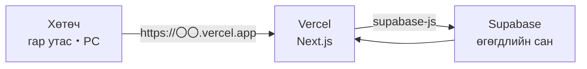
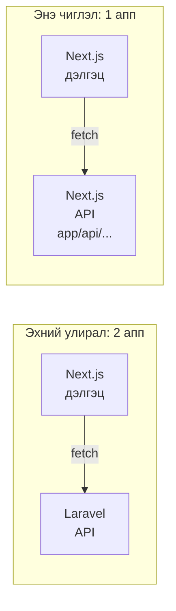
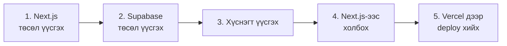
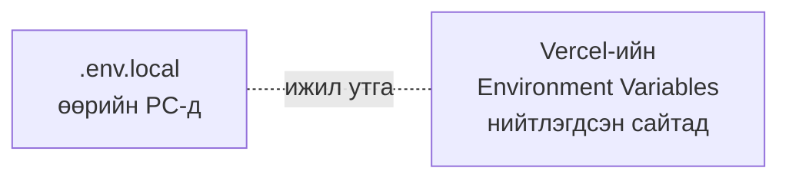

# Чөлөөт бүтээл A. Deploy чиглэл — Next.js + Vercel + Supabase

> 🇯🇵 Эх хувь (япон хэлээр): [2026_10_09_資料2.md](<../../../2年生_システム開発実践/後期/2026_10_09/2026_10_09_資料2.md>) <!-- original-ja-link -->

Хийсэн аппаа **интернэтэд нийтэлж**, гар утас болон найзын PC-ээс ч ашиглаж болохоор болгох чиглэл юм.

> 💰 **Бүгдийг үнэгүй хийж болно**
> | Үйлчилгээ | Ашиглах төлөвлөгөө |
> |---------|----------|
> | Next.js | Үнэгүй (нээлттэй эх) |
> | Vercel | **Hobby** (үнэгүй. Хувийн, ашгийн бус хэрэглээнд) |
> | Supabase | **Free** (үнэгүй) |
>
> Кредит карт бүртгүүлэх шаардлагагүй. Төлбөртэй төлөвлөгөө рүү шилжихийг санал болгосон ч сонгохгүй байгаарай.

[«Чөлөөт бүтээл: Өөрийн дуртай зүйлээ хөгжүүлцгээе» рүү буцах](./2026_10_09_資料1.md)

---

## 1. Бүтэц

Эхний улиралд өгөгдөл боловсруулалтыг Laravel, өгөгдөл хадгалалтыг MySQL хийж байсан.
Энэ чиглэлд тэр 2-ын оронд **Supabase** ашиглана.



| Нэр | Юу вэ? | Эхний улиралтай харьцуулбал |
|------|-----------|------------|
| **Next.js** | Дэлгэц бүтээнэ (**backend API ч хийж болно**) | school-frontend (＋ Laravel API) |
| **Vercel** | Next.js-ийг интернэтэд нийтэлнэ | (байхгүй) |
| **Supabase** | Интернэт дээрх өгөгдлийн сан. API-г ч автоматаар бэлдэж өгнө | Laravel API ＋ MySQL |

### Next.js бол full-stack framework

Эхний улиралд "дэлгэц нь Next.js, API нь Laravel" гэж 2 апп болгон хувааж хийсэн.
Гэвч Next.js бол **full-stack framework** учраас **дэлгэц (frontend) болон API (backend)-г нэг төсөлд хийж болно.**



`app/api/` дотор `route.ts` үүсгэвэл тэр нь API болно (**Route Handler** гэж нэрлэдэг).

```ts
// app/api/hello/route.ts
export async function GET() {
  return Response.json({ message: "こんにちは" });
}
```

`npm run dev`-ээр эхлүүлээд http://localhost:3000/api/hello-ийг нээвэл JSON буцаж ирнэ.

| | Эхний улирал (Laravel) | Next.js |
|---|---|---|
| URL тогтоох | `routes/api.php`-д бичнэ | `app/api/〇〇/route.ts`-ийн **фолдерын байршлаар** тогтоно |
| Боловсруулалт бичих | Controller-ийн метод | `GET` / `POST` гэх мэт функц |
| JSON буцаах | `return response()->json([...])` | `return Response.json({...})` |

**Ийм үед Next.js-ийн API-г ашиглана**

- Гадаад API (AI гэх мэт) ашиглахдаа **API түлхүүрийг хөтчид харуулахыг хүсэхгүй** үед
  (API доторх боловсруулалт сервер дээр ажилладаг тул `NEXT_PUBLIC_`-гүй орчны хувьсагчийг аюулгүй ашиглаж болно)
- Өгөгдлийг хадгалахаас өмнө сервер талд шалгамаар байгаа үед

> Энгийн өгөгдөл оруулах, гаргах бол дэлгэцээс Supabase руу шууд холбоход OK.
> "Сервер талд хиймээр зүйл" гарч ирвэл Next.js-ийн API хийцгээе.

## 2. Бэлтгэлийн дараалал



### 2-1. Next.js төсөл үүсгэх

Цаг агаарын мэдээний апптай адил `create-next-app`-аар үүсгэж, GitHub руу push хийчихнэ.
→ [Цаг агаарын мэдээний аппын материал](../2026_10_02/2026_10_02_資料2.md)

### 2-2. Supabase төсөл үүсгэх

1. https://supabase.com/-ийг нээж, `Start your project` → **GitHub-ээр нэвтрэх**
2. `New project`-ийг дарж, дараах байдлаар бөглөнө

| Зүйл | Оруулах агуулга |
|------|------------|
| Project name | Аппын нэр |
| Database Password | Хүчтэй нууц үг (`Generate a password` хангалттай. Тэмдэглэж авна) |
| Region | **Northeast Asia (Tokyo)** |
| Төлөвлөгөө | **Free (үнэгүй)** |

### 2-3. Хүснэгт үүсгэх

Зүүн цэсний `Table Editor` → `Create a new table`-ээр төлөвлөгөөний хуудсандаа төлөвлөсөн хүснэгтээ үүсгэнэ.
`Enable Row Level Security (RLS)`-ийг **асаалттай чигт нь** үлдээнэ (доорх анхааруулгыг хараарай).

### 2-4. Next.js-ээс холбох

Supabase-ийн `Project Settings` → `API Keys`-ээс **Project URL** болон **Publishable key** (эсвэл anon key)-г хуулж авна.
Next.js төсөлдөө Supabase ашиглах package суулгана.

```bash
npm install @supabase/supabase-js
```

Төслийн үндсэн фолдерт `.env.local` үүсгэж, хуулсан утгуудаа бичнэ.

```bash
NEXT_PUBLIC_SUPABASE_URL=https://xxxxxxxx.supabase.co
NEXT_PUBLIC_SUPABASE_KEY=хуулж авсан Publishable key
```

`lib/supabase.ts` үүсгэж, Supabase-д холбогдох бэлтгэлээ хийнэ.

```ts
import { createClient } from "@supabase/supabase-js";

export const supabase = createClient(
  process.env.NEXT_PUBLIC_SUPABASE_URL!,
  process.env.NEXT_PUBLIC_SUPABASE_KEY!
);
```

Дараа нь өгөгдөл авчрах, нэмэх зэргийг хийж болно.

| Хийх зүйл | Supabase | Эхний улирлын Laravel-тай харьцуулбал |
|------------|---------|----------------------|
| Бүгдийг авчрах | `supabase.from("books").select("*")` | `Book::all()` |
| Нэмэх | `supabase.from("books").insert({ title: "..." })` | `Book::create([...])` |
| Устгах | `supabase.from("books").delete().eq("id", 1)` | `Book::find(1)->delete()` |

> ⚠️ **RLS (Row Level Security)-д анхаар**
> RLS асаалттай хүснэгтэд **policy (хэн унших, бичих эрхтэйг тогтоох дүрэм)** үүсгэхгүй бол өгөгдөл хоосон буцаж ирнэ.
> `Authentication` → `Policies`-ээс хүснэгт бүрт policy нэмээрэй.
> "Өгөгдөл авч чадахгүй байна!" үед эхлээд эндээс шалгана. Ойлгохгүй бол багшийг дуудаарай.

> ⚠️ **`secret` түлхүүр (service_role түлхүүр)-ийг ашиглахгүй**
> `NEXT_PUBLIC_` угтвартай утгуудыг хөтчөөс хэн ч харж чадна.
> Энд **зөвхөн Publishable key (anon key)**-г оруулна. `secret` түлхүүр оруулбал өгөгдлийн санг хэн ч өөрчилж чадах болно.

### 2-5. Vercel дээр deploy хийх

Цаг агаарын мэдээний апптай ижил алхмаар deploy хийнэ. → [Vercel дээр deploy хийх](../2026_10_02/2026_10_02_資料3.md#2-vercel-дээр-үнэгүй-deploy-хийх)

Гэхдээ энэ удаа **орчны хувьсагч тохируулах шаардлагатай**.
Vercel төслийн `Settings` → `Environment Variables`-д `.env.local`-тэй ижил 2 утгыг бүртгээд, дахин deploy хийнэ.



> `.env.local` нь GitHub руу push хийгддэггүй (`.gitignore`-д орсон байдаг).
> Тиймээс Vercel дээр ч тусад нь бүртгэх шаардлагатай.

---

## 3. Эндээс цааш хийж байгаад сурна

Бэлтгэл хийгдсэн бол дараа нь **өөрийн хийхийг хүссэн зүйлээ хийж байгаад** суралцана.
"Энэ функцийг хиймээр байна → судлах → турших → ажиллалаа!" гэдгийг давтах явцад ашиглаж чадах технологи чинь нэмэгдэнэ.

Эргэлзвэл **өөрийн хамгийн чухал гэж үзсэн зүйлээ** эргэн санаарай. "Энэ хэсгийг л заавал ингэж хиймээр байна" гэсэн бодол тань дараа нь юу сурахыг зааж өгнө.

Дуусгасан бол **нийтэлсэн URL болон GitHub-ийн URL**-ыг портфолио болгон илгээж болно.

> ⚠️ **Supabase-ийг хэсэг хугацаанд ашиглахгүй бол түр зогсдог**
> Үнэгүй төлөвлөгөөнд **1 долоо хоног орчим хандалт байхгүй бол төсөл түр зогсоно**.
> Зогссон үед нийтэлсэн URL-ыг нээсэн ч өгөгдөл харагдахгүй.
> Supabase-ийн dashboard-оос дахин эхлүүлбэл хэвэндээ орно (өгөгдөл устахгүй).
> **Илгээхийн өмнө болон ярилцлагын өмнө нийтэлсэн URL-аа өөрөө нээж, ажиллаж байгаа эсэхийг шалгаарай.**
→ [Портфолио болгон илгээх](./2026_10_09_資料1.md#5-портфолио-болгон-илгээх)

[Материал 1-ийн "Хийж байгаад сурах"](./2026_10_09_資料1.md#4-хийж-байгаад-сурах)-ыг ч хамт уншаарай.
