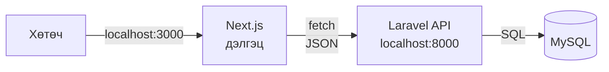
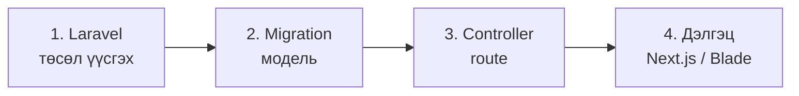

# Чөлөөт бүтээл B. Локал орчны чиглэл — Laravel гэх мэт

> 🇯🇵 Эх хувь (япон хэлээр): [2026_10_09_資料3.md](<../../../2年生_システム開発実践/後期/2026_10_09/2026_10_09_資料3.md>) <!-- original-ja-link -->

Өөрийн PC (`localhost`) дээр ажиллуулах чиглэл юм.

[Чөлөөт бүтээл: Өөрийн дуртай зүйлээ хөгжүүлцгээе руу буцах](./2026_10_09_資料1.md)

---

Эхний улирлын **сурагчийн бүртгэлийн апп**-тай ижил хослолоор хийнэ. Шинээр сурах зүйл цөөн тул **функц бүтээхэд анхаарлаа төвлөрүүлж** чадна.

---

## 1. Хийх аргаа сонгох

Хийх арга 2 янз байна.

| Хийх арга | Агуулга | Хэнд тохирох вэ |
|-------|------|---------|
| **Laravel API ＋ Next.js** | Эхний улиралтай адил. Дэлгэц нь Next.js, өгөгдөл нь Laravel | Эхний улиралд үзсэн зүйлээ давтангаа бүтээхийг хүссэн хүн |
| **Зөвхөн Laravel (Blade)** | Дэлгэцийг мөн Laravel-ийн Blade-ээр хийнэ | Бүтцээ энгийн байлгахыг хүссэн хүн |

---

## 2. Бэлтгэлийн дараалал

Эхний улирлын материал болон бэлэн болсон кодыг лавлагаа болгон ашиглаарай.

- Ерөнхий дараалал → [Хөгжүүлэлтийн урсгал: тэгээс эхлэн API бүтээх хүртэл](../../前期/開発の流れ_まとめ.md)
- Эхний улирлын давталт → [Эхний улирлын давталт (сэргээн санах)](../2026_10_02/2026_10_02_資料1.md)
- Бэлэн хувилбарын код → [portfolio](../../前期/portfolio/)

> **"Laravel гэх мэт" гэдэг дэх "гэх мэт"**
> Эхний улиралд ашигласнаас өөр зүйлээр (Python гэх мэт) хиймээр байгаа хүмүүс багштайгаа зөвлөлдөөрэй.

---

## 3. Эндээс цааш бүтээх явцдаа суралцана

Бэлтгэлээ хангасны дараа **өөрийн хийхийг хүссэн зүйлээ бүтээх явцдаа** суралцана.
"Энэ функцийг хиймээр байна → судлах → турших → ажиллалаа!" гэдгийг давтах явцад ашиглаж чадах технологи чинь нэмэгдэнэ.

Юу хийхээ мэдэхгүй болсон үедээ **өөрийн чухалчилж буй зүйлээ** эргэн санаарай. "Энэ хэсгийг л заавал ингэж хиймээр байна" гэсэн бодол тань дараа нь юу сурах хэрэгтэйг зааж өгнө.

Дуусгасны дараа **GitHub-ийн URL**-ыг портфолио болгон илгээж болно. README-д **дэлгэцийн зураг, бичлэг зэрэг** оруулж, хэрхэн ажиллаж байгааг нь харуулаарай.
→ [Портфолио болгон илгээх](./2026_10_09_資料1.md#5-портфолио-болгон-илгээх)

[Материал 1-ийн "Хийж байгаад сурах"](./2026_10_09_資料1.md#4-хийж-байгаад-сурах)-ыг ч хамт уншаарай.
