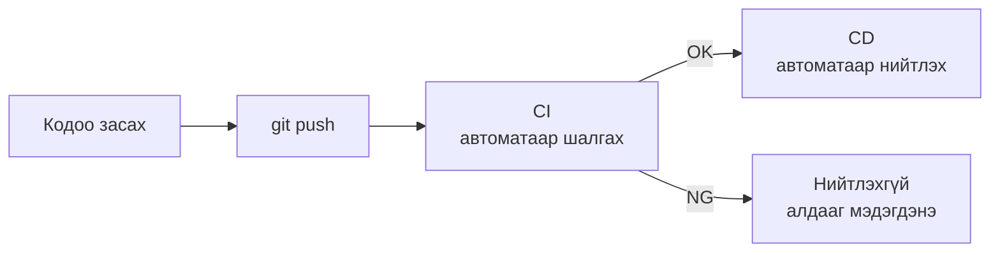
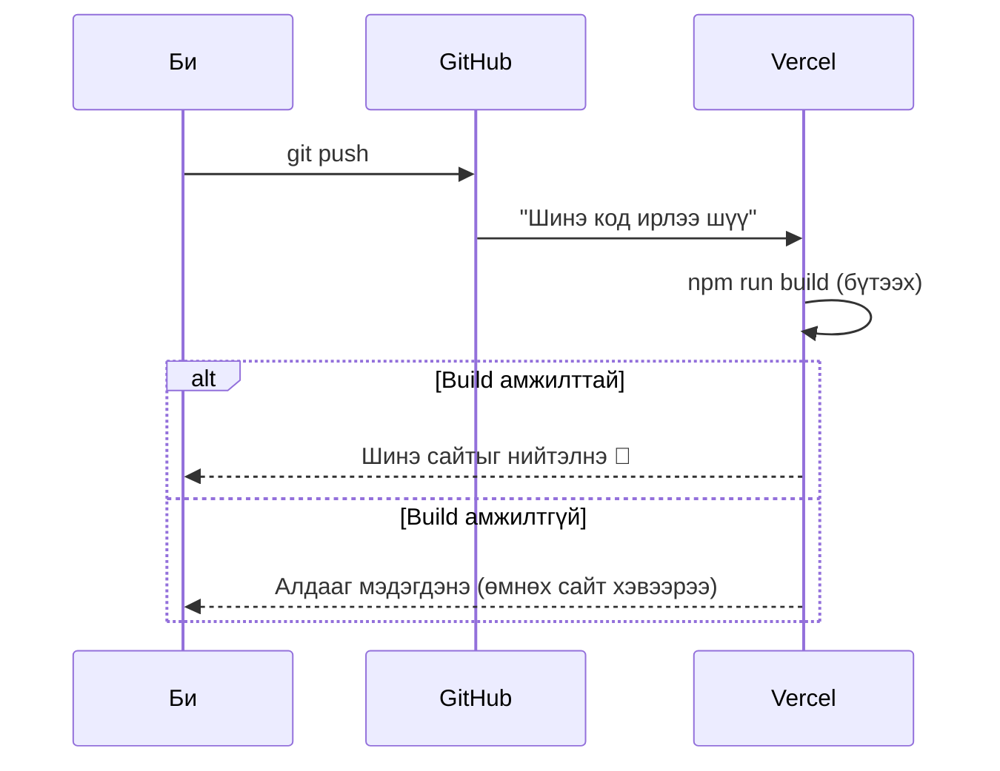
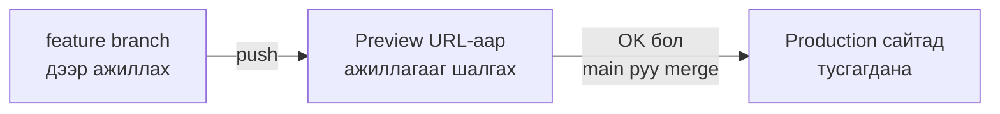
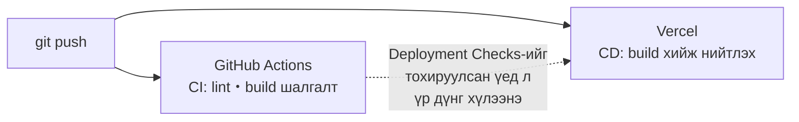

# CI/CD-ийн тухай

> 🇯🇵 Эх хувь (япон хэлээр): [CICDについて.md](<../../../2年生_システム開発実践/後期/2026_10_09/CICDについて.md>) <!-- original-ja-link -->

Deploy чиглэлд GitHub руу push хийхэд л Vercel дээрх сайт шинэчлэгдэж байсан.
Үнэндээ энэ бол **CI/CD (си-ай/си-ди)**-ийн механизм юм.
Энд CI/CD гэж юу болохыг харцгаая.

[Чөлөөт бүтээл A. Deploy чиглэл рүү буцах](./2026_10_09_資料2.md)

---

## 1. CI/CD гэж юу вэ

**CI/CD** бол "код бичсэний дараах ажлыг **автоматжуулах**" механизм юм.

| Нэр | Албан ёсны нэр | Утга | Товчхондоо |
|------|----------|------|-----------|
| **CI** | Continuous Integration (тасралтгүй нэгтгэл) | Push хийх бүрт **автоматаар шалгана** | Автомат шалгалт |
| **CD** | Continuous Delivery / Deployment (тасралтгүй хүргэлт／байршуулалт) | Шалгалтад тэнцвэл **автоматаар нийтэлнэ** | Автоматаар нийтлэх |

> 💡 **"Бие даалтын ажил хүлээлгэн өгөх"-тэй зүйрлэвэл**
> - **CI** ＝ Хүлээлгэн өгөхөөс өмнө үсгийн алдаа болон хуудасны тоог **автоматаар шалгаж өгдөг** функц
> - **CD** ＝ Шалгалтад тэнцвэл **багшид автоматаар хүлээлгэн өгдөг** функц
>
> Гараар хийвэл "шалгахаа мартсан", "хүлээлгэн өгөхөө мартсан" гэх зүйл гардаг. Автоматжуулбал үргэлж ижил байдлаар хийж чадна.

> 📝 **CD-ийн 2 утга**
> CD нь **тасралтгүй хүргэлт** (хэзээ ч нийтэлж болох төлөвт байлгаж, нийтлэх товчийг хүн дардаг) болон **тасралтгүй байршуулалт** (нийтлэх хүртэлх бүх үйлдэл автомат) гэсэн 2 утгатай.
> Энэ материал дахь Vercel шиг push хийхэд автоматаар нийтлэгддэг нь **тасралтгүй байршуулалт** юм.

---

## 2. CI/CD байхгүй бол яах вэ?

CI/CD байхгүй бол код засах бүрдээ **гараар** ажил хийнэ.


- Шалгахаа мартаж, **алдаатай кодыг нийтэлчихнэ**
- Байршуулах файлаа **андуурна**
- Үргэлж ижил ажил хийдэг тул **цаг их зарцуулна**

CI/CD байвал ийм болно.



**Өөрийн хийх зүйл бол зөвхөн `git push`** юм.

---

## 3. Vercel CD-г хийж өгдөг

Vercel болон GitHub-ийг холбовол **push хийх бүрт автоматаар deploy** хийгдэнэ. Энэ бол **CD** юм.



> 📝 **Build амжилтгүй болсон ч сайт эвдрэхгүй**
> Build амжилтгүй болбол **өмнөх хувилбарын сайт хэвээрээ** харагдана.
> Vercel-ийн `Deployments` дэлгэцээс амжилтгүй болсон шалтгааныг (алдааны мессеж) шалгаарай.

### Branch бүрт "туршилтын URL" үүсдэг

Vercel дээр branch-аас хамаарч нийтлэгдэх байдал өөр байна.

| Push хийсэн branch | Юу болох вэ? | URL |
|------------------|-----------|-----|
| `main` | **Production сайт** шинэчлэгдэнэ | `https://〇〇.vercel.app` |
| Бусад (`feature/login` гэх мэт) | **Туршилтын сайт (Preview)** үүснэ | `https://〇〇-git-feature-login-〇〇.vercel.app` гэх мэт |



Шинэ функцийг **branch үүсгэж, Preview URL-аар шалгасны дараа main руу merge** хийвэл production сайтыг эвдэхгүй байж чадна.
Эхний улиралд багаар хөгжүүлэхдээ сурсан **branch → pull request → merge** дараалалтай ижил.

---

## 4. CI-г хийж үзэх (GitHub Actions)

Vercel хийж өгдөг зүйл нь голчлон CD.
**CI (автомат шалгалт)**-г **GitHub Actions** гэдэг GitHub-ийн функцээр нэмж болно (нээлттэй repository бол үнэгүй. Хаалттай repository ч сар бүр тогтоосон хугацаа хүртэл үнэгүй).

### 4-1. Тохиргооны файл үүсгэх

Төсөлдөө `.github/workflows/ci.yml` үүсгэнэ.

```yaml
# .github/workflows/ci.yml
name: CI

# Хэзээ ажиллуулах вэ: push болон pull request хийх үед
on:
  push:
  pull_request:

jobs:
  check:
    runs-on: ubuntu-latest   # GitHub-ийн бэлдсэн PC дээр ажиллана
    steps:
      - uses: actions/checkout@v6      # Кодыг татаж авна
      - uses: actions/setup-node@v6    # Node.js суулгана
        with:
          node-version: 24
      - run: npm ci                    # Package-уудыг суулгана
      - run: npm run lint              # Кодын бичлэгийг шалгана
      - run: npm run build             # Build хийж болох эсэхийг шалгана
```

> ⚠️ **`npm run lint` ажиллахгүй бол**
> `create-next-app` дээр **Linter-т None сонгосон** төсөлд `lint` script байхгүй. Тэр тохиолдолд `npm run lint` мөрийг устгаарай.
> Мөн Next.js 16-аас эхлэн `next lint` команд байхгүй болсон. Хуучин төсөлд `"lint": "next lint"` гэж байвал `"lint": "eslint"` болгож өөрчилнө.
> `package.json`-ийн `"scripts"`-ийг харж, `lint` байгаа эсэхийг шалгаарай.

| Мөр | Утга |
|----|------|
| `on:` | **Хэзээ** ажиллуулах |
| `runs-on:` | **Хаана** ажиллуулах (GitHub-ийн компьютерийг ашиглана) |
| `steps:` | **Юу** хийх (дээрээс доош дарааллаар ажиллуулна) |

### 4-2. Үр дүнг харах

Файлаа push хийвэл GitHub repository-ийн **`Actions`** табаас үр дүнг харж болно.

| Тэмдэг | Утга |
|------|------|
| ✅ Ногоон чагт | Бүх шалгалтад тэнцсэн |
| ❌ Улаан загалмай | Хаа нэгтээ амжилтгүй болсон → дарвал алдааг харж болно |

Pull request-ийн дэлгэц дээр ч үр дүн харагддаг тул **merge хийхээс өмнө асуудлыг анзаарч чадна**.

> ⚠️ **GitHub Actions амжилтгүй болсон ч Vercel deploy хийнэ**
> GitHub Actions (CI) болон Vercel (CD) нь **тус тусдаа** ажилладаг.
> Тиймээс юу ч тохируулахгүй бол CI ❌ байсан ч Vercel-ийн build амжилттай болвол **production сайт шинэчлэгдэнэ**.
> "CI ✅ үед л production-д гаргах"-ыг хүсвэл Vercel-ийн **Deployment Checks** гэдэг функцийг ашиглана.
> Төслийн `Settings` доторх `Build and Deployment` хэсгийн Deployment Checks дээр `Add Checks`-ийг дарж, GitHub Actions-ийн шалгалтыг сонгоно (дэлгэрэнгүйг [Vercel-ийн баримт бичиг](https://vercel.com/docs/deployment-checks)-ээс харна уу).

CI болон CD-ийн хамаарлыг зургаар үзүүлбэл дараах байдалтай.



> 💡 **README-д badge байрлуулбал портфолиод давуу тал болгон харуулж болно**
> `Actions` табын workflow-г нээж, `Filter workflow runs`-ийн хажууд байгаа `⋮` → `Create status badge` → `Copy status badge Markdown`-оор badge-ийн код үүсгэж болно.
> README-д байрлуулбал "CI/CD ашиглан хөгжүүлж байгаа" нь шууд харагдана.

---

## 5. CI/CD-ийн давуу тал

- **Алдааг эрт анзаарч чадна**: push хийнгүүт шалгагдана
- **Нийтлэх нь амархан**: зөвхөн `git push`-ээр production-д тусгагдана
- **Үргэлж ижил алхмаар хийж чадна**: гар ажиллагааны алдаа арилна
- **Багаар хөгжүүлэхэд тохиромжтой**: хэний код ч ижил дүрмээр шалгагдана

Бодит хөгжүүлэлтийн ажлын байранд CI/CD-г **бараг заавал** ашигладаг.
Чөлөөт бүтээлдээ ашиглаж үзвэл ажилд орохдоо ярьж болох туршлагатай болно.

---

## 6. Дүгнэлт

- **CI** ＝ push хийвэл **автоматаар шалгана**, **CD** ＝ шалгалтад тэнцвэл **автоматаар нийтэлнэ**
- Vercel автоматаар шалгадаг зүйл нь зөвхөн **build амжилттай болох эсэх**. GitHub Actions-ийн үр дүнгээс хамааран сайтыг нийтлэхийг зогсоохыг хүсвэл **Deployment Checks**-ийг тохируулна
- Vercel нь GitHub-тай холбогдож, **push хийх бүрт автоматаар deploy (CD)** хийж өгдөг
- `main`-ээс бусад branch-ийг **Preview URL**-аар шалгаж болно
- **GitHub Actions** ашиглавал lint болон build-ийн **автомат шалгалт (CI)**-ыг нэмж болно
- Өөрийн хийх зүйл бол **зөвхөн `git push`**

[Чөлөөт бүтээл A. Deploy чиглэл рүү буцах](./2026_10_09_資料2.md)
