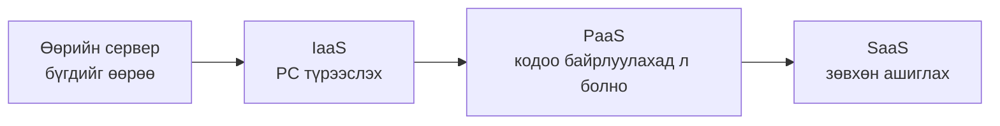
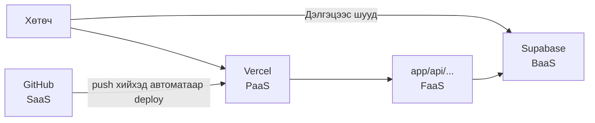

# IaaS・PaaS・SaaS・BaaS-ийн тухай

> 🇯🇵 Эх хувь (япон хэлээр): [IaaS_PaaS_SaaS_BaaSについて.md](<../../../2年生_システム開発実践/後期/2026_10_09/IaaS_PaaS_SaaS_BaaSについて.md>) <!-- original-ja-link -->

Cloud үйлчилгээний талаар судлахад **IaaS (айас)**・**PaaS (пас)**・**SaaS (сас)**・**BaaS (бас)** гэх мэт үгс байнга гардаг.
Бүгд "〇〇 as a Service (〇〇-ийг үйлчилгээ хэлбэрээр ашиглах)"-ийн товчлол бөгөөд **хэр зэргийг үйлчилгээнд даатгах вэ** гэсэн ялгааг илэрхийлдэг.

[Чөлөөт бүтээл A. Deploy чиглэл рүү буцах](./2026_10_09_資料2.md)

---

## 1. Товчхондоо

| Нэр | Албан ёсны нэр | Түрээслэх зүйл | Товчхондоо |
|------|----------|-----------|-----------|
| **IaaS** | Infrastructure as a Service | **Сервер (PC) өөрийг нь** | Хоосон PC түрээслэнэ |
| **PaaS** | Platform as a Service | **Апп ажиллуулах орчин** | Кодоо байрлуулбал ажиллана |
| **BaaS** | Backend as a Service | **Backend-ийн функцүүд** | Өгөгдлийн сан, нэвтрэлт анхнаасаа байдаг |
| **FaaS** | Function as a Service | **Функц ажиллуулах орчин** | Зөвхөн функц бичихэд л ажиллана |
| **SaaS** | Software as a Service | **Бэлэн апп** | Шууд ашиглахад л болно |

Доош явах тусам **өөрөө хийх зүйл цөөн** болно.

---

## 2. Пиццагаар жишээлбэл

| | Өөрөө хийх зүйл | Пиццагаар бол |
|---|---|---|
| **Өөрийн сервер** | Бүгд | Гурилаар пиццаны зуурмаг хийж, зуухаа ч өөрөө худалдаж авна |
| **IaaS** | OS・програм хангамжийг бэлтгэх, апп хийх | Гал тогоо, зуух түрээсэлж, орцоо бэлтгэхээс эхлэн өөрөө хийнэ |
| **PaaS** | Зөвхөн апп (код) | Зуурмаг, зуух бэлэн байгаа. Зөвхөн пиццан дээрээ орох орцыг өөрөө тавина |
| **SaaS** | Юу ч хийхгүй (зөвхөн ашиглана) | Хүргэлтийн пицца захиалаад идэхэд л болно |

→ Баруун тийш явах тусам **амархан**. Зүүн тийш явах тусам **чөлөөтэй тохируулж болно**.

---

## 3. Хэн юуг удирдах вэ?

Апп ажиллуулахад янз бүрийн "давхарга" хэрэгтэй.
**🟦 = өөрөө удирдана**, **⬜ = үйлчилгээ удирдаж өгнө**.

| Давхарга | Өөрийн сервер | IaaS | PaaS | SaaS |
|----|:---:|:---:|:---:|:---:|
| Апп (өөрийн код) | 🟦 | 🟦 | 🟦 | ⬜ |
| Өгөгдөл | 🟦 | 🟦 | 🟦 | ⬜ |
| PHP・Node.js зэрэг ажиллах орчин | 🟦 | 🟦 | ⬜ | ⬜ |
| OS (Linux гэх мэт) | 🟦 | 🟦 | ⬜ | ⬜ |
| Сервер (PC-ийн их бие) | 🟦 | ⬜ | ⬜ | ⬜ |
| Сүлжээ・барилга・цахилгаан | 🟦 | ⬜ | ⬜ | ⬜ |

---

## 4. Тус бүрийг дэлгэрэнгүй

### 4-1. IaaS (айас) — Хоосон PC түрээслэх

Интернэтээр дамжуулан алсад байгаа **нэг PC түрээслэн ашиглаж байна** гэж төсөөлж болно.
OS суулгах, PHP болон MySQL суулгах зэргийг **өөрөө** хийнэ.

- **Жишээ**: AWS-ийн EC2, Google Cloud-ийн Compute Engine, Sakura Cloud
- **Давуу тал**: юуг ч чөлөөтэй хийж болно
- **Хүндрэлтэй тал**: тохиргоо болон аюулгүй байдлын арга хэмжээг бүгдийг өөрөө хийх шаардлагатай

> Эхний улирлын Laravel-ийг IaaS дээр нийтэлбэл "Linux суулгах → PHP・MySQL суулгах → кодоо байрлуулах → 24 цаг ажиллуулах"-ыг бүгдийг өөрөө хийнэ.

### 4-2. PaaS (пас) — Кодоо байрлуулбал ажиллана

**Апп ажиллуулах орчин анхнаасаа бүрдсэн** үйлчилгээ юм.
Өөрөө **зөвхөн кодоо бэлдэхэд** л нийтлэх хүртэл бүгдийг хариуцаж өгнө.

- **Жишээ**: **Vercel**, Render, Heroku, Google App Engine
  (Heroku 2026 онд шинэ функцийн хөгжүүлэлтээ зогсооно гэж зарласан. PaaS-ийн эртний, түгээмэл жишээ учраас нэр нь байнга дурдагддаг)
- **Давуу тал**: серверийн тохиргоо шаардлагагүй. Зөвхөн `git push`-ээр нийтэлж болно
- **Хүндрэлтэй тал**: үйлчилгээний дэмждэг хэл болон ашиглах боломжтой аргуудаар хязгаарлагдана

> 🎯 **Deploy чиглэлд ашиглах Vercel бол PaaS юм.**
> Next.js-ийн кодоо GitHub руу push хийхэд л интернэтэд нийтэлж чадсан.

### 4-3. BaaS (бас) — Backend анхнаасаа байдаг

**Өгөгдлийн сан・нэвтрэх функц・файл хадгалалт зэрэг backend-ийн функцүүдийг нэг дор олгодог** үйлчилгээ юм.
Backend-ийн кодыг (эхний улирлынхаар бол Laravel API) **өөрөө бичихгүйгээр** апп хийж болно.

- **Жишээ**: **Supabase**, Firebase
- **Давуу тал**: frontend (дэлгэц) бүтээхэд анхаарлаа төвлөрүүлж чадна
- **Хүндрэлтэй тал**: нарийн төвөгтэй боловсруулалтад тусдаа API хийх шаардлагатай

| Хийх зүйл | Эхний улирал (өөрөө хийнэ) | Supabase (BaaS) |
|------------|-----------------|-----------------|
| Өгөгдөл хадгалах | Laravel API ＋ MySQL | Анхнаасаа байдаг |
| Нэвтрэх функц | Өөрөө хийнэ | Анхнаасаа байдаг (Authentication) |
| Зураг хадгалах | Өөрөө хийнэ | Анхнаасаа байдаг (Storage) |

> 🎯 **Deploy чиглэлд ашиглах Supabase бол BaaS юм.**

### 4-4. FaaS (фас) — Зөвхөн функц бичихэд л ажиллана

**Нэг функц бичвэл дуудагдсан үед л ажиллуулж өгдөг** үйлчилгээ юм.
"Serverless"-ийн гол үзэл санаа юм. → [Serverless-ийн тухай](./サーバレスについて.md)

- **Жишээ**: **Vercel Functions** (Next.js-ийн `app/api/〇〇/route.ts`), AWS Lambda, Cloudflare Workers
- **Давуу тал**: ашигласан хэмжээгээрээ л төлбөр төлнө. Хандалт нэмэгдсэн ч автоматаар зохицуулна
- **Хүндрэлтэй тал**: удаан үргэлжлэх боловсруулалтад тохиромжгүй. Функц дотор өгөгдөл хадгалж үлдээж чадахгүй

### 4-5. SaaS (сас) — Бэлэн апп ашиглах

**Бэлэн болсон аппыг интернэтээр дамжуулан шууд ашигладаг** үйлчилгээ юм.
Та бүхний өдөр бүр ашигладаг зүйлсийн ихэнх нь SaaS.

- **Жишээ**: Gmail, Google Docs, **GitHub**, Slack, Zoom, Notion
- **Давуу тал**: суулгах ч, удирдах ч шаардлагагүй. Шууд ашиглаж болно
- **Хүндрэлтэй тал**: аппын дотоод ажиллагааг өөрөө өөрчилж чадахгүй

> Чөлөөт бүтээлдээ хийсэн аппаа нийтэлж, бусдад ашиглуулбал тэр ч бас **SaaS** юм.

---

## 5. Deploy чиглэлийн бүтцэд хэрэглэвэл

| Ашиглаж буй зүйл | Төрөл |
|--------------|------|
| GitHub | SaaS (кодыг удирддаг бэлэн үйлчилгээ) |
| Vercel | PaaS (Next.js ажиллуулах орчин) |
| Next.js-ийн API (`app/api/`) | FaaS (Vercel дээр дуудагдсан үед л ажилладаг функц) |
| Supabase | BaaS (өгөгдлийн сан・нэвтрэлт зэрэг backend) |

> 📝 **Яг таг ангилах боломжгүй тохиолдол ч бий**
> "Vercel бол PaaS, мөн FaaS ч олгодог" гэх мэтээр нэг үйлчилгээ олон дүр төрхтэй байх тохиолдол бий.
> Нэрийг цээжлэхээс илүү **"хэр зэргийг үйлчилгээнд даатгаж байна вэ"** гэдгээр бодож чаддаг болоорой.

---

## 6. Дүгнэлт

- "〇〇 as a Service" нь **хэр зэргийг үйлчилгээнд даатгах вэ** гэсэн ялгаа
- **IaaS**: PC түрээслэнэ (чөлөөтэй ч хүндрэлтэй)
- **PaaS**: кодоо байрлуулбал ажиллана (Vercel)
- **BaaS**: backend-ийн функцүүд анхнаасаа байдаг (Supabase)
- **FaaS**: зөвхөн функц бичихэд л ажиллана (Vercel дээрх Next.js-ийн API)
- **SaaS**: бэлэн аппыг ашиглахад л болно (Gmail・GitHub)
- Даатгах тусам **амархан**, өөрөө хийх тусам **чөлөөтэй**

[Чөлөөт бүтээл A. Deploy чиглэл рүү буцах](./2026_10_09_資料2.md)
