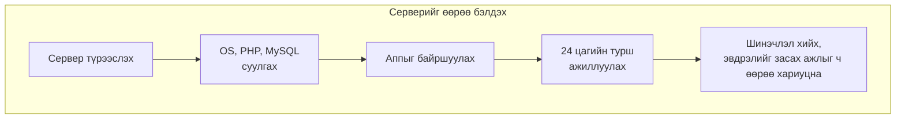
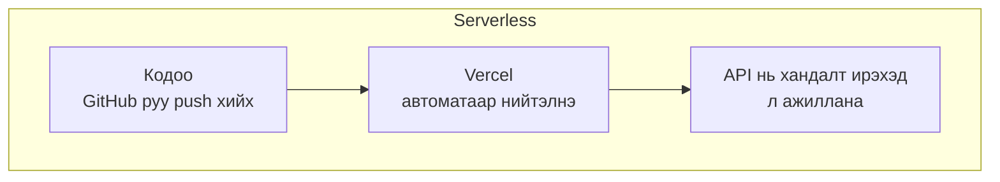
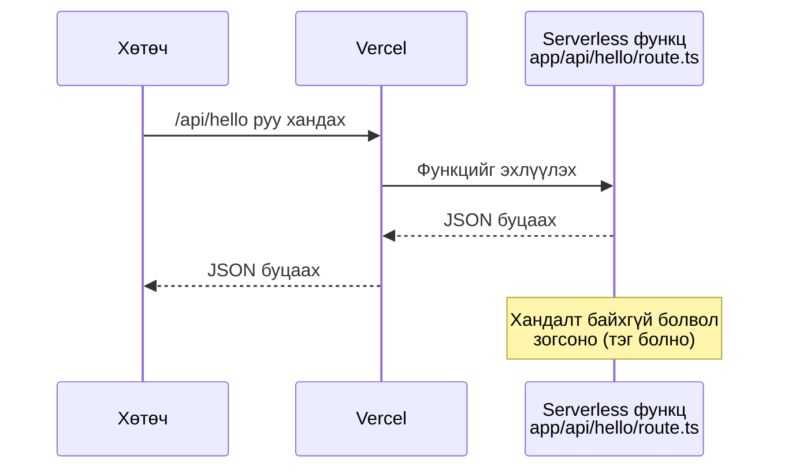
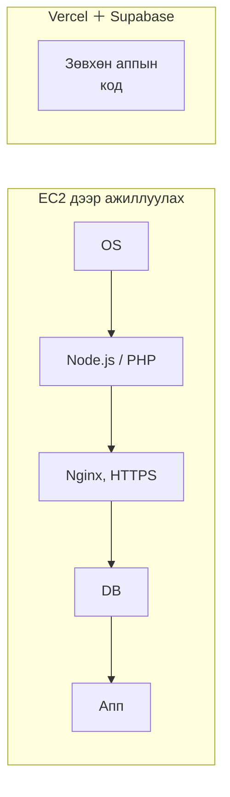

# Serverless-ийн тухай

> 🇯🇵 Эх хувь (япон хэлээр): [サーバレスについて.md](<../../../2年生_システム開発実践/後期/2026_10_09/サーバレスについて.md>) <!-- original-ja-link -->

Deploy чиглэлд ашиглах **Vercel** дээр Next.js-ийн API нь "**serverless**" гэж нэрлэгддэг механизмаар ажилладаг.
Энд serverless гэж юу болохыг өмнөх улиралд үзсэн Laravel-тэй харьцуулж үзье.

[Чөлөөт бүтээл A. Deploy чиглэл рүү буцах](./2026_10_09_資料2.md)

---

## 1. Serverless гэж юу вэ

**Serverless (сервергүй)** гэдэг нь "сервер байхгүй" гэсэн утгатай биш.
Сервер **байгаа**. Харин **серверийг өөрөө бэлдэж, удирдах шаардлагагүй** механизмыг хэлдэг.

> 💡 **"Такси"-тай зүйрлэвэл**
> - **Серверийг өөрөө бэлдэх** ＝ машин худалдаж авах. Зогсоол, техникийн үзлэг, бензин, эвдрэл гарвал засуулах зэргийг бүгдийг өөрөө хариуцна
> - **Serverless** ＝ таксинд суух. Очих газраа хэлэхэд л болно, машиныг жолооч (компани) хариуцна
>
> Аль алинд нь "машин" ашиглаж байна. Ялгаа нь **хэн удирдаж байгаа** явдал юм.

---

## 2. Өмнөх улирлын аргатай харьцуулж үзье

Өмнөх улиралд өөрийн компьютер дээр `php artisan serve`-г ажиллуулж Laravel-ийн серверийг асааж байсан.
Хэрэв үүнийг интернэтэд нийтлэх бол **тасралтгүй ажиллах серверийг** өөрөө бэлдэх хэрэгтэй.





| | Серверийг өөрөө бэлдэх | Serverless (Vercel гэх мэт) |
|---|---|---|
| Сервер бэлдэх | Өөрөө хийнэ (OS, програм суулгана) | **Шаардлагагүй** |
| Ажиллаж буй хугацаа | **24 цагийн турш** | **Хандалт ирэх үед л** |
| Хандалт гэнэт өсвөл | Серверээ өөрөө нэмнэ | **Автоматаар нэмэгдэнэ** |
| Шинэчлэл, аюулгүй байдлын арга хэмжээ | Өөрөө хийнэ | Үйлчилгээ хийж өгнө |
| Зардал | Ашиглаагүй ч төлбөр гарна | **Ашигласан хэмжээгээрээ** (бага бол үнэгүй) |

---

## 3. "Хандалт ирэх үед л ажиллана" гэдэг нь

Serverless-ийн хамгийн гол онцлог нь **дуудагдсан үедээ л ажилладаг** явдал юм.

Материал 2-т хийсэн Next.js-ийн API (`app/api/〇〇/route.ts`) нь Vercel руу deploy хийхэд **serverless функц (Vercel Functions)** болж ажиллана.



```ts
// app/api/hello/route.ts
export async function GET() {
  return Response.json({ message: "こんにちは" });
}
```

Та өөрөө бичих зүйл бол **зөвхөн энэ функц**.
"Серверийг асаах", "портын дугаар тогтоох" зэрэг ажлыг Vercel хийж өгнө.

---

## 4. Supabase бол serverless уу?

Supabase ч мөн адил **серверийг удирдах шаардлагагүй**. Өмнөх улиралд MySQL-ийг өөрийн компьютер (XAMPP эсвэл Homebrew) дээр ажиллуулж байсан бол
Supabase-д **өгөгдлийн сангийн бэлтгэл болон API хийх ажлыг Supabase хийж өгнө**.

| Хийх зүйл | Өмнөх улирал (Laravel ＋ MySQL) | Supabase |
|---------|------------------------|----------|
| Өгөгдлийн санг ажиллуулах | XAMPP гэх мэтээр өөрөө асаана | Supabase ажиллуулж өгнө |
| Хүснэгт үүсгэх | Migration бичнэ | Table Editor-оор үүсгэж болно |
| Өгөгдөл оруулах, гаргах API | Controller, route-ийг өөрөө бичнэ | **Автоматаар бэлэн болно** |

Гэхдээ Supabase-ийн өгөгдлийн сан **зөвхөн дуудагдсан үедээ ажилладаг гэсэн үг биш**.
Төсөл бүрт өгөгдлийн сангийн сервер бэлдэгдэж, **тасралтгүй ажиллаж байдаг** (үнэгүй төлөвлөгөөнд долоо хоног орчим ашиглахгүй бол түр зогсдог нь үүнтэй холбоотой).

| | Vercel-ийн API (serverless функц) | Supabase-ийн өгөгдлийн сан |
|---|---|---|
| Серверийн удирдлага | Шаардлагагүй | Шаардлагагүй |
| Ажиллаж буй хугацаа | **Дуудагдсан үед л** | **Үргэлж ажиллаж байдаг** |
| Төрөл | Serverless (FaaS) | **BaaS** (backend-ээ даатгах үйлчилгээ) |

> ⚠️ **Үнэгүй төлөвлөгөөнд автомат backup байхгүй**
> Supabase өдөр бүр автоматаар backup хийж өгдөг нь зөвхөн төлбөртэй төлөвлөгөөнд.
> Үнэгүй төлөвлөгөөнд уствал асуудал болох өгөгдлөө өөрөө гаргаж (экспорт хийж) хадгалаарай.

> 📝 **"Serverless" гэдэг үгийн хэрэглээ**
> "Серверийг удирдах шаардлагагүй" гэсэн өргөн утгаар Supabase шиг үйлчилгээг ч "serverless" гэж нэрлэх нь бий.
> Гэхдээ энэ материалд хэлж буй "дуудагдсан үедээ л ажилладаг" serverless-ээс арай өөр учраас Supabase-ийг **BaaS** гэж санаарай.
> → [IaaS・PaaS・SaaS・BaaS-ийн тухай](./IaaS_PaaS_SaaS_BaaSについて.md)

---

## 5. Давуу тал ба анхаарах зүйл

### Давуу тал 👍

- **Шууд нийтэлж болно**: GitHub руу push хийхэд л deploy болно
- **Зардал бага**: Ашигласан хэмжээгээрээ. Оюутны хувийн аппад үнэгүй төлөвлөгөө хангалттай
- **Хандалт өсөөд ч асуудалгүй**: Боловсруулах хүчин чадал автоматаар нэмэгдэнэ
- **Апп хийхэд анхаарлаа төвлөрүүлж болно**: Серверийн удирдлагын талаар бодох шаардлагагүй

### Анхаарах зүйл ⚠️

| Анхаарах зүйл | Энэ юу гэсэн үг вэ? |
|---------------|--------------|
| **Эхний хандалт бага зэрэг удаан байж магадгүй** | Хэсэг хугацаанд ашиглагдаагүй бол функц зогссон байдаг тул асахад цаг зарцуулна (үүнийг **cold start** гэдэг). Одоогийн Vercel-д энэ хугацааг нэлээд богиносгох арга хэмжээ авсан |
| **Урт боловсруулалт хийхэд тохиромжгүй** | Нэг удаагийн боловсруулалтад хугацааны дээд хязгаар бий (Vercel-ийн үнэгүй төлөвлөгөөнд **дээд тал нь 5 минут**). Хүнд боловсруулалтад тохиромжгүй |
| **Функц дотор өгөгдөл хадгалж болохгүй** | Функц хэзээ зогсохыг мэдэхгүй тул хувьсагч эсвэл файлд хадгалсан ч **дараагийн удаа үлдсэн байх баталгаагүй** → **Өгөгдлийг Supabase-д хадгална** |
| **Үнэгүй төлөвлөгөөнд хязгаар бий** | Хэт их ашиглавал зогсож магадгүй. Төлбөртэй төлөвлөгөө сонгохгүй байгаарай |

> 📝 **"Өгөгдөл функц дотор үлддэггүй" гэдэг нь маш чухал**
> Laravel-ийн үеийнх шиг **өгөгдлийг өгөгдлийн санд хадгалах** нь үндсэн зарчим.
> Serverless функц доторх хувьсагч дараагийн хандалтын үед **устсан байж магадгүй** гэж бодоорой.
> Нөгөө талаас, Vercel-д нэг функц олон хандалтыг зэрэг боловсруулах тохиолдол ч байдаг тул **хувьсагч өөр хүний хандалттай хуваалцагдах** боломжтой. Хэрэглэгч бүрийн өгөгдлийг функцийн гаднах хувьсагчид хийхээс зайлсхийгээрэй.

---

## 6. Хэрэв serverless ашиглахгүй бол? (EC2 дээр ажиллуулах тохиолдол)

Serverless-ийн ач тусыг **серверийг өөрөө бэлдэх тохиолдол**-той харьцуулахад илүү сайн ойлгоно.
Энд AWS-ийн **EC2** (интернэтийн нөгөө талд байгаа нэг компьютер түрээслэх үйлчилгээ) дээр ажиллуулах тохиолдлыг үзье.

EC2 бол зүгээр л **хоосон компьютер (Linux)** түрээслэх явдал. Node.js ч, PHP ч суугаагүй.
→ Дэлгэрэнгүйг [IaaS・PaaS・SaaS・BaaS-ийн тухай](./IaaS_PaaS_SaaS_BaaSについて.md)-ийн IaaS хэсгээс үзээрэй.

### 6-1. Next.js-ийг EC2 дээр ажиллуулбал

| Хийх зүйл | Агуулга | Vercel дээр бол |
|---|---|---|
| 1. EC2 үүсгэх | OS (Ubuntu гэх мэт) сонгож асаана | Шаардлагагүй |
| 2. Node.js суулгах | `nvm` гэх мэтээр Node.js суулгана | Шаардлагагүй |
| 3. Кодоо татаж авах | `git clone` хийнэ | GitHub-аа холбоход л болно |
| 4. Орчны хувьсагч тавих | `.env.local` гэх мэтийг өөрөө үүсгэнэ | Дэлгэц дээр бүртгэнэ |
| 5. Build хийж асаах | `npm ci` → `npm run build` → `npm run start` | Автомат |
| 6. Тасралтгүй ажиллуулах | Терминалаа хаасан ч зогсохгүйн тулд **PM2** гэх мэт хэрэгсэл ашиглана | Автомат |
| 7. Порт нээх | EC2-ийн **security group**-д 80, 443 портыг нээнэ | Шаардлагагүй |
| 8. Nginx байршуулах | Next.js нь 3000 порт дээр ажилладаг тул **Nginx**-ээр 80, 443 портоос дамжуулна | Шаардлагагүй |
| 9. HTTPS болгох | **Let's Encrypt** гэх мэтээр гэрчилгээ авч, шинэчлэлийг ч үргэлжлүүлнэ | Автомат |
| 10. Шинэчлэх үед | Тухай бүр нэвтэрч орж `git pull` → build → дахин асаана | Зөвхөн `git push` |
| 11. Үргэлжлүүлэн удирдах | OS-ийн шинэчлэл, аюулгүй байдлын арга хэмжээ, сервер унасан үеийн арга хэмжээ | Шаардлагагүй |

### 6-2. Laravel-ийг EC2 дээр ажиллуулбал

Laravel-ийн хувьд суулгах зүйл бүр ч олон болно.

| Хийх зүйл | Агуулга | Өмнөх улиралд (өөрийн компьютер дээр) |
|---|---|---|
| 1. EC2 үүсгэх | OS (Ubuntu гэх мэт) сонгож асаана | Өөрийн компьютер |
| 2. PHP суулгах | PHP өөрөө болон Laravel-ийн ашигладаг өргөтгөлүүд (`mbstring`, `xml`, `curl`, MySQL-тэй холбогдох `pdo_mysql` гэх мэт) | XAMPP эсвэл Homebrew |
| 3. Composer суулгах | PHP-ийн package удирдах хэрэгсэл | Суулгасан |
| 4. Web сервер суулгах | **Nginx ＋ PHP-FPM** (PHP-г ажиллуулах механизм) суулгаж, `public/` хавтсыг нийтлэх тохиргоо хийнэ | `php artisan serve` |
| 5. MySQL бэлдэх | EC2 дээр өөрөө суулгах эсвэл AWS-ийн **RDS** (өгөгдлийн сангийн үйлчилгээ) ашиглана | XAMPP эсвэл Homebrew |
| 6. Кодоо татаж авах | `git clone` → `composer install --no-dev` | Адилхан |
| 7. `.env` үүсгэх | `APP_ENV=production`, `APP_DEBUG=false`, DB-ийн холболтын хаяг зэргийг бичээд `php artisan key:generate` | Адилхан (production-д зориулсан утга болгоно) |
| 8. Хүснэгт үүсгэх | `php artisan migrate --force` | `php artisan migrate` |
| 9. Эрх тохируулах | `storage/` болон `bootstrap/cache/`-д Web сервер бичиж чаддаг болгоно | Анхаарах шаардлагагүй байсан |
| 10. Порт нээх, HTTPS | 80, 443 портыг нээж, Let's Encrypt-ээр гэрчилгээ авна | Шаардлагагүй байсан |
| 11. Шинэчлэх үед | `git pull` → `composer install` → `migrate` → cache-ийг дахин үүсгэх (`php artisan optimize`) | — |
| 12. Үргэлжлүүлэн удирдах | OS, PHP-ийн шинэчлэл, аюулгүй байдлын арга хэмжээ, гэмтлийн үеийн арга хэмжээ | — |

> ⚠️ **Production орчинд анхаарах зүйл**
> - **`php artisan serve`-г production-д ашигладаггүй.** Энэ нь хөгжүүлэлтэд зориулсан энгийн сервер бөгөөд олон хандалтыг даах зориулалттай биш. Оронд нь Nginx ＋ PHP-FPM ашиглана (тиймээс Next.js-ийн үеийн PM2 ердийн үед хэрэггүй).
> - **`APP_DEBUG=true` хэвээр нь нийтэлж болохгүй.** Алдааны дэлгэц дээр нууц үг зэрэг чухал мэдээлэл харагдах аюултай.

### 6-3. Харьцуулж үзвэл



Өмнөх улирлын оюутны удирдлагын аппыг (Next.js ＋ Laravel API ＋ MySQL) EC2 дээр нийтлэх гэвэл **6-1 ба 6-2 хоёулаа** шаардлагатай болно.
Deploy чиглэлд **Vercel ＋ Supabase** ашигладаг нь ийм бэлтгэл, удирдлагыг даатгаж, **апп хийхэд анхаарлаа төвлөрүүлэх** зорилготой.

> 💡 **EC2 дээр ажиллуулахад ч утга учир бий**
> Бүгдийг өөрөө хийх нь хэцүү ч, тэр хэрээр **сервер хэрхэн ажилладгийг сайн ойлгож**, бүхнийг хүссэнээрээ тохируулж чадна.
> Бодит компаниудад ч EC2 шиг серверийг түгээмэл ашигладаг. Сонирхсон хүмүүс чөлөөт бүтээлээ хийсний дараа туршаад үзээрэй.

---

## 7. Дүгнэлт

- Serverless гэдэг нь "сервер байхгүй" биш, **серверийг удирдах шаардлагагүй** механизм
- **Хандалт ирэх үед л** ажиллаж, **ашигласан хэмжээгээрээ** төлбөр гарна
- Vercel руу deploy хийсэн Next.js-ийн API нь **serverless функц** болж ажиллана
- Supabase-д ч удирдлагаа даатгаж болох ч өгөгдлийн сан нь **үргэлж ажиллаж байдаг**. Serverless гэхээсээ илүү **BaaS**
- Өгөгдлийг функц дотор биш, **өгөгдлийн санд хадгална**
- EC2 шиг сервер дээр ажиллуулбал Node.js, PHP, Nginx, HTTPS, өгөгдлийн сан зэргийг **бүгдийг өөрөө бэлдэж, удирдах** шаардлагатай

[Чөлөөт бүтээл A. Deploy чиглэл рүү буцах](./2026_10_09_資料2.md)
