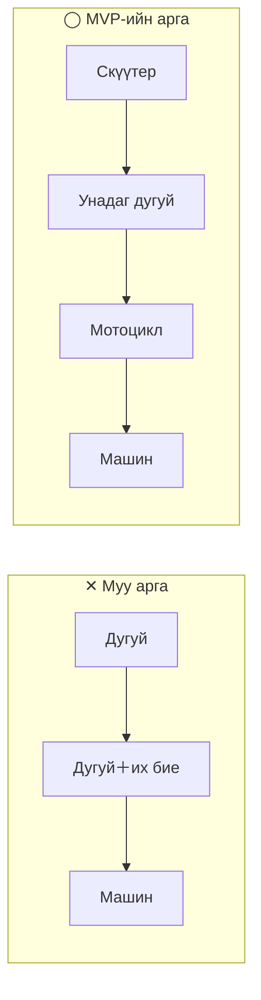
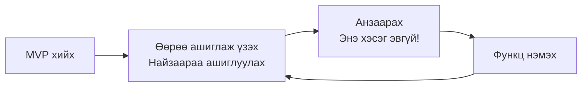
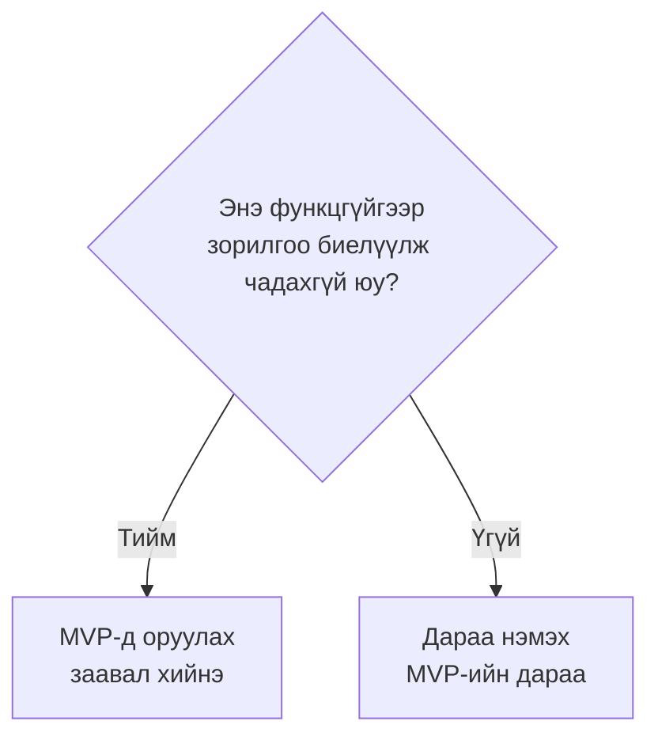
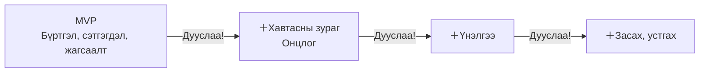
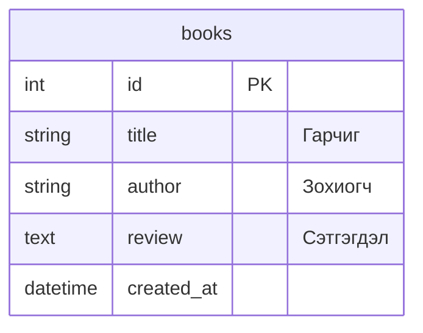

# MVP: Эхлээд "ашиглахад хангалттай хамгийн энгийн хувилбар"-ыг бүтээж дуусгая

> 🇯🇵 Эх хувь (япон хэлээр): [2026_10_16_資料1.md](<../../../2年生_システム開発実践/後期/2026_10_16/2026_10_16_資料1.md>) <!-- original-ja-link -->

## 1. MVP гэж юу вэ

Өнгөрсөн удаа [Эхлээд жижгээр хийх](../2026_10_09/2026_10_09_資料1.md#эхлээд-жижгээр-хийх) тухай ярьсан.
Энэ "жижгээр хийсэн зүйл"-д нэр бий. Тэр нь **MVP** юм.

| Товчлохоос өмнө | Утга |
|-------|------|
| **M**inimum | Хамгийн бага |
| **V**iable | Ашиглаж болох, амьдрах чадвартай |
| **P**roduct | Бүтээгдэхүүн, апп |

Өөрөөр хэлбэл MVP гэдэг нь **"Энэ байхад л ашиглаж болно" гэсэн хамгийн энгийн апп** юм.
Бодит компаниудад ч шинэ үйлчилгээ хийхдээ эхлээд MVP хийж нийтлээд, хэрэглэгчдийн хариу үйлдлийг харангаа хөгжүүлдэг.

> 💡 **"Карри будаа"-тай зүйрлэвэл**
> Карриний MVP бол "будаа ＋ карриний соус". Зөвхөн үүгээр **карри болгон идэхэд хангалттай**.
> Тонкацу, бяслаг, даршилсан ногоо бол дараа нь нэмж болох зүйлс.
> Харин нэмэлт зүйлс хэчнээн их байсан ч **соус байхгүй** бол карри болгон идэж чадахгүй.

---

## 2. MVP-ийн тухай түгээмэл буруу ойлголт

MVP бол "дутуу хийсэн зүйл" биш. **Жижиг ч гэсэн бүрэн ашиглаж болох** нь чухал.



| | ✕ Муу арга | ◯ MVP-ийн арга |
|---|---|---|
| 1 дэх удаа | Зөвхөн дугуй → **Явж чадахгүй** | Скүүтер → **Явж чадна!** |
| 2 дахь удаа | Дугуй＋их бие → **Одоо ч явж чадахгүй** | Унадаг дугуй → **Илүү хурдан явж чадна** |
| Дундаас хугацаа дуусвал | **Юу ч ашиглаж чадахгүй** | **Ашиглаж болох зүйл гарт үлдэнэ** |

- ✕ хувилбарт эцэс хүртэл хийж дуусгахгүй бол **нэг ч удаа ашиглаж чадахгүй**
- ◯ хувилбарт аль ч шатанд зогссон **"шилжиж явах" гэсэн зорилгоо биелүүлж чадна**

Апп ч мөн адил. "Зөвхөн нэвтрэх дэлгэц төгс", "Зөвхөн дизайн төгс" боловч **гол функц нь ажиллахгүй** байх нь ✕ загвар юм.

---

## 3. Яагаад MVP-ээс эхэлж хийх вэ?

### ① Дуусгаж чадалгүй орхихоос сэргийлнэ

Чөлөөт бүтээлд хамгийн их тохиолддог алдаа бол **хэт олон функц шахаж, дуусгаж чадалгүй орхих** явдал.
MVP-ээ эхэлж хийчихвэл **аль ч шатанд хугацаа дууссан "ажилладаг апп" гарт үлдэнэ**.

### ② Эрт ашиглаж үзвэл жинхэнэ хэрэгтэй зүйл нь ойлгогдоно

Хийхээсээ өмнө бодсон "байвал сайн байна" гэсэн зүйл нь бодитоор ашиглаж үзэхэд **хэрэггүй байсан** нь олонтаа.
Эсрэгээрээ, ашиглаж үзээд л "Энэ байхгүй бол эвгүй юм байна!" гэж анзаардаг функц ч бий.



### ③ Портфолио болгон эхлээд "үзүүлж болох" төлөвт хүрнэ

Ажилд орохоор материалаа өгөхдөө **дуусаагүй апп**-ыг үзүүлэхэд хэцүү.
MVP бэлэн бол хэзээ ч **"ажилладаг зүйл" болгон илгээж болох төлөвт** байна.
Өөрийн онцгойлон анхаарах зүйлсээ түүн дээр **бага багаар нэмээд явбал** болно.

---

## 4. MVP-ийг хэрхэн тодорхойлох вэ

### Алхам 1: Аппын зорилгыг нэг өгүүлбэрээр бичих

Эхлээд аппыг **"хэн", "юу хийхэд" ашиглахыг** нэг өгүүлбэрээр бичнэ.

```
〇〇 хүн △△ хийхэд зориулсан апп
```

| Апп | Зорилго (1 өгүүлбэр) |
|-------|-----------|
| Уншсан номын тэмдэглэл | Ном унших дуртай хүн **уншсан ном болон сэтгэгдлээ тэмдэглэж, эргэн харах** зориулалттай апп |
| Дасгалын тэмдэглэл | Хүчний дасгал хийдэг хүн **өдөр бүрийн дасгал болон давталтын тоогоо тэмдэглэх** зориулалттай апп |
| Дугуйлангийн ирцийн хүснэгт | Дугуйлангийн менежер **бэлтгэлийн ирцийг нэгтгэх** зориулалттай апп |

> Энэ өгүүлбэрийн **тод бичсэн хэсэг** бол аппын "соус". Энэ хэсэг хийгдэхгүй бол апп болж чадахгүй.

### Алхам 2: Хийхийг хүссэн бүх функцээ бичиж гаргах

Санаанд орсон функцээ эргэлзэлгүйгээр **бүгдийг** бичиж гаргана. Энд хийж чадах эсэхийг одоохондоо бодох шаардлагагүй.

**Уншсан номын тэмдэглэлийн аппын жишээ**

- Ном бүртгэх (гарчиг, зохиогч)
- Сэтгэгдэл бичих
- Үнэлгээ (1〜5 од) өгөх
- Бүртгэсэн номнуудаа жагсаалтаар харах
- Номыг засах, устгах
- Хавтасны зургийг харуулах
- Ном хайх
- Төрлөөр ангилах
- Нэвтрэх функц
- Найзуудтайгаа ном хуваалцах
- Уншсан номын тоог график болгох

### Алхам 3: "Байхгүй бол зорилгоо биелүүлж чадахгүй юу?" гэдгээр ангилах

Бичиж гаргасан функцуудаа нэг нэгээр нь хараад **"Үүнгүйгээр зорилгоо (алхам 1-ийн өгүүлбэр) биелүүлж чадахгүй юу?"** гэж өөрөөсөө асуу.



**Уншсан номын тэмдэглэлийн аппын жишээ** (зорилго: уншсан ном болон сэтгэгдлээ тэмдэглэж, эргэн харах)

| Функц | Үүнгүйгээр зорилгоо биелүүлж чадахгүй юу? | Ангилал |
|------|-------------------|------|
| Ном бүртгэх (гарчиг, зохиогч) | Тийм (тэмдэглэж чадахгүй) | **MVP** |
| Сэтгэгдэл бичих | Тийм (сэтгэгдлээ тэмдэглэж чадахгүй) | **MVP** |
| Бүртгэсэн номнуудаа жагсаалтаар харах | Тийм (эргэн харж чадахгүй) | **MVP** |
| Үнэлгээ (1〜5 од) өгөх | Үгүй (сэтгэгдэл байвал тэмдэглэж болно) | Дараа |
| Номыг засах, устгах | Үгүй (байхгүй ч тэмдэглэж, эргэн харж болно) | Дараа |
| Хавтасны зургийг харуулах | Үгүй | Дараа |
| Ном хайх | Үгүй (номын тоо цөөн байхад жагсаалт хангалттай) | Дараа |
| Төрлөөр ангилах | Үгүй | Дараа |
| Нэвтрэх функц | Үгүй (зөвхөн өөрөө ашиглах бол хэрэггүй) | Дараа |
| Найзуудтайгаа ном хуваалцах | Үгүй | Дараа |
| Уншсан номын тоог график болгох | Үгүй | Дараа |

> 💡 **MVP-ийн функц 3 орчим байх нь зохимжтой**. 5 ба түүнээс олон болвол "Үнэхээр үүнгүйгээр зорилгоо биелүүлж чадахгүй юу?" гэж дахин асууж үзээрэй.

> ⚠️ **Нэвтрэх функцийг MVP-д оруулахгүй байх нь элбэг**
> Нэвтрэх функц хэцүү бөгөөд цаг их зарцуулдаг ч ихэнх тохиолдолд **аппын зорилго өөрөө биш**.
> Эхлээд нэвтрэлтгүйгээр ажилладаг зүйл хийж, хэрэгтэй болсон үед дараа нь нэмээрэй.

### Алхам 4: "Дараа нэмэх" функцуудыг эрэмбэлэх

"Дараа нэмэх" функцуудад **хийхийг хүссэн дарааллаа** өгнө.
Энд хамгийн чухалчлах зүйл бол өнгөрсөн удаа ярьсан **өөрийн онцгойлон анхаарах зүйл** юм.

| Дараалал | Функц | Шалтгаан |
|-----|------|------|
| 1 | Хавтасны зургийг харуулах | **Номын тавиур шиг харагдуулмаар байна** (хамгийн гол онцлог) |
| 2 | Үнэлгээ (1〜5 од) өгөх | Санал болгох номыг нэг харцаар мэдэж болно |
| 3 | Номыг засах, устгах | Алдаа гаргасан үед засмаар байна |
| 4 | Төрлөөр ангилах | Номын тоо нэмэгдвэл хэрэгтэй |
| … | … | … |



Онцгойлон анхаарсан функцээ **MVP-ийн дараа шууд** хийхийг зөвлөж байна.
Зөвхөн MVP-тэй бол бусдынхтай төстэй апп болох хандлагатай ч, онцлог нэмэгдсэнээр **"зөвхөн өөрийн апп"** болно.

---

## 5. MVP-д хэрэгтэй хүснэгтийг төлөвлөх

Хүснэгтийг ч **зөвхөн MVP-д хэрэгтэй баганаас** эхэлнэ. Баганыг дараа нь migration (Supabase бол удирдлагын дэлгэц)-оор нэмж болно.



Үнэлгээ (`rating`) болон хавтасны зураг (`image_url`)-ийг тухайн функцийг хийх үедээ нэмэхэд болно.

