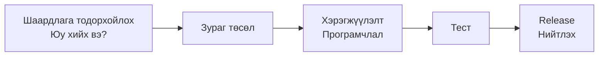
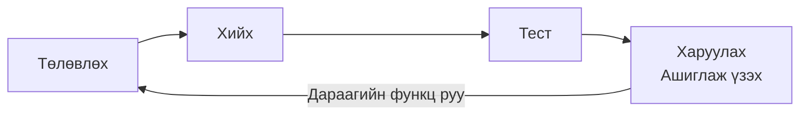
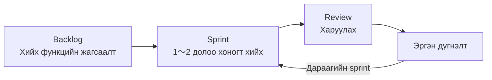

# Agile хөгжүүлэлтийн тухай

> 🇯🇵 Эх хувь (япон хэлээр): [アジャイル開発について.md](<../../../2年生_システム開発実践/後期/2026_10_23/アジャイル開発について.md>) <!-- original-ja-link -->

Өнгөрсөн удаа эхлээд жижиг хэмжээтэйгээр бүрэн хийж дуусгах **MVP**-ийн талаар үзсэн.
"Жижгээр хийж, ашиглаж үзээд, бага багаар хөгжүүлэх" гэсэн хийх аргад нэр бий. Тэр нь **Agile хөгжүүлэлт** юм.
Энд эртнээс хэрэглэгдэж ирсэн **Waterfall хөгжүүлэлт**-тэй харьцуулж үзье.

[Чөлөөт бүтээл рүү буцах](../2026_10_09/2026_10_09_資料1.md)

---

## 1. Товчхондоо

| Нэр | Дуудлага | Явуулах арга | Товчхондоо |
|------|-------|-------|-----------|
| **Waterfall хөгжүүлэлт** | Waterfall (хүрхрээ) | Бүгдийг тодорхойлсны дараа дарааллаар нь нэг удаа хийнэ | Төлөвлөгөөний дагуу хийх |
| **Agile хөгжүүлэлт** | Agile (шуурхай) | Жижгээр хийж, давтан сайжруулна | Хийх явцдаа хөгжүүлэх |

---

## 2. Waterfall хөгжүүлэлт

**Хүрхрээний ус дээрээс доош урсдаг шиг**, үе шатуудыг нэг нэгээр нь дарааллаар явуулна.
Өмнөх үе шат дуусахаас нааш дараагийн үе шат руу шилжихгүй. Үндсэндээ **буцаж ухрахгүй** гэсэн зарчимтай.

| Давуу тал 👍 | Анхаарах зүйл ⚠️ |
|------------|-----------------|
| Эхэндээ бүгдийг тодорхойлдог тул **хуваарь, зардлыг урьдчилан тооцоолоход хялбар** | Дундаас нь "Ингэвэл дээр юм байна" гэж **хэлэхэд хэцүү** |
| Үе шат бүрээр хариуцагчдыг хуваахад хялбар | Хэрэглэгч ажилладаг зүйлийг харах нь **хамгийн сүүлд** |
| Банк, төрийн байгууллага зэрэг **алдаа гаргаж болохгүй** системд тохиромжтой | Сүүлд нь "Бодож байснаас өөр байна" гэвэл **дахин хийхэд маш хэцүү** |

---

## 3. Agile хөгжүүлэлт

**Жижиг функц бүрээр "Төлөвлөх → Хийх → Шалгах"-ыг давтаж**, аппаа бага багаар хөгжүүлнэ.
Нэг давталт нь **1〜4 долоо хоног орчим** богино хугацаатай.

| Давуу тал 👍 | Анхаарах зүйл ⚠️ |
|------------|-----------------|
| **Эрт үе шатанд ажилладаг зүйл** харж болно | Эцэст нь хэр хэмжээнд хийж чадахаа **эхэндээ харахад хэцүү** |
| Хэрэглэгчийн санал бодлыг **дараагийн давталтад шууд тусгаж** болно | "Ямар ч байсан хийчихье" гэж хандвал **зураг төсөл замбараагүй** болох магадлалтай |
| Дундаас чиглэлээ өөрчлөхөд хялбар | Багаараа **байнга ярилцах** шаардлагатай |

> 💡 **MVP бол Agile хөгжүүлэлтийн "1 дэх удаа"**
> MVP хийж, ашиглаж үзээд, онцгойлон анхаарсан функцээ нэг нэгээр нэмэх——
> Чөлөөт бүтээлээ хийх энэ арга нь яг Agile хөгжүүлэлт юм.

---

## 4. Харьцуулж үзье

**"Хоол хийх"**-тэй зүйрлэж үзье.

| | Waterfall | Agile |
|---|---|---|
| Явуулах арга | Цэсийн хоолыг **бүгдийг нь урьдчилан сонгож**, хүйтэн зуушнаас амттан хүртэл дарааллаар нь хийж, **сүүлд нь нэг дор гаргана** | Эхлээд нэг хоол хийж **амсуулаад**, сэтгэгдлийг нь сонсож, дараагийн хоолоо шийднэ |
| Дундах өөрчлөлт | "Загас биш мах байвал дээр" гэвэл маш хэцүү | Дараагийн хоолыг өөрчлөхөд л болно |
| Тохиромжтой нөхцөл | Хуримын хоол (цэс эхнээсээ тодорхой) | Гэр бүлийн хоол (тухайн өдрийн сэтгэл санаагаар өөрчлөгдөнө) |

Аль нь зөв гэж байхгүй. **Хийх зүйлээсээ хамааран сонгож хэрэглэнэ.**

---

## 5. Scrum — Agile хөгжүүлэлтийн нэг арга

Agile хөгжүүлэлтийн аргуудаас хамгийн алдартай нь **Scrum** юм. Регби тоглоомд баг мөр зэрэгцэн нийлдэг "scrum"-аас нэр нь гаралтай.

| Нэр томьёо | Утга | Чөлөөт бүтээлд бол |
|-----|------|---------------|
| **Sprint** | Нэг давталтын хугацаа (1〜4 долоо хоног) | 1〜2 хичээл |
| **Product backlog** | Хийхийг хүссэн функцуудыг **чухлын дарааллаар** эрэмбэлсэн жагсаалт | MVP-ийн материалд хийсэн "Дараа нэмэх функц (хийх дараалал)" |
| **Daily scrum** | Өдөр бүр 15 минут орчмын богино уулзалт | Хичээлийн эхэнд "Өнөөдөр хийх зүйл"-ээ шийдэх |
| **Sprint review** | Хийсэн зүйлээ үзүүлж, санал авах | Найз эсвэл багшаараа ашиглуулах |
| **Эргэн дүгнэлт (Retrospective)** | Ажлын явцаа эргэн харж, дараагийнхад ашиглах | Хичээлийн төгсгөлд "Сайн болсон зүйл, хүндрэлтэй байсан зүйл"-ээ бодох |

> 💡 **GitHub дээр backlog үүсгэж болно**
> GitHub-ийн **Issues**-д "хийхийг хүссэн функц"-ээ нэг нэгээр бүртгэж, **Projects** дээр "Хийх, Хийгдэж буй, Дууссан" гэж байрлуулбал бодит ажлын байран дээрхтэй адил backlog удирдаж болно.

---

## 6. Ажлын байран дээр аль нь түгээмэл вэ?

Сүүлийн үеийн Web үйлчилгээ болон гар утасны аппын хөгжүүлэлтэд **Agile хөгжүүлэлт** өргөн хэрэглэгддэг.
Учир нь хэрэглэгчдийн хариу үйлдлийг ажиглан, бараг долоо хоног бүр эсвэл бүр өдөр бүр шинэчилдэг.

Нөгөө талаар банкны систем, үйлдвэрийн машин удирддаг систем зэрэгт одоо ч **Waterfall хөгжүүлэлт** хэрэглэгдэж байна.
Мөн том чиглэлийг Waterfall-аар тодорхойлж, нарийн хэсгийг Agile-аар явуулдаг **хосолсон** хэлбэр ч бий.

> 💡 **Ажлын ярилцлагад ярьж болно**
> "Чөлөөт бүтээлдээ эхлээд MVP хийж, ашиглаж үзээд функц нэмэх **Agile аргаар** ажилласан" гэж хэлж чадвал хөгжүүлэлтийн явцыг ойлгодог гэдгээ илэрхийлж чадна.

---

## 7. Дүгнэлт

- **Waterfall хөгжүүлэлт** ＝ Бүгдийг тодорхойлсны дараа дарааллаар нь нэг удаа хийнэ (буцаж ухрахгүй)
- **Agile хөгжүүлэлт** ＝ Жижгээр хийж, ашиглаж үзээд, давтан сайжруулна
- **Scrum** бол Agile хөгжүүлэлтийн нэг арга. **Sprint** (богино хугацаа)-ийг давтана
- **MVP → функц нэмэх** гэсэн чөлөөт бүтээлээ хийх арга нь Agile хөгжүүлэлт мөн
- Аль нь зөв гэдэг биш, **хийх зүйлээсээ хамааран сонгож хэрэглэнэ**

[Чөлөөт бүтээл рүү буцах](../2026_10_09/2026_10_09_資料1.md)
