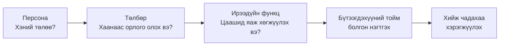
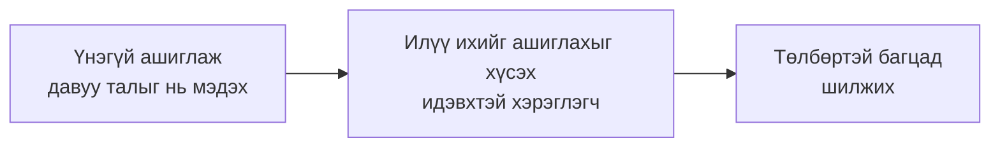
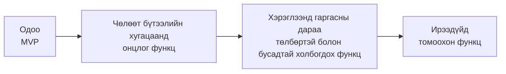
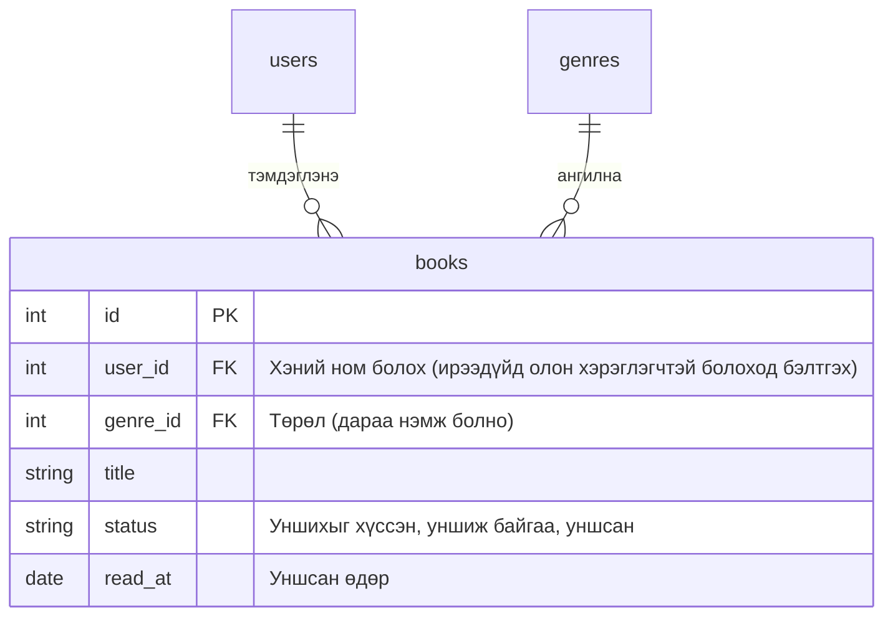
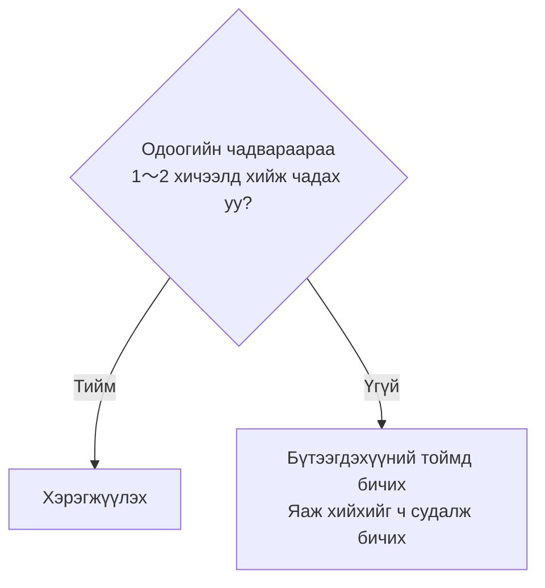

# Чөлөөт бүтээлээ ирээдүйд хэрхэн хөгжүүлэхийг бодож хийх

> 🇯🇵 Эх хувь (япон хэлээр): [自由制作の将来像も考えて作る.md](<../../../2年生_システム開発実践/後期/2026_10_23/自由制作の将来像も考えて作る.md>) <!-- original-ja-link -->

Чөлөөт бүтээлийн аппаа "хичээлийн даалгавар" биш, **үнэхээр хэрэглээнд гаргах үйлчилгээ** гэж бодоод үзье.
**Хэн ашиглах вэ (персона)**, **хаанаас орлого олох вэ (төлбөр)**, **цаашид ямар функц нэмэх вэ** гэдгийг бодож, **бүтээгдэхүүний тойм** баримт бичигт нэгтгэнэ.

[Чөлөөт бүтээл рүү буцах](../2026_10_09/2026_10_09_資料1.md)

---

## 1. Яагаад ирээдүйн дүр төрхийг бодох вэ?



- **Ямар функц хийхээ шийдэхэд хялбар болно**: "Энэ хүнд (персона) хэрэгтэй юу?" гэж бодоод шийдэж болно
- **Ажлын ярилцлагад ярьж болно**: "Хэний ямар асуудлыг шийдэх апп вэ, үйлчилгээгээ хэрхэн тогтвортой үргэлжлүүлэх вэ" гэдгийг тайлбарлаж чадвал **бодож төлөвлөж хийсэн хүн** гэдэг нь ойлгогдоно
- **Компанид ажиллахтай адил**: Компанид апп хийхдээ бүтээж эхлэхээсээ өмнө заавал **төсөл, санаагаа төлөвлөдөг**

> 💡 Бүгдийг хэрэгжүүлэх шаардлагагүй. **Бодсон зүйлээ бүтээгдэхүүний тоймд бичиж үлдээх** төдий ч портфолиогийн хувьд үнэ цэнтэй.

---

## 2. Персона тодорхойлох

### Персона гэж юу вэ

**Персона** гэдэг нь аппыг ашиглах хүнийг **нэг тодорхой хүн** болгон нарийвчлан тодорхойлсон зүйл юм.
"20-иод насны хүн" гэх мэт ерөнхий ангилал биш, **бодитоор байж болох нэг хүнийг** төсөөлнө.

| ✕ Ерөнхий | ◯ Персона |
|----------|----------|
| Ном унших дуртай хүн | Танака Сакура (21 настай, их сургуулийн 3-р курс). Сургууль руугаа галт тэргээр явахдаа сард 3〜4 ном уншдаг. Уншсан номынхоо агуулгыг удалгүй мартдаг, найзууд нь санал болгох ном асуухад хариулж чаддаггүйдээ санаа зовдог |

> 💡 **Яагаад нэг хүнээр хязгаарлах вэ?**
> "Бүх хүнд зориулж" хийвэл хэн бүхэнд **бага зэрэг ашиглахад төвөгтэй** апп болох хандлагатай.
> Нэг хүнээр хязгаарлавал "Сакура бол галт тэргэн дотор **нэг гараараа** тэмдэглэмээр байгаа байх" гэх мэтээр **тодорхой бодож чадна**.

### Персонад тодорхойлох зүйлс

| Зүйл | Жишээ (уншсан номын тэмдэглэлийн апп) |
|-----|-----------------|
| Нэр, нас, ажил мэргэжил | Танака Сакура, 21 настай, их сургуулийн 3-р курс |
| Амьдралын хэв маяг | Сургууль руугаа явахдаа галт тэргэнд өдөр бүр 30 минут ном уншдаг. Гар утас үргэлж биедээ байдаг |
| Мэдээллийн технологи ашиглах чадвар | Олон нийтийн сүлжээ их ашигладаг. Төвөгтэй тохиргоо хийхдээ тааруу |
| Асуудал | Уншсан номынхоо агуулгыг удалгүй мартдаг. Санал болгох ном асуухад хариулж чаддаггүй |
| Зорилго (ямар үр дүнд хүрэхийг хүсэж байна вэ?) | Уншсан ном болон сэтгэгдлээ дараа нь хялбархан эргэн хардаг болох |
| Аппыг ашиглах нөхцөл | Галт тэргэнд уншиж дуусмагцаа **гар утсаараа** тэмдэглэнэ |

> ⚠️ **Зөвхөн өөртөө ашигтай хэрэглэгчийг бүү төсөөл**
> "Өдөр бүр аппаа нээж, бүх функцийг ашигладаг хүн" бараг байдаггүй.
> **Завгүй, залхуу, хурдан уйддаг** гэх мэт бодит хүнийг төсөөлөөрэй.

---

## 3. Хаана төлбөр авахаа бодох

### Орлого олох арга (орлогын загвар)

| Загвар | Механизм | Жишээ |
|-------|------|-----|
| **Зар сурталчилгаа** | Апп үнэгүй. Дэлгэц дээр зар байршуулж, зар захиалагчаас мөнгө авна | YouTube (үнэгүй багц), мэдээний апп |
| **Нэг удаагийн худалдан авалт** | Эхэндээ ганц удаа төлнө | Төлбөртэй гар утасны тоглоом, програм хангамж |
| **Subscription** (захиалга) | Сар бүр, жил бүр төлнө | Netflix, Spotify |
| **Фримиум** | Үндсэн функц нь **үнэгүй**. Илүү хэрэгтэй функц ашиглахыг хүссэн хүн л **төлбөр төлнө** | Spotify, Notion, LINE стикер |

Хувиараа хийх веб аппын хувьд **фримиум** загварыг төлөвлөхөд хамгийн хялбар.

### "Үнэгүй" ба "төлбөртэй"-н хооронд зааг татах

Фримиумд хамгийн чухал нь **хаана хүртэл үнэгүй, хаанаас эхлэн төлбөртэй болгох** явдал.



| Бодох арга | Тайлбар |
|-------|------|
| **Аппын "зорилго"-ыг үнэгүй болгох** | MVP-ийн функц (хамгийн чухал функц) төлбөртэй бол хэн ч ашиглаж эхлэхгүй |
| **Их ашигладаг хүн илүү төлнө** | "〇 хүртэл үнэгүй" гэх мэтээр **хэмжээгээр** зааг тогтооно |
| **Байвал хэрэгтэй ч, байхгүй байсан ч болох зүйлийг** төлбөртэй болгох | Ойлгомжтой график, өгөгдөл экспортлох, дизайн өөрчлөх гэх мэт |
| **Персона мөнгө төлөх шалтгаан**-ыг бодох | "Сакура юуны төлөө сард 300 иен төлөх вэ?" |

**Уншсан номын тэмдэглэлийн аппын жишээ**

| | Үнэгүй багц | Төлбөртэй багц (сард 300 иен) |
|---|---|---|
| Ном бүртгэх | **50 хүртэл ном** | Хязгааргүй |
| Сэтгэгдэл бичих | ◯ | ◯ |
| Жагсаалтаар эргэн харах | ◯ | ◯ |
| Уншсан номын тооны график | ✕ | ◯ |
| Номын тавиурын дизайн өөрчлөх | 1 төрөл | 10 төрөл |
| Зар сурталчилгаа | Байна | **Байхгүй** |

> 💡 **"Сакура"-гаар бодвол**
> Оюутан учраас их мөнгө төлж чадахгүй. Гэхдээ нэг жилийн турш ашиглаж, **уншсан номын тоо нь 50-аас давах** үед тэмдэглэл нь хуримтлагдсан тул уг үйлчилгээг орхихыг хүсэхгүй болсон байна.
> Тэр үед "Хязгааргүй＋график"-ийг сард 300 иенээр санал болговол төлж магадгүй.

---

## 4. Ирээдүйн функцийг бодох

### Функцийг хугацаагаар нь ангилах

[MVP](../2026_10_16/2026_10_16_資料1.md)-д "Дараа нэмэх функц"-үүдийг бичиж гаргасан. Тэдгээрийг **хугацаагаар** нь ангилж байрлуулна.
Энэ "хэзээ, юуг хийх вэ" гэсэн төлөвлөгөөг **roadmap** гэдэг.



| Хугацаа | Функцийн жишээ (уншсан номын тэмдэглэлийн апп) |
|-----|-----------------------|
| **Одоо (MVP)** | Ном бүртгэх, сэтгэгдэл, жагсаалт |
| **Чөлөөт бүтээлийн хугацаанд** | Хавтасны зураг, үнэлгээ (од), хайлт |
| **Хэрэглээнд гаргасны дараа** | Нэвтрэх, төлбөртэй багц, уншсан номын тооны график |
| **Ирээдүйд** | Найзуудтайгаа номын тавиураа хуваалцах, баркод уншуулж ном бүртгэх, хиймэл оюун ухаанаар унших ном санал болгох |

### Санаа гаргах арга

- **Персонагийн нэг өдрийг** төсөөлж, "Энэ үед ч ашиглаж чадвал хэрэгтэй юм байна" гэж бодогдох нөхцөлийг хайх
- **Төстэй 3 аппыг** ашиглаж үзээд "давуу тал" болон "ашиглахад төвөгтэй тал"-ыг бичиж гаргах
- **Өгөгдөл хуримтлагдвал** юу хийж болохыг бодох (график, чансаа, санал болголт)
- **Бусад хүмүүстэй холбогдвол** юу хийж болохыг бодох (хуваалцах, сэтгэгдэл, чансаа)

---

## 5. Сайн зураг төсөл ирээдүйг ч бодож үздэг

### Хэлээгүй функцийг "таамаглах"

Ажил дээрээ апп хийхэд захиалагч "Ийм апп хийж өгөөч" гэж хүсэлт гаргадаг.
Гэхдээ захиалагч **хэрэгтэй бүх зүйлээ хэлж өгдөггүй**. Ашиглаж эхэлснийхээ дараа "Үүнийг ч бас хүсэж байна" гэж хэлэх нь олонтаа.

**Сайн зураг төсөл** гэдэг нь зөвхөн хэлсэн зүйлийг хийх биш,
**"Хэлээгүй ч гэсэн, магадгүй ийм функц нэмж өгөөч гэж хэлэх байх" гэж таамаглаж зураг төсөл гаргах** явдал юм.

> 💡 **"Байшин барих"-тай зүйрлэвэл**
> Эхнэр нөхөр хоёрт зориулж байшин барихдаа "Ирээдүйд хүүхэдтэй болбол тусдаа өрөө хэрэгтэй гэж хэлэх байх" гэж бодоод
> **дараа нь хана нэмж 2 өрөө болгон хувааж болох** том өрөөтэй болгох——энэ бол ирээдүйг бодсон зураг төсөл юм.
> Одоо шууд хүүхдийн өрөө хийх биш, **дараа нь нэмэхэд хялбар** байдлаар бэлдэж үлдээнэ.

### Таамагласан жишээ (уншсан номын тэмдэглэлийн апп)

| Одоо хүссэн зүйл | Хэлж магадгүй зүйл (таамаглал) | Одооноос хийж үлдээх зураг төсөл |
|------------------|--------------------|-------------------|
| Өөрийн уншсан номыг тэмдэглэмээр байна | "Гэр бүл, найзууд ч ашиглахыг хүсэж байна" | `books` хүснэгтэд хэний ном болохыг илтгэх `user_id`-г оруулж болох хэлбэртэй болгох |
| "Уншсан"-аа тэмдэглэмээр байна | "**Уншихыг хүссэн ном**, **уншиж байгаа ном**-оо ч ялгамаар байна" | "Уншсан/уншаагүй" гэсэн 2 сонголт (`true` / `false`) биш, **төлөв (`status`)** багана болгох |
| Төрөл оноомоор байна | "Төрлөө өөрөө нэмэх, нэрийг нь өөрчлөх хүсэлтэй байна" | Төрлийг шууд текстээр бичих биш, **`genres` хүснэгт болгон салгаж** холбох |
| Сэтгэгдэл бичмээр байна | "Дараа нь сэтгэгдлээ **дахин бичмээр байна**", "Хэзээ уншсанаа мэдмээр байна" | `created_at`, `updated_at`-ийг үлдээж, **уншсан өдөр (`read_at`)** баганыг бодож үлдээх |



> ⚠️ **Таамагласан функц бүрийг хийх гэсэн үг биш**
> Ирээдүйг харгалзан үзэх зүйл нь **зохиомж (хүснэгтийн бүтэц, кодыг хэрхэн хуваах)** юм. Харин функцийг [MVP](../2026_10_16/2026_10_16_資料1.md)-д үзсэнчлэн бага багаар хийж нэмнэ.
> "Хэлж магадгүй зүйлс"-ийг бүгдийг хийж эхэлбэл хэзээ ч дуусахгүй.
> **Одоо хийхгүй. Гэхдээ дараа нэмэхдээ дахин хийх шаардлагагүй хэлбэртэй болгож үлдээх**——энэ бол гол санаа.

### Таамаглахад туслах зөвлөмж

- **1 хүн → олон хүн**: Одоо ганцаараа ашигладаг зүйл ч "Бусад хүн ч ашиглахыг хүсэж байна" гэж хэлж магадгүй юу?
- **2 сонголт → 3 ба түүнээс олон**: "Тийм/үгүй"-гээр хийсэн зүйлд "Дахиад нэг сонголт хэрэгтэй" гэж хэлж магадгүй юу?
- **Тогтмол утга → өөрөө өөрчлөх**: Програмд бичсэн сонголтуудыг хэрэглэгч өөрөө нэмэх эсвэл өөрчлөхийг хүсэж магадгүй юу?
- **Зөвхөн одоогийнх → түүхийг хадгалах**: "Хэзээ өөрчлөгдсөн", "Өмнө нь ямар байсан"-ыг мэдмээр байна гэж хэлж магадгүй юу?
- **Персона**-гаар бодох: "Сакура хагас жил ашигласны дараа юу хүсэх болох вэ?"

> 💡 **Ажлын ярилцлагад ярьж болно**
> "Одоогоор нэвтрэх функц байхгүй ч, ирээдүйд бусад хүн ч ашиглаж болохоор `user_id` оруулж болох хүснэгтийн зураг төсөл гаргасан" гэж хэлж чадвал
> **урьдчилан харж зураг төсөл гаргаж чаддаг хүн** гэдэг нь ойлгогдоно. Таамагласан зүйлээ бүтээгдэхүүний тоймын roadmap-д ч бичиж үлдээгээрэй.

---

## 6. Хэрэгжүүлэх үү, бүтээгдэхүүний тоймд бичих үү

Санаанд орсон функцуудыг бүгдийг хийх шаардлагагүй.
**Хэцүү биш бол хэрэгжүүлэх**, **хэцүү юм шиг бол бүтээгдэхүүний тоймд бичих** гэж ангилна.



| Шийдвэрлэх шалгуур | Жишээ |
|-----------|-----|
| **Хэрэгжүүлэх** (одоогийн мэдлэгээ ашиглаад хийж чадна) | 1 багана нэмэх (үнэлгээ, төрөл), хайлт, эрэмбэлэх, "〇 хүртэл" гэсэн дээд хязгаарыг шалгах, төлбөртэй багцын **зөвхөн дэлгэцийг** хийх (үнийн хүснэгтийн хуудас) |
| **Бүтээгдэхүүний тоймд бичих** (шинэ технологи, мөнгө, хувийн мэдээлэлтэй холбоотой) | Жинхэнэ төлбөр тооцоо (кредит карт), баркод уншуулах, AI санал болголт, гар утасны апп болгох, олон хүн зэрэг ашиглах механизм |

> 💡 **"Бүтээгдэхүүний тоймд бичих" нь ч бас бахархалтай үр дүн**
> "Төлбөр тооцоог **Stripe** гэдэг үйлчилгээ ашиглавал хэрэгжүүлж болох юм шиг байна" гэх мэтээр **яаж хийхийг судалж бичиж үлдээвэл**
> "Одоо хийж чадахгүй ч, хийх аргыг нь мэднэ" гэж ажлын ярилцлагад ярьж болно.

> ⚠️ **Жинхэнэ төлбөр тооцоог хэрэгжүүлэхгүй**
> Кредит картын төлбөр тооцоонд алдаа гаргавал **жинхэнэ мөнгө шилжинэ**. Чөлөөт бүтээлд **бүтээгдэхүүний тоймд бичих** хүртэл л хийгээрэй.
> Төлбөрийн механизмыг туршмаар байвал хэрэглэгч төлбөртэй багц ашиглаж байгаа эсэхийг **өгөгдлийн сангийн баганаар (`is_premium` гэх мэт) сольж үзэх** төдийд хязгаарлана.

---

## 7. Бүтээгдэхүүний тойм бичих

Бодсон зүйлээ **бүтээгдэхүүний тойм** баримт бичигт нэгтгэнэ.
Бүтээгдэхүүний тойм гэдэг нь "**Ямар бүтээгдэхүүн, хэнд зориулсан бөгөөд цаашид яаж хөгжүүлэх вэ**" гэдгийг анх удаа харж буй хүнд ч ойлгогдохоор нэгтгэсэн зүйл юм.
Repository дотор `docs/プロダクト概要.md` үүсгэж бичвэл GitHub дээр шууд үзүүлж болно. README-ээс холбоос тавиарай.

### Бүтээгдэхүүний тоймын загвар

```markdown
# 〇〇 (аппын нэр) бүтээгдэхүүний тойм

## 1. Товчхондоо
〇〇 хүнд △△ хийхэд зориулсан апп

## 2. Персона
- Нэр, нас, ажил мэргэжил:
- Амьдралын хэв маяг:
- Мэдээллийн технологи ашиглах чадвар:
- Асуудал:
- Зорилго (ямар үр дүнд хүрэхийг хүсэж байна вэ?):
- Аппыг ашиглах нөхцөл:

## 3. Төстэй аппуудаас ялгаатай тал
| Апп | Давуу тал | Ашиглахад төвөгтэй тал |
|-------|----------|-----------|
|       |          |           |

Энэ аппын өвөрмөц онцлог:

## 4. Орлогын загвар (хаана төлбөр авах вэ)
- Загвар: (Фримиум / Зар сурталчилгаа / Subscription / Нэг удаагийн худалдан авалт)
- Төлбөртэй багцын үнэ:

| | Үнэгүй багц | Төлбөртэй багц |
|---|---|---|
|   |   |   |

Персона мөнгө төлөх шалтгаан:

## 5. Roadmap (ирээдүйн функц)
| Хугацаа | Функц | Төлөв |
|-----|------|-----|
| Одоо (MVP) |  | ✅ Хэрэгжүүлсэн |
| Чөлөөт бүтээлийн хугацаанд |  | 🚧 Хийгдэж байна |
| Хэрэглээнд гаргасны дараа |  | 📝 Хараахан хийгээгүй |
| Ирээдүйд |  | 📝 Хараахан хийгээгүй |

## 6. Хараахан хийгээгүй функцийг хийх аргын тэмдэглэл
- 〇〇 функц: △△ гэдэг үйлчилгээ, технологи ашиглавал хийж болох юм шиг
```

### Бичихдээ анхаарах зүйл

- **Персона → төлбөр → roadmap** бүгд **хоорондоо холбоотой** байхаар бичих (персонагийн хүссэн функц нь төлбөртэй багц болон roadmap-д орсон байх)
- Төлөвийн баганаар (✅ 🚧 📝) **хаана хүртэл хэрэгжүүлсэн** нь нэг харцаар ойлгогдохоор болгох
- Нэг бичээд дуусгах биш, хийх явцдаа **байнга дахин засаж бичих** ([Agile хөгжүүлэлт](./アジャイル開発について.md)-тэй адил санаа)

---

## 8. Дүгнэлт

- Чөлөөт бүтээлийн аппаа **үнэхээр хэрэглээнд гаргах үйлчилгээ** гэж бодох
- **Персона** ＝ Ашиглах хүнийг **нэг тодорхой хүн** болгон тодорхойлох
- Төлбөрийн хувьд **фримиум** загварыг төлөвлөхөд хялбар. **Үндсэн зориулалтын функцийг үнэгүй** байлгаж, **их ашигладаг хэрэглэгчээс болон байвал хэрэгтэй функцэд төлбөр авах**
- Ирээдүйн функцийг **хугацаагаар ангилж** roadmap болгох
- **Сайн зураг төсөл** нь захиалагчийн хэлээгүй функцийг ч **таамаглаж**, **дараа нэмэхэд хялбар хэлбэртэй** болгож үлдээдэг (хийхдээ бага багаар)
- **Хэцүү биш бол хэрэгжүүлэх**, **хэцүү бол бүтээгдэхүүний тоймд бичих** (хийх аргыг ч судалж бичих)
- Жинхэнэ төлбөр тооцоог хэрэгжүүлэхгүй. Хэрэглэгч төлбөртэй багц ашиглаж байгаа эсэхийг **өгөгдлийн сангийн баганаар сэлгэж үзэх** төдийд хязгаарлах
- Бүтээгдэхүүний тоймыг `docs/プロダクト概要.md`-д бичиж, README-ээс холбоос тавих

[Чөлөөт бүтээл рүү буцах](../2026_10_09/2026_10_09_資料1.md)
