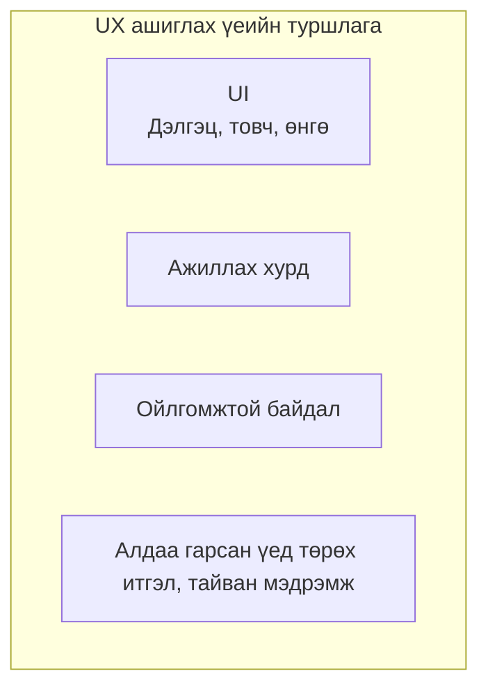
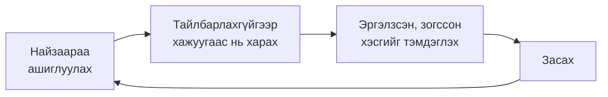

# UI ба UX-ийн тухай

> 🇯🇵 Эх хувь (япон хэлээр): [UI_UXについて.md](<../../../2年生_システム開発実践/後期/2026_10_30/UI_UXについて.md>) <!-- original-ja-link -->

Аппын тухай ярихад **UI (юү-ай)** ба **UX (юү-экс)** гэдэг үг их гардаг.
Хоёулаа "ашиглаж буй хүн"-тэй холбоотой үг боловч утга нь арай өөр.

[Чөлөөт бүтээл рүү буцах](../2026_10_09/2026_10_09_資料1.md)

---

## 1. Товчхондоо

| Нэр | Албан ёсны нэр | Утга | Товчхондоо |
|------|----------|------|-----------|
| **UI** | User Interface (хэрэглэгчийн интерфейс) | Хэрэглэгчийн **харж, хүрч буй хэсэг** (дэлгэц, товч, текст, өнгө) | Гадаад төрх ба ажиллагаа |
| **UX** | User Experience (хэрэглэгчийн туршлага) | Хэрэглэгчийн **ашиглахдаа мэдэрч буй зүйл** (тохиромжтой, хөгжилтэй, ойлгомжтой) | Ашиглах үеийн туршлага |

> 💡 **"Ресторан"-тай зүйрлэвэл**
> - **UI** ＝ Цэс, таваг, ширээ, рестораны дотоод засал
> - **UX** ＝ "Шууд суудал олдсон", "Захиалахад амархан байсан", "Амттай байсан", "Дахиад ирмээр байна" гэж мэдрэх зэрэг **нийт туршлага**
>
> Цэс нь гоё (UI сайн) байсан ч хоол гарч ирэхэд 1 цаг болвол туршлага (UX) сайн биш.

---

## 2. UI ба UX-ийн хамаарал

UI бол UX-ийн **нэг хэсэг**.
Сайн UX бүтээхэд сайн UI хэрэгтэй ч, **зөвхөн UI сайн байгаад UX сайн болохгүй**.

| Жишээ | UI | UX |
|----|----|----|
| Товч нь гоё ч дарахад хариу өгөхгүй | ◯ | ✕ |
| Гадаад төрх нь энгийн ч хүссэн мэдээлэлдээ шууд хүрч болно | △ | ◯ |
| Оруулсан өгөгдөл алдаанаас болж бүгд устчихсан | — | ✕✕ |

---

## 3. Сайн UI-ийн гол санаа

### ① Нэгэн жигд болгох (тууштай байдал)

Ижил утгатай зүйлсийг **ижил харагдуулж, ижил байрлалд** байрлуулна.

| ✕ Муу | ◯ Сайн |
|----------|-------|
| Хуудас бүрт "Хадгалах" товчны өнгө, байрлал өөр | Хадгалах товч аль ч хуудсанд **ижил өнгөтэй, ижил байрлалд** |
| "Бүртгэх", "Нэмэх", "Үүсгэх" гэж ижил утгатай үгс янз бүр | Үгээ **нэг болгож жигдлэх** |

### ② Дарж болох зүйлийг дарж болно гэдэг нь ойлгогдохоор болгох

Товч, холбоосыг **нэг харахад дарж болно гэдэг нь ойлгогдох** төрхтэй болгоно.
Хулганаа дээр нь аваачихад өнгө нь өөрчлөгддөг (`hover`) бол бүр ч ойлгомжтой болно.

### ③ Чухал зүйлийг тодруулах

Хэрэглэгчээр хамгийн түрүүнд даруулахыг хүссэн товчийг ("Хадгалах" гэх мэт) **тод өнгөтэй**, бусдыг ("Цуцлах" гэх мэт) **цайвар өнгөтэй** болгоно.
Бүгд тод байвал **аль нь ч тодрохгүй** болно.

### ④ Уншихад хялбар болгох

- Текст ба дэвсгэрийн өнгөний ялгааг (**контраст**) хангалттай гаргах (цайвар саарал текст уншихад хэцүү)
- Текстийг хэт жижиг болгохгүй байх
- Хоосон зай (завсар) гаргаж, хэт шахахгүй байх

---

## 4. Сайн UX-ийн гол санаа

### ① Хариу өгөх (эргэх холбоо)

Товч дарахад **юу болсныг мэдэгдэнэ**. Хариу байхгүй бол хэрэглэгч "Дарагдсан болов уу?" гэж санаа зовж, олон удаа дарчихдаг.

| Нөхцөл | Эргэх холбооны жишээ |
|-----|----------------|
| Хадгалж байх үед | "Хадгалж байна…" гэж харуулах, товчийг дарагдахгүй болгох |
| Хадгалж дууссан | "Хадгаллаа" гэж харуулах |
| Алдаа | **Юу буруу байгаа, яах ёстойг** харуулах |

### ② Алдааг хэрэглэгчид ойлгомжтой, эелдгээр мэдээлэх

| ✕ Муу | ◯ Сайн |
|----------|-------|
| `Error 422` | "Гарчгаа оруулна уу" |
| Алдаа гарвал оруулсан агуулга бүгд устдаг | Оруулсан агуулгыг **хэвээр нь үлдээж**, алдаатай хэсгийг улаанаар тэмдэглэх |

### ③ Буцаах боломжгүй үйлдлийг баталгаажуулах

**Устгах** гэх мэт буцааж болохгүй үйлдлийн өмнө "Үнэхээр устгах уу?" гэж баталгаажуулна.

### ④ Цөөн алхмаар дуусгах

Түгээмэл ашигладаг функцийг **цөөн товшилтоор** ашиглах боломжтой болгоно.
"Мэдээлэл бүртгэх бүрдээ 3 хуудас дамждаг" апп аажмаар ашиглагдахаа болино.

---

## 5. Өөрийн аппаа шалгах арга

Хамгийн сайн арга бол **бусдаар ашиглуулах** явдал.

- Хийсэн хүн өөрөө хэрхэн ашиглахыг мэддэг тул **ойлгоход хэцүү хэсгийг анзаарч чаддаггүй**
- Ашиглаж буй хүний **зогссон, эргэлзсэн хэсэг** бол засах ёстой хэсэг
- Амаар тайлбарлахыг хүсэх болсон бол энэ нь **дэлгэцээр ойлгуулж чадахгүй байна** гэсэн дохио

---

## 6. Дүгнэлт

- **UI** ＝ Дэлгэц, товч, өнгө гэх мэт **харж, хүрч буй хэсэг**
- **UX** ＝ Ашиглах үед **мэдэрч буй зүйл, туршлага бүхэлдээ**
- UI бол UX-ийн нэг хэсэг. **Зөвхөн гадаад төрх сайн байгаад сайн туршлага болохгүй**
- Сайн UI: **Нэгэн жигд болгох, дарж болно гэдэг нь ойлгогдох, чухал зүйлийг тодруулах, уншихад хялбар**
- Сайн UX: **Хариу өгөх, алдааг ойлгомжтой, эелдгээр мэдээлэх, буцаах боломжгүй үйлдлийг баталгаажуулах, цөөн алхам**
- Хамгийн сайн шалгах арга бол **бусдаар ашиглуулах**

[Чөлөөт бүтээл рүү буцах](../2026_10_09/2026_10_09_資料1.md)
