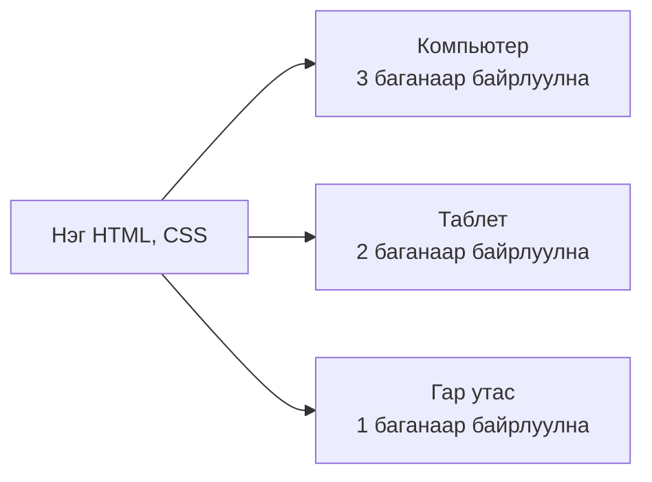
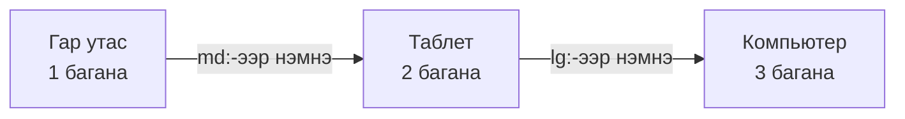
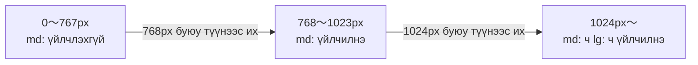
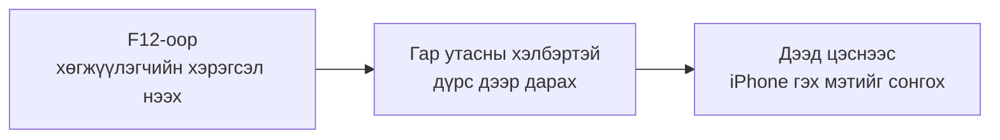

# Responsive дизайны тухай

> 🇯🇵 Эх хувь (япон хэлээр): [レスポンシブデザインについて.md](<../../../2年生_システム開発実践/後期/2026_11_06/レスポンシブデザインについて.md>) <!-- original-ja-link -->

Вэб сайтыг компьютер, таблет, гар утас гэх мэт **янз бүрийн хэмжээтэй дэлгэц** дээр үздэг.
Нэг хуудсыг **аль ч дэлгэц дээр үзэхэд эвтэйхэн харагдахаар хийх** аргыг **responsive дизайн** гэдэг.

[Чөлөөт бүтээл рүү буцах](../2026_10_09/2026_10_09_資料1.md)

---

## 1. Responsive дизайн гэж юу вэ

**Responsive (респонсив)** гэдэг нь "хариу үйлдэл үзүүлэх" гэсэн утгатай.
Дэлгэцийн **өргөнд** тохируулан элементүүдийн байрлалыг автоматаар өөрчилнө.



> 💡 **Өмнө нь "гар утасны сайт"-ыг тусад нь хийдэг байсан**
> Өмнө нь компьютерт зориулсан хуудас болон гар утсанд зориулсан хуудсыг (`m.〇〇.com` гэх мэт) **тус тусад нь** хийх нь бий байсан.
> Ингэвэл засах болгондоо **хоёуланг нь засах** шаардлагатай. Responsive дизайнтай бол **нэгийг засахад л** хангалттай.

---

## 2. Яагаад чухал вэ?

- Одоо вэб сайтыг **гар утсаараа үздэг хүн маш олон**
- Компанийн хүн ч портфолиогийн URL-ыг **гар утсаараа нээж** магадгүй
- Гар утсаар үзэхэд текст хэт жижиг эсвэл хуудасны агуулга дэлгэцээс хажуу тийш халин гарвал **үүгээр л сэтгэгдэл муудаж болно**

---

## 3. Механизм ① viewport

Гар утасны хөтөч юу ч заагаагүй бол **компьютерт зориулсан хуудсыг жижигрүүлж** харуулдаг (текст маш жижиг болно).
Үүнээс сэргийлдэг нь HTML-ийн `<head>`-д бичдэг **viewport** тохиргоо юм.

```html
<meta name="viewport" content="width=device-width, initial-scale=1">
```

| Хэсэг | Утга |
|-----|------|
| `width=device-width` | Хуудасны өргөнийг **тухайн төхөөрөмжийн дэлгэцийн өргөнд** тааруулна |
| `initial-scale=1` | Эхэндээ **томруулж, жижигрүүлэхгүйгээр** (1:1 масштабаар) харуулна |

> 📝 **Next.js автоматаар оруулж өгдөг**
> Next.js (App Router)-д энэ viewport тохиргоо **анхнаасаа автоматаар** орсон байдаг.
> Laravel-ийн Blade-ээр хийхдээ хуудасны ерөнхий загварын файлдаа өөрөө бичээрэй (`laravel new`-ээр үүсгэсэн хуудсанд анхнаасаа орсон байдаг).

---

## 4. Механизм ② Media query

**Media query** гэдэг нь "Дэлгэцийн өргөн 〇〇px-ээс их буюу тэнцүү үед л энэ CSS-ийг ашигла" гэж заадаг бичиглэл юм.

```css
/* Ердийн үед (гар утас) 1 багана */
.cards {
  display: grid;
  grid-template-columns: 1fr;
}

/* Дэлгэцийн өргөн 768px буюу түүнээс их бол 2 багана */
@media (min-width: 768px) {
  .cards {
    grid-template-columns: 1fr 1fr;
  }
}

/* 1024px буюу түүнээс их бол 3 багана */
@media (min-width: 1024px) {
  .cards {
    grid-template-columns: 1fr 1fr 1fr;
  }
}
```

Элементүүдийн байрлалыг өөрчлөх дэлгэцийн **өргөний зааг**-ийг **breakpoint** гэдэг.

---

## 5. Tailwind CSS-ээр бичвэл

Tailwind CSS-д классын нэрийн өмнө `md:` эсвэл `lg:` нэмэхэд л media query-тэй адил үр дүнд хүрч болно.

```html
<div class="grid grid-cols-1 md:grid-cols-2 lg:grid-cols-3 gap-4">
  <div>カード1</div>
  <div>カード2</div>
  <div>カード3</div>
</div>
```

| Бичиглэл | Хэзээ хэрэглэгдэх вэ? |
|-------|------------|
| `grid-cols-1` | **Үргэлж** (гар утас) |
| `sm:` | Өргөн **640px буюу түүнээс их** үед |
| `md:grid-cols-2` | Өргөн **768px буюу түүнээс их** үед (таблетын хэмжээ) |
| `lg:grid-cols-3` | Өргөн **1024px буюу түүнээс их** үед (компьютерын хэмжээ) |

---

## 6. Mobile first

Дээрх хоёр жишээнд хоёуланд нь **гар утасны дэлгэцэд зориулсан загварыг эхэлж бичээд**, дэлгэц томрох үеийн өөрчлөлтийг **дараа нь нэмж** байна.
Энэ санааг **mobile first** гэдэг.



- Жижиг дэлгэцэд харуулах боломжтой зүйл цөөн тул **үнэхээр хэрэгтэй зүйлсийг л** бодож сонгоно
- Жижиг дэлгэцэд зориулан цэгцэлсэн загварыг том дэлгэцэд тохируулан өргөжүүлэх нь **амархан**

> ⚠️ **Tailwind-ийн `md:` нь "md буюу түүнээс их" гэсэн утгатай**
> `md:hidden` нь "**зөвхөн** таблет дээр нуух" биш, "768px **буюу түүнээс их** бол нуух" гэсэн үг.
> Гар утсан дээр харагдах загварыг `md:` гэх мэт угтваргүй **ердийн классаар** бичнэ.

Дэлгэцийн өргөн болон үйлчлэх классуудын хамаарал дараах байдалтай.



---

## 7. Гар утасны төрхийг шалгах

Гар утасгүй байсан ч **хөтчийн хөгжүүлэгчийн хэрэгслээр** шалгаж болно.



| Түгээмэл асуудал | Засах арга |
|-----------|------|
| Хажуу тийш гүйлгэж болдог (халин гарч байна) | Өргөнийг `px`-ээр тогтоосон элемент байгаа эсэхийг хайх. Зурагт `max-width: 100%` |
| Товч жижиг тул дарахад хэцүү | Хуруугаар дарахад хялбар хэмжээтэй (**44px орчим**) болгох |
| Хүснэгт хажуу тийш халин гарна | Хүснэгтийг хажуу тийш гүйлгэж болох хайрцагт хийх, эсвэл гар утсан дээр карт хэлбэрт шилжүүлэх |
| Текст хэт жижиг | Үндсэн текстийг **16px орчим** байхаар баримжаалах |

> 💡 Deploy чиглэлийн суралцагчид Vercel-ийн URL-аа **өөрийн гар утсаар нээж** шалгаж үзээрэй.

---

## 8. Дүгнэлт

- **Responsive дизайн** ＝ Нэг хуудсыг **дэлгэцийн өргөнд тааруулан** үзэхэд эвтэйхэн байдлаар өөрчлөн харуулах арга
- **Viewport** тохиргоогоор гар утсан дээр ч **1:1 масштабаар** харагдана (Next.js-д автоматаар тохируулагдана)
- **Media query**-ээр "〇〇px буюу түүнээс их бол энэ CSS" гэж заана. Заагийг **breakpoint** гэдэг
- Tailwind CSS-д `md:` `lg:` залгахад л болно
- **Mobile first**: Гар утасны төрхийг эхэлж хийгээд, том дэлгэцийн өөрчлөлтийг нэмнэ
- Шалгахдаа **хөгжүүлэгчийн хэрэгсэл** болон **өөрийн гар утсаа** ашиглана

[Чөлөөт бүтээл рүү буцах](../2026_10_09/2026_10_09_資料1.md)
