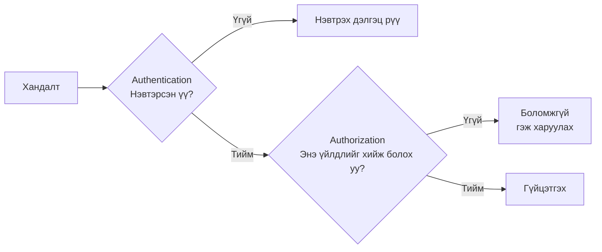
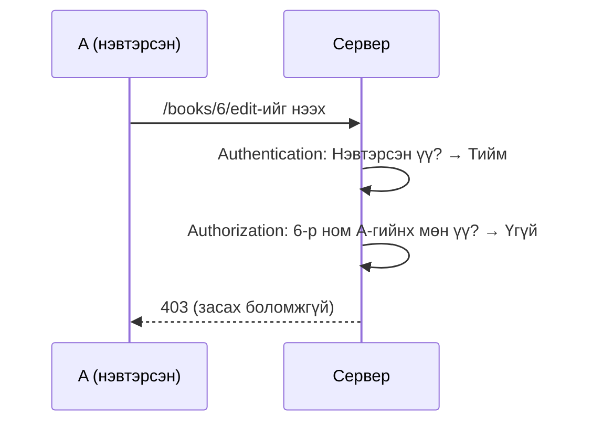
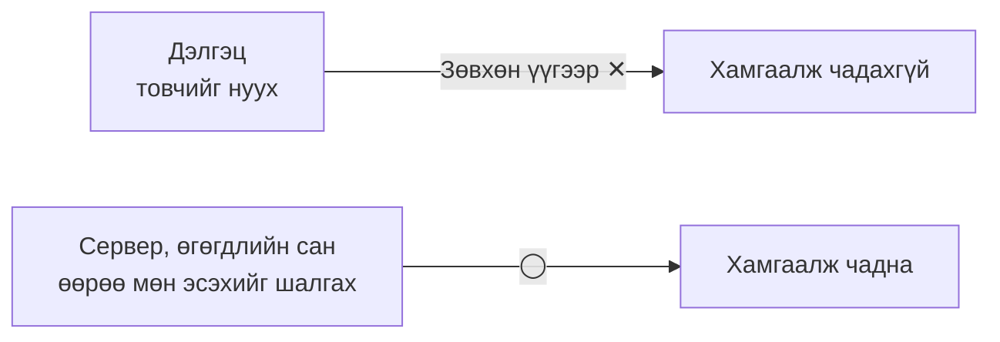

# Authentication ба authorization-ийн тухай

> 🇯🇵 Эх хувь (япон хэлээр): [認証と認可について.md](<../../../2年生_システム開発実践/後期/2026_11_13/認証と認可について.md>) <!-- original-ja-link -->

Нэвтрэх функц хийхэд **authentication (хэн болохыг баталгаажуулах)** ба **authorization (эрх олголт)** гэсэн 2 үг гарч ирдэг.
Нэр нь төстэй ч хийдэг ажил нь өөр.

[Чөлөөт бүтээл рүү буцах](../2026_10_09/2026_10_09_資料1.md)

---

## 1. Товчхондоо

| Нэр | Англиар | Шалгах зүйл | Товчхондоо |
|------|-----|-----------|-----------|
| **Authentication** | Authentication (аутентикэйшн), товчоор **AuthN** | **Чи хэн бэ?** | Хэн болохыг баталгаажуулах |
| **Authorization** | Authorization (авторизэйшн), товчоор **AuthZ** | **Чи юу хийж болох вэ?** | Зөвшөөрлийн шалгалт |

> 💡 **"Концерт"-той зүйрлэвэл**
> - **Authentication** ＝ Орох хаалган дээр **тасалбар болон биеийн байцаалтаа** үзүүлж, тасалбар эзэмшигч мөн эсэхээ шалгуулах
> - **Authorization** ＝ Тасалбарын төрлөөс хамааран **орж болох газар тодорхой болно** (энгийн суудлын хүн зөвхөн эрх бүхий хүмүүст зориулсан бүсэд орж чадахгүй)
>
> Хэн болох нь баталгаажсан ч (authentication OK) хаана ч орж болно гэсэн үг биш (authorization нь тусдаа).

---

## 2. Дараалал нь "Authentication → Authorization"

**Хэн болохыг мэдэхгүй бол юу хийж болохыг ч шийдэж чадахгүй.** Тиймээс authentication үргэлж түрүүлж хийгдэнэ.



---

## 3. Өөрийн аппдаа хэрэглэж үзье

**Уншсан номын тэмдэглэлийн аппын** жишээгээр бодъё.

| Нөхцөл | Authentication уу? Authorization уу? | Шалгах зүйл |
|-----|-----------|-----------|
| Имэйл хаяг болон нууц үгээр нэвтрэх | **Authentication** | Үнэхээр энэ хүн мөн үү? |
| Нэвтрээгүй хүн "Ном бүртгэх" хуудсыг нээх | **Authentication** | Нэвтэрсэн үү? → Нэвтрээгүй бол нэвтрэх дэлгэц рүү |
| A нь **B-гийн** сэтгэгдлийг засах гэж оролдох | **Authorization** | Энэ номыг бүртгэсэн нь өөрөө юу? → Үгүй бол боломжгүй |
| Зөвхөн админ бусдын нийтлэлийг устгаж чадна | **Authorization** | Энэ хүн админ уу? |

> ⚠️ **Түгээмэл алдаа: Зөвхөн authentication хийгээд authorization-оо мартах**
> "Зөвхөн нэвтэрсэн хүн засах хуудсыг нээж чадна" гэдэг л байвал нэвтэрсэн **хэн ч** URL дахь тоог өөрчлөхөд л **бусдын өгөгдлийг** засаж чадчихна.
>
> ```
> /books/5/edit   ← Өөрийн ном
> /books/6/edit   ← Тоог өөрчилбөл… бусдын ном уу?
> ```
>
> Засах, устгах үед **"Энэ өгөгдөл нэвтэрсэн хүний өөрийнх нь мөн үү?"** гэдгийг заавал шалгаарай.

Authorization-ийн шалгалт байвал нэвтэрсэн хүн байсан ч бусдын өгөгдөлд хандахыг дараах байдлаар зогсооно.



---

## 4. HTTP-ийн төлөвийн код (status code)

Алдаа гарсан үед буцаах төлөвийн код нь authentication болон authorization-ийн хувьд ялгаатай.

| Код | Нэр | Утга |
|-------|-----|------|
| **401** | Unauthorized | **Authentication** хийгдээгүй (нэвтрээгүй, хэн болох нь тодорхойгүй) |
| **403** | Forbidden | Authentication хийгдсэн ч **authorization** өгөгдөөгүй (тухайн үйлдэл хориотой) |

> 📝 401-ийн нэр нь "Unauthorized (зөвшөөрөгдөөгүй)" боловч утга нь **authentication хийгдээгүй** гэсэн үг. Нэр нь төөрөгдүүлэм тул утгаар нь санаарай.

---

## 5. Технологи тус бүрд яаж хийх вэ?

### Laravel-ийн хувьд

| | Ашиглах зүйл | Жишээ |
|---|---|---|
| Authentication | `Auth`, middleware `auth` | Нэвтрээгүй хүнийг нэвтрэх дэлгэц рүү шилжүүлэх |
| Authorization | **Policy**, `Gate` | "Номыг зөвхөн бүртгэсэн хүн өөрөө засаж чадна" гэсэн дүрэм бичих |

```php
// routes/web.php: Зөвхөн нэвтэрсэн хүн (authentication)
Route::middleware('auth')->group(function () {
    Route::get('/books/{book}/edit', [BookController::class, 'edit']);
});
```

```php
// BookController: Өөрийн ном эсэх (authorization)
public function edit(Book $book)
{
    if ($book->user_id !== Auth::id()) {
        abort(403); // Өөрийн ном биш бол 403
    }

    return view('books.edit', compact('book'));
}
```

### Supabase-ийн хувьд

| | Ашиглах зүйл | Жишээ |
|---|---|---|
| Authentication | **Supabase Auth** | Имэйл, нууц үг эсвэл Google бүртгэлээр нэвтрэх |
| Authorization | **RLS (Row Level Security / мөрийн түвшний аюулгүй байдал)** | "`user_id` нь өөрийн хэрэглэгчийн ID-тай таарч байгаа мөрүүдийг л харж, өөрчилж болно" гэсэн дүрмийг өгөгдлийн санд бичих |

> ⚠️ **Supabase-д RLS маш чухал**
> Supabase нь хөтчөөс **шууд өгөгдлийн сан руу хандана**.
> RLS тохируулаагүй бол **хэн ч бүх өгөгдлийг харж, устгаж чадах** байдалд орж болзошгүй.
> Supabase-ийн удирдлагын дэлгэцэнд хүснэгт бүрт RLS **идэвхтэй (Enabled)** болсон эсэхийг шалгаарай.

---

## 6. Дэлгэц дээр нуух төдий нь authorization биш

"Бусдын номонд засах товч харуулахгүй"——энэ бол **хэрэглэгчийн интерфэйсийн шийдэл**, **authorization биш**.
Товч байхгүй ч URL-ыг шууд бичих эсвэл API-г шууд дуудвал үйлдэл хийж чадчихдаг.



**Authorization-ийн шалгалтыг заавал серверийн талд (Laravel-ийн controller, Supabase-ийн RLS гэх мэт) хийнэ.**

---

## 7. Дүгнэлт

- **Authentication** ＝ **Чи хэн бэ?** (хэн болохыг баталгаажуулах, нэвтрэлт)
- **Authorization** ＝ **Чи юу хийж болох вэ?** (зөвшөөрлийн шалгалт)
- Дараалал нь **authentication → authorization**
- Нэвтрээгүй → **401**, нэвтэрсэн ч хориотой → **403**
- Laravel бол **auth middleware＋Policy**, Supabase бол **Supabase Auth＋RLS**
- Товчийг нуух төдийд хамгаалж чадахгүй. **Серверийн талд заавал шалгана**

[Чөлөөт бүтээл рүү буцах](../2026_10_09/2026_10_09_資料1.md)
