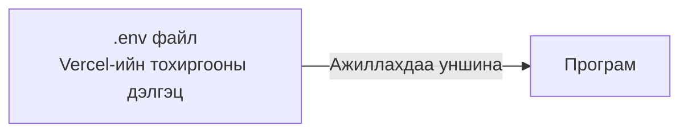
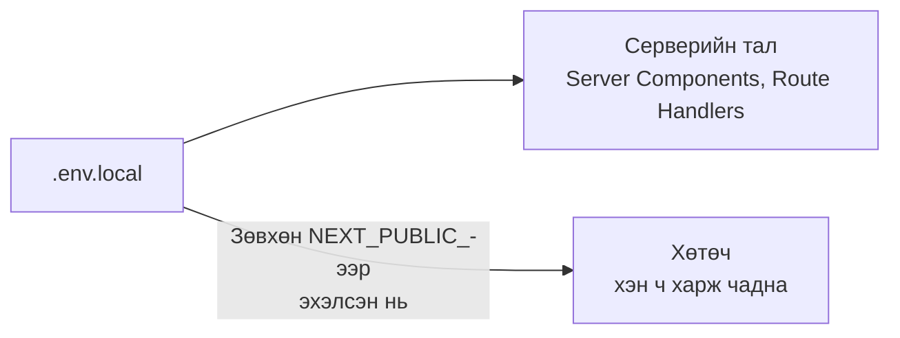
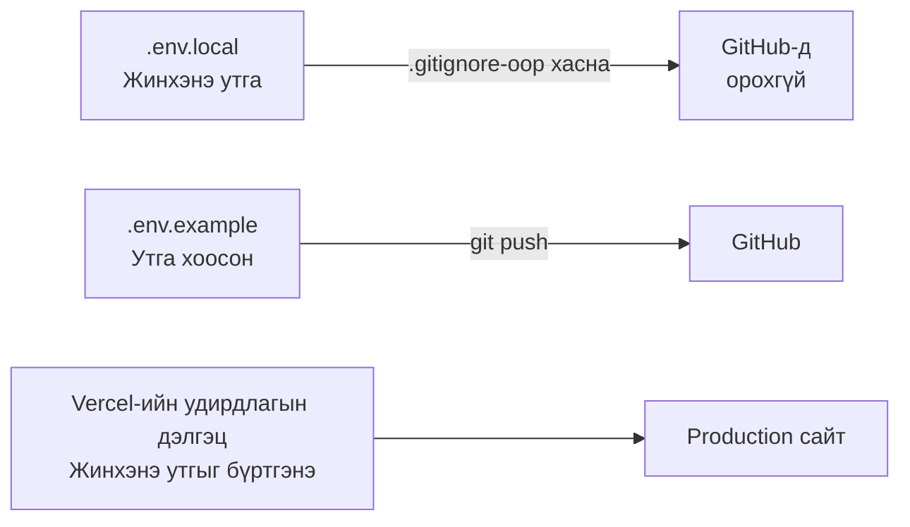
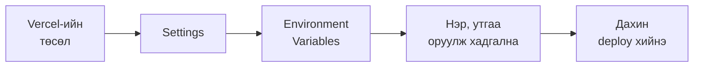

# Орчны хувьсагчийн тухай

> 🇯🇵 Эх хувь (япон хэлээр): [環境変数について.md](<../../../2年生_システム開発実践/後期/2026_11_27/環境変数について.md>) <!-- original-ja-link -->

Чөлөөт бүтээлийн материалд "**API key болон нууц үгийг GitHub-д байршуулахгүй**", "`.env`-д бичнэ" гэж олон удаа бичсэн.
Энэ `.env`-д бичиж буй зүйл бол **орчны хувьсагч (environment variable)** юм.
Энд орчны хувьсагч гэж юу болох, яагаад ашигладаг талаар үзье.

[Чөлөөт бүтээл рүү буцах](../2026_10_09/2026_10_09_資料1.md)

---

## 1. Орчны хувьсагч гэж юу вэ

**Орчны хувьсагч** гэдэг нь програмын **гадна** хадгалдаг тохиргооны утга юм.
Програм ажиллахдаа тэр утгыг **уншиж** ашиглана.



| Орчны хувьсагчид хийх зүйл | Жишээ |
|------------------|-----|
| **Нууц утга** | API key, өгөгдлийн сангийн нууц үг |
| **Байршлаас хамаарч өөрчлөгдөх утга** | Өгөгдлийн сангийн байршил (өөрийн компьютер дээр үү, production сервер дээр үү), API-ийн URL |

> 💡 **"Гэрийн түлхүүр"-тэй зүйрлэвэл**
> Байшингийн **зураг төслийг** (програм) бусдад үзүүлсэн ч асуудалгүй.
> Харин **түлхүүрийг** (нууц үг) зураг төсөл дээр нааж үлдээхгүй, **тусад нь хадгалдаг** биз дээ.
> Орчны хувьсагч бол програмаас тусад нь хадгалдаг **түлхүүр** шиг зүйл юм.

---

## 2. Яагаад орчны хувьсагч ашигладаг вэ?

### ① Нууц утгыг GitHub-д байршуулахгүйн тулд

API key-г програмд **шууд бичиж** GitHub-д нийтэлбэл **дэлхийн хэн ч харж чадна**.

```js
// ✕ Аюултай: Кодод шууд бичсэн
const apiKey = "sk-abc123xyz...";
```

```js
// ◯ Аюулгүй: Орчны хувьсагчаас уншина
const apiKey = process.env.WEATHER_API_KEY;
```

> ⚠️ **GitHub-д байршуулсан key-г тэр дороо буруугаар ашигладаг**
> Нийтийн repository-д орсон key-г автоматаар хайдаг програм байдаг.
> Андуурч push хийчихвэл **commit-ийг устгахад л хангалтгүй** (түүхэнд үлдсэн байдаг).
> Шууд үйлчилгээний удирдлагын дэлгэц дээр **key-г хүчингүй болгож, шинэ key дахин үүсгээрэй**.

### ② Байршлаас хамаарч утгыг сэлгэхийн тулд

Ижил програм байсан ч **өөрийн компьютер** болон **production орчинд (Vercel гэх мэт)** холбогдох газар нь өөр байна.

| | Өөрийн компьютер (хөгжүүлэлтийн орчин) | Production орчин |
|---|---|---|
| Өгөгдлийн сан | Өөрийн компьютер дээрх MySQL | Интернэт дээрх өгөгдлийн сан |
| API-ийн URL | `http://localhost:8000` | `https://〇〇.com` |

Програмаа **өөрчлөхгүйгээр**, зөвхөн орчны хувьсагчийг өөрчилбөл холбогдох газраа сэлгэж болно.
"**Орчноос** хамаарч өөрчлөгддөг **хувьсагч**" учраас **орчны хувьсагч** гэж нэрлэдэг.

---

## 3. `.env` файл

Хөгжүүлэлтийн явцад `.env` гэдэг нэртэй файлд орчны хувьсагчаа бичнэ.

### Laravel-ийн хувьд (`.env`)

```
APP_NAME=BookApp
DB_HOST=127.0.0.1
DB_DATABASE=laravel
DB_USERNAME=laravel
DB_PASSWORD=password
```

```php
// Унших үед (config файл дотор)
'database' => env('DB_DATABASE'),
```

### Next.js-ийн хувьд (`.env.local`)

```
WEATHER_API_KEY=abc123xyz
NEXT_PUBLIC_SUPABASE_URL=https://〇〇.supabase.co
```

```js
// Унших үед
const apiKey = process.env.WEATHER_API_KEY;
```

> ⚠️ **Next.js-ийн `NEXT_PUBLIC_`-д анхаар**
> Нэр нь `NEXT_PUBLIC_`-ээр эхэлдэг орчны хувьсагч **хөтөч рүү илгээгдэж, хэн ч харж чадна**.
> **Нууц утгын (API key гэх мэт) нэрийн өмнө `NEXT_PUBLIC_` угтвар бүү нэмээрэй**.
> `NEXT_PUBLIC_`-гүй орчны хувьсагчийг зөвхөн серверийн талд (Server Components эсвэл Route Handlers) ашиглаж болно.

Утга хаа хүртэл хүрэхийг зургаар үзүүлбэл дараах байдалтай.



> 📝 Supabase-ийн **URL болон нийтэд зориулсан key (publishable key / anon key)** нь хөтөч дээр ашиглах зориулалттай тул тэдгээрийн нэрийн өмнө `NEXT_PUBLIC_` угтвар нэмж болно.
> Харин өгөгдлөө хамгаалахын тулд **RLS**-ийг заавал тохируулна (→ [Authentication ба authorization-ийн тухай](../2026_11_13/認証と認可について.md)).
> Харин **secret key / service_role key** нь бүх үйлдлийг хийх эрхтэй key тул тэдгээрийн хувьсагчийн нэрийн өмнө `NEXT_PUBLIC_` угтварыг хэзээ ч нэмж болохгүй.

---

## 4. `.env`-ийг GitHub-д байршуулахгүй байх механизм

`.env` GitHub-д ордоггүй нь **`.gitignore`**-д бичигдсэн байдагтай холбоотой.

```
# .gitignore
.env
.env*.local
```

`.gitignore`-д бичигдсэн файлыг **Git үл тоомсорлодог** тул commit хийгдэхгүй.
Laravel болон `create-next-app`-аар үүсгэсэн төсөлд **анхнаасаа бичигдсэн** байдаг.

### `.env.example` бэлдэх

`.env` GitHub-д байршдаггүй тул бусад хүн **ямар орчны хувьсагч хэрэгтэйг** мэдэх боломжгүй.
Тиймээс **утгыг хоосон үлдээсэн загвар** болох `.env.example`-ийг үүсгэж GitHub-д байршуулна.

```
# .env.example (GitHub-д байршуулна)
WEATHER_API_KEY=
NEXT_PUBLIC_SUPABASE_URL=
```

> 💡 Laravel-д анхнаасаа `.env.example` байдаг. Портфолио болгон үзүүлэхэд ч `.env.example` байвал **цэгцтэй хийсэн** гэсэн сэтгэгдэл төрүүлнэ.

---

## 5. Production (Vercel)-д удирдлагын дэлгэц дээр тохируулна

`.env.local` GitHub-д ордоггүй тул **Vercel-д хүрэхгүй**.
Production-ийн орчны хувьсагчийг Vercel-ийн удирдлагын дэлгэц дээр тохируулна.

Өөрийн компьютер, GitHub, Vercel тус бүрд юу байршихыг цэгцлэвэл дараах байдалтай.



Тохируулах алхам нь дараах байдалтай.



> ⚠️ **Орчны хувьсагч нэмсэн, өөрчилсөн бол дахин deploy хий**
> Орчны хувьсагч **deploy хийх үед** уншигддаг. Зөвхөн тохируулаад орхивол одоо ажиллаж буй сайтад тусгагдахгүй.

---

## 6. Дүгнэлт

- **Орчны хувьсагч** ＝ Програмын **гадна** хадгалдаг тохиргооны утга
- Ашиглах шалтгаан нь **нууц утгыг хамгаалах**, **орчноос хамаарч утгыг сэлгэх**
- Хөгжүүлэлтийн явцад **`.env`**-д (Next.js бол `.env.local`) бичнэ. **`.gitignore`**-ийн ачаар GitHub-д орохгүй
- Хэрэгтэй орчны хувьсагчийн загвар болгон **`.env.example`**-ийг GitHub-д байршуулна
- Next.js-ийн **`NEXT_PUBLIC_`** нь хөтөч дээр ил харагдана. Нууц утгад залгахгүй
- Production (Vercel)-д **удирдлагын дэлгэц дээр тохируулж**, **дахин deploy хийнэ**
- Key-гээ push хийчихвэл **шууд хүчингүй болгож, дахин үүсгэнэ**

[Чөлөөт бүтээл рүү буцах](../2026_10_09/2026_10_09_資料1.md)
