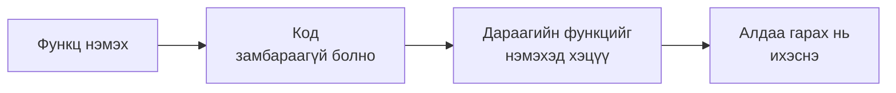
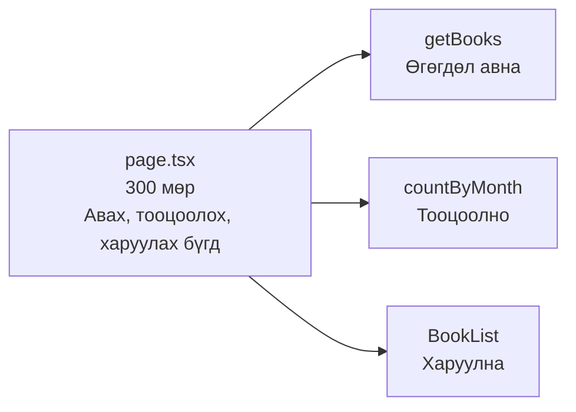
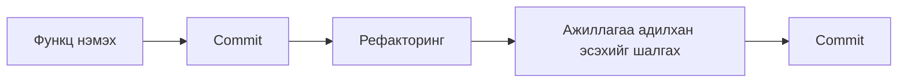

# Рефакторингийн тухай

> 🇯🇵 Эх хувь (япон хэлээр): [リファクタリングについて.md](<../../../2年生_システム開発実践/後期/2026_12_04/リファクタリングについて.md>) <!-- original-ja-link -->

Функцуудыг ар араас нь нэмсээр байвал код урт болж, **хаана юу бичигдсэнийг мэдэхгүй** болж эхэлдэг.
Ийм үед хийдэг зүйл бол **рефакторинг** юм.

[Чөлөөт бүтээл рүү буцах](../2026_10_09/2026_10_09_資料1.md)

---

## 1. Рефакторинг гэж юу вэ

**Рефакторинг** гэдэг нь **аппын ажиллагааг өөрчлөхгүйгээр** кодын **дотоод бүтцийг уншихад хялбар, засахад амар болгож цэгцлэх** явдал юм.

| | Ажиллагаа (хэрэглэгчийн хардаг зүйл) | Кодын дотоод бүтэц |
|---|---|---|
| Функц нэмэх | **Өөрчлөгдөнө** | Өөрчлөгдөнө |
| Алдаа засах | **Өөрчлөгдөнө** (зөв болно) | Өөрчлөгдөнө |
| **Рефакторинг** | **Өөрчлөгдөхгүй** | Өөрчлөгдөнө (цэгцтэй болно) |

> 💡 **"Өрөө цэвэрлэх"-тэй зүйрлэвэл**
> Өрөөгөө цэгцэлсэн ч байгаа эд зүйлс (хийж чадах зүйл) өөрчлөгдөхгүй.
> Гэхдээ хаана юу байгаа нь ойлгомжтой болдог тул **дараа нь ямар нэг юм хайх, шинэ зүйл тавихад амар** болно.

---

## 2. Яагаад рефакторинг хийдэг вэ?



- Код замбараагүй бол **дараагийн функцийг нэмэхэд цаг их зарцуулна**
- Ижил код олон газар байвал **нэг газрыг нь засахаа мартаж**, алдаа гарна
- Хагас жилийн дараах та өөрөө одоогийн кодоо **бараг санахгүй**
- Портфолиод компанийн хүн **кодыг ч хардаг**. Уншихад хялбар код өндөр үнэлэгдэнэ

---

## 3. Иймэрхүү код бол рефакторинг хийх дохио

Замбараагүй кодод түгээмэл хэв шинж байдаг. Үүнийг **кодоос муу үнэр гарах (code smell)** гэдэг.

| Дохио | Жишээ |
|-------|-----|
| **Ижил код олон газар байна** | Ижил толгой хэсгийг бүх хуудсанд хуулж бичсэн |
| **Нэг функц, файл хэт урт** | `page.tsx` 300 мөртэй |
| **Нэр нь ойлгомжгүй** | `data`, `tmp`, `a`, `flg` |
| **Юу хийж байгаа нь ойлгомжгүй тоо** | `if (status === 2)` (2 гэж юу вэ?) |
| **Ашиглагдаагүй код** | Тайлбар болгож үлдээсэн хуучин код |

---

## 4. Түгээмэл рефакторинг

### ① Нэрийг ойлгомжтой болгох

```js
// ✕ Юу агуулж байгаа нь ойлгомжгүй
const d = await getData();
const l = d.filter((x) => x.r >= 4);
```

```js
// ◯ Нэрийг харахад ойлгогдоно
const books = await getBooks();
const favoriteBooks = books.filter((book) => book.rating >= 4);
```

Энэ бол хамгийн хялбар бөгөөд хамгийн үр дүнтэй рефакторинг юм.

### ② Ижил кодыг нэг болгож нэгтгэх

Өмнөх улирал болон 1-р курст үзсэн **бүрэлдэхүүн хэсэг (компонент, `@include`)** болгох нь ч рефакторинг юм.

```jsx
// ✕ Ижил төрхтэй картыг олон хуудсанд бичсэн
<div className="rounded border p-4">
  <h2 className="font-bold">{book.title}</h2>
  <p>{book.author}</p>
</div>
```

```jsx
// ◯ BookCard гэдэг бүрэлдэхүүн хэсэг болгож, хаана ч ашиглана
<BookCard book={book} />
```

Ингэчихвэл картын төрхийг өөрчлөх хэрэгтэй болоход **нэг газар засахад л** хангалттай.
Ижил зүйлийг давтахгүй байх санааг **DRY (драй)** (Don't Repeat Yourself) гэдэг.

### ③ Утга нь ойлгомжгүй тоонд нэр өгөх

```js
// ✕ 2 юуг илэрхийлж байгаа нь ойлгомжгүй
if (book.status === 2) { ... }
```

```js
// ◯ Нэр өгнө
const STATUS_FINISHED = 2; // Уншиж дууссан
if (book.status === STATUS_FINISHED) { ... }
```

### ④ Урт функц, файлыг хуваах

Нэг функц **олон янзын зүйл хийж байвал** ажил бүрээр нь хуваана.



---

## 5. Рефакторингийн дүрэм

### Дүрэм ① Эхлээд commit хийх

Рефакторинг хийхээсээ өмнө **ажиллаж буй төлөвийг commit** хийнэ.
Эвдчихсэн ч шууд **хуучин байдалд нь буцааж** чадна.

### Дүрэм ② Функц нэмэхтэй зэрэг хийхгүй

"Функц нэмэнгээ цэгцэлье" гэвэл ажиллахаа больсон үед **аль нь шалтгаан болсныг мэдэхгүй** болно.



### Дүрэм ③ Бага багаар хийх

Нэг дор бүгдийг засах гэж оролдолгүй **нэгийг засаад шалгах**-ыг давтана.

### Дүрэм ④ Дууссаны дараа ажиллагаа өөрчлөгдөөгүй эсэхийг шалгах

Рефакторинг хийхдээ **ажиллагааг өөрчлөхгүй** байх ёстой.
Зассаны дараа **өмнөхтэйгээ адил ажиллаж байгаа эсэхийг** заавал шалгана.
Энэ шалгалтыг автоматаар хийж өгдөг нь дараагийн удаа үзэх **тест** юм.

---

## 6. Рефакторинг хийхэд AI-аар туслуулах

AI-д "Энэ кодыг уншихад хялбар болгож рефакторинг хийгээч" гэж хүсэлт гаргавал цэгцэлсэн код гаргаж өгнө.
Гэхдээ дараах зүйлсэд анхаараарай.

- **Ажиллагаа өөрчлөгдөөгүй эсэхийг** өөрөө шалгах (AI алдаа гаргах ч бий)
- **Яагаад ингэж зассаныг** ойлгосныхоо дараа ашиглах. Тайлбарлаж чадахгүй кодынхоо талаар ажлын ярилцлагад асуувал хариулахад хэцүү
- Нэг дор их зүйл хүсэлгүй **нэг удаад нэг файл, нэг функцээр** хүсэлт гаргах

---

## 7. Дүгнэлт

- **Рефакторинг** ＝ **Ажиллагааг өөрчлөхгүйгээр** кодыг уншихад хялбар, засахад амар болгож цэгцлэх
- Дохио нь **ижил код олон газар, хэт урт, нэр ойлгомжгүй, утга нь ойлгомжгүй тоо**
- Түгээмэл нь **нэр өөрчлөх, бүрэлдэхүүн хэсэг болгож нэгтгэх (DRY), тоонд нэр өгөх, хуваах**
- **Эхлээд commit хийх**, **функц нэмэхтэй зэрэг хийхгүй**, **бага багаар хийх**, **ажиллагаа адилхан эсэхийг шалгах**
- AI ашиглахдаа ч **ойлгосныхоо дараа** ашиглах

[Чөлөөт бүтээл рүү буцах](../2026_10_09/2026_10_09_資料1.md)
