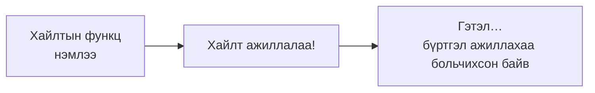
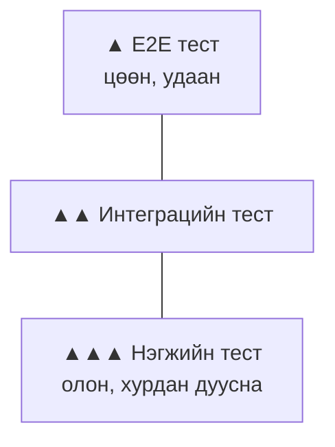

# Тестийн тухай

> 🇯🇵 Эх хувь (япон хэлээр): [テストについて.md](<../../../2年生_システム開発実践/後期/2026_12_11/テストについて.md>) <!-- original-ja-link -->

Апп хийсний дараа **зөв ажиллаж байгаа эсэхийг** нь шалгана. Үүнийг **тест** гэнэ.
Энд тестийн төрлүүд болон тестийг **автоматаар** хийх механизмтай танилцана.

[Чөлөөт бүтээл рүү буцах](../2026_10_09/2026_10_09_資料1.md)

---

## 1. Тест гэж юу вэ

**Тест** гэдэг нь програм **бодсон ёсоор ажиллаж байгаа эсэхийг** шалгахыг хэлнэ.

Та бүхэн ч код бичсэнийхээ дараа **браузер дээр хуудсаа нээгээд, товч дарж** шалгадаг шүү дээ.
Энэ ч бас жинхэнэ тест. Хүн гараараа хийдэг учраас **гар тест** гэж нэрлэдэг.

| | Гар тест | Автомат тест |
|---|---|---|
| Хийх арга | Хүн дэлгэц дээр дарж шалгана | **Тестийн програм** шалгана |
| Хугацаа | Шалгах зүйл олшрох тусам **их цаг ордог** | Хэдэн зуу байсан ч **хэдэн секундээс хэдэн минут** |
| Шалгахаа мартах | Тохиолддог | **Тохиолддоггүй** (үргэлж нэг ижил зүйлийг хийдэг) |

---

## 2. Автомат тест яагаад чухал вэ?

Шинэ функц нэмэх эсвэл [рефакторинг](../2026_12_04/リファクタリングについて.md) хийх үед **өмнө нь ажиллаж байсан хэсэг эвдэрч** болно.
Үүнийг **регресс** (ухралт) гэнэ.



Функц нэмэгдэх бүрт **бүх функцийг гараар дахин шалгах** нь их хэцүү.
Автомат тест байвал ганц командаар **бүгдийг нь нэг дор дахин шалгаж чадна**.

> 💡 **Жишээ нь, «шалгалтын хариу тулгах» шиг**
> «Энэ бодлогын хариу нь 〇〇» гэсэн **хариуг (хүлээгдэж буй үр дүнг)** урьдчилан тогтоочихвол,
> дараа нь зөвхөн **хариутай таарч байгаа эсэхийг** механикаар шалгахад л хангалттай.

---

## 3. Тестийн төрлүүд

Тестийг **хэр том хэсгийг шалгаж байгаагаар** нь ангилдаг.

| Төрөл | Шалгах зүйл | Жишээ |
|-----|-----------|-----|
| **Нэгжийн тест** (юнит тест) | **Нэг функц, нэг хэсэг** зөв ажиллаж байгаа эсэх | «Үнэлгээний дунджийг тооцох функц»-д `[4, 5, 3]` өгөхөд `4` гарах эсэх |
| **Интеграцийн тест** | **Хэд хэдэн хэсгийг хослуулахад** зөв ажиллаж байгаа эсэх | «Ном бүртгэх API»-г дуудахад өгөгдлийн санд хадгалагдах эсэх |
| **E2E тест** (End to End) | **Хэрэглэгчийн адилаар** эхнээс нь дуустал ажиллаж байгаа эсэх | Браузерыг автоматаар ажиллуулж, нэвтрэх → ном бүртгэх → жагсаалтад харагдах эсэх |



Жижиг тест (нэгжийн тест) нь **хурдан бөгөөд бичихэд амархан** учраас олныг нь бичнэ.
Том тест (E2E тест) нь **удаан** учраас зөвхөн чухал урсгалуудаар хязгаарлана.
Ийм хэлбэртэй учраас үүнийг **тестийн пирамид** гэж нэрлэдэг.

---

## 4. Тест хэрхэн бичдэгийг харцгаая

### Нэгжийн тест (JavaScript, Vitest-ийн жишээ)

```js
// average.js: үнэлгээний дунджийг тооцох функц
export function average(ratings) {
  if (ratings.length === 0) return 0;
  const total = ratings.reduce((sum, r) => sum + r, 0);
  return total / ratings.length;
}
```

```js
// average.test.js: тест
import { expect, test } from "vitest";
import { average } from "./average";

test("平均を計算できる", () => {
  expect(average([4, 5, 3])).toBe(4);
});

test("1つもないときは 0", () => {
  expect(average([])).toBe(0);
});
```

| Хэсэг | Утга |
|-----|------|
| `test("〇〇", ...)` | Тестийн нэр болон шалгах агуулга |
| `expect(A).toBe(B)` | **A нь B байх ёстой** (хүлээгдэж буй үр дүн) |

### Интеграцийн тест (Laravel-ийн жишээ)

Laravel-д анхнаасаа тестийн механизм суусан байдаг.

```php
// tests/Feature/BookTest.php
public function test_本を登録できる(): void
{
    $response = $this->post('/books', [
        'title' => 'こころ',
        'author' => '夏目漱石',
    ]);

    $response->assertRedirect('/books');                      // Жагсаалт руу буцна
    $this->assertDatabaseHas('books', ['title' => 'こころ']); // DB-д хадгалагдсан байна
}
```

```powershell
php artisan test
```

> 📝 Laravel-д тест бичих **PHPUnit** болон **Pest** гэсэн 2 арга бий. Дээрх нь PHPUnit-ийн бичих арга. Төсөл үүсгэхдээ алийг нь сонгосноос хамаарч бичих арга өөр болох тул `tests` хавтас доторх жишээг харж үзээрэй.

---

## 5. Тестийн үр дүн

Тестийг ажиллуулахад үр дүн нь харагдана.

| Харагдах байдал | Утга |
|-----|------|
| ✅ PASS (ногоон) | Хүлээсэн ёсоор болсон |
| ❌ FAIL (улаан) | Хүлээснээс өөр болсон → аль тест дээр юу нь зөрснийг харуулна |

> 💡 **CI дээр тестийг автоматаар ажиллуулах**
> [CI/CD-ийн тухай](../2026_10_09/CICDについて.md) хичээлээр үзсэн **GitHub Actions**-д тестийн командыг оруулбал,
> **push хийх бүрт автоматаар тест** хийгдэнэ. Эвдэрсэн кодыг даруй анзаарч чадна.

---

## 6. Юуг тестлэх вэ?

Бүгдийг нь тестлэх шаардлагагүй. Эхлээд дараах хэсгүүдээс эхэлцгээе.

- **Хамгийн чухал функцууд** (MVP-ийн функцууд)
- **Тооцоолол хийдэг хэсэг** (нийлбэр, дундаж, огнооны тооцоо гэх мэт)
- **Алдаа гаргахад амархан хэсэг** (0 бичлэгтэй үед, хоосон оролттой үед, маш урт оролттой үед)
- **Нэг удаа алдаа гарч байсан хэсэг** (ижил алдааг давтахгүйн тулд)

> 💡 **Портфолиодоо онцлон харуулж болно**
> Портфолиодоо тест хүртэл бичсэн оюутан цөөхөн байдаг.
> Чухал функцууддаа хэдхэн тест байхад л «**чанарт анхаарч бүтээж чаддаг хүн**» гэдэг нь харагдана.

---

## 7. Дүгнэлт

- **Тест** = програм **бодсон ёсоор ажиллаж байгаа эсэхийг** шалгах
- **Гар тест**-ийг хүн хийдэг, **автомат тест**-ийг програм хийдэг
- Автомат тест байвал функц нэмэх эсвэл рефакторинг хийхэд **юм эвдрээгүй эсэхийг (регресс)** даруй шалгаж чадна
- Төрөл нь **нэгжийн тест, интеграцийн тест, E2E тест**. Жижиг тестийг олноор нь (**тестийн пирамид**)
- `expect(A).toBe(B)` шиг, **хүлээгдэж буй үр дүнтэй** харьцуулна
- **GitHub Actions**-тэй хослуулбал push хийх бүрт автоматаар тест хийгдэнэ

[Чөлөөт бүтээл рүү буцах](../2026_10_09/2026_10_09_資料1.md)
