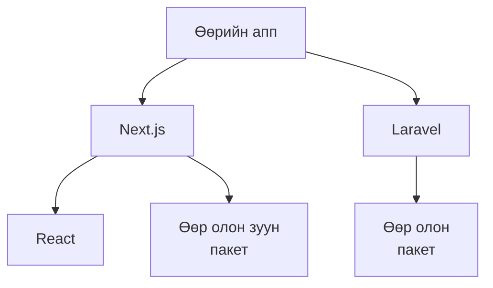
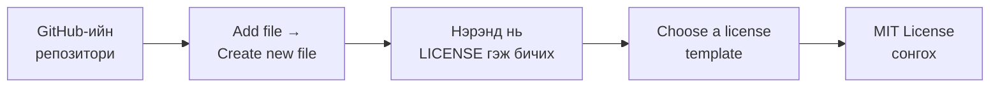

# OSS ба лицензийн тухай

> 🇯🇵 Эх хувь (япон хэлээр): [OSSとライセンスについて.md](<../../../2年生_システム開発実践/後期/2026_12_18/OSSとライセンスについて.md>) <!-- original-ja-link -->

Чөлөөт бүтээлдээ ашиглаж байгаа Laravel, Next.js, React, Tailwind CSS-ийг бүгдийг нь **үнэгүй** ашиглаж болно.
Учир нь эдгээр нь **OSS (нээлттэй эхийн програм хангамж)** юм.
Энд OSS болон түүнийг ашиглахдаа дагаж мөрдөх **лицензийн** тухай үзнэ.

[Чөлөөт бүтээл рүү буцах](../2026_10_09/2026_10_09_資料1.md)

---

## 1. OSS гэж юу вэ

**OSS (Open Source Software / нээлттэй эхийн програм хангамж)** гэдэг нь **эх код (програмын дотоод агуулга) нь нээлттэй** бөгөөд
тогтоосон дүрмийг баримталбал **хэн ч чөлөөтэй ашиглаж, өөрчилж, тарааж болох** програм хангамж юм.

| | OSS | OSS биш програм хангамж |
|---|---|---|
| Эх код | **Нээлттэй** | Нээлттэй биш (зөвхөн компанийн дотор) |
| Өөрчлөх | Дүрмийг баримталбал болно | Болохгүй |
| Жишээ | Laravel, Next.js, React, MySQL, Linux, VS Code-ийн суурь код | Windows, Microsoft Office, Photoshop |

> 💡 **Жишээ нь, «жороо олонд нээх» шиг**
> Хоолны жороо интернэтэд нийтлээд «Чөлөөтэй хийгээрэй. Өөрийнхөөрөө өөрчилсөн ч болно. Гэхдээ **анхны жорын зохиогчийн нэрийг бичээрэй**» гэх —
> энэ бол OSS-ийн үзэл санаа. Энэ «гэхдээ 〇〇» гэсэн хэсэг нь **лиценз** юм.

---

## 2. Бидний эргэн тойрон дахь OSS

Чөлөөт бүтээлийн апп ч үнэндээ **OSS-ээс бүтсэн** байдаг.

`npm install` эсвэл `composer install`-ээр суулгадаг зүйлсийн (`node_modules` болон `vendor` доторх агуулгын) ихэнх нь OSS юм.
Дэлхийн өнцөг булан бүрийн хүмүүсийн бүтээсэн OSS-ийн ачаар **бүгдийг тэгээс эхлүүлж хийхгүйгээр** апп бүтээж чадаж байна.

---

## 3. Лиценз гэж юу вэ

**Лиценз** гэдэг нь «энэ програм хангамжийг **хэрхэн ашиглаж болохыг**» тогтоосон **дүрэм** юм.
OSS-ийг чөлөөтэй ашиглаж болох ч **юу ч хийж болно гэсэн үг биш**. Лицензэд бичигдсэн дүрмийг баримтлах шаардлагатай.

### Түгээмэл лицензүүд

| Лиценз | Чөлөөтэй байдал | Дүрэм (товчхондоо) | Ашигладаг жишээ |
|----------|------|-----------------|-----------|
| **MIT** | Маш чөлөөтэй | **Зохиогчийн эрх болон лицензийн текстийг үлдээвэл** юунд ч ашиглаж болно (төлбөртэй апп-д ч болно) | Laravel, Next.js, React, Tailwind CSS |
| **Apache 2.0** | Чөлөөтэй | MIT-тэй бараг адил. **Өөрчлөлт хийснээ тэмдэглэх** гэх мэт дүрэм арай олон | TypeScript, Kubernetes |
| **GPL** | Арай хатуу | GPL кодыг ашигласан програм хангамжийг **тараах** бол **өөрийн кодыг ч GPL-ээр нээлттэй** болгох ёстой | Linux, WordPress |

> 📝 **GPL шиг лицензийг «копилефт» гэдэг**
> «Чөлөөтэй ашиглаж болно, гэхдээ үүнийг ашиглаж бүтээсэн зүйлээ ч **мөн адил чөлөөтэй** болгоорой» гэсэн үзэл санаа юм.
> Компанид апп хийхдээ ашиглаж буй OSS-ийнхээ лицензийг **заавал шалгадаг**.

---

## 4. Өөрийн апп-д лиценз өгөх

GitHub-д нийтэлсэн өөрийн репозиторид ч лиценз өгч болно.

> ⚠️ **Лиценз өгөхгүй бол бусад хүн чөлөөтэй ашиглаж чадахгүй**
> Нээлттэй репозитори байсан ч лицензгүй бол **бусад хүнд кодыг ашиглах, өөрчлөх зөвшөөрөл олгогдоогүй** гэсэн үг.
> «Чөлөөтэй ашиглаасай» гэвэл MIT, «зөвхөн хараасай (ашиглахыг хүсэхгүй)» гэвэл лицензгүй гэж бодоорой.

---

## 5. Кодоос гадна ч «эрх» бий

Апп-даа оруулах **зураг, чимэглэл, дүрс тэмдэг (икон), фонт, хөгжим**-д ч бүтээсэн хүний **зохиогчийн эрх** бий.

| ✕ Хийж болохгүй | ◯ Ингэж хий |
|----------------|----------|
| Интернэтээс хайж олсон зургийг шууд ашиглах | **Үнэгүй материал** (ашиглалтын нөхцөлийг шалгах) эсвэл өөрөө хийсэн, авсан зургаа ашиглах |
| Аниме, тоглоомын дүрийн зургийг апп-даа оруулж нийтлэх | Нийтлэх апп-д ашиглахгүй. Ашиглах бол **албан ёсны удирдамжийг** шалгах |
| Үнэгүй материалын ашиглалтын нөхцөлийг уншилгүй ашиглах | «Кредит (зохиогчийн нэр)-ийг заавал харуулах» гэх мэт дүрмийг баримтлах |

> 💡 **Дүрс тэмдэг, фонтын хувьд OSS-ийнх нь тохиромжтой**
> Дүрс тэмдгийн хувьд **Heroicons, Lucide**, фонтын хувьд **Google Fonts** гэх мэт үнэгүй нийтлэгдсэн зүйлс бий.
> Лицензийг нь шалгаад ашиглаарай.

> ⚠️ **Портфолиод онцгой анхаар**
> Портфолио бол **компанийн хүмүүст харуулах зүйл**. Эрхийг нь хүндэтгээгүй зураг орсон байвал, зөвхөн тэр нь л **маш муу сэтгэгдэл** төрүүлнэ.

---

## 6. OSS-д «хариу барих»

OSS-ийг дэлхийн өнцөг булан бүрийн хүмүүс **сайн дураараа эсвэл ажлынхаа хүрээнд** бүтээдэг. Зөвхөн ашиглаад зогсохгүй, хариу барих аргууд ч бий.

| Хариу барих арга | Агуулга |
|-----------|------|
| ⭐ **Од (star)** | GitHub дээр ашиглаж буй OSS-ийнхээ репозиторид од дарах (хамгийн амархан) |
| 🐛 **Issue** | Алдаа олвол Issue-ээр мэдэгдэх |
| 📝 **Баримт бичгийг засах** | Тайлбарын алдаа, үсгийн алдааг pull request-ээр засах |
| 🔧 **Кодыг засах** | Алдааг засах pull request илгээх |

OSS-д pull request илгээж, түүнийгээ төсөлд нэгтгүүлсэн туршлага ажилд ороход ч **том давуу тал** болно.

---

## 7. Дүгнэлт

- **OSS** = эх код нь нээлттэй, дүрмийг баримталбал **хэн ч ашиглаж, өөрчилж болох** програм хангамж
- Laravel, Next.js, React ч OSS. Өөрийн апп маань **OSS-ээс бүтсэн**
- **Лиценз** = хэрхэн ашиглаж болох дүрэм. **MIT** (маш чөлөөтэй), **GPL** (өөрийн кодыг ч нээлттэй болгох шаардлагатай байж болно) гэх мэт
- Өөрийн репозиторид ч **LICENSE** файлаар лиценз өгч болно
- Зураг, дүрс тэмдэг, фонт, хөгжимд ч **зохиогчийн эрх** бий. Портфолиод онцгой анхаар
- Зөвхөн ашиглаад зогсохгүй, **од, Issue, pull request**-ээр хариу барьж болно

[Чөлөөт бүтээл рүү буцах](../2026_10_09/2026_10_09_資料1.md)
