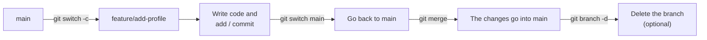
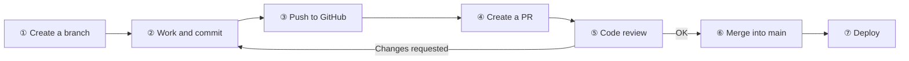
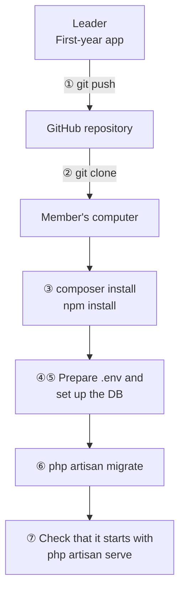

# Getting Ready for Team Development with Git

> 🇯🇵 Original (Japanese version): [2026_04_30.md](<../../../2年生_システム開発実践/前期/2026_04_30/2026_04_30.md>) <!-- original-ja-link -->

---

## Git Review + branch / merge

### Today's Goals
- Review commit/push, which you learned in your first year
- Understand the idea of branches and be able to use them
- Know how to merge

---

### What Is a Branch?

**A branch = a "fork" in your work. It lets you develop new features without breaking the main code.**

```
main (production branch)
  │
  ├── feature/login    ← Working on the login feature
  ├── feature/search   ← Working on the search feature
  └── bugfix/404-error ← Fixing a bug
```

```bash
# Check the current branch
git branch
# → * main (* marks the current branch)

# Create a new branch and switch to it
git checkout -b feature/add-profile
# or (Git 2.23 and later)
git switch -c feature/add-profile

# List branches
git branch -a   # -a also shows remote branches

# Go back to main
git switch main

# Delete a branch
git branch -d feature/add-profile
```

---

### merge — Combining Branches

Merging is how you bring the changes you made on a working branch into main at the end.



```bash
# ① Work on the feature/add-profile branch and commit
git switch feature/add-profile
# ... write code ...
git add .
git commit -m "プロフィール画面を追加"

# ② Go back to the main branch
git switch main

# ③ Bring the changes from feature/add-profile into main
git merge feature/add-profile

# ④ Delete the branch after merging (optional)
git branch -d feature/add-profile
```

---

### Resolving Conflicts

```bash
# If two people change the same line, a conflict happens when you merge
# When you open the conflicted file...

<<<<<<< HEAD
  echo "Aさんが書いたコード";
=======
  echo "Bさんが書いたコード";
>>>>>>> feature/b-work

# ↑ Fix this by hand so it becomes the correct code
# After fixing it:
git add .
git commit -m "コンフリクトを解消"
```

---

## Class 02: GitHub Flow — PRs and Code Review

### What Is GitHub Flow?

It is a set of rules for developing software as a team.

```
① Create a working branch from main
      git switch -c feature/xxxx

② Work and commit on the branch
      git add .
      git commit -m "メッセージ"

③ Push to GitHub
      git push origin feature/xxxx

④ Create a Pull Request (PR)
      → On GitHub, request that this code be merged into main

⑤ Team members review the code
      → They write comments or ask for changes

⑥ If there are no problems, merge into main
⑦ Deploy (release it to production)
```

As a diagram, the flow looks like this. If a reviewer asks for changes, go back to ②, make the changes, and push again.



### How to Write a Pull Request

```markdown
## Changes
- Added a profile screen
- Made it possible to show the user's name and icon

## Please check
- Whether it displays correctly when you access `/profile`
- Whether you are redirected to `/login` when not logged in

## Screenshots
(attach images)
```

### What to Look For in a Code Review

- Are there any bugs or logic errors?
- Are there any security problems (XSS, SQL Injection, etc.)?
- Is the code easy to read?
- Are there tests? (optional in the second year)

---

## Class 03: Running the First-Year App as a Team

### Steps

These steps explain how the leader uploads the app to GitHub and how each team member runs it on their own computer.



```bash
# ① The team leader pushes the first-year app to GitHub
git init
git remote add origin https://github.com/チーム名/app.git
git add .
git commit -m "initial commit"
git push -u origin main

# ② Team members clone it
git clone https://github.com/チーム名/app.git
cd app

# ③ Install the dependencies
composer install
npm install

# ④ Environment settings
cp .env.example .env
php artisan key:generate

# ⑤ DB settings (edit .env)
# DB_DATABASE=app_db
# DB_USERNAME=root
# DB_PASSWORD=

# ⑥ Migration
php artisan migrate

# ⑦ Check that it starts
php artisan serve
```

---

## Summary

| Command | Meaning |
|---------|------|
| `git switch -c branch-name` | Create a branch and switch to it |
| `git switch main` | Go back to main |
| `git merge branch-name` | Merge a branch into the current branch |
| `git push origin branch-name` | Push a branch to the remote |
| Pull Request (PR) | Request on GitHub that your code be merged |
| Code review | Comment on and point out issues in a PR |
