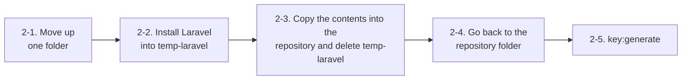
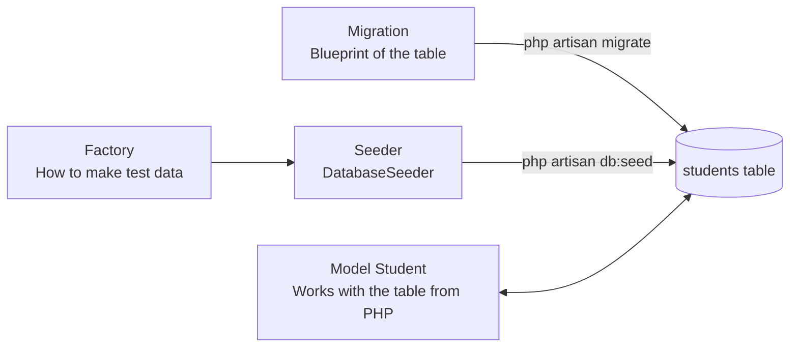

> 🇯🇵 Original (Japanese version): [20260506.md](<../../../2年生_システム開発実践/前期/2026_05_06/20260506.md>) <!-- original-ja-link -->

## Initial Setup of a Laravel Project

> **Goal:** Build the Laravel project for this class from scratch and get it ready for API development.

---

### Before You Start: Check That You Have Everything You Need

Before starting, check that the required software is installed.  
Open a terminal and run the following commands **one line at a time**.

---

#### Checking PHP

```bash
php --version
```

**If it works:**
```
PHP 8.2.x (cli) ...  ← OK if a version is shown
```

**If the command fails (you see `command not found` or `'php' is not recognized`):**

PHP is not installed. If you install XAMPP, you can use PHP and MySQL together.

**On Windows:**
1. Go to `https://www.apachefriends.org/`
2. Download and install "XAMPP for Windows"
3. After installing, add `C:\xampp\php` to the **PATH environment variable**  
   (Search for "environment variables" in the Start menu → "Edit the system environment variables" → "Environment Variables" → select "Path" and click "Edit" → click "New" and add `C:\xampp\php`)
4. **Close the terminal and open it again**, then run `php --version` once more

**On Mac:**
1. Run the following in the terminal (if you have Homebrew)
   ```bash
   brew install php
   ```
2. If you don't have Homebrew, run the following first
   ```bash
   /bin/bash -c "$(curl -fsSL https://raw.githubusercontent.com/Homebrew/install/HEAD/install.sh)"
   ```

---

#### Checking Composer

```bash
composer --version
```

**If it works:**
```
Composer version 2.x.x ...  ← OK if a version is shown
```

**If the command fails (you see `command not found` or `'composer' is not recognized`):**

Composer is not installed. Install it with the following steps.

**On Windows:**
1. Go to `https://getcomposer.org/download/`
2. Download and run "Composer-Setup.exe"
3. If the installer asks where PHP is, specify `C:\xampp\php\php.exe`
4. When the installation is finished, **close the terminal and open it again**, then run `composer --version`

**On Mac:**
```bash
brew install composer
```

---

#### Checking MySQL

```bash
mysql --version
```

**If it works:**
```
mysql  Ver 8.0.x ...  ← OK if a version is shown
```

Once the version is shown, next check whether the MySQL **server** is running.

> **Note (Mac):** Even if `mysql --version` shows a version, the server may not be installed.  
> `mysql-client` (connection tool only) and `mysql` (the server itself) are different things.  
> Be sure to check that the server is running with the steps below.

**On Mac:**
```bash
brew services list | grep mysql
```

| What you see | Meaning |
|------|------|
| `mysql  started` | The server is running. You can go on to the next step |
| `mysql  stopped` | The server is stopped. Go to the "start it" steps below |
| No mysql line appears | The server itself is not installed. Go to the "install it" steps below |

**On Windows (XAMPP):**  
Open the XAMPP Control Panel and click the "Start" button next to MySQL.  
If it shows "Running", it has started.

**If the MySQL server is stopped (start it):**

```bash
# On Mac
brew services start mysql
```

With XAMPP, click the "Start" button in the Control Panel.

**If the MySQL server itself is not installed (Mac):**

```bash
brew install mysql
brew services start mysql
```

> **About the password when connecting**  
> When you run `mysql -u root -p`, it asks for a password.  
> If you just installed it with Homebrew, there is **no password**, so just press Enter.  
> With XAMPP, there is also **no password** by default.  
> If you remember setting a password yourself, enter that password.

---

**If the command fails (you see `command not found` or `'mysql' is not recognized`):**

MySQL is not installed.

**On Windows (using XAMPP):**
1. If XAMPP is already installed, add `C:\xampp\mysql\bin` to the PATH environment variable  
   (Use the same steps as when you added PHP, but this time add `C:\xampp\mysql\bin`)
2. **Close the terminal and open it again**, then run `mysql --version`

**On Mac:**
```bash
brew install mysql
brew services start mysql
```

---

> **If that still doesn't fix it, ask your teacher.**  
> Also check with your teacher if your version is too old (such as PHP 7.x).  
> The recommended versions are **PHP 8.1 or later, Composer 2.x, and MySQL 8.x**.

---

### Step 1｜Move into the Repository You Cloned

You should already have a repository that you cloned from GitHub.  
Open a terminal and move into that folder.

**On Windows (PowerShell or Command Prompt):**
```bash
cd C:\Users\(your-username)\Documents\(repository-name)
```

**On Mac:**
```bash
cd ~/Documents/(repository-name)
```

Check that you moved there:
```bash
pwd
```
```
/Users/(your-username)/Documents/(repository-name)  ← OK if you are inside the repository
```

Let's also check that it is recognized as a Git repository:
```bash
git status
```
```
On branch main
nothing to commit, working tree clean  ← OK if you see something like this
```

> **If `git status` shows an error** (such as `not a git repository`)  
> You have not moved into the repository. Check the folder name and run `cd` again.

---

### Step 2｜Install Laravel

The folder you cloned contains a `.git` folder that `git clone` created automatically.  
`composer create-project laravel/laravel .` only works if the folder is completely empty, so it gives you an error.

```
Project directory "..." is not empty.  ← You get this error
```

> **`.git` is a hidden folder, so you can't see it in Finder or File Explorer.**  
> You can check it by running `ls -a` in the terminal.

So we will **first create the project in a different folder and then move its contents**.



#### 2-1. Move Up One Folder

```bash
cd ..
```

Check:
```bash
pwd
```
```
/Users/(your-username)/Documents  ← OK if you are one level above the repository
```

#### 2-2. Install Laravel into a Temporary Folder

```bash
composer create-project laravel/laravel temp-laravel
```

> This takes **2 to 5 minutes**. Lots of text will scroll by on the screen, but just wait.  
> If `Application ready!` appears at the end, it worked.

#### 2-3. Move the Contents of the Temporary Folder into the Repository Folder

**On Mac:**
```bash
cp -r temp-laravel/. (repository-name)/
rm -rf temp-laravel
```

**On Windows (PowerShell):**
```powershell
Copy-Item -Path temp-laravel\* -Destination (repository-name)\ -Recurse -Force
Copy-Item -Path temp-laravel\.* -Destination (repository-name)\ -Recurse -Force -ErrorAction SilentlyContinue
Remove-Item -Recurse -Force temp-laravel
```

> Replace the **(repository-name)** part with the folder name of your own repository.

#### 2-4. Go Back to the Repository Folder

```bash
cd (repository-name)
```

Check that you moved there correctly:
```bash
pwd
```
```
/Users/(your-username)/Documents/(repository-name)  ← OK if you are inside the repository
```

If folders such as `app/` and `routes/` have been created, it worked:
```bash
ls
```
```
README.md  app  artisan  bootstrap  composer.json  config  database  ...
```

#### 2-5. Generate the Application Key

Laravel needs an **application key** (a secret key) for sessions and encryption.  
Be sure to run this.

```bash
php artisan key:generate
```

```
   INFO  Application key set successfully.
```

> When you run this command, a value is set automatically for `APP_KEY=` in the `.env` file.  
> If you forget, you will see an error screen called `MissingAppKeyException`.

**If you get an error: `No APP_KEY variable was found in the .env file`**

The `.env` file has no `APP_KEY=` line.  
Open `.env` in VSCode and add the following line at the end of the file.

```dotenv
APP_KEY=
```

After saving, run it again:

```bash
php artisan key:generate
```

If a long string is filled in automatically after `APP_KEY=`, it worked.

**Folder structure at this point (main items only):**

```
(repository-name)/          ← The folder you cloned (= the Git repository)
├── app/
│   ├── Http/
│   │   └── Controllers/   ← Where controllers go
│   └── Models/            ← Where models go
├── database/
│   ├── migrations/        ← Where table definitions go
│   ├── factories/         ← Settings for generating test data
│   └── seeders/           ← Settings for inserting test data
├── routes/
│   ├── api.php            ← API routing (the main one we use this time)
│   └── web.php            ← Blade routing (the one you used in your first year)
└── .env                   ← Settings file with DB connection info and more
```

---

### Step 3｜Prepare the Database

#### What Is phpMyAdmin?

**phpMyAdmin** is a management tool that lets you work with MySQL databases in your browser.  
You can create, inspect, and delete databases through the interface without typing commands.

| Environment             | How to open phpMyAdmin                                                        |
| -------------- | ---------------------------------------------------------------------- |
| Windows (XAMPP) | Click the "Admin" button in the XAMPP Control Panel → `http://localhost/phpmyadmin` opens in your browser |
| Mac (XAMPP)     | Click the "Admin" button in the XAMPP Control Panel → `http://localhost/phpmyadmin` opens in your browser |
| Mac (Homebrew)  | phpMyAdmin must be installed separately (it's easier to use the terminal steps below)                             |

---

#### 3-1. Create the Database

**On Windows (XAMPP + phpMyAdmin):**

1. "Start" MySQL in the XAMPP Control Panel
2. Open `http://localhost/phpmyadmin` in your browser
3. Click "**New**" in the menu on the left
4. Enter the following and click the "**Create**" button

   - **Database name:** `school_api`
   - **Collation:** `utf8mb4_unicode_ci`

**On Mac (Homebrew):**

We will create it from the terminal, which doesn't require setting up phpMyAdmin.  
Make sure MySQL is running before you do this.

```bash
mysql -u root
```
```sql
CREATE DATABASE school_api CHARACTER SET utf8mb4 COLLATE utf8mb4_unicode_ci;
EXIT;
```

> If you have set a password, type `mysql -u root -p` and then enter your password.

#### 3-2. Set Up the `.env` File

Open the project in VSCode and open the `.env` file directly under the root.

```
(repository-name)/
└── .env   ← Open this
```

> **⚠️ Note: Do not delete everything in the file and rewrite it.**  
> `.env` already contains many settings, such as `APP_KEY`.  
> **Find only the 5 DB-related lines and change their values. Don't touch any other lines.**

If you scroll down in the file, you will find lines like the following.  
Change only the right side of `=` on these 5 lines:

```dotenv
DB_CONNECTION=mysql
DB_HOST=127.0.0.1
DB_PORT=3306
DB_DATABASE=school_api    ← Change to the name of the DB you just created
DB_USERNAME=root           ← MySQL user name (usually root)
DB_PASSWORD=               ← Leave it empty if you haven't set a password
```

When you're done, save with **Ctrl+S** (**Cmd+S** on Mac).

> **`.env` is a settings file that contains passwords.**  
> It is set up so that it is not included in Git automatically, so don't show it to other people.

---

### Step 4｜Create the Model, Migration, and Factory

In this class, we will build an API that manages **students (Student)**.  
You can create all the files you need at once with the single command below.

```bash
php artisan make:model Student -mf
```

| Option | Meaning                  | File created                                             |
| ----- | ------------------- | ---------------------------------------------------- |
| (none)  | Creates the model              | `app/Models/Student.php`                             |
| `-m`  | Also creates a migration (table definition) | `database/migrations/xxxx_create_students_table.php` |
| `-f`  | Also creates a factory (test data generation)  | `database/factories/StudentFactory.php`              |

The 3 files that are created and the seeder we will use later are connected like this.



If you see the following after running it, it worked:

```
   INFO  Model [app/Models/Student.php] created successfully.
   INFO  Factory [database/factories/StudentFactory.php] created successfully.
   INFO  Migration [database/migrations/2024_xx_xx_create_students_table.php] created successfully.
```

---

### Step 5｜Edit the Model (Setting `$fillable`)

Open the newly created `app/Models/Student.php` in VSCode.

```
school-api/
└── app/
    └── Models/
        └── Student.php   ← Open this
```

When you open the file, it looks like the following. Add `$fillable`:

```php
<?php
namespace App\Models;

use Illuminate\Database\Eloquent\Factories\HasFactory;
use Illuminate\Database\Eloquent\Model;

class Student extends Model
{
    use HasFactory;

    // ↓ Add this one line
    protected $fillable = ['name', 'email', 'score'];
}
```

> **What is `$fillable`?**  
> It is a Laravel security feature. Only the column names you list can be changed with `create()` or `update()`.  
> If you don't set this, you will get an error later when saving data from the API.

---

### Step 6｜Edit the Migration File

When you open the `database/migrations/` folder in VSCode, you will see files whose names start with a date.

```
school-api/
└── database/
    └── migrations/
        ├── 0001_01_01_000000_create_users_table.php    ← Provided by Laravel from the start
        ├── 0001_01_01_000001_create_cache_table.php    ← Provided by Laravel from the start
        ├── 0001_01_01_000002_create_jobs_table.php     ← Provided by Laravel from the start
        └── 2024_xx_xx_xxxxxx_create_students_table.php ← ← Created in Step 4 (edit this one)
```

**Open `create_students_table.php` at the very bottom** and rewrite the contents of the `up()` method:

```php
public function up(): void
{
    Schema::create('students', function (Blueprint $table) {
        $table->id();                              // ID (auto-incrementing number)
        $table->string('name', 100);              // Full name
        $table->string('email')->unique();         // Email address (no duplicates)
        $table->integer('score')->default(0);     // Score (default is 0)
        $table->timestamps();                      // Created/updated date and time (automatic)
    });
}
```

---

### Step 7｜Run the Migration to Create the Table

```bash
php artisan migrate
```

If it succeeds, you will see the following:

```
   INFO  Running migrations.

  0001_01_01_000000_create_users_table ................... 21ms DONE
  0001_01_01_000001_create_cache_table ................... 10ms DONE
  0001_01_01_000002_create_jobs_table .................... 10ms DONE
  2024_xx_xx_xxxxxx_create_students_table ............... 15ms DONE
```

Check that the table was created.

**On Windows (phpMyAdmin):**  
Open `http://localhost/phpmyadmin` in your browser and click `school_api` on the left. You should see the `students` table.

**On Mac (terminal):**
```bash
mysql -u root -e "SHOW TABLES IN school_api;"
```
```
+----------------------+
| Tables_in_school_api |
+----------------------+
| cache                |
| jobs                 |
| migrations           |
| students             |  ← OK if you see this
| users                |
+----------------------+
```

#### Common Errors and How to Fix Them

**Error 1: Can't connect to the DB**
```
SQLSTATE[HY000] [2002] Connection refused
```
→ MySQL is not running.  
→ **Windows:** "Start" MySQL in the XAMPP Control Panel.  
→ **Mac:** Run `brew services start mysql`.

**Error 2: The database can't be found**
```
SQLSTATE[HY000] [1049] Unknown database 'school_api'
```
→ Either you didn't create the database in Step 3, or the database name in `.env` is wrong.  
→ **Windows:** Check the database name in phpMyAdmin.  
→ **Mac:** Check the list of databases with `mysql -u root -e "SHOW DATABASES;"`.

**Error 3: Wrong password**
```
SQLSTATE[HY000] [1045] Access denied for user 'root'@'localhost'
```
→ `DB_PASSWORD` in `.env` is wrong. Check your MySQL password and fix it.

---

### Step 8｜Insert Test Data

Prepare test data to use for checking that the API works.

#### 8-1. Edit the Factory

Open `database/factories/StudentFactory.php`.

```
school-api/
└── database/
    └── factories/
        └── StudentFactory.php   ← Open this
```

Rewrite the contents of the `definition()` method:

```php
public function definition(): array
{
    return [
        'name'  => $this->faker->name(),                      // Random name
        'email' => $this->faker->unique()->safeEmail(),        // Random email
        'score' => $this->faker->numberBetween(0, 100),        // Random score from 0 to 100
    ];
}
```

#### 8-2. Edit the Seeder

Open `database/seeders/DatabaseSeeder.php` and add one line to the `run()` method:

```php
public function run(): void
{
    \App\Models\Student::factory(10)->create(); // Create 10 student records
}
```

#### 8-3. Insert the Test Data

```bash
php artisan db:seed
```

```
   INFO  Seeding database.
```

Check that the data was inserted.

**On Windows (phpMyAdmin):**  
Open `http://localhost/phpmyadmin` and click `school_api` → `students`. You will see 10 records.

**On Mac (terminal):**
```bash
mysql -u root -e "SELECT COUNT(*) FROM school_api.students;"
```
```
+----------+
| COUNT(*) |
+----------+
|       10 |  ← OK if it shows 10
+----------+
```

---

### Step 9｜Start the Development Server

```bash
php artisan serve
```

```
   INFO  Server running on [http://127.0.0.1:8000].

  Press Ctrl+C to stop the server
```

Go to `http://localhost:8000` in your browser. If the "Laravel" logo appears, the server started successfully.

> **This page is only for checking that the server is running.**  
> The data you inserted with the seeder is inside the database and is not shown on this page.  
> In the next class, you will be able to get and display the data by creating API endpoints.

> **To stop the server, press `Ctrl + C`.**  
> Don't close the terminal while the server is running.

#### If You Want to Check That the Seeder Data Was Inserted Correctly

**On Mac (check in the terminal):**

```bash
mysql -u root -e "SELECT id, name, score FROM school_api.students LIMIT 5;"
```

```
+----+------------------+-------+
| id | name             | score |
+----+------------------+-------+
|  1 | Tanaka Taro      |    72 |
|  2 | Yamada Hanako    |    88 |
...
+----+------------------+-------+
```

If you see random data like this, the seeder worked.

**On Windows (check in phpMyAdmin):**

Open `http://localhost/phpmyadmin` and click `school_api` → `students`. You will see a list of 10 records.

---

### Checklist So Far

| Item to check | Check |
|---------|---------|
| `php --version` / `composer --version` showed a version | □ |
| You created the project with `composer create-project` | □ |
| You generated the application key with `php artisan key:generate` | □ |
| You created the `school_api` database | □ |
| You set the DB connection info in `.env` | □ |
| You added `$fillable` to `app/Models/Student.php` | □ |
| You added the columns to the migration file | □ |
| You created the `students` table with `php artisan migrate` | □ |
| 10 test records were inserted with `php artisan db:seed` | □ |
| The server started with `php artisan serve` and you checked it in the browser | □ |
