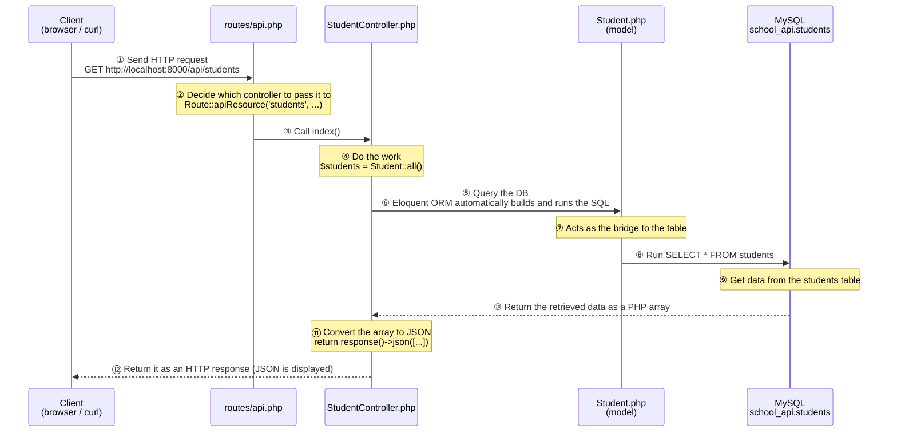
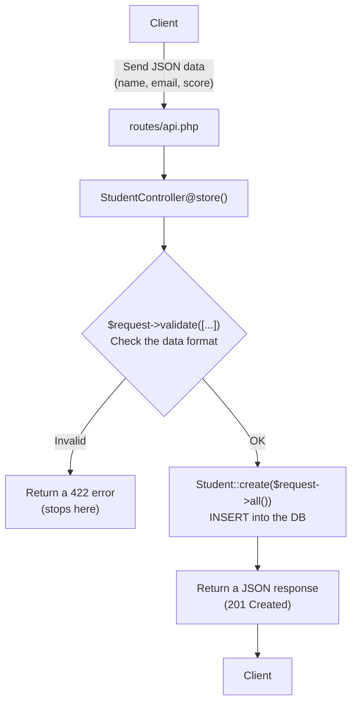

> 🇯🇵 Original (Japanese version): [20260514.md](<../../../2年生_システム開発実践/前期/2026_05_14/20260514.md>) <!-- original-ja-link -->


## Turning the Blade App into an API

### Today's Goals
- Be able to explain what a REST API is
- Be able to write a controller that returns a JSON response
- Understand routing in `api.php`

---

### What Is a REST API?

#### "What's an API?" in one sentence

**API = "an interface that returns only data"**

In your first year, when you opened a URL in the browser, you got back HTML (a full page, including how it looks).  
An API uses the same mechanism, but instead of HTML it returns **only data (JSON)**.

```
[Blade app (what you built in your first year)]
Browser → GET /students → Server → returns an HTML page
                                      ↑ Includes everything: tables, buttons, design

[REST API (what we start building today)]
Browser or other apps → GET /api/students → Server → returns only JSON data
                                                      ↑ No visuals, data only
```

> **Why return only JSON?**  
> Frontends built with React or Vue create their own user interfaces,  
> so they only need the server to send the data.  
> Once you build an API, different applications, such as React apps and smartphone apps, can reuse the same data.

---

#### What does JSON look like?

**JSON (pronounced "JAY-son")** is a text format for representing data.  
It has fixed rules so that browsers and other apps can read it easily.

```json
{
    "status": "ok",
    "data": [
        {
            "id": 1,
            "name": "田中太郎",
            "email": "tanaka@example.com",
            "score": 85
        },
        {
            "id": 2,
            "name": "山田花子",
            "email": "yamada@example.com",
            "score": 72
        }
    ]
}
```

> **How to read it:**  
> - Inside `{ }`, write things in the form "key": "value"  
> - `[ ]` is a list (it groups several pieces of data together)  
> - Strings are wrapped in `"`. Numbers are not  
> - Do not put a comma `,` after the last item

---

#### The REST idea: combining URLs and HTTP methods

A REST API decides what to do by combining "**URL (where)** × **HTTP method (what to do)**."  
An HTTP method is a word that shows the type of request.

| HTTP method | Meaning | Everyday comparison |
|-------------|------|-------------------|
| `GET`       | Get | Viewing a page, searching |
| `POST`      | Create | Submitting a form |
| `PUT/PATCH` | Update | Rewriting the content |
| `DELETE`    | Delete | Pressing a delete button |

The student API we will build in this class:

| URL                  | Method      | Meaning   | What it does           |
| -------------------- | --------- | ---- | --------------- |
| `/api/students`      | GET       | Get list | Returns data for all students      |
| `/api/students`      | POST      | Create | Registers a new student      |
| `/api/students/{id}` | GET       | Get details | Returns one specific student    |
| `/api/students/{id}` | PUT/PATCH | Update   | Updates the specified student's information |
| `/api/students/{id}` | DELETE    | Delete   | Deletes the specified student     |

> `{id}` is replaced with a number. For example, `GET /api/students/3` means "get the student whose id is 3."

---

### About HTTP Status Codes

Every API response always comes with a **status code** (a number).  
Browsers and React look at this number to decide whether the request succeeded or failed.

| Code | Meaning | When it's used |
|-------|------|---------|
| `200 OK` | Success | A get, update, or delete succeeded |
| `201 Created` | Created successfully | A new item was created with POST |
| `404 Not Found` | Not found | The specified id does not exist |
| `422 Unprocessable Entity` | Validation error | The input values are invalid |
| `500 Internal Server Error` | Server error | There is a bug in the program |

> For example, if you call `GET /api/students/999` and there is no student with id=999,  
> the API returns "404" to say "not found."

---

### Step 10｜Create an API Controller

#### 10-1. Create the controller file

Run the following in the terminal (open a **separate tab** from the terminal running `php artisan serve`).

```bash
php artisan make:controller Api/StudentController --api
```

**What the command means:**
- `make:controller` → creates a controller file
- `Api/StudentController` → creates `StudentController.php` inside the `Api` folder
- `--api` → writes the five API methods for you in advance (`index` `store` `show` `update` `destroy`)

If you see the following after running it, it worked:

```
   INFO  Controller [app/Http/Controllers/Api/StudentController.php] created successfully.
```

Check where the file was created:

```
(repository name)/
└── app/
    └── Http/
        └── Controllers/
            └── Api/                     ← newly created folder
                └── StudentController.php  ← this was created
```

---

#### 10-2. Open the controller file

Open `app/Http/Controllers/Api/StudentController.php` in VSCode.  
A file created with the `--api` option starts out looking like this:

```php
<?php

namespace App\Http\Controllers\Api;

use Illuminate\Http\Request;
use App\Http\Controllers\Controller;

class StudentController extends Controller
{
    public function index()
    {
        //
    }

    public function store(Request $request)
    {
        //
    }

    public function show(string $id)
    {
        //
    }

    public function update(Request $request, string $id)
    {
        //
    }

    public function destroy(string $id)
    {
        //
    }
}
```

> **What are `namespace` and `use`?**  
> - `namespace` is like this file's "address." It shows that the file lives inside the `Api` folder.  
> - `use` is a "declaration to bring in" another file. We will add one later so we can use the `Student` model.

---

#### 10-3. Write the logic in the controller

Replace **all** of the file's contents with the code below.  
(Press Ctrl+A to select all → paste, or delete the existing content and replace it.)

```php
<?php

namespace App\Http\Controllers\Api;

use App\Http\Controllers\Controller;
use App\Models\Student;           // ← makes the Student model available
use Illuminate\Http\Request;

class StudentController extends Controller
{
    // -------------------------------------------------------
    // GET /api/students  → returns a list of all students
    // -------------------------------------------------------
    public function index()
    {
        $students = Student::all();  // get all records from the database

        return response()->json([
            'status' => 'ok',
            'data'   => $students,   // put the retrieved data into JSON and return it
        ]);
    }

    // -------------------------------------------------------
    // POST /api/students  → registers a new student
    // -------------------------------------------------------
    public function store(Request $request)
    {
        // Validation: check the format of the data that was sent
        $request->validate([
            'name'  => 'required|max:100',          // required, up to 100 characters
            'email' => 'required|email|unique:students', // required, email format, no duplicates
            'score' => 'required|integer|min:0|max:100', // required, integer, 0-100
        ]);

        $student = Student::create($request->all()); // save to the DB

        // return with the 201 Created (created successfully) status code
        return response()->json([
            'status' => 'ok',
            'data'   => $student,
        ], 201);
    }

    // -------------------------------------------------------
    // GET /api/students/{id}  → returns the one student with the given id
    // -------------------------------------------------------
    public function show($id)
    {
        $student = Student::find($id); // look up one record by id

        if (!$student) {
            // if not found → return 404 Not Found
            return response()->json([
                'status'  => 'error',
                'message' => 'Student not found',
            ], 404);
        }

        return response()->json([
            'status' => 'ok',
            'data'   => $student,
        ]);
    }

    // -------------------------------------------------------
    // PUT /api/students/{id}  → updates the student with the given id
    // -------------------------------------------------------
    public function update(Request $request, $id)
    {
        $student = Student::findOrFail($id); // automatically returns 404 if not found

        $request->validate([
            'name'  => 'sometimes|max:100',          // sometimes = check only if it was sent
            'score' => 'sometimes|integer|min:0|max:100',
        ]);

        $student->update($request->all()); // update the DB

        return response()->json([
            'status' => 'ok',
            'data'   => $student,
        ]);
    }

    // -------------------------------------------------------
    // DELETE /api/students/{id}  → deletes the student with the given id
    // -------------------------------------------------------
    public function destroy($id)
    {
        Student::findOrFail($id)->delete(); // find it and delete it

        return response()->json([
            'status'  => 'ok',
            'message' => 'Deleted',
        ]);
    }
}
```

**After replacing it, save with Ctrl+S (Cmd+S on Mac).**

---

#### Summary of what each method does

| Method name | Matching URL | What it does |
|-----------|------------|---------|
| `index()` | GET /api/students | Gets all records and returns them as JSON |
| `store()` | POST /api/students | Validate → save to DB → return with 201 |
| `show($id)` | GET /api/students/{id} | Look up one record → 404 if missing → return as JSON |
| `update($request, $id)` | PUT /api/students/{id} | Look up one record → validate → update DB |
| `destroy($id)` | DELETE /api/students/{id} | Look up one record → delete |

---

### Step 11｜Enable API Routing

Just creating a controller does not connect a URL to it.  
You need to set up **routing**, which says "when this URL is accessed, call this method."

#### 11-1. Create `routes/api.php`

> **⚠️ Since Laravel 11, `routes/api.php` does not exist by default.**  
> It is only created when you run the following command.

```bash
php artisan install:api
```

While it runs, it will ask you to confirm twice. Answer `yes` (or press Enter) both times to continue.

---

**[Confirmation 1] Run the migrations?**

```
   INFO  Published API routes file.

 One new database migration has been published. Would you like to run all pending database migrations? (yes/no) [yes]:
 > yes
```

> After `routes/api.php` is created, it asks whether to run the migrations right now.  
> Type `yes` or press Enter to continue.

---

**[Confirmation 2] Confirm running in production**

```
                                                                    
                         APPLICATION IN PRODUCTION.                 
                                                                    

 ┌ Are you sure you want to run this command? ──────────────────┐
 │ Yes                                                          │
 └──────────────────────────────────────────────────────────────┘
```

> **You may be surprised to see "APPLICATION IN PRODUCTION," but there is nothing to worry about.**  
> This is just Laravel's safety check asking, "Are you sure you want to run this?"  
> Choose "Yes" to continue.

---

**The migrations run**

```
   INFO  Running migrations.

  2026_xx_xx_xxxxxx_create_personal_access_tokens_table .......... DONE
```

> The `personal_access_tokens` table is created.  
> This is **the table Sanctum uses to store authentication tokens**.  
> We will use it when we implement authentication in Session 07. For now, just remember that it was created automatically.

---

**If you see this message at the end, it worked:**

```
   INFO  API scaffolding installed. Please add the [Laravel\Sanctum\HasApiTokens] trait to your User model.
```

> The `Please add the [Laravel\Sanctum\HasApiTokens] trait...` part at the end  
> asks you to add a setting to the User model, but **we will do that in Session 07. You can ignore it for now.**

---

What this command did:
- Created the `routes/api.php` file
- Registered API routing in `bootstrap/app.php`
- Installed Laravel Sanctum (the authentication package we will use in Session 07)
- Ran the migration for the `personal_access_tokens` table

Folder structure after running it:

```
(repository name)/
└── routes/
    ├── api.php   ← this was created (API routing)
    └── web.php   ← this one is for Blade (we won't touch it this time)
```

> **The difference between `api.php` and `web.php`**  
> - `web.php` … where you write routes that return HTML  
> - `api.php` … for APIs that return JSON. `/api/` is automatically added to the start of the URL

#### 11-2. Add the routes

Open `routes/api.php` in VSCode. At first it is almost empty. Replace it with the following:

```php
<?php

use Illuminate\Support\Facades\Route;
use App\Http\Controllers\Api\StudentController;  // ← add this line

Route::apiResource('students', StudentController::class);
// ↑ this one line automatically registers five routes
```

**After replacing it, save with Ctrl+S (Cmd+S on Mac).**

---

#### Check the routes registered by `Route::apiResource`

`Route::apiResource('students', StudentController::class)` registers the following five routes **in one line**.

Command to check:

```bash
php artisan route:list --path=api/students
```

```
  GET|HEAD   api/students ............. students.index  › Api\StudentController@index
  POST       api/students ............. students.store  › Api\StudentController@store
  GET|HEAD   api/students/{student} ... students.show   › Api\StudentController@show
  PUT|PATCH  api/students/{student} ... students.update › Api\StudentController@update
  DELETE     api/students/{student} ... students.destroy› Api\StudentController@destroy
```

> Writing these by hand one at a time would take five lines, but with `apiResource` you only need one.

---

### Step 12｜Check the API in the Browser

If the development server is not running, start it:

```bash
php artisan serve
```

#### 12-1. Test retrieving the list (GET /api/students) in the browser

Open the following URL in your browser:

```
http://localhost:8000/api/students
```

If you see JSON like the following, it worked:

```json
{
    "status": "ok",
    "data": [
        {
            "id": 1,
            "name": "Tanaka Taro",
            "email": "tanaka@example.com",
            "score": 72,
            "created_at": "2024-xx-xx ...",
            "updated_at": "2024-xx-xx ..."
        },
        ...
    ]
}
```

> **If you get an error instead of JSON, check the following.**

**Common errors and how to fix them:**

| Error | Cause | Fix |
|-----------|------|-------|
| `Class "App\Http\Controllers\Api\StudentController" not found` | The `use` line is written incorrectly | Check the `use` line in `api.php` |
| `SQLSTATE[HY000] [2002] Connection refused` | MySQL is not running | Start MySQL (XAMPP or `brew services start mysql`) |
| Blank page / 500 error | PHP syntax error | Open `.storage/logs/laravel.log` and check the error |
| Only `{"message":""}` is shown | The route was found, but the code inside threw an error | Check the controller code |

---

#### 12-2. Test retrieving one record (GET /api/students/{id}) in the browser

Open the following URL in your browser (change the id number to one that actually exists in your data):

```
http://localhost:8000/api/students/1
```

```json
{
    "status": "ok",
    "data": {
        "id": 1,
        "name": "Tanaka Taro",
        "email": "tanaka@example.com",
        "score": 72,
        "created_at": "2024-xx-xx ...",
        "updated_at": "2024-xx-xx ..."
    }
}
```

If you use an id that does not exist:

```
http://localhost:8000/api/students/999
```

```json
{
    "status": "error",
    "message": "Student not found"
}
```

If you see this, it is working correctly.

---

#### 12-3. Check POST, PUT, and DELETE with the curl command

The browser's address bar can only send GET requests.  
To test POST (create), PUT (update), and DELETE (delete), use a command called **curl**.

> **What is curl?**  
> It is a command that sends HTTP requests from the terminal. It comes preinstalled on both Mac and Windows.  
> Run it in a **separate tab** from the terminal running `php artisan serve`.

---

**How to read the curl command options:**

| Option | Meaning |
|-----------|------|
| `-X POST` | Specifies the HTTP method (POST / PUT / DELETE, etc.) |
| `-H "Content-Type: application/json"` | Declares "I am sending JSON" |
| `-d '{...}'` | The data to send (in JSON format) |

---

**① Create (POST /api/students)**

**On Mac:**
```bash
curl -X POST http://localhost:8000/api/students \
  -H "Content-Type: application/json" \
  -d '{"name": "新しい生徒", "email": "new@example.com", "score": 90}'
```

**On Windows (Command Prompt):**
```cmd
curl -X POST http://localhost:8000/api/students -H "Content-Type: application/json" -d "{\"name\": \"新しい生徒\", \"email\": \"new@example.com\", \"score\": 90}"
```

> On Windows, you need to escape `"` as `\"`.

Response on success (status code `201 Created`):

```json
{"status":"ok","data":{"id":11,"name":"新しい生徒","email":"new@example.com","score":90,...}}
```

---

**② Update (PUT /api/students/{id})**

Example: change the score of the student with id `1` to `95`:

**On Mac:**
```bash
curl -X PUT http://localhost:8000/api/students/1 \
  -H "Content-Type: application/json" \
  -d '{"score": 95}'
```

**On Windows (Command Prompt):**
```cmd
curl -X PUT http://localhost:8000/api/students/1 -H "Content-Type: application/json" -d "{\"score\": 95}"
```

Response on success (status code `200 OK`):

```json
{"status":"ok","data":{"id":1,"name":"Tanaka Taro","email":"tanaka@example.com","score":95,...}}
```

---

**③ Delete (DELETE /api/students/{id})**

Example: delete the student with id `1`:

**On Mac:**
```bash
curl -X DELETE http://localhost:8000/api/students/1
```

**On Windows (Command Prompt):**
```cmd
curl -X DELETE http://localhost:8000/api/students/1
```

Response on success (status code `200 OK`):

```json
{"status":"ok","message":"Deleted"}
```

---

**After deleting, check the list. If the number of records went down, it worked:**

```bash
curl http://localhost:8000/api/students
```

---

### Which Files a Request Passes Through

Let's look at which files run, in order, behind the scenes when you send `GET /api/students` from the browser or curl.

---

#### Overall flow diagram

Time flows from top to bottom. Solid arrows are the "outbound trip (request)," and dotted arrows are the "return trip (response)."



---

#### Summary of each file's role

| File | Role | Steps it handles |
|---------|------|---------------|
| `routes/api.php` | Maps "which URL → which controller" | ② |
| `app/Http/Controllers/Api/StudentController.php` | Receives the request, processes it, and returns the response | ④⑥⑪ |
| `app/Models/Student.php` | Bridges the DB table and the PHP code | ⑦ |
| `Database (MySQL)` | Actually stores and searches the data | ⑨ |

---

#### What is Eloquent ORM? (more on ⑥ and ⑦)

Just by writing `Student::all()`, Laravel automatically generates and runs the SQL `SELECT * FROM students;` for you.  
This mechanism is called **Eloquent ORM**.

```php
// What you write in PHP   →  The SQL that actually runs
Student::all()           →  SELECT * FROM students;
Student::find(1)         →  SELECT * FROM students WHERE id = 1 LIMIT 1;
Student::create([...])   →  INSERT INTO students (...) VALUES (...);
$student->update([...])  →  UPDATE students SET ... WHERE id = ?;
$student->delete()       →  DELETE FROM students WHERE id = ?;
```

> The advantage of an ORM is that **you don't have to write SQL directly**.  
> The model's class name (`Student`) is automatically matched to the table name (`students`).

---

#### How the POST flow is different

For `POST /api/students` (create), the basic flow is the same, but **validation** happens partway through.



---

### Checklist So Far

| Item | Check |
|---------|---------|
| I can explain that a REST API is "a system that returns only data" | □ |
| I know the basic JSON syntax (`{}` `[]` `"key": "value"`) | □ |
| I ran `php artisan make:controller Api/StudentController --api` | □ |
| I wrote the code for the five methods in `StudentController.php` | □ |
| I ran `php artisan install:api` and created `routes/api.php` | □ |
| I added `Route::apiResource` to `routes/api.php` | □ |
| `php artisan route:list` showed the five routes | □ |
| I opened `http://localhost:8000/api/students` in the browser and got JSON back | □ |
| `http://localhost:8000/api/students/1` returned JSON for one record | □ |
| `http://localhost:8000/api/students/999` returned a 404 error in JSON | □ |
