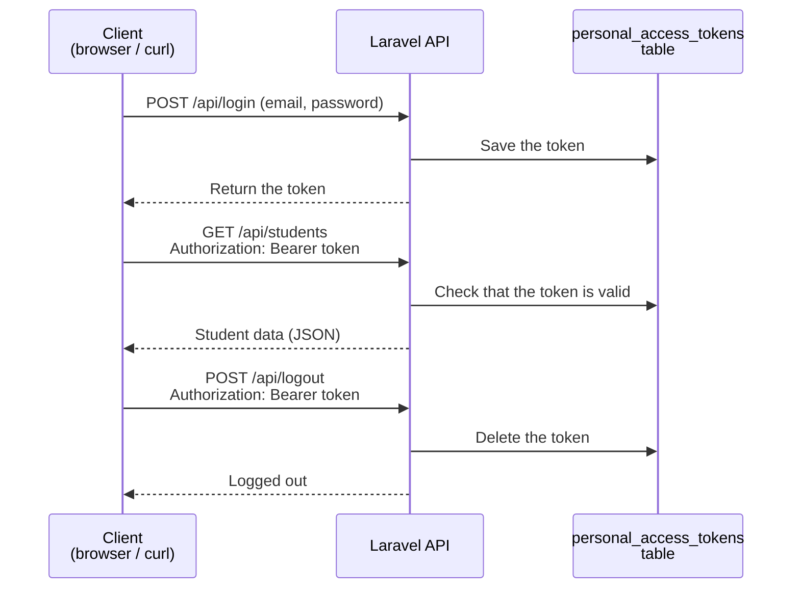
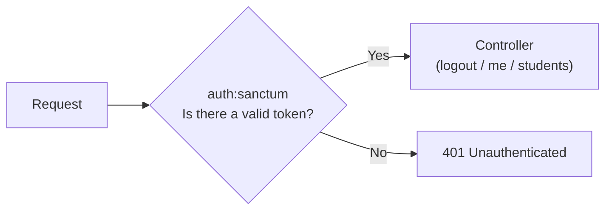

# Turning Laravel into a REST API

> 🇯🇵 Original (Japanese version): [20260521.md](<../../../2年生_システム開発実践/前期/2026_05_21/20260521.md>) <!-- original-ja-link -->

---

## Session 05: Organizing the CRUD API with a Resource Controller

### API Resource: Shaping the Response

```bash
php artisan make:resource StudentResource
```

```php
// app/Http/Resources/StudentResource.php
class StudentResource extends JsonResource
{
    public function toArray(Request $request): array
    {
        return [
            'id'         => $this->id,
            'name'       => $this->name,
            'email'      => $this->email,
            'score'      => $this->score,
            'evaluation' => $this->score >= 80 ? 'A' : 'B',  // you can add calculated values too
            'created_at' => $this->created_at->format('Y/m/d'),
            // do not include fields you don't need (such as password)
        ];
    }
}
```

**Using it in the controller:**

```php
use App\Http\Resources\StudentResource;
use App\Http\Resources\StudentCollection;

public function index()
{
    $students = Student::all();
    return StudentResource::collection($students);
    // → wraps every record in the Resource and returns them
}

public function show($id)
{
    return new StudentResource(Student::findOrFail($id));
}
```

---

## Session 06: Making API Responses Consistent

### Best Practices for API Response Format

```json
// On success
{
    "status": "ok",
    "data": { ... }
}

// On error
{
    "status": "error",
    "message": "Not found",
    "errors": {
        "email": ["このメールアドレスは既に使われています"]
    }
}
```

---

## Session 07: Token Authentication with Sanctum

### What Is Sanctum?

It is Laravel's **API authentication package**.  
It manages login state using tokens (a kind of password).

The process from login to logout works as follows:



```bash
composer require laravel/sanctum
php artisan vendor:publish --provider="Laravel\Sanctum\SanctumServiceProvider"
php artisan migrate
```

**Implementing the authentication API:**

```php
// app/Http/Controllers/Api/AuthController.php
class AuthController extends Controller
{
    // POST /api/login
    public function login(Request $request)
    {
        $request->validate([
            'email'    => 'required|email',
            'password' => 'required',
        ]);
        
        // check the email and password
        if (!Auth::attempt($request->only('email', 'password'))) {
            return response()->json([
                'status'  => 'error',
                'message' => 'メールアドレスまたはパスワードが違います',
            ], 401);
        }
        
        $user = Auth::user();
        
        // issue a token
        $token = $user->createToken('api-token')->plainTextToken;
        
        return response()->json([
            'status' => 'ok',
            'token'  => $token,
            'user'   => $user,
        ]);
    }
    
    // POST /api/logout
    public function logout(Request $request)
    {
        // delete the current token
        $request->user()->currentAccessToken()->delete();
        
        return response()->json(['status' => 'ok', 'message' => 'Logged out']);
    }
    
    // GET /api/me
    public function me(Request $request)
    {
        return response()->json(['status' => 'ok', 'user' => $request->user()]);
    }
}
```

---

## Session 08: Authentication Middleware and Access Control

The `auth:sanctum` middleware acts as a gatekeeper, checking whether a request has a token before it reaches the controller.



```php
// routes/api.php

// Routes that don't require authentication
Route::post('/login', [AuthController::class, 'login']);
Route::post('/register', [AuthController::class, 'register']);

// Routes that require authentication (auth:sanctum)
Route::middleware('auth:sanctum')->group(function () {
    Route::post('/logout', [AuthController::class, 'logout']);
    Route::get('/me', [AuthController::class, 'me']);
    Route::apiResource('students', StudentController::class);
});
```

**How to test the API (curl commands):**

```bash
# Log in
curl -X POST http://localhost:8000/api/login \
  -H "Content-Type: application/json" \
  -d '{"email":"test@example.com","password":"password"}'
# → {"token": "1|abc123..."}

# Call an API that requires authentication
curl http://localhost:8000/api/students \
  -H "Authorization: Bearer 1|abc123..."
```

---

## Summary

| Concept | Blade (1st year) | API (2nd year) |
|------|-------------|------------|
| Response | HTML (view) | JSON (response()->json()) |
| Routing | routes/web.php | routes/api.php |
| Authentication | Session | Sanctum token |
| Screens | Returned by Blade | Built by the frontend |
