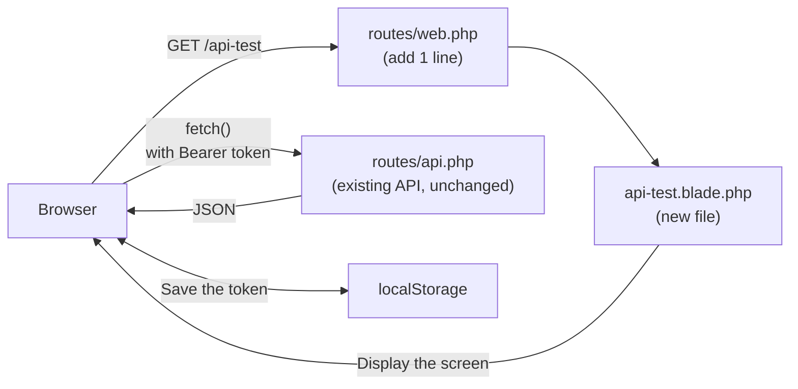

> 🇯🇵 Original (Japanese version): [20260528.md](<../../../2年生_システム開発実践/前期/2026_05_28/20260528.md>) <!-- original-ja-link -->

## Checking Token Authentication in the Browser (Extra)

In addition to using curl, we'll create a page where you can visually check how token authentication works in the browser.

### Overview

When you open `/api-test`, a login screen appears.  
After you log in, the list of students fetched through the API is displayed, and you can also add and delete students.

```
[Before login]
┌──────────────────────────────────┐
│  API Token Tester                │
│                                  │
│   Log in to see the              │
│   student list                   │
│                                  │
│   [Email address       ]         │
│   [Password            ]         │
│   [Log in (POST /api/login)]     │
└──────────────────────────────────┘

[After login]
┌──────────────────────────────────────────────────────────────┐
│  API Token Tester  ● Logged in: テストユーザー  [Log out]    │
├──────────────────────────────────────────────────────────────┤
│  Student list  GET /api/students  HTTP 200                   │
│  ┌────┬──────────┬────────────────────┬───────┬────────┐     │
│  │ ID │  Name    │  Email             │ Score │        │     │
│  ├────┼──────────┼────────────────────┼───────┼────────┤     │
│  │  1 │ 田中太郎 │ tanaka@example.com │  85   │ Delete │     │
│  │  2 │ 山田花子 │ yamada@example.com │  72   │ Delete │     │
│  └────┴──────────┴────────────────────┴───────┴────────┘     │
│                                                              │
│  Add new (POST /api/students)                                │
│  [Name] [Email address] [Score] [Add]                        │
│                                                              │
│  ▶ Code this page uses (it's written the same way in React)  │
└──────────────────────────────────────────────────────────────┘
```

> **We won't change any of the existing API code.**  
> All we add is one line in `routes/web.php` and one view file.

Here is how the new files relate to the existing API. `web.php` displays the screen, and `api.php` handles the data exchange just as before.



---

### Step 1｜Add a Route to `routes/web.php`

Open your project's `routes/web.php` in VSCode.

```
(repository name)/
└── routes/
    └── web.php   ← open this
```

Add the following line at the end of the file:

```php
Route::get('/api-test', fn() => view('api-test'));
```

> **You don't need to add a `use` line.**  
> This route uses a closure (an anonymous function), so it doesn't call a controller class.  
> It works without adding a `use App\Http\Controllers\...` line.

After adding it, `routes/web.php` will look like this:

```php
<?php

use Illuminate\Support\Facades\Route;

Route::get('/', function () {
    return view('welcome');
});

Route::get('/api-test', fn() => view('api-test'));  // ← add this line
```

**After adding it, save with Ctrl+S (Cmd+S on Mac).**

---

### Step 2｜Create `resources/views/api-test.blade.php`

Create a new file called `api-test.blade.php` inside the `resources/views/` folder.

#### 2-1. Create a new file

In the VSCode Explorer, right-click the `resources/views/` folder  
→ select "New File" → type the file name `api-test.blade.php` and press Enter.

```
(repository name)/
└── resources/
    └── views/
        ├── welcome.blade.php   ← file that was already there
        └── api-test.blade.php  ← create this
```

#### 2-2. Copy and paste all of the code below

Open the file you created, then copy and paste **all** of the code below:

```html
<!DOCTYPE html>
<html lang="ja">
<head>
    <meta charset="UTF-8">
    <title>API トークンテスター</title>
    <style>
        * { box-sizing: border-box; margin: 0; padding: 0; }
        body { font-family: sans-serif; background: #f4f6f8; color: #333; }

        .header {
            background: #1565C0; color: white;
            padding: 16px 32px;
            display: flex; align-items: center; gap: 16px;
        }
        .header h1 { font-size: 1.2em; font-weight: bold; }
        .header .sub { font-size: 0.85em; opacity: 0.85; }

        .layout { display: grid; grid-template-columns: 340px 1fr; gap: 0; min-height: calc(100vh - 56px); }

        /* Left pane */
        .left { background: white; border-right: 1px solid #e0e0e0; padding: 24px; display: flex; flex-direction: column; gap: 24px; }

        .section-title {
            font-size: 0.75em; font-weight: bold; letter-spacing: .05em;
            color: #888; text-transform: uppercase; margin-bottom: 10px;
        }

        /* Login status badge */
        .status-badge {
            display: flex; align-items: center; gap: 8px;
            padding: 10px 14px; border-radius: 8px; font-size: 0.88em;
        }
        .status-badge.logged-out { background: #fff3e0; color: #e65100; }
        .status-badge.logged-in  { background: #e8f5e9; color: #2e7d32; }
        .dot { width: 9px; height: 9px; border-radius: 50%; flex-shrink: 0; }
        .dot-red   { background: #e53935; }
        .dot-green { background: #43a047; }

        /* Token display */
        .token-box {
            background: #f5f5f5; border: 1px solid #ddd;
            border-radius: 6px; padding: 8px 10px;
            font-family: monospace; font-size: 0.8em;
            word-break: break-all; color: #555;
            max-height: 70px; overflow-y: auto;
        }

        /* Form */
        label { display: block; font-size: 0.85em; font-weight: bold; margin-bottom: 4px; }
        input[type="email"], input[type="password"] {
            width: 100%; padding: 8px 10px;
            border: 1px solid #ccc; border-radius: 6px;
            font-size: 0.95em; margin-bottom: 10px;
        }
        input:focus { outline: 2px solid #1976D2; border-color: transparent; }

        /* Buttons */
        .btn {
            width: 100%; padding: 9px; border: none; border-radius: 6px;
            font-size: 0.95em; cursor: pointer; font-weight: bold;
        }
        .btn-primary { background: #1976D2; color: white; }
        .btn-primary:hover { background: #1565C0; }
        .btn-danger  { background: #D32F2F; color: white; }
        .btn-danger:hover  { background: #B71C1C; }
        .btn:disabled { opacity: 0.45; cursor: not-allowed; }

        /* API test button group */
        .api-btn-group { display: flex; flex-direction: column; gap: 8px; }
        .api-btn {
            width: 100%; padding: 9px 12px; border-radius: 6px;
            font-size: 0.88em; cursor: pointer; font-weight: bold;
            text-align: left; border: 1.5px solid;
        }
        .api-btn .method { font-size: 0.75em; letter-spacing: .05em; opacity: 0.8; }
        .api-btn .path   { font-family: monospace; }
        .api-btn-noauth  { background: #fff8e1; border-color: #FFA000; color: #E65100; }
        .api-btn-noauth:hover  { background: #fff3e0; }
        .api-btn-auth    { background: #e3f2fd; border-color: #1976D2; color: #0d47a1; }
        .api-btn-auth:hover    { background: #bbdefb; }
        .api-btn-auth:disabled { opacity: 0.45; cursor: not-allowed; }

        /* Right pane: response */
        .right { padding: 24px; display: flex; flex-direction: column; gap: 16px; }

        .res-header {
            display: flex; align-items: center; gap: 12px; flex-wrap: wrap;
        }
        .res-title { font-size: 0.75em; font-weight: bold; color: #888; letter-spacing: .05em; text-transform: uppercase; }
        .res-meta  { display: flex; gap: 10px; align-items: center; }

        .status-pill {
            padding: 3px 12px; border-radius: 99px;
            font-weight: bold; font-size: 0.85em;
        }
        .status-200 { background: #e8f5e9; color: #2e7d32; }
        .status-201 { background: #e8f5e9; color: #2e7d32; }
        .status-401 { background: #fff3e0; color: #e65100; }
        .status-422 { background: #fce4ec; color: #880e4f; }
        .status-4xx { background: #fce4ec; color: #880e4f; }
        .status-5xx { background: #fce4ec; color: #880e4f; }
        .status-0   { background: #f5f5f5; color: #888; }

        .endpoint-label {
            font-family: monospace; font-size: 0.85em; color: #555;
            background: #f5f5f5; padding: 3px 10px; border-radius: 4px;
        }

        .res-body {
            flex: 1;
            background: #1e1e1e; color: #d4d4d4;
            border-radius: 8px; padding: 20px;
            font-family: 'Courier New', monospace; font-size: 0.9em;
            line-height: 1.6; white-space: pre-wrap;
            min-height: 300px; overflow: auto;
        }
        .res-body.empty { color: #555; font-style: italic; }

        /* JSON syntax colors */
        .jk { color: #9cdcfe; }   /* key */
        .js { color: #ce9178; }   /* string value */
        .jn { color: #b5cea8; }   /* number */
        .jb { color: #569cd6; }   /* boolean/null */

        /* Hint area */
        .hint-box {
            background: #e8f5e9; border: 1px solid #a5d6a7;
            border-radius: 6px; padding: 10px 14px;
            font-size: 0.83em; line-height: 1.6; color: #1b5e20;
        }
        .hint-box.warn { background: #fff8e1; border-color: #ffe082; color: #6d4c00; }
        .hint-box.info { background: #e3f2fd; border-color: #90caf9; color: #0d47a1; }

        /* Nav links */
        .nav { font-size: 0.82em; }
        .nav a { color: #1976D2; text-decoration: none; }
        .nav a:hover { text-decoration: underline; }

        .divider { border: none; border-top: 1px solid #eee; }
    </style>
</head>
<body>

<div class="header">
    <div>
        <div class="header h1">API トークンテスター</div>
        <div class="sub">コマ07〜08 Sanctum トークン認証の動作確認ツール</div>
    </div>
    <div style="margin-left:auto; font-size:0.82em; opacity:0.8;">
        <a href="/students" style="color:white;">← Blade管理画面</a>
    </div>
</div>

<div class="layout">

    <!-- Left pane: control panel -->
    <div class="left">

        <!-- ① Authentication status -->
        <div>
            <div class="section-title">① 認証状態</div>
            <div id="badge-logged-out" class="status-badge logged-out">
                <span class="dot dot-red"></span>
                <span>ログアウト中（トークンなし）</span>
            </div>
            <div id="badge-logged-in" class="status-badge logged-in" style="display:none;">
                <span class="dot dot-green"></span>
                <span id="badge-username">ログイン中</span>
            </div>
            <div id="token-area" style="margin-top:10px; display:none;">
                <div class="section-title" style="margin-bottom:4px;">現在のトークン</div>
                <div id="token-display" class="token-box">—</div>
            </div>
        </div>

        <hr class="divider">

        <!-- ② Login -->
        <div id="login-section">
            <div class="section-title">② ログイン</div>
            <label>メールアドレス</label>
            <input type="email" id="email" value="test@example.com" placeholder="test@example.com">
            <label>パスワード</label>
            <input type="password" id="password" value="password" placeholder="password">
            <button class="btn btn-primary" onclick="doLogin()">POST /api/login</button>
        </div>

        <!-- ② Logout (shown when logged in) -->
        <div id="logout-section" style="display:none;">
            <div class="section-title">② ログアウト</div>
            <button class="btn btn-danger" onclick="doLogout()">POST /api/logout</button>
        </div>

        <hr class="divider">

        <!-- ③ API test -->
        <div>
            <div class="section-title">③ API を叩いてみる</div>
            <div class="api-btn-group">
                <button class="api-btn api-btn-noauth" onclick="testNoToken()">
                    <div class="method">⚠ トークンなし</div>
                    <div class="path">GET /api/students</div>
                </button>
                <button class="api-btn api-btn-auth" id="btn-with-token" onclick="testWithToken()" disabled>
                    <div class="method">✓ トークンあり</div>
                    <div class="path">GET /api/students</div>
                </button>
                <button class="api-btn api-btn-auth" id="btn-me" onclick="testMe()" disabled>
                    <div class="method">✓ トークンあり</div>
                    <div class="path">GET /api/me</div>
                </button>
                <button class="api-btn api-btn-noauth" onclick="testBadPassword()">
                    <div class="method">✗ パスワード間違い</div>
                    <div class="path">POST /api/login</div>
                </button>
            </div>
        </div>

        <hr class="divider">

        <div class="nav">
            <a href="/students">Blade 管理画面 (/students)</a><br>
            <a href="/api/students" target="_blank">API JSON (/api/students) ↗</a>
        </div>

    </div>

    <!-- Right pane: response display -->
    <div class="right">

        <div>
            <div class="res-header">
                <div class="res-title">レスポンス</div>
                <div class="res-meta">
                    <span id="res-status" class="status-pill status-0">—</span>
                    <span id="res-endpoint" class="endpoint-label">—</span>
                </div>
            </div>
        </div>

        <div id="hint" class="hint-box info">
            左のパネルでボタンを押すと、ここにレスポンス（サーバーからの返答）が表示されます。<br>
            まず「② ログイン」→ トークンを取得 → 「③ APIを叩いてみる」の順に試してみましょう。
        </div>

        <pre id="res-body" class="res-body empty">// ここにレスポンスが表示されます</pre>

    </div>
</div>

<script>
// ─── State management ───────────────────────────────────
let token = localStorage.getItem('api_token') || null;
let userName = localStorage.getItem('api_username') || null;

// Update the UI on startup
updateUI();

// ─── UI update ───────────────────────────────────────────
function updateUI() {
    const loggedIn = !!token;

    document.getElementById('badge-logged-out').style.display = loggedIn ? 'none' : 'flex';
    document.getElementById('badge-logged-in').style.display  = loggedIn ? 'flex' : 'none';
    document.getElementById('token-area').style.display       = loggedIn ? 'block' : 'none';
    document.getElementById('login-section').style.display    = loggedIn ? 'none' : 'block';
    document.getElementById('logout-section').style.display   = loggedIn ? 'block' : 'none';

    if (loggedIn) {
        document.getElementById('badge-username').textContent = `ログイン中：${userName || 'ユーザー'}`;
        document.getElementById('token-display').textContent  = token;
    }

    document.getElementById('btn-with-token').disabled = !loggedIn;
    document.getElementById('btn-me').disabled         = !loggedIn;
}

// ─── Response display ───────────────────────────────────
function showResult(status, data, endpoint, method = 'GET') {
    // Status badge
    const pill = document.getElementById('res-status');
    const statusText = status === 0 ? 'ERROR' : String(status);
    pill.textContent = statusText;
    pill.className = 'status-pill ' + (
        status === 200 ? 'status-200' :
        status === 201 ? 'status-201' :
        status === 401 ? 'status-401' :
        status === 422 ? 'status-422' :
        status >= 400  ? 'status-4xx' :
        status >= 500  ? 'status-5xx' : 'status-0'
    );

    document.getElementById('res-endpoint').textContent = `${method} ${endpoint}`;

    // JSON syntax highlighting
    const json = JSON.stringify(data, null, 2);
    document.getElementById('res-body').innerHTML = highlight(json);
    document.getElementById('res-body').classList.remove('empty');

    // Hint message
    const hint = document.getElementById('hint');
    if (status === 401) {
        hint.className = 'hint-box warn';
        hint.innerHTML = '🔒 <strong>401 Unauthenticated</strong><br>トークンがない（または無効な）リクエストは拒否されます。<br>ログインしてトークンを取得してから再度試してください。';
    } else if (status === 200 && data.data) {
        hint.className = 'hint-box';
        hint.innerHTML = '✅ <strong>200 OK</strong><br>有効なトークンを Bearer ヘッダーに付けたリクエストが成功しました。<br>React からも同じヘッダーを付けてデータを取得します。';
    } else if (status === 200 && data.token) {
        hint.className = 'hint-box';
        hint.innerHTML = '✅ <strong>ログイン成功</strong><br>トークンが発行されました。このトークンを <code>Authorization: Bearer &lt;token&gt;</code> ヘッダーに付けてAPIを呼びます。<br>右のパネルの <code>token</code> フィールドをコピーしてcurlでも使えます。';
    } else if (status === 200 && data.message === 'Logged out') {
        hint.className = 'hint-box warn';
        hint.innerHTML = '🔓 <strong>ログアウト成功</strong><br>サーバー側でトークンが削除されました。<br>このトークンは無効になり、以降のリクエストで 401 が返ります。';
    } else {
        hint.className = 'hint-box info';
        hint.innerHTML = `レスポンス受信：HTTP ${status}`;
    }
}

// ─── API calls ───────────────────────────────────────────
async function doLogin() {
    const email    = document.getElementById('email').value;
    const password = document.getElementById('password').value;

    const res = await fetch('/api/login', {
        method: 'POST',
        headers: {
            'Content-Type': 'application/json',
            'Accept':       'application/json',
        },
        body: JSON.stringify({ email, password }),
    });
    const data = await res.json();
    showResult(res.status, data, '/api/login', 'POST');

    if (res.ok && data.token) {
        token    = data.token;
        userName = data.user?.name || 'ユーザー';
        localStorage.setItem('api_token',    token);
        localStorage.setItem('api_username', userName);
        updateUI();
    }
}

async function doLogout() {
    const res = await fetch('/api/logout', {
        method: 'POST',
        headers: {
            'Accept':        'application/json',
            'Authorization': `Bearer ${token}`,
        },
    });
    const data = await res.json();
    showResult(res.status, data, '/api/logout', 'POST');

    token    = null;
    userName = null;
    localStorage.removeItem('api_token');
    localStorage.removeItem('api_username');
    updateUI();
}

async function testNoToken() {
    const res  = await fetch('/api/students', {
        headers: { 'Accept': 'application/json' },
    });
    const data = await res.json();
    showResult(res.status, data, '/api/students');
}

async function testWithToken() {
    const res  = await fetch('/api/students', {
        headers: {
            'Accept':        'application/json',
            'Authorization': `Bearer ${token}`,
        },
    });
    const data = await res.json();
    showResult(res.status, data, '/api/students');
}

async function testMe() {
    const res  = await fetch('/api/me', {
        headers: {
            'Accept':        'application/json',
            'Authorization': `Bearer ${token}`,
        },
    });
    const data = await res.json();
    showResult(res.status, data, '/api/me');
}

async function testBadPassword() {
    const email = document.getElementById('email').value || 'test@example.com';
    const res = await fetch('/api/login', {
        method: 'POST',
        headers: {
            'Content-Type': 'application/json',
            'Accept':       'application/json',
        },
        body: JSON.stringify({ email, password: 'wrong_password' }),
    });
    const data = await res.json();
    showResult(res.status, data, '/api/login (パスワード間違い)', 'POST');
}

// ─── JSON syntax highlighting ───────────────────────────
function highlight(json) {
    return json
        .replace(/&/g, '&amp;').replace(/</g, '&lt;').replace(/>/g, '&gt;')
        .replace(
            /("(\\u[a-zA-Z0-9]{4}|\\[^u]|[^\\"])*"(\s*:)?|\b(true|false|null)\b|-?\d+(?:\.\d*)?(?:[eE][+\-]?\d+)?)/g,
            match => {
                if (/^"/.test(match)) {
                    return /:$/.test(match)
                        ? `<span class="jk">${match}</span>`
                        : `<span class="js">${match}</span>`;
                }
                if (/true|false|null/.test(match)) return `<span class="jb">${match}</span>`;
                return `<span class="jn">${match}</span>`;
            }
        );
}
</script>

</body>
</html>
```

**After pasting, save with Ctrl+S (Cmd+S on Mac).**

---

### Step 3｜Check It in the Browser

If the development server is not running, start it:

```bash
php artisan serve
```

Open the following URL in your browser:

```
http://localhost:8000/api-test
```

If you see the title "API トークンテスター" (API Token Tester) and a layout with left and right panes, it worked.

**Common errors and how to fix them:**

|Error|Cause|Fix|
|---|---|---|
|`View [api-test] not found`|The file name or folder is wrong|Check that `resources/views/api-test.blade.php` exists|
|The page doesn't appear (404)|The route hasn't been added|Check the end of `routes/web.php`|
|The page opens, but pressing a button gives an error|The development server isn't running|Start it with `php artisan serve`|

---

### Step 4｜Check That It Works

#### ① Log in

The login screen already has the account details filled in:

|Item|Value|Where it was created|
|---|---|---|
|Email address|`test@example.com`|The extra section at the end of this handout|
|Password|`password`|The extra section at the end of this handout|

> **If you haven't created the account yet**  
> See the extra section at the end of this handout and run the following commands to create the user:
> ```bash
> php artisan tinker
> ```
> ```php
> \App\Models\User::create(['name' => 'テストユーザー', 'email' => 'test@example.com', 'password' => bcrypt('password')]);
> ```
> After exiting tinker with `exit`, come back to this step.

1. Check the pre-filled email address and password
2. Press the "Log in (POST /api/login)" button
3. If the header shows "ログイン中：テストユーザー" and the student list table appears, it worked

The issued token is shown in shortened form on the right side of the header.  
This token is automatically attached to every request from now on.

> **It's fine to close the page.**  
> The token is saved in the browser's `localStorage`, so you stay logged in even when you open the page again.

---

#### ② Check the student list

The student list appears right after you log in.  
Check that "`GET /api/students` → `HTTP 200`" is shown above the table.

> **You can't get this data unless you are logged in.**  
> If you call `GET /api/students` without a token, you get `401 Unauthenticated`.  
> The flow "log in → show the list" is exactly how token authentication works.

---

#### ③ Add a student

Fill in the "Add new (POST /api/students)" form and press the "Add" button.

| Item      | Example input                       |
| ------- | ------------------------- |
| Name      | `新しい生徒`                   |
| Email address | `new-student@example.com` |
| Score      | `88`                      |

When the student is added successfully, the list is automatically fetched again and the new row appears.

> **If you get a validation error**  
> That email address is already registered. Use a different one.

---

#### ④ Delete a student

Press the "Delete" button on the row you want to delete.  
A confirmation dialog appears. Press "OK" to delete the student, and the list is fetched again.

---

#### ⑤ Log out and check that the token no longer works

1. Press the "Log out (POST /api/logout)" button on the right side of the header
2. If you are taken back to the login screen, it worked

> **Why can't you see the list anymore?**  
> When you call `POST /api/logout`, the record for that token is deleted  
> from the server's `personal_access_tokens` table.  
> A deleted token will no longer be accepted no matter where you send it, so you can't get the list either.

---

### What Is fetch()? (Preparing for React)

This page calls the API using JavaScript's `fetch()`.  
Click "▶ Code this page uses" at the bottom of the page to see the actual code.

```javascript
// Send a request with the token in the Authorization header
const res = await fetch('/api/students', {
    headers: {
        'Accept':        'application/json',
        'Authorization': `Bearer ${token}`,  // ← attach this token to the header
    },
});
const data = await res.json();
// data.data contains the array of students
```

> When this code shows up in the React lessons (Session 17 onward),  
> you should recognize it as "the code that was running on that page."

---

### Checklist (Extra)

|Item|Check|
|---|---|
|I added the route at the end of `routes/web.php`|□|
|I created `resources/views/api-test.blade.php`|□|
|I pasted all of the code and saved it|□|
|Opening `http://localhost:8000/api-test` showed the login screen|□|
|After logging in, the student list table appeared|□|
|"HTTP 200" was shown above the table|□|
|I added a student with the form and it appeared in the list|□|
|I deleted a student with the delete button and it disappeared from the list|□|
|After logging out, I was taken back to the login screen|□|

---

### Extra: Creating the Login Account

The `/api-test` login screen comes pre-filled with `test@example.com` / `password`,  
but you create this account with `php artisan tinker`.

**If you haven't created the account yet, follow these steps:**

```bash
php artisan tinker
```

```php
\App\Models\User::create(['name' => 'テストユーザー', 'email' => 'test@example.com', 'password' => bcrypt('password')]);
```

After exiting tinker with `exit`, pick up again from Step 3.
