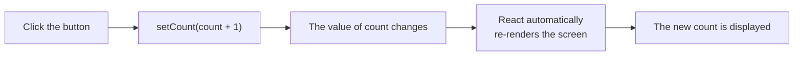
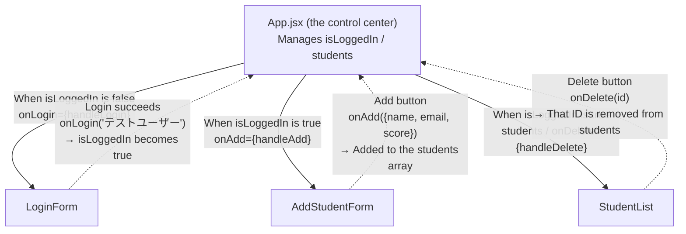

# Session 16｜React Basics — Components, JSX, props, and useState

> 🇯🇵 Original (Japanese version): [2026_06_11.md](<../../../2年生_システム開発実践/前期/2026_06_11/2026_06_11.md>) <!-- original-ja-link -->

## Today's Goals
- Understand how to write JSX
- Create and use components
- Pass data with `props`
- Manage state with `useState`

> **Where this fits:** We are learning this as the "foundation" for Next.js next time.  
> The goal is to understand "what JSX is and why we split things into components."

---

## 0. Setting Up React (first time only!)

### 0-1. Check That Node.js Is Installed

First, check whether **Node.js** is installed.  
Run the command below in a terminal (the VSCode terminal).

```bash
node -v
```

If a version number appears, you're good (e.g. `v20.11.0`).  
If you see `command not found`, install Node.js first.

> **Installing Node.js:** Download the **LTS version** (the recommended version) from https://nodejs.org/

---

### 0-2. Create a React Project (Using Vite)

In the terminal, move to **the folder where you want to create the project**, then run the command below.

```bash
npm create vite@latest my-app -- --template react
```

> `my-app` is the project name. You can change it to any name you like (e.g. `react-practice`).

When you run it, you'll see the following messages. Press Enter to continue.

```
✔ Select a framework: › React
✔ Select a variant: › JavaScript
```

---

### 0-3. Install the Required Packages and Start the App

After creating the project, run the commands in this order.

```bash
# ① Move into the folder you just created
cd my-app

# ② Install all the required packages
npm install

# ③ Start the development server
npm run dev
```

If you see something like this in the terminal, it worked!

```
  VITE v5.x.x  ready in xxx ms

  ➜  Local:   http://localhost:5173/
```

Open `http://localhost:5173/` in your browser to see the React sample page.

> **To stop the server:** Press `Ctrl + C` in the terminal

---

### 0-4. Look at the Folder Structure

```
my-app/
├── public/          # Where static files such as images go
├── src/             # ← This is where you'll do most of your editing!
│   ├── App.jsx      # The main component (the first file you'll work on)
│   ├── App.css      # Styles for App.jsx
│   ├── main.jsx     # The app's entry point (you usually don't touch it)
│   └── index.css    # Global styles
├── index.html       # The app's HTML template
└── package.json     # Project settings and the list of packages used
```

**To start, you only need to edit `src/App.jsx`!**

---

### 0-5. Try Rewriting App.jsx

Open `src/App.jsx`, delete everything in it, and replace it with the code below.

```jsx
function App() {
  return (
    <div>
      <h1>はじめての React！</h1>
      <p>環境構築できました！</p>
    </div>
  );
}

export default App;
```

When you save, the browser updates automatically (hot reload).  
If you see "はじめての React！" ("My first React!"), you're all set!

---

## 1. What Is React?

**React = a JavaScript library for building UIs out of "components" (parts)**

```
Traditional HTML + JavaScript:
  <div id="app"></div>
  document.getElementById("app").innerHTML = "...";
  → Hard to manage as the number of pages grows

React:
  <Button label="送信" />  ← A reusable part
  <Card title="タイトル" body="内容" />
  → Build pages by combining parts
```

---

## 2. JSX — Writing HTML Inside JavaScript

> **When do you use it?** Plain HTML can't show variable values directly. With JSX, you can embed values with `{variableName}` and they update live. Use it whenever you want to show "dynamic values" such as user names, dates, or calculation results.  
> **Check:** Change `namae` to your own name and save → check that the page updates automatically. Check that `{1 + 1}` is shown as `2`.

```jsx
// ▼ Try writing this in src/App.jsx (delete everything in the file and replace it with the code below)

// JSX = JavaScript + XML (an HTML-like syntax)

// A regular function (component)
function Hello() {
  // Return JSX
  return (
    <div>
      <h1>こんにちは！</h1>
      <p>React を始めよう</p>
    </div>
  );
}

// Embed JavaScript expressions with {}
function Greeting() {
  const namae = "田中太郎";
  const today = new Date().toLocaleDateString("ja-JP");
  
  return (
    <div>
      <h1>こんにちは、{namae}さん！</h1>
      <p>今日は {today} です</p>
      <p>1 + 1 = {1 + 1}</p>
    </div>
  );
}

export default Greeting;
```

**Things to watch out for in JSX:**

> **When do you use it?** When you get an error while writing JSX, one of these three rules is often the cause. If you see a red error, come back here and check your code against them.

```jsx
// ▼ Reference notes on syntax (this won't run on its own — read it and remember it)

// ① Use className for classes (class is a reserved word in JS)
<div className="container">

// ② Close every element
<input type="text" />  // Self-closing tag

// ③ Wrap multiple elements in a single parent
return (
  <div>
    <h1>タイトル</h1>
    <p>内容</p>
  </div>
);
// Or use a Fragment (<></>)
return (
  <>
    <h1>タイトル</h1>
    <p>内容</p>
  </>
);
```

---

## 3. props — Passing Data to Components

> **When do you use it?** When you want to show several cards or rows that share the same design but have "different data." Write one component, and you can reuse it as many times as you like just by passing different data.  
> **Check:** Check that the StudentCard with `passed={false}` has an orange-ish background. Try adding a fourth `<StudentCard>` yourself.

```jsx
// ▼ Try writing this in src/App.jsx (delete everything in the file and replace it with the code below)

// props = the "arguments" of a component

// Component definition (receives props)
function StudentCard({ name, score, passed }) {
  return (
    <div style={{
      border: "1px solid #ddd",
      padding: "16px",
      margin: "8px",
      backgroundColor: passed ? "#e3f2fd" : "#fbe9e7"
    }}>
      <h3>{name}</h3>
      <p>点数: {score}点</p>
      <span>{passed ? "✅ 合格" : "❌ 不合格"}</span>
    </div>
  );
}

// How to use it (parent component)
function App() {
  return (
    <div>
      <StudentCard name="田中太郎" score={85} passed={true} />
      <StudentCard name="鈴木花子" score={45} passed={false} />
      <StudentCard name="山田次郎" score={91} passed={true} />
    </div>
  );
}

export default App;
```

---

## 4. useState — Managing State

> **When do you use it?** When you want a value that changes through user actions — clicks, typing, selections — to show up on the screen right away. Values that change, like `count`, must always be managed with `useState`. A normal variable (`let count = 0`) won't update the screen.  
> **Check:** Press `+1` five times and check that the number goes up. Check that `リセット` (Reset) sets it back to 0. Also check that the page doesn't reload.

```jsx
// ▼ Try writing this in src/App.jsx (delete everything in the file and replace it with the code below)
import { useState } from "react";

function Counter() {
  // useState(initialValue) → [current value, function to change the value]
  const [count, setCount] = useState(0);
  
  return (
    <div>
      <p>カウント: {count}</p>
      
      {/* count goes up every time the button is pressed */}
      <button onClick={() => setCount(count + 1)}>+1</button>
      <button onClick={() => setCount(count - 1)}>-1</button>
      <button onClick={() => setCount(0)}>リセット</button>
    </div>
  );
}

export default Counter;
```

Here is a diagram of the flow: when you call `setCount`, React redraws the screen.



---

## 5. Rendering Lists

> **When do you use it?** Use this pattern when you want to render each item in an array, such as a list of products, students, or comments. As items are added to the data, they appear in the list automatically.  
> **Check:** Add a fourth student to the `students` array → check that a new `<li>` appears automatically. Also try removing `key={student.id}` and check that a warning appears in the browser console (F12).

```jsx
// ▼ Try writing this in src/App.jsx (delete everything in the file and replace it with the code below)
function StudentList() {
  const students = [
    { id: 1, name: "田中太郎", score: 85 },
    { id: 2, name: "鈴木花子", score: 72 },
    { id: 3, name: "山田次郎", score: 91 },
  ];
  
  return (
    <ul>
      {/* Generate elements with the array's map method */}
      {/* key lets React track what changed (always add it inside loops) */}
      {students.map((student) => (
        <li key={student.id}>
          {student.name} - {student.score}点
        </li>
      ))}
    </ul>
  );
}

export default StudentList;
```

---

## 6. Forms and Events

> **When do you use it?** When you want to "get what the user typed and do something with it," such as search, login, or data entry. Use `onChange` to update state every time the input changes, and `onSubmit` to handle what happens when the button is pressed.  
> **Check:** Type something and press "検索" (Search), then check that the result text appears. Also try commenting out `e.preventDefault()` (add `//` in front of it) and check that the page reloads when you submit.

```jsx
// ▼ Try writing this in src/App.jsx (delete everything in the file and replace it with the code below)
import { useState } from "react";

function SearchForm() {
  const [query, setQuery] = useState("");
  const [result, setResult] = useState(null);
  
  function handleSubmit(e) {
    e.preventDefault();  // Prevent the page from reloading
    setResult(`"${query}" を検索しました`);
  }
  
  return (
    <form onSubmit={handleSubmit}>
      <input
        type="text"
        value={query}
        onChange={(e) => setQuery(e.target.value)}
        // onChange = update the state with setQuery every time the input changes
        placeholder="検索キーワード"
      />
      <button type="submit">検索</button>
      {result && <p>{result}</p>}
    </form>
  );
}

export default SearchForm;
```

---

## 7. Hands-On Exercise — Build a Student Management App with Mock Data

Using everything we've learned so far — JSX, components, props, and useState —  
we'll build a **"Student Management App."**

> **What is a mock?**  
> It means using data written in your code instead of a real API.  
> This is "practice building screens without an API."  
> Next time (Next.js), we'll switch this same screen over to a real API.

---

### 7-1. What the Finished App Looks Like

```
【Before login】
┌──────────────────────────┐
│  ログイン                 │
│                          │
│  [メールアドレス        ] │
│  [パスワード            ] │
│  [    ログイン          ] │
│                          │
│  ※ test@example.com     │
│     / password           │
└──────────────────────────┘

【After login】
┌──────────────────────────────────────────────────┐
│ 生徒管理アプリ（React Mock版） ● ログイン中  [ログアウト] │
├──────────────────────────────────────────────────┤
│ 新規追加                                          │
│ [名前] [メールアドレス] [点数] [追加]               │
├──────────────────────────────────────────────────┤
│ 生徒一覧（3件）                                    │
│ ID │ 名前     │ メール              │ 点数 │      │
│  1 │ 田中太郎 │ tanaka@example.com │  85  │ 削除 │
│  2 │ 山田花子 │ yamada@example.com │  72  │ 削除 │
└──────────────────────────────────────────────────┘
```

---

### 7-2. File Structure

Create a `components/` folder inside `src/` and split the code into separate components.

```
src/
├── App.jsx                      ← Main file (manages all the state)
├── components/
│   ├── LoginForm.jsx            ← Login form
│   ├── StudentList.jsx          ← Student list table
│   └── AddStudentForm.jsx       ← Add-student form
└── main.jsx                     ← Don't touch
```

In VSCode, right-click the `src/` folder → `New Folder` → type `components` and press Enter.

---

### 7-3. Step 1｜Create LoginForm.jsx

Create a new file `src/components/LoginForm.jsx`, then copy and paste the code below.

```jsx
import { useState } from "react";

// Fixed login credentials for the mock (instead of a real API)
const MOCK_EMAIL = "test@example.com";
const MOCK_PASSWORD = "password";
const MOCK_NAME = "テストユーザー";

// onLogin = a function passed in from App.jsx, called when login succeeds
function LoginForm({ onLogin }) {
  const [email, setEmail] = useState("test@example.com");
  const [password, setPassword] = useState("password");
  const [error, setError] = useState("");

  function handleSubmit(e) {
    e.preventDefault(); // Prevent the page from reloading

    // Login succeeds if the input matches the mock credentials
    if (email === MOCK_EMAIL && password === MOCK_PASSWORD) {
      onLogin(MOCK_NAME); // Pass the user name to the parent component
    } else {
      setError("メールアドレスまたはパスワードが違います");
    }
  }

  return (
    <div style={{
      maxWidth: "400px", margin: "80px auto",
      background: "white", padding: "32px",
      borderRadius: "8px", boxShadow: "0 2px 8px rgba(0,0,0,0.1)"
    }}>
      <h2 style={{ marginBottom: "24px", textAlign: "center" }}>ログイン</h2>

      <form onSubmit={handleSubmit}>
        <div style={{ marginBottom: "16px" }}>
          <label style={{ display: "block", marginBottom: "6px", fontWeight: "bold" }}>
            メールアドレス
          </label>
          <input
            type="email"
            value={email}
            onChange={(e) => setEmail(e.target.value)}
            style={{ width: "100%", padding: "10px", border: "1px solid #ccc", borderRadius: "6px", fontSize: "1em", boxSizing: "border-box" }}
          />
        </div>

        <div style={{ marginBottom: "16px" }}>
          <label style={{ display: "block", marginBottom: "6px", fontWeight: "bold" }}>
            パスワード
          </label>
          <input
            type="password"
            value={password}
            onChange={(e) => setPassword(e.target.value)}
            style={{ width: "100%", padding: "10px", border: "1px solid #ccc", borderRadius: "6px", fontSize: "1em", boxSizing: "border-box" }}
          />
        </div>

        {/* Show the error only when error is not empty */}
        {error && (
          <p style={{ color: "#D32F2F", fontSize: "0.9em", marginBottom: "12px" }}>
            {error}
          </p>
        )}

        <button
          type="submit"
          style={{ width: "100%", padding: "12px", background: "#1976D2", color: "white", border: "none", borderRadius: "6px", fontSize: "1em", fontWeight: "bold", cursor: "pointer" }}
        >
          ログイン
        </button>
      </form>

      <p style={{ marginTop: "16px", fontSize: "0.85em", color: "#888", textAlign: "center" }}>
        ※ Mock用: test@example.com / password
      </p>
    </div>
  );
}

export default LoginForm;
```

---

### 7-4. Step 2｜Create StudentList.jsx

Create a new file `src/components/StudentList.jsx`, then copy and paste the code below.

```jsx
// StudentList: the whole student list table
// students = an array of student data (passed in from the parent)
// onDelete = a function called when the Delete button is pressed (passed in from the parent)
function StudentList({ students, onDelete }) {
  return (
    <div style={{ background: "white", borderRadius: "8px", padding: "24px", boxShadow: "0 2px 8px rgba(0,0,0,0.05)" }}>
      <h2 style={{ marginBottom: "16px", fontSize: "1.1em" }}>
        生徒一覧
        <span style={{ color: "#888", fontWeight: "normal", fontSize: "0.85em" }}>
          （{students.length}件）
        </span>
      </h2>

      {/* When there are 0 students, show a "no students" message */}
      {students.length === 0 ? (
        <p style={{ color: "#888", textAlign: "center", padding: "24px" }}>
          生徒が登録されていません
        </p>
      ) : (
        <table style={{ width: "100%", borderCollapse: "collapse" }}>
          <thead>
            <tr style={{ background: "#f5f5f5" }}>
              <th style={thStyle}>ID</th>
              <th style={thStyle}>名前</th>
              <th style={thStyle}>メール</th>
              <th style={thStyle}>点数</th>
              <th style={thStyle}></th>
            </tr>
          </thead>
          <tbody>
            {/* Display each student in the array with the StudentRow component */}
            {students.map((student) => (
              <StudentRow
                key={student.id}
                student={student}
                onDelete={onDelete}
              />
            ))}
          </tbody>
        </table>
      )}
    </div>
  );
}

// StudentRow: one row of the table
function StudentRow({ student, onDelete }) {
  function handleDelete() {
    // Show a confirmation dialog before deleting
    if (window.confirm(`${student.name} を削除しますか？`)) {
      onDelete(student.id); // Tell the parent "please delete this ID"
    }
  }

  return (
    <tr style={{ borderBottom: "1px solid #eee" }}>
      <td style={tdStyle}>{student.id}</td>
      <td style={tdStyle}>{student.name}</td>
      <td style={tdStyle}>{student.email}</td>
      <td style={tdStyle}>{student.score}</td>
      <td style={tdStyle}>
        <button
          onClick={handleDelete}
          style={{ background: "#D32F2F", color: "white", border: "none", borderRadius: "4px", padding: "4px 12px", cursor: "pointer", fontSize: "0.85em" }}
        >
          削除
        </button>
      </td>
    </tr>
  );
}

// Style constants (group styles that are used repeatedly)
const thStyle = { padding: "10px 16px", textAlign: "left", fontWeight: "bold", fontSize: "0.9em" };
const tdStyle = { padding: "12px 16px", fontSize: "0.95em" };

export default StudentList;
```

---

### 7-5. Step 3｜Create AddStudentForm.jsx

Create a new file `src/components/AddStudentForm.jsx`, then copy and paste the code below.

```jsx
import { useState } from "react";

// onAdd = a function called when the Add button is pressed (passed in from the parent)
function AddStudentForm({ onAdd }) {
  const [name, setName] = useState("");
  const [email, setEmail] = useState("");
  const [score, setScore] = useState("");
  const [error, setError] = useState("");

  function handleSubmit(e) {
    e.preventDefault();
    setError(""); // Reset the error

    // Validation (input check)
    if (!name || !email || !score) {
      setError("すべての項目を入力してください");
      return;
    }
    if (Number(score) < 0 || Number(score) > 100) {
      setError("点数は0〜100の数値を入力してください");
      return;
    }

    // Pass the new student data to the parent component
    onAdd({ name, email, score: Number(score) });

    // Reset the form
    setName("");
    setEmail("");
    setScore("");
  }

  return (
    <div style={{ background: "white", borderRadius: "8px", padding: "24px", boxShadow: "0 2px 8px rgba(0,0,0,0.05)", marginBottom: "24px" }}>
      <h2 style={{ marginBottom: "16px", fontSize: "1.1em" }}>新規追加</h2>

      <form onSubmit={handleSubmit} style={{ display: "flex", gap: "12px", alignItems: "flex-end", flexWrap: "wrap" }}>
        <div>
          <label style={labelStyle}>名前</label>
          <input
            type="text"
            value={name}
            onChange={(e) => setName(e.target.value)}
            placeholder="田中太郎"
            style={inputStyle}
          />
        </div>
        <div>
          <label style={labelStyle}>メールアドレス</label>
          <input
            type="email"
            value={email}
            onChange={(e) => setEmail(e.target.value)}
            placeholder="tanaka@example.com"
            style={inputStyle}
          />
        </div>
        <div>
          <label style={labelStyle}>点数</label>
          <input
            type="number"
            value={score}
            onChange={(e) => setScore(e.target.value)}
            placeholder="85"
            min="0"
            max="100"
            style={{ ...inputStyle, width: "80px" }}
          />
        </div>
        <button
          type="submit"
          style={{ padding: "10px 20px", background: "#1976D2", color: "white", border: "none", borderRadius: "6px", fontWeight: "bold", cursor: "pointer", fontSize: "0.95em" }}
        >
          追加
        </button>
      </form>

      {error && (
        <p style={{ color: "#D32F2F", marginTop: "10px", fontSize: "0.9em" }}>{error}</p>
      )}
    </div>
  );
}

const labelStyle = { display: "block", marginBottom: "4px", fontSize: "0.85em", fontWeight: "bold" };
const inputStyle = { padding: "9px 12px", border: "1px solid #ccc", borderRadius: "6px", fontSize: "0.95em", width: "180px" };

export default AddStudentForm;
```

---

### 7-6. Step 4｜Connect Everything in App.jsx

Open `src/App.jsx`, **delete everything in it**, and replace it with the code below.

```jsx
import { useState } from "react";
import LoginForm from "./components/LoginForm";
import StudentList from "./components/StudentList";
import AddStudentForm from "./components/AddStudentForm";

// Mock data shown from the start
const INITIAL_STUDENTS = [
  { id: 1, name: "田中太郎", email: "tanaka@example.com", score: 85 },
  { id: 2, name: "山田花子", email: "yamada@example.com", score: 72 },
  { id: 3, name: "山田次郎", email: "jiro@example.com", score: 91 },
];

function App() {
  // Manage the login state
  const [isLoggedIn, setIsLoggedIn] = useState(false);
  const [userName, setUserName] = useState("");

  // Manage the student list
  const [students, setStudents] = useState(INITIAL_STUDENTS);
  const [nextId, setNextId] = useState(4); // ID for the next student to be added

  // On successful login: called from LoginForm
  function handleLogin(name) {
    setIsLoggedIn(true);
    setUserName(name);
  }

  // On logout
  function handleLogout() {
    setIsLoggedIn(false);
    setUserName("");
  }

  // Add a student: called from AddStudentForm
  function handleAdd(newStudent) {
    setStudents([...students, { ...newStudent, id: nextId }]);
    setNextId(nextId + 1);
  }

  // Delete a student: called from StudentList
  function handleDelete(id) {
    setStudents(students.filter((s) => s.id !== id));
  }

  return (
    <div style={{ background: "#f4f6f8", minHeight: "100vh" }}>

      {/* Header */}
      <header style={{
        background: "#1565C0", color: "white",
        padding: "16px 32px",
        display: "flex", alignItems: "center"
      }}>
        <h1 style={{ fontSize: "1.2em" }}>生徒管理アプリ（React Mock版）</h1>

        {/* Show the user name and Logout button on the right side of the header only while logged in */}
        {isLoggedIn && (
          <div style={{ marginLeft: "auto", display: "flex", alignItems: "center", gap: "12px" }}>
            <span style={{ fontSize: "0.9em" }}>● ログイン中：{userName}</span>
            <button
              onClick={handleLogout}
              style={{ background: "#D32F2F", color: "white", border: "none", borderRadius: "6px", padding: "6px 14px", cursor: "pointer" }}
            >
              ログアウト
            </button>
          </div>
        )}
      </header>

      {/* Main content */}
      <main style={{ padding: "32px", maxWidth: "900px", margin: "0 auto" }}>
        {/* If isLoggedIn is true, show the student management screen; if false, show the login screen */}
        {isLoggedIn ? (
          <>
            <AddStudentForm onAdd={handleAdd} />
            <StudentList students={students} onDelete={handleDelete} />
          </>
        ) : (
          <LoginForm onLogin={handleLogin} />
        )}
      </main>

    </div>
  );
}

export default App;
```

---

### 7-7. Test It

Start the development server and check the app in your browser.

```bash
npm run dev
```

Go to `http://localhost:5173/` and try the following, in order.

| What to check | Action | Expected result |
|---------|------|------------|
| Screen before login | Open the page | The login form is displayed |
| Successful login | Log in with `test@example.com` / `password` | The header shows "ログイン中" (Logged in), and the student list is displayed |
| Failed login | Log in with a different password | An error message is displayed |
| Adding a student | Fill in the form and click "追加" (Add) | A new row is added to the table |
| Deleting a student | Press the "削除" (Delete) button | A confirmation dialog appears → click OK and the row disappears |
| When there are 0 students | Delete all students | "生徒が登録されていません" (No students registered) is displayed |
| Logout | Press the "ログアウト" (Logout) button | You're taken back to the login form |

---

### 7-8. Understanding the Flow of the Code

In the diagram below, solid lines show "the parent passing props to a child," and dotted lines show "a child calling a parent's function to change the state."



> **Key point:** `App.jsx` manages all the data (state) in one place,  
> and passes "the data" and "the functions that change it" to child components as props. This is the basic React pattern.

---

### 7-9. How This Differs from Next.js (Preview of Next Time)

| | React (this time) | Next.js (next time) |
|--|--|--|
| Getting data | A mock array in the code | Fetched from the Laravel API with `fetch('/api/students')` |
| Login | Compared against fixed values | Get a token with `POST /api/login` |
| Delete | Update the array with filter | Call `DELETE /api/students/{id}` and fetch the data again |
| How the screen looks | **Exactly the same** | **Exactly the same** |

Next time, we'll **reuse the screen we built today as is** and switch only the data-fetching part over to the API.

---

## Summary

| Concept | Description |
|------|------|
| Component | A reusable piece of the UI. Defined as a function |
| JSX | Lets you write UI inside JavaScript with HTML-like syntax |
| props | Pass data from a parent component to a child component |
| useState | Manages state inside a component |
| key | An attribute that identifies each element when rendering a list |

---

## Coming Up Next (Session 17)

An introduction to Next.js.  
Using what you know about React, we'll learn about the App Router, page structure, and file-based routing.
