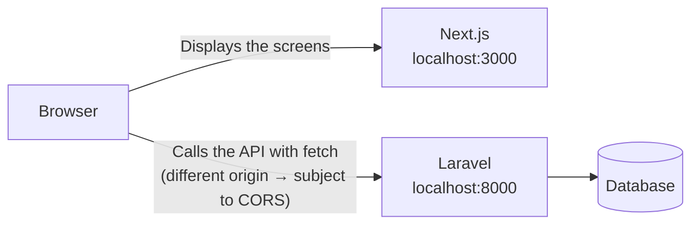
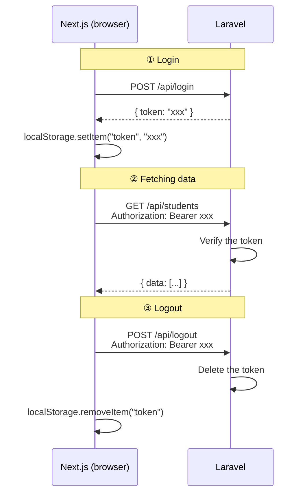

# Sessions 17–22｜Introduction to Next.js → Connecting to the Laravel API

> 🇯🇵 Original (Japanese version): [2026_07_02.md](<../../../2年生_システム開発実践/前期/2026_07_02/2026_07_02.md>) <!-- original-ja-link -->

---

## Session 17: Switching the Mock Version to the API

### Today's Goals
- Create a Next.js project
- Understand how the App Router works
- Switch the mock screens you built in Session 16 over to the real Laravel API

> **Today's key point:**  
> The components you built in Session 16 (LoginForm, StudentList, AddStudentForm)  
> **can be used almost as is.** The only thing that changes is how the data is fetched.

---

### 0. Compare the Mock Version and the API Version

| | Session 16 (mock version, React) | Session 17 (API version, Next.js) |
|--|--|--|
| Getting data | A fixed array in the code | Fetched from the Laravel API with `fetch()` |
| Login | Compared against fixed values | Get a token with `POST /api/login` |
| Adding a student | Add to the array | Call `POST /api/students` |
| Deleting a student | Remove from the array | Call `DELETE /api/students/{id}` |
| How the screen looks | **Exactly the same** | **Exactly the same** |

---

### 1. Create a Next.js Project

#### 1-1. Installation

Run the following in the terminal (create it in a **different folder** from `my-app`).

```bash
npx create-next-app@latest school-frontend
```

You may be asked a few questions. If so, answer them as follows.

```
Would you like to use TypeScript?             → Yes  ← Use TypeScript
Would you like to use ESLint?                 → Yes
Would you like to use Tailwind CSS?           → Yes  ← Install it for now
Would you like your code inside a src/ dir?   → No   ← Put the app/ folder directly in the project root
Would you like to use App Router?             → Yes
Would you like to use Turbopack?              → No
Would you like to customize the import alias? → No
```

> **About TypeScript**  
> Your files will have the `.tsx` (TypeScript) extension. The basic code is almost the same as JavaScript.  
> Whenever you need to write types, we'll explain them as we go.
>
> **About Tailwind CSS**  
> We'll install it, but this time we'll use inline styles. You can make use of Tailwind in later lessons.

#### 1-2. Install and Start the App

```bash
# Move into the project folder
cd school-frontend

# Start the development server (create-next-app has already installed the packages for you)
npm run dev
```

If you open `http://localhost:3000` and see the Next.js sample page, it worked.

---

### 2. Look at the Folder Structure

```
school-frontend/
├── app/                         ← Where page files go (routing)
│   ├── layout.tsx               ← The HTML structure shared by all pages
│   ├── page.tsx                 ← The page shown when you visit /
│   ├── login/
│   │   └── page.tsx             ← The /login page
│   └── students/
│       └── page.tsx             ← The /students page
├── components/                  ← Same place as in Session 16
│   ├── LoginForm.tsx
│   ├── StudentList.tsx
│   └── AddStudentForm.tsx
└── package.json
```

**Differences from Session 16:**

| Session 16 (React + Vite) | Session 17 (Next.js) |
|--|--|
| `src/App.jsx` is the main file | `app/page.tsx` is the home page |
| Only one page (SPA) | Each folder becomes a URL (`login/page.tsx` → `/login`) |
| Starts from `index.html` | `layout.tsx` defines the HTML structure |

---

### 3. Copy the Components from Session 16

First, create the `src/components/` folder and copy the files you made in Session 16 into it.

```
Copy the following into school-frontend/components/:
  ├── LoginForm.tsx      ← Copy LoginForm.jsx from Session 16 (change the extension to .tsx)
  ├── StudentList.tsx    ← Copy StudentList.jsx from Session 16 (change the extension to .tsx)
  └── AddStudentForm.tsx ← Copy AddStudentForm.jsx from Session 16 (change the extension to .tsx)
```

> **About the file extension**  
> Because we're using TypeScript, all file extensions will be `.tsx` (files that contain JSX).  
> You can copy the code from the Session 16 `.jsx` files almost as is.

Add `"use client";` to the **very first line** of each copied file.

```js
"use client";  // ← Add this one line!
import { useState } from "react";
// ... the rest is the same as the Session 16 code
```

> **What is `"use client"`?**  
> By default, Next.js runs your code on the server.  
> For components that use "browser features" such as `useState` or `onClick`,  
> write `"use client"` at the top to tell Next.js "this runs in the browser."

---

### 4. Rewrite layout.js

Open `app/layout.tsx`, delete everything in it, and replace it with the code below.

```tsx
export const metadata = {
  title: "生徒管理アプリ",
};

export default function RootLayout({
  children,
}: {
  children: React.ReactNode;
}) {
  return (
    <html lang="ja">
      <body style={{ margin: 0, fontFamily: "sans-serif", background: "#f4f6f8" }}>
        {children}
      </body>
    </html>
  );
}
```

> **What is `{ children }: { children: React.ReactNode }`?**  
> It's a TypeScript type definition. It says "children will contain React elements."  
> `React.ReactNode` means "anything React can display, such as JSX or strings."

---

### 5. Redirect the Home Page (/) to the Login Page

Open `app/page.tsx`, delete everything in it, and replace it with the code below.

```tsx
import { redirect } from "next/navigation";

// When someone visits /, automatically send them to /login
export default function Home() {
  redirect("/login");
}
```

---

### 6. Create the Login Page (/login)

Create the `app/login/` folder, and create a new `page.tsx` file in it.

```
app/login/page.tsx  ← New file
```

Copy and paste the code below.

```tsx
"use client";

import { useState } from "react";
import { useRouter } from "next/navigation";

export default function LoginPage() {
  const router = useRouter(); // Used for navigating between pages
  const [email, setEmail] = useState("test@example.com");
  const [password, setPassword] = useState("password");
  const [error, setError] = useState("");
  const [loading, setLoading] = useState(false);

  async function handleSubmit(e) {
    e.preventDefault();
    setError("");
    setLoading(true);

    // ★ Difference from Session 16: checking fixed values → calling the real API
    const res = await fetch("http://localhost:8000/api/login", {
      method: "POST",
      headers: {
        "Content-Type": "application/json",
        "Accept": "application/json",
      },
      body: JSON.stringify({ email, password }),
    });

    const data = await res.json();
    setLoading(false);

    if (res.ok) {
      // ★ Save the token in the browser
      localStorage.setItem("token", data.token);
      localStorage.setItem("userName", data.user?.name || "ユーザー");
      // Go to the /students page
      router.push("/students");
    } else {
      setError("メールアドレスまたはパスワードが違います");
    }
  }

  return (
    <div style={{
      maxWidth: "400px", margin: "80px auto",
      background: "white", padding: "32px",
      borderRadius: "8px", boxShadow: "0 2px 8px rgba(0,0,0,0.1)"
    }}>
      <h2 style={{ marginBottom: "24px", textAlign: "center" }}>ログイン</h2>

      <form onSubmit={handleSubmit}>
        <div style={{ marginBottom: "16px" }}>
          <label style={{ display: "block", marginBottom: "6px", fontWeight: "bold" }}>
            メールアドレス
          </label>
          <input
            type="email"
            value={email}
            onChange={(e) => setEmail(e.target.value)}
            style={{ width: "100%", padding: "10px", border: "1px solid #ccc", borderRadius: "6px", fontSize: "1em", boxSizing: "border-box" }}
          />
        </div>

        <div style={{ marginBottom: "16px" }}>
          <label style={{ display: "block", marginBottom: "6px", fontWeight: "bold" }}>
            パスワード
          </label>
          <input
            type="password"
            value={password}
            onChange={(e) => setPassword(e.target.value)}
            style={{ width: "100%", padding: "10px", border: "1px solid #ccc", borderRadius: "6px", fontSize: "1em", boxSizing: "border-box" }}
          />
        </div>

        {error && (
          <p style={{ color: "#D32F2F", fontSize: "0.9em", marginBottom: "12px" }}>
            {error}
          </p>
        )}

        <button
          type="submit"
          disabled={loading}
          style={{ width: "100%", padding: "12px", background: loading ? "#aaa" : "#1976D2", color: "white", border: "none", borderRadius: "6px", fontSize: "1em", fontWeight: "bold", cursor: loading ? "not-allowed" : "pointer" }}
        >
          {loading ? "ログイン中..." : "ログイン"}
        </button>
      </form>
    </div>
  );
}
```

**Differences from `LoginForm.tsx` in Session 16:**

| | Session 16 (mock) | Session 17 (API) |
|--|--|--|
| Authentication method | Compared against fixed values | `fetch("http://localhost:8000/api/login")` |
| After login | `setIsLoggedIn(true)` | `localStorage.setItem("token", ...)` + page navigation |
| Page navigation | Switch screens with a conditional | `router.push("/students")` |

---

### 7. Create the Student Management Page (/students)

Create the `app/students/` folder, and create a new `page.tsx` file in it.

```
app/students/page.tsx  ← New file
```

Copy and paste the code below.

```tsx
"use client";

import { useState, useEffect } from "react";
import { useRouter } from "next/navigation";
import StudentList from "@/components/StudentList";
import AddStudentForm from "@/components/AddStudentForm";

export default function StudentsPage() {
  const router = useRouter();
  const [students, setStudents] = useState([]);
  const [userName, setUserName] = useState("");
  const [loading, setLoading] = useState(true);
  const [addError, setAddError] = useState(""); // ← For showing errors when adding fails

  // ★ useEffect: runs only once, when the page is displayed
  useEffect(() => {
    const token = localStorage.getItem("token");

    // If there's no token, send the user back to the login page
    if (!token) {
      router.push("/login");
      return;
    }

    setUserName(localStorage.getItem("userName") || "ユーザー");
    loadStudents(token);
  }, []); // [] = run only the first time

  // Fetch the student list from the API
  async function loadStudents(token) {
    setLoading(true);

    const res = await fetch("http://localhost:8000/api/students", {
      headers: {
        "Accept": "application/json",
        "Authorization": `Bearer ${token}`, // ★ Attach the token to the header
      },
    });

    // 401 = the token is invalid → send the user back to the login page
    if (res.status === 401) {
      router.push("/login");
      return;
    }

    const data = await res.json();
    setStudents(data.data); // The Laravel API returns data in the form { data: [...] }
    setLoading(false);
  }

  // Add a student
  async function handleAdd(newStudent) {
    const token = localStorage.getItem("token");
    setAddError(""); // ← Reset the error

    const res = await fetch("http://localhost:8000/api/students", {
      method: "POST",
      headers: {
        "Content-Type": "application/json",
        "Accept": "application/json",
        "Authorization": `Bearer ${token}`,
      },
      body: JSON.stringify(newStudent),
    });

    if (res.ok) {
      loadStudents(token); // ★ After adding, fetch the list again to update the screen
    } else {
      // ★ If it fails, show the API's error details on the screen
      const data = await res.json();
      if (data.errors) {
        const messages = Object.values(data.errors).flat().join(" / ");
        setAddError(messages);
      } else {
        setAddError(`エラーが発生しました（HTTP ${res.status}）`);
      }
    }
  }

  // Delete a student
  async function handleDelete(id) {
    const token = localStorage.getItem("token");

    const res = await fetch(`http://localhost:8000/api/students/${id}`, {
      method: "DELETE",
      headers: {
        "Accept": "application/json",
        "Authorization": `Bearer ${token}`,
      },
    });

    if (res.ok) {
      loadStudents(token); // ★ After deleting, fetch the list again to update the screen
    }
  }

  // Log out
  async function handleLogout() {
    const token = localStorage.getItem("token");

    await fetch("http://localhost:8000/api/logout", {
      method: "POST",
      headers: {
        "Accept": "application/json",
        "Authorization": `Bearer ${token}`,
      },
    });

    localStorage.removeItem("token");
    localStorage.removeItem("userName");
    router.push("/login");
  }

  if (loading) {
    return (
      <div style={{ textAlign: "center", padding: "80px", color: "#888" }}>
        読み込み中...
      </div>
    );
  }

  return (
    <div style={{ background: "#f4f6f8", minHeight: "100vh" }}>

      {/* Header (looks the same as in Session 16) */}
      <header style={{
        background: "#1565C0", color: "white",
        padding: "16px 32px",
        display: "flex", alignItems: "center"
      }}>
        <h1 style={{ fontSize: "1.2em" }}>生徒管理アプリ（Next.js API版）</h1>
        <div style={{ marginLeft: "auto", display: "flex", alignItems: "center", gap: "12px" }}>
          <span style={{ fontSize: "0.9em" }}>● ログイン中：{userName}</span>
          <button
            onClick={handleLogout}
            style={{ background: "#D32F2F", color: "white", border: "none", borderRadius: "6px", padding: "6px 14px", cursor: "pointer" }}
          >
            ログアウト
          </button>
        </div>
      </header>

      {/* Main content (uses the same components as Session 16) */}
      <main style={{ padding: "32px", maxWidth: "900px", margin: "0 auto" }}>
        <AddStudentForm onAdd={handleAdd} />
        {/* ★ Show the API's error message when adding fails */}
        {addError && (
          <p style={{ color: "#D32F2F", marginBottom: "16px", fontWeight: "bold" }}>
            ⚠ {addError}
          </p>
        )}
        <StudentList students={students} onDelete={handleDelete} />
      </main>

    </div>
  );
}
```

**Differences from `App.tsx` in Session 16:**

|                            | Session 16 (mock)     | Session 17 (API)                  |
| -------------------------- | --------------------- | --------------------------------- |
| Initial data               | `INITIAL_STUDENTS` array | Fetched with `useEffect` → `fetch` |
| Add                        | push to the array     | `POST /api/students` → fetch again |
| Delete                     | filter the array      | `DELETE /api/students/{id}` → fetch again |
| StudentList/AddStudentForm | **Exactly the same**  | **Exactly the same**              |

---

### 8. CORS Settings (Laravel Side)

When Next.js (`http://localhost:3000`) calls Laravel (`http://localhost:8000`),  
the requests are normally blocked by **a browser security feature (CORS)**.

Notice that you're accessing two servers on different ports: the screens on port 3000 and the API on port 8000.



**In Laravel 13, all origins (`*`) are allowed by default, so you don't need to change any settings during development.**

> **What is CORS?**  
> It's a mechanism where the browser blocks "requests to a different server (even just a different port counts as different)"  
> for security reasons.  
> You can lift this block by explicitly telling Laravel "access from this origin is OK."

---

#### (Reference) Restrict Allowed Origins in Production

When development is finished and you deploy to production, narrow down the origins that are allowed access.

First, generate the config file:

```bash
php artisan config:publish cors
```

Open the generated `config/cors.php` and change it:

```php
// Before (all origins allowed)
'allowed_origins' => ['*'],

// After (only the production frontend URL allowed)
'allowed_origins' => ['https://your-frontend.com'],
```

After making the change, clear the config cache:

```bash
php artisan config:clear
```

---

### 8-2. Common Mistakes in Route Settings (`routes/api.php`)

> **⚠ Common pitfall: registering `Route::apiResource` twice**  
>
> If you write the `students` route twice like this, **the one written later takes precedence**.  
> Mixing an unauthenticated version and an authenticated version leads to unexpected behavior.
>
> ```php
> // ❌ Wrong: the same resource is registered twice
> Route::apiResource('students', StudentController::class); // ← Delete this
>
> Route::middleware('auth:sanctum')->group(function () {
>     Route::apiResource('students', StudentController::class); // ← Keep only this one
> });
> ```
>
> ```php
> // ✅ Correct: write it only inside auth:sanctum
> Route::post('/login', [AuthController::class, 'login']);
>
> Route::middleware('auth:sanctum')->group(function () {
>     Route::post('/logout', [AuthController::class, 'logout']);
>     Route::get('/me',      [AuthController::class, 'me']);
>     Route::apiResource('students', StudentController::class);
> });
> ```
>
> After setting this up, you can check the list of routes with `php artisan route:list --path=api/students`.

---

### 9. Start Both Servers and Test

**Open two terminals** and start one server in each.

```bash
# Terminal ① Laravel (backend)
cd （Laravelプロジェクトのフォルダ）
php artisan serve
# → Starts at http://localhost:8000

# Terminal ② Next.js (frontend)
cd school-frontend
npm run dev
# → Starts at http://localhost:3000
```

When you go to `http://localhost:3000` in your browser, you'll be redirected to `/login`.

---

### 10. Testing Checklist

| What to check | Action | Expected result |
|---------|------|------------|
| Redirect | Open `http://localhost:3000` | You're automatically taken to `/login` |
| Failed login | Log in with a different password | An error message is displayed |
| Successful login | Log in with the correct credentials | You're taken to `/students` and the student list is displayed |
| Fetching from the API | Look at the student list | Real data from the Laravel database is displayed |
| Adding a student | Fill in the form and add a student | A new row is added to the table |
| Deleting a student | Press the Delete button | After you confirm, the row disappears |
| Logout | Press the Logout button | You're taken back to `/login` |
| Unauthenticated access | After logging out, open `/students` directly | You're redirected to `/login` |

---

### 11. Summary of Changes from Session 16 to Session 17

```
Session 16 (mock version, React)   Session 17 (API version, Next.js)
─────────────────────────────────────────────────────────
src/
├── App.jsx                →  app/students/page.tsx
│   (managed with useState)     (managed with useEffect + fetch)
│
├── components/
│   ├── LoginForm.jsx      →  app/login/page.tsx
│   │   (checks fixed values)   (fetch POST /api/login)
│   │
│   ├── StudentList.jsx    →  components/StudentList.tsx
│   │                           (just add "use client")
│   │
│   └── AddStudentForm.jsx →  components/AddStudentForm.tsx
│                               (just add "use client")
│
└── main.jsx               →  app/layout.tsx
```

> **Important point:**  
> We **haven't changed the contents of** `StudentList` and `AddStudentForm` **at all.**  
> We only added one line: `"use client"`.  
> Components focus on "displaying things," and the Page is responsible for "getting the data" —  
> this is the basic idea behind component design in React / Next.js.

---

## Session 18: Component Design

### Today's Goals
- Extract shared components
- Think about prop types (what kind of data is passed in)

---

### Create Reusable Components

If you look back at the app you built in Session 17, you'll find some "parts that could be used on other pages too."

```
components/
├── ui/                      ← General-purpose UI parts
│   ├── Button.tsx
│   ├── StatusBadge.tsx      ← Displays badges such as "In progress"
│   └── LoadingSpinner.tsx
└── students/                ← Parts used only for student management
    ├── StudentList.tsx
    └── AddStudentForm.tsx
```

---

### Example: Button Component

```tsx
"use client";

// variant = "primary" (blue) or "danger" (red)
function Button({ children, onClick, variant = "primary", disabled = false }: {
  children: React.ReactNode;
  onClick?: () => void;
  variant?: "primary" | "danger";
  disabled?: boolean;
}) {
  const bgColor = variant === "danger" ? "#D32F2F" : "#1976D2";

  return (
    <button
      onClick={onClick}
      disabled={disabled}
      style={{
        padding: "9px 18px",
        background: disabled ? "#aaa" : bgColor,
        color: "white",
        border: "none",
        borderRadius: "6px",
        fontWeight: "bold",
        cursor: disabled ? "not-allowed" : "pointer",
        fontSize: "0.95em",
      }}
    >
      {children}
    </button>
  );
}

export default Button;

// How to use it
// <Button onClick={handleSave}>保存</Button>
// <Button variant="danger" onClick={handleDelete}>削除</Button>
// <Button disabled={loading}>{loading ? "送信中..." : "送信"}</Button>
```

---

### Example: LoadingSpinner Component

```tsx
function LoadingSpinner({ message = "読み込み中..." }: { message?: string }) {
  return (
    <div style={{ textAlign: "center", padding: "60px", color: "#888" }}>
      <p>{message}</p>
    </div>
  );
}

export default LoadingSpinner;
```

---

## Session 19: A Closer Look at useEffect

### Today's Goals
- Explain when `useEffect` runs
- Understand what the dependency array (second argument) means

---

### What Is useEffect?

```js
useEffect(() => {
  // The code written here runs at "specific times"
}, [依存配列]);
```

| Dependency array | When it runs |
|---------|-------------|
| `[]` | **Only once**, when the component is first displayed |
| `[value]` | Every time `value` changes |
| Omitted (none) | After every render (rarely used) |

---

### Common Use: Fetching Again When the ID Changes

```tsx
"use client";

import { useState, useEffect } from "react";

export default function StudentDetailPage({ params }: { params: { id: string } }) {
  const [student, setStudent] = useState<any>(null);

  useEffect(() => {
    const token = localStorage.getItem("token");

    fetch(`http://localhost:8000/api/students/${params.id}`, {
      headers: {
        "Accept": "application/json",
        "Authorization": `Bearer ${token}`,
      },
    })
      .then((res) => res.json())
      .then((data) => setStudent(data.data));

  }, [params.id]); // ← Fetch again every time params.id changes

  if (!student) return <p>読み込み中...</p>;

  return (
    <div>
      <h1>{student.name}</h1>
      <p>メール: {student.email}</p>
      <p>点数: {student.score}</p>
    </div>
  );
}
```

---

## Session 20: Understanding How Authentication Works

### Today's Goals
- Explain the token authentication flow with a diagram
- Implement a redirect for users who aren't logged in

---

### The Token Authentication Flow

This diagram shows, step by step, how the token is passed back and forth during login → fetching data → logout.



---

### Redirecting Users Who Aren't Logged In (Custom Hook)

If you use the same redirect logic on several pages, put it into a **custom hook**.

```ts
// hooks/useAuth.ts
import { useEffect, useState } from "react";
import { useRouter } from "next/navigation";

export function useAuth() {
  const router = useRouter();
  const [token, setToken] = useState(null);
  const [userName, setUserName] = useState("");

  useEffect(() => {
    const savedToken = localStorage.getItem("token");
    if (!savedToken) {
      router.push("/login");
      return;
    }
    setToken(savedToken);
    setUserName(localStorage.getItem("userName") || "ユーザー");
  }, []);

  return { token, userName };
}

// How to use it (on each page)
// const { token, userName } = useAuth();
// → If there's no token, the user is automatically sent to /login
```

---

## Session 21: Form Validation in Practice

### Today's Goals
- Implement validation (input checks) on the frontend
- Receive validation errors from Laravel and display them

---

### Receiving Validation Errors from Laravel

When Laravel returns a 422 error, the response body includes the fields that failed and the reasons why.

```json
{
  "message": "The email has already been taken.",
  "errors": {
    "email": ["The email has already been taken."]
  }
}
```

To display these on the screen, loop through `data.errors` and pull out the messages.

```tsx
if (res.ok) {
  loadStudents(token);
} else {
  const data = await res.json();
  if (data.errors) {
    // Join all the values (arrays) in errors into a single string
    const messages = Object.values(data.errors).flat().join(" / ");
    setAddError(messages);
  } else {
    setAddError(`エラーが発生しました（HTTP ${res.status}）`);
  }
}
```

> **⚠ A common cause of 422: duplicate email addresses**  
> Because of Laravel's `unique:students` rule, each email address can be registered only once.  
> If you see "The email has already been taken.", use a different email address.
>
> | Error message | Cause |
> |--|--|
> | The email has already been taken. | That email address already exists in the database |
> | The score must be an integer. | The score contains a decimal (e.g. 80.5) |
> | The name field is required. | The name is empty |

---

## Session 22: Midterm Project — Complete a Full-Stack App

Finish a full-stack app using **the API from the first semester (Laravel) + Next.js screens**.

### Checklist

- [ ] Login screen (`/login`)
- [ ] Student list page (`/students`) — fetches data from the API
- [ ] Add-student feature (form + validation)
- [ ] Delete-student feature
- [ ] Redirect when not logged in
- [ ] Logout feature
- [ ] CORS settings (Laravel side)
- [ ] Start both servers at the same time and test

---

## Coming Up Next (Session 23)

We'll start the graduation project.  
Starting with requirements definition and screen design, you'll work in teams to build a full-scale web app.
