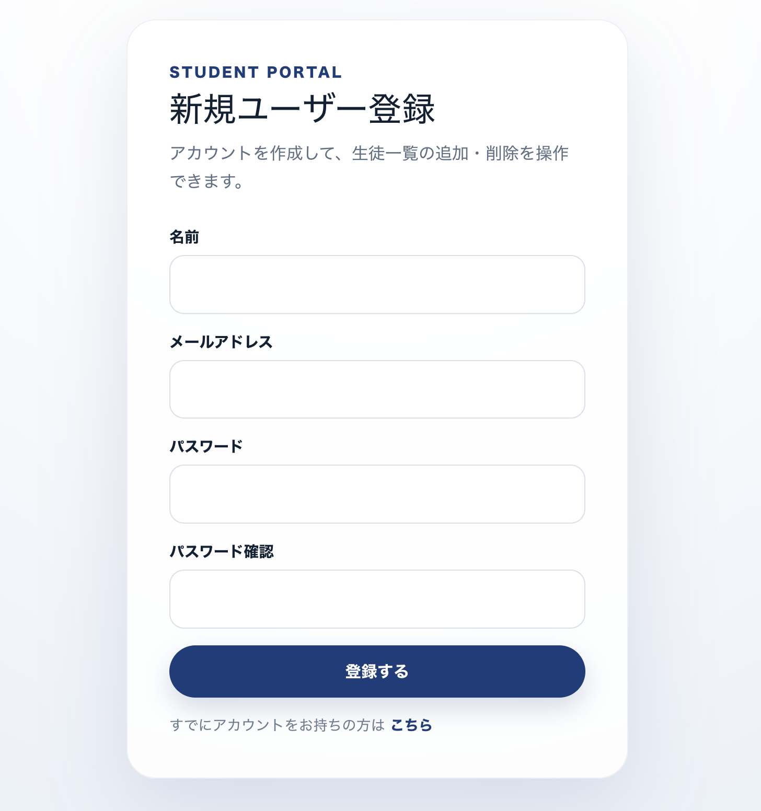
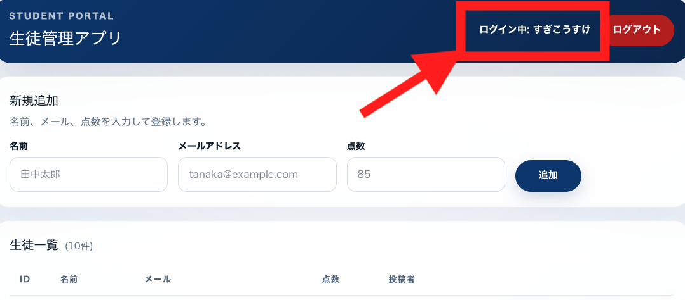
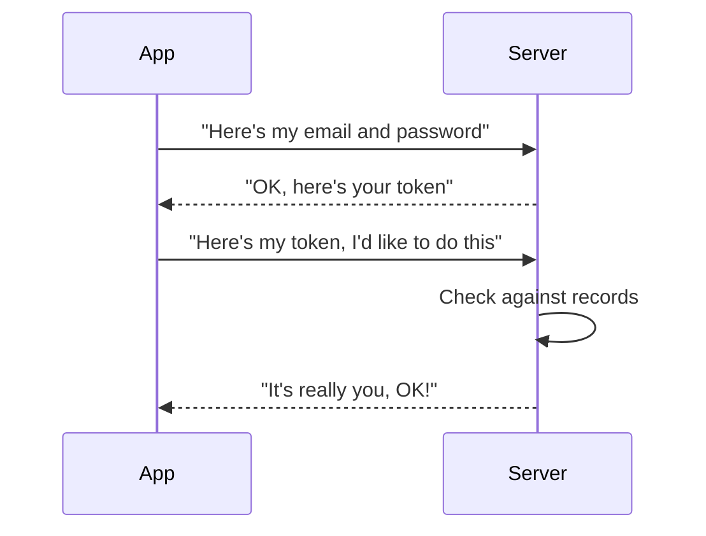
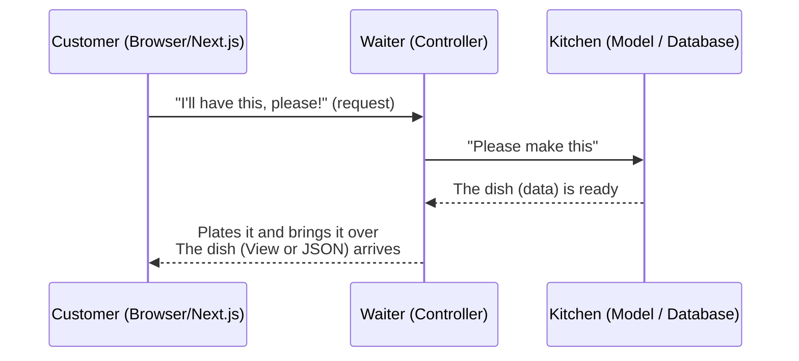

# Lesson 23 | Adding User Registration, and Reviewing What We've Learned So Far

> 🇯🇵 Original (Japanese version): [2026_07_09.md](<../../../2年生_システム開発実践/前期/2026_07_09/2026_07_09.md>) <!-- original-ja-link -->

---

# If you've made it this far, next let's build a new user registration screen

Right now there's only a login screen, so someone who wants to add a new student can't get into the app.

## What we're building

We'll build a "New User Registration" screen like the one in the image below. By letting people create new accounts, even first-time users can make their own account and log in.



If you can log in as the newly registered user, you're done!!!



## What the screen needs

- An input field for **name**
- An input field for **email address**
- An input field for **password**
- An input field for **password confirmation** (the user types the same password again to prevent typos)
- A **Register button**
- A link to the login screen that says "Already have an account? Click here"

## Implementation hints (this connects to what you've learned so far)

- What this screen does is **Create (making a new user)** in CRUD terms. On the Laravel side, it corresponds to `store()`
- The name, email, and password the user enters in a Next.js **form** are sent (POST) to the Laravel API
- The Laravel **Controller** validates what it receives (do the password and password confirmation match? Is the email already taken? etc.) and then saves it to the database through the **Model**
- Once registration succeeds, a natural flow is to send the user straight to the login screen (or log them in right away and issue a **token**)

---

# Review of what we've learned so far (I'll explain on the whiteboard!)

## 1. How tokens work

An app's server receives requests from lots of people. When it does, it has to check: "Is this request really from the person who logged in?" The thing we use for this check, a bit like a "password card", is called a **token**.

### Think of an amusement park wristband

When you enter an amusement park, you show your ticket and get a "wristband", right? After that, you don't have to show your ticket again every time you go on a ride. **Just showing your wristband** tells the staff, "This person has already been let in."

A token plays exactly the same role.

```
   [Sign up at the ticket booth]
          ↓
   Staff: "OK, here's your wristband"
          ↓
   ★ Put the wristband on your wrist ★
          ↓
   From then on, every time you go on a ride,
   just show your wristband and you're good!
```

### It works the same way in the app world

1. **Log in**: Send your email address and password to say, "It's me"
2. **Get a token**: Once the server confirms "It's really you," it issues a password card (token)
3. **Keep the card**: The app stores the token it received
4. **Show the card**: Every time you do something, you send that token along with it
5. **The server checks**: It checks its records ("Yes, this token belongs to someone who's logged in") and gives the OK

As a diagram, the flow looks like this:



### Things to remember

- A token is just like a password. **If someone else sees it or steals it, they can pretend to be you**, so handle it carefully
- "Logging out" = recording in the server's records that "this token is no longer valid"
- Having a person do this check every time would be a lot of work, so in Laravel a mechanism called `auth:sanctum` checks it automatically

### You can check tokens in the developer tools

Actually, you can see which token your app currently has **just by opening the browser's developer tools (DevTools)**.

- **Application tab (in Chrome)** → Look at `Local Storage` to see the stored token string
- **Network tab** → Look at the traffic when a request is sent to the API, and you can see the actual token in the `Authorization: Bearer ○○○` header

If you're not sure whether you're actually getting a token or attaching it to the request correctly, get in the habit of checking the developer tools first. This makes it much easier to find the cause of bugs.

### Actual JavaScript code

The code below is **code you write on the Next.js side (frontend), not the Laravel side**. Think of it as the code for the "customer", the one asking the waiter (Controller) for things.

#### 1. Log in, then get and save the token

```javascript
async function login(email, password) {
  const response = await fetch('http://localhost:8000/api/login', {
    method: 'POST',
    headers: {
      'Content-Type': 'application/json',
    },
    body: JSON.stringify({ email, password }),
  });

  const data = await response.json();

  // Save the token sent from the server in the browser
  localStorage.setItem('token', data.token);
}
```

#### 2. Call the API with the saved token attached

```javascript
async function fetchMyProfile() {
  // Get the token we saved earlier
  const token = localStorage.getItem('token');

  const response = await fetch('http://localhost:8000/api/user', {
    method: 'GET',
    headers: {
      // Attach the token here, like showing your "password card"
      Authorization: `Bearer ${token}`,
    },
  });

  const data = await response.json();
  console.log(data);
}
```

#### 3. Log out (invalidate the token)

```javascript
async function logout() {
  const token = localStorage.getItem('token');

  await fetch('http://localhost:8000/api/logout', {
    method: 'POST',
    headers: {
      Authorization: `Bearer ${token}`,
    },
  });

  // Also delete the token left in the browser
  localStorage.removeItem('token');
}
```

The `Authorization: Bearer ${token}` part is exactly the "showing your wristband" step. If you don't attach the header this way, the server "doesn't know who the request is from," so you get a 401 error (authentication error).

## 2. About CRUD

CRUD is an acronym for the **4 basic actions** an app performs on data. It's easy to understand if you picture a notebook.

| Letter | Action | Notebook example |
|------|------|------------------|
| **C**reate | Add new data | Write a new page in the notebook |
| **R**ead | View data | Read back a page you wrote |
| **U**pdate | Change data | Erase what you wrote and write it again |
| **D**elete | Remove data | Tear out the page and throw it away |

```
      ┌─────────── Notebook (database) ───────────┐
      │                                             │
 Create│ Add a new page   →  [ Page 1 ]             │
      │                                             │
  Read │ Read it          →  "Yep, this one"        │
      │                                             │
Update │ Rewrite it       →  [ Page 1 (revised) ]   │
      │                                             │
Delete │ Tear it out      →  (the page is gone)     │
      └─────────────────────────────────────────────┘
```

### Why does it matter?

- Message boards, online shops, social media, task management apps... almost every app is a combination of "create, view, update, and delete data"
- Laravel has a handy feature called `Route::apiResource` that sets up these 4 (actually 5) actions all at once

```php
Route::apiResource('users', UserController::class);
// This one line sets up all the routes for "create, view, update, delete"
```

Keeping CRUD in mind makes it easier for everyone on the team to understand "what this button is for."

## 3. About MVC in Laravel

It's easier to picture a Laravel app if you compare it to a **restaurant**. The roles are clearly divided, so things don't get confusing even when lots of people work together.

### Think of it as roles in a restaurant

- **Controller = the waiter**: The person who takes orders from customers (requests), passes them to the kitchen, and brings the finished dishes to the customer
- **Model = the kitchen and fridge**: The place that stores ingredients (data) and actually cooks the food (gets and saves data)
- **View = the dish served on a plate**: The final presentation that the customer sees

As a diagram, the flow from order to served dish looks like this:



### What changes when we turn it into an API?

Before turning it into an API, the waiter (Controller) took the dish from the kitchen, plated it **inside the restaurant**, and served it right in front of the customer (building the screen with Blade).

After turning it into an API, the waiter (Controller) **no longer plates the dish and instead hands the customer only the ingredients and recipe (JSON data)**. The job of actually putting together what the user sees (plating the dish) is now handled by the Next.js side.

In other words, the waiter's basic job of "taking orders and dealing with the kitchen" doesn't change. You can think of it this way: **only the final plating (building the screen's appearance) has moved over to the Next.js side**.

