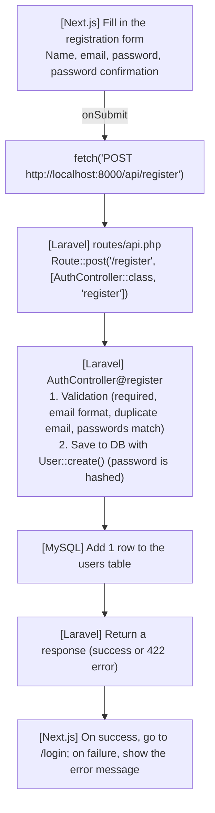

# Steps for Building the New User Registration Screen

> 🇯🇵 Original (Japanese version): [2026_07_09_2.md](<../../../2年生_システム開発実践/前期/2026_07_09/2026_07_09_2.md>) <!-- original-ja-link -->

This document is a step-by-step guide to actually completing the Lesson 23 assignment, "Build a new user registration screen."  
We'll implement the task given in `2026_07_09.md` on top of the `school-frontend` project we built in previous lessons (Lessons 17–22).

---

## 0. The big picture: what connects to what

The registration screen is a feature that "creates one new record," so in CRUD terms it's **Create**.  
The flow is almost the same as the login screen (Lesson 17); only the destination URL and the validation rules change.



Actually, the registration route **was already defined in `routes/api.php` back in Lesson 08.**

```php
// routes/api.php (this should already be there)
Route::post('/login', [AuthController::class, 'login']);
Route::post('/register', [AuthController::class, 'register']);
```

However, we've only implemented `login` / `logout` / `me` inside `AuthController`, so  
**the `register()` method doesn't exist yet**. Today we'll start by creating it.

---

## 1. Laravel side: implement `register()`

Open `app/Http/Controllers/Api/AuthController.php` and add it near the `login()` method.

```php
// app/Http/Controllers/Api/AuthController.php
use App\Models\User;
use Illuminate\Support\Facades\Hash;

// POST /api/register
public function register(Request $request)
{
    // ① Validate the input
    $validated = $request->validate([
        'name'     => 'required|string|max:255',
        'email'    => 'required|email|unique:users,email',
        'password' => 'required|min:8|confirmed',
    ]);

    // ② Create the user (always hash the password)
    $user = User::create([
        'name'     => $validated['name'],
        'email'    => $validated['email'],
        'password' => Hash::make($validated['password']),
    ]);

    // ③ We want to log them in right away, so issue a token and return it too
    $token = $user->createToken('api-token')->plainTextToken;

    return response()->json([
        'status' => 'ok',
        'token'  => $token,
        'user'   => $user,
    ], 201); // 201 = successfully created
}
```

### Key points about validation

| Rule | Meaning |
|--------|------|
| `required` | 422 error if left empty |
| `email` | Checks that it's in email format |
| `unique:users,email` | Checks that the same email isn't already in the `users` table (prevents duplicate registration) |
| `min:8` | Password must be at least 8 characters |
| `confirmed` | A special rule that automatically checks **whether the value matches the value of the field named "the same name + `_confirmation`"** |

When you use the `confirmed` rule, the key names sent from the frontend must look like this:

```json
{
  "name": "田中太郎",
  "email": "tanaka@example.com",
  "password": "password123",
  "password_confirmation": "password123"
}
```

If you get even one character of the name `password_confirmation` wrong, the `confirmed` rule won't work, causing a bug where "you get an error even though the passwords match," so be careful.

---

## 2. Next.js side: create the `/register` page

Create an `app/register/` folder and create a new `page.tsx` file in it.

```
app/register/page.tsx  ← new file
```

We'll build it with the same structure as the login page (Lesson 17). **The only differences are the input fields and where the data is sent.**

```tsx
"use client";

import { useState } from "react";
import { useRouter } from "next/navigation";

export default function RegisterPage() {
  const router = useRouter();
  const [name, setName] = useState("");
  const [email, setEmail] = useState("");
  const [password, setPassword] = useState("");
  const [passwordConfirmation, setPasswordConfirmation] = useState("");
  const [error, setError] = useState("");
  const [loading, setLoading] = useState(false);

  async function handleSubmit(e) {
    e.preventDefault();
    setError("");
    setLoading(true);

    const res = await fetch("http://localhost:8000/api/register", {
      method: "POST",
      headers: {
        "Content-Type": "application/json",
        "Accept": "application/json",
      },
      // ★ Match the key names to the Laravel validation
      body: JSON.stringify({
        name,
        email,
        password,
        password_confirmation: passwordConfirmation,
      }),
    });

    const data = await res.json();
    setLoading(false);

    if (res.ok) {
      // ★ Log them in right away (save the token and go to /students)
      localStorage.setItem("token", data.token);
      localStorage.setItem("userName", data.user?.name || "ユーザー");
      router.push("/students");
    } else if (data.errors) {
      // Same Laravel validation error display we learned in Lesson 21
      const messages = Object.values(data.errors).flat().join(" / ");
      setError(messages);
    } else {
      setError(`エラーが発生しました（HTTP ${res.status}）`);
    }
  }

  return (
    <div style={{
      maxWidth: "400px", margin: "80px auto",
      background: "white", padding: "32px",
      borderRadius: "8px", boxShadow: "0 2px 8px rgba(0,0,0,0.1)"
    }}>
      <h2 style={{ marginBottom: "24px", textAlign: "center" }}>新規ユーザー登録</h2>

      <form onSubmit={handleSubmit}>
        <div style={{ marginBottom: "16px" }}>
          <label style={{ display: "block", marginBottom: "6px", fontWeight: "bold" }}>名前</label>
          <input
            type="text"
            value={name}
            onChange={(e) => setName(e.target.value)}
            style={{ width: "100%", padding: "10px", border: "1px solid #ccc", borderRadius: "6px", fontSize: "1em", boxSizing: "border-box" }}
          />
        </div>

        <div style={{ marginBottom: "16px" }}>
          <label style={{ display: "block", marginBottom: "6px", fontWeight: "bold" }}>メールアドレス</label>
          <input
            type="email"
            value={email}
            onChange={(e) => setEmail(e.target.value)}
            style={{ width: "100%", padding: "10px", border: "1px solid #ccc", borderRadius: "6px", fontSize: "1em", boxSizing: "border-box" }}
          />
        </div>

        <div style={{ marginBottom: "16px" }}>
          <label style={{ display: "block", marginBottom: "6px", fontWeight: "bold" }}>パスワード</label>
          <input
            type="password"
            value={password}
            onChange={(e) => setPassword(e.target.value)}
            style={{ width: "100%", padding: "10px", border: "1px solid #ccc", borderRadius: "6px", fontSize: "1em", boxSizing: "border-box" }}
          />
        </div>

        <div style={{ marginBottom: "16px" }}>
          <label style={{ display: "block", marginBottom: "6px", fontWeight: "bold" }}>パスワード確認</label>
          <input
            type="password"
            value={passwordConfirmation}
            onChange={(e) => setPasswordConfirmation(e.target.value)}
            style={{ width: "100%", padding: "10px", border: "1px solid #ccc", borderRadius: "6px", fontSize: "1em", boxSizing: "border-box" }}
          />
        </div>

        {error && (
          <p style={{ color: "#D32F2F", fontSize: "0.9em", marginBottom: "12px" }}>
            {error}
          </p>
        )}

        <button
          type="submit"
          disabled={loading}
          style={{ width: "100%", padding: "12px", background: loading ? "#aaa" : "#1976D2", color: "white", border: "none", borderRadius: "6px", fontSize: "1em", fontWeight: "bold", cursor: loading ? "not-allowed" : "pointer" }}
        >
          {loading ? "登録中..." : "登録する"}
        </button>

        <p style={{ textAlign: "center", marginTop: "16px", fontSize: "0.9em" }}>
          すでにアカウントをお持ちの方は{" "}
          <a href="/login" style={{ color: "#1976D2", fontWeight: "bold" }}>こちら</a>
        </p>
      </form>
    </div>
  );
}
```

### Differences from the login page (Lesson 17)

| | `/login` (Lesson 17) | `/register` (this lesson) |
|--|--|--|
| Input fields | Email, password | Name, email, password, password confirmation |
| Sent to | `POST /api/login` | `POST /api/register` |
| Response on success | `{ token, user }` | `{ token, user }` (same shape) |
| What's shown on failure | Fixed message (401) | Laravel validation messages (422) |
| Where it goes after success | `/students` | `/students` (the user is logged in immediately upon registration) |

---

## 3. Link the login screen and the registration screen to each other

As stated in the assignment spec (`2026_07_09.md`), the registration screen needs a link to the login screen that says "Already have an account? Click here" (it's already added at the end of the code above).

It's also a good idea to add a link to the registration screen on the login screen, so users can move back and forth without getting lost.

```tsx
// Add at the very bottom of the <form> in app/login/page.tsx
<p style={{ textAlign: "center", marginTop: "16px", fontSize: "0.9em" }}>
  アカウントをお持ちでない方は{" "}
  <a href="/register" style={{ color: "#1976D2", fontWeight: "bold" }}>こちら</a>
</p>
```

---

## 4. Start both servers and check that it works

```bash
# Terminal ① Laravel
cd (your Laravel project folder)
php artisan serve

# Terminal ② Next.js
cd school-frontend
npm run dev
```

### Checklist for testing

| What to check | What to do | Expected result |
|---------|------|------------|
| Screen display | Open `http://localhost:3000/register` | Input fields for name, email, password, and password confirmation are shown |
| Normal registration | Fill everything in correctly and press "登録する" (Register) | You're taken to `/students` and are logged in |
| Duplicate email | Register with an email address that's already registered | An error such as "The email has already been taken." is shown |
| Password mismatch | Enter different values for password and password confirmation | "The password confirmation does not match." is shown |
| Empty fields | Submit without entering anything | A "required" error is shown for each field |
| Navigation (register → login) | Press "すでにアカウントをお持ちの方はこちら" (Already have an account? Click here) | You're taken to `/login` |
| Navigation (login → register) | Press "こちら" (Click here) on the login screen | You're taken to `/register` |
| Login check | Log in again with the newly registered email and password | Login succeeds |

---

## Summary: where today's work fits in

| What we already had | What we added this time |
|--|--|
| The `/register` route was already set up in `routes/api.php` (Lesson 08) | Implemented the body of `register()` in `AuthController` (validation + `User::create`) |
| The `/login` page already existed (Lesson 17) | Created a new `/register` page with the same structure |
| We already learned how to display 422 errors in Lesson 21 | Applied the same mechanism to show errors on the registration form |

The key point of this assignment is that there are almost no new concepts: you can build it just by combining parts you've learned in previous lessons, namely **the Create operation in CRUD, Controller/Model, validation, and token issuance**.
