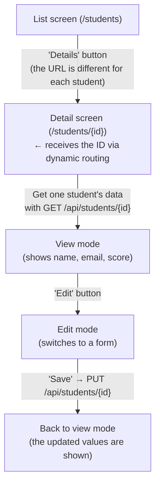
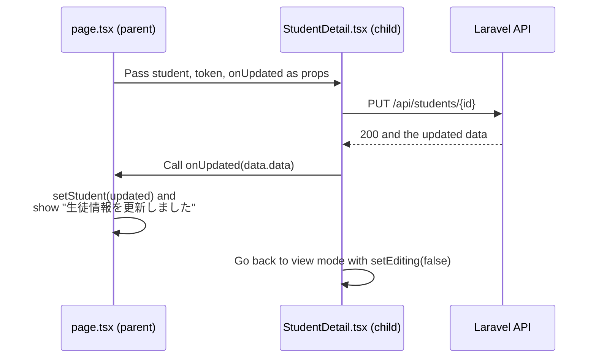

# Lesson 24 | Building the Detail Screen - Implementation Steps

> 🇯🇵 Original (Japanese version): [2026_07_16_実装.md](<../../../2年生_システム開発実践/前期/2026_07_16/2026_07_16_実装.md>) <!-- original-ja-link -->

## Today's goals

- From the "Details" button on the list screen, you can move to a screen that shows just that one student
- With the "Edit" button on the detail screen, you can switch to a form right there and update the data
- You can set up an update API endpoint (`PUT /api/students/{id}`) on the Laravel side

> **Where this fits:** While the list screen (`GET /api/students`) is for "viewing everyone at once," the detail screen is for "viewing and fixing just the one person specified by their ID." In CRUD terms, **Read (viewing just one record)** and **Update** switch back and forth within a single screen.

---

## The big picture: what we're building



### Why we build it in this order

> 💡 **Think of it like... a restaurant's "individual order card"**
>
> If the list screen is "today's reservation list," the detail screen is an "individual order card" for just one customer. To rewrite (edit) the card directly, the restaurant side (Laravel) first needs a window for "taking out this card" (`GET /api/students/{id}`) and a window for "accepting changes" (`PUT /api/students/{id}`). Without them, you can't even get started.

Without the backend update API, even if you build the edit form on the frontend, there's nowhere to save to, so you can't test it. That's why we'll go in this order: **backend (API) → link from the list → detail screen (view) → edit mode**, building small pieces and running them as we go.

### File structure (what we'll touch this time)

| Symbol | Meaning |
|---|---|
| 🆕 New | Create a new file |
| ➕ Add | Add code to an existing file |
| 👀 Check | No changes needed. Just check that it's already done |

```
Laravel/
├── app/Http/Requests/UpdateStudentRequest.php      🆕 New
├── app/Http/Controllers/Api/StudentController.php  ➕ Add update()
└── routes/api.php                                  👀 Check only

school-frontend/
├── components/students/StudentList.tsx             ➕ Add details link
├── components/students/StudentDetail.tsx           🆕 New (view ⇔ edit)
└── app/students/[id]/page.tsx                       🆕 New → ➕ add more later (dynamic routing)
```

---

## Step 1 | Backend: add the update API

We already have APIs for listing students, getting details, and deleting, but there's no endpoint yet for "rewriting one record." We'll build that first.


### 1-3. Check `routes/api.php`

**👀 Check only (usually no changes needed)** — `Route::apiResource('students', StudentController::class)` includes `update` by default. Add `update` **only** if you've narrowed it down with `->only([...])`.

```php
Route::middleware('auth:sanctum')->group(function () {
    Route::post('/logout', [AuthController::class, 'logout']);
    Route::get('/me', [AuthController::class, 'me']);
    Route::apiResource('students', StudentController::class);
    
    // Just check that it isn't using only
    // Route::apiResource('students', StudentController::class)->only(['index', 'show']);
});
```

### 1-4. Check that it works

```bash
cd Laravel && php artisan serve
```

After logging in and getting a token, try calling the update API directly with `curl`.

⚠️ Note for those using Windows (PowerShell)
If you use curl as is in PowerShell, you'll get an error. Be sure to type curl.exe instead, or type cmd in the terminal to switch to "Command Prompt" before running it. You'll also need to escape the double quotes (\") in the data.
```bash
curl -X PUT http://localhost:8000/api/students/1 \
  -H "Authorization: Bearer <the token you got>" \
  -H "Content-Type: application/json" \
  -H "Accept: application/json" \
  -d '{"name":"テスト太郎","email":"test-taro@example.com","score":80}'
```

| What to check | What to do | Expected result |
|---|---|---|
| Successful update | Run the curl command above | Returns 200, and the JSON includes the updated name, email, and score |
| Validation | Run it with `200` for `score` | Returns 422 |
| Authentication required | Run it without the `Authorization` header | Returns 401 |
| Non-existent ID | Run it against `/api/students/9999` | Returns 404 |

---

## Step 2 | Frontend: link from the list to the details

Edit `school-frontend/components/students/StudentList.tsx`.

### Why we need this

If you can't jump from each row of the list to "the URL for just this student," there's no way to reach the detail screen even after you build it. The key is to **embed the student's ID directly into the URL**.

**➕ Add (at the top of the existing file)** — Add the `import`.

```tsx
// ▼ Add at the top of StudentList.tsx
"use client";

import Link from "next/link";
```

**➕ Add (to the existing file)** — Add the style for the details link somewhere below `bodyCell`.

```tsx
// Style constants (group styles that are used repeatedly)
const thStyle = { padding: "10px 16px", textAlign: "left", fontWeight: "bold", fontSize: "0.9em" };
const tdStyle = { padding: "12px 16px", fontSize: "0.95em" };

// ▼ Add somewhere below here (style for the details link)
const detailLinkStyle = {
  display: "inline-flex",
  alignItems: "center",
  justifyContent: "center",
  minWidth: 104,
  padding: "0.85rem 1.25rem",
  borderRadius: 999,
  background: "#163D7A",
  color: "#fff",
  fontWeight: 700,
  fontSize: "0.95rem",
  letterSpacing: "0.01em",
  boxShadow: "0 10px 24px rgba(22, 61, 122, 0.18)",
};
```

**🔁 Replace (in the existing file)** — Replace the last `<td>` in `StudentRow` (the cell with the action buttons) with the following.

```tsx
// StudentRow: one row of the table
function StudentRow({ student, onDelete }) {
  function handleDelete() {
    // Show a confirmation dialog before deleting
    if (window.confirm(`${student.name} を削除しますか？`)) {
      onDelete(student.id); // Tell the parent "please delete this ID"
    }
  }

  return (
    <tr style={{ borderBottom: "1px solid #eee" }}>
      <td style={tdStyle}>{student.id}</td>
      <td style={tdStyle}>{student.name}</td>
      <td style={tdStyle}>{student.email}</td>
      <td style={tdStyle}>{student.score}</td>
      <td style={tdStyle}>
      <div style={{ display: "flex", gap: "0.5rem", flexWrap: "wrap" }}>
        <Link href={`/students/${student.id}`} style={detailLinkStyle}>
          詳細
        </Link>
        <button
          onClick={handleDelete}
          style={{ background: "#D32F2F", color: "white", border: "none", borderRadius: "4px", padding: "4px 12px", cursor: "pointer", fontSize: "0.85em" }}
        >
          削除
        </button>
        </div >
      </td>
    </tr>
  );
}
```

### Check that it works

```bash
cd school-frontend && npm run dev
```

| What to check | What to do | Expected result |
|---|---|---|
| Link is shown | Open `/students` | A "詳細" (Details) button appears on each row |
| Navigation | Click the "詳細" (Details) button | You go to `/students/{that row's ID}` (a 404 is fine at this point; we'll build it in Step 3) |

---

## Step 3 | Frontend: detail screen (view mode)

**🆕 New file** — Create `school-frontend/app/students/[id]/page.tsx` (also create a new folder named `[id]`).

### Why name the folder `[id]`?

In Next.js, if you put a folder name in square brackets like `[id]`, it creates a **dynamic route**, which lets the page receive that part of the URL (the `3` in `/students/3`).

```tsx
"use client";

import { useState, useEffect } from "react";
import { useRouter, useParams } from "next/navigation";
import Link from "next/link";


export default function StudentDetailPage() {
  const router = useRouter();
  const params = useParams(); // Receive the {id} part of the URL
  const [student, setStudent] = useState(null);
  const [userName, setUserName] = useState("");
  const [loading, setLoading] = useState(true);
  const [notFound, setNotFound] = useState(false);
  const [token, setToken] = useState(null); // ★ Added the missing "token" box (state) here, which was causing the error!

  // ★ useEffect: runs only once when the page is displayed
  useEffect(() => {
    const savedToken = localStorage.getItem("token");

    // If there's no token, send them back to the login page
    if (!savedToken) {
      router.push("/login");
      return;
    }

    setToken(savedToken); // ★ Save the retrieved token in state
    setUserName(localStorage.getItem("userName") || "ユーザー");
    loadStudent(savedToken);
  }, []); // [] = run only the first time

  // Get one specific student's data from the API
  async function loadStudent(currentToken) {
    setLoading(true);
    setNotFound(false);
  
    try {
      // Query the Laravel API using params.id from the URL parameters
      const res = await fetch(`http://localhost:8000/api/students/${params.id}`, {
        headers: {
          "Accept": "application/json",
          "Authorization": `Bearer ${currentToken}`, // ★ Attach the token to the header
        },
      });

      // 401 = invalid token → send them back to the login page
      if (res.status === 401) {
        router.push("/login");
        return;
      }

      // 404 = student not found
      if (res.status === 404) {
        setStudent(null);
        setNotFound(true);
        return;
      }

      const data = await res.json();
      setStudent(data.data); // The Laravel API returns data in the form { data: {...} }
    } catch (error) {
      console.error("データの取得に失敗しました", error);
    } finally {
      setLoading(false);
    }
  }

  // Log out
  async function handleLogout() {
    const currentToken = localStorage.getItem("token");

    await fetch("http://localhost:8000/api/logout", {
      method: "POST",
      headers: {
        "Accept": "application/json",
        "Authorization": `Bearer ${currentToken}`,
      },
    });

    localStorage.removeItem("token");
    localStorage.removeItem("userName");
    router.push("/login");
  }

  // ★ Wait until the token is ready and loading has finished
  if (!token || loading) {
    return (
      <div style={{ textAlign: "center", padding: "80px", color: "#888" }}>
        生徒データを読み込んでいます...
      </div>
    );
  }

  return (
    <div style={{ background: "#f4f6f8", minHeight: "100vh" }}>

      {/* Header (same shared look as the list screen) */}
      <header style={{
        background: "#1565C0", color: "white",
        padding: "16px 32px",
        display: "flex", alignItems: "center"
      }}>
        <h1 style={{ fontSize: "1.2em" }}>生徒管理アプリ（Next.js API版）</h1>
        <div style={{ marginLeft: "auto", display: "flex", alignItems: "center", gap: "12px" }}>
          <span style={{ fontSize: "0.9em" }}>● ログイン中：{userName}</span>
          <button
            onClick={handleLogout}
            style={{ background: "#D32F2F", color: "white", border: "none", borderRadius: "6px", padding: "6px 14px", cursor: "pointer" }}
          >
            ログアウト
          </button>
        </div>
      </header>

      {/* Main content */}
      <main style={{ padding: "32px", maxWidth: "640px", margin: "0 auto", display: "grid", gap: "20px" }}>
        
        <Link href="/students" style={{ color: "#1565C0", fontWeight: "bold", textDecoration: "none" }}>
          ← 一覧に戻る
        </Link>


        {/* ★ What to show when the student isn't found or the data is empty */}
        {notFound || !student ? (
          <div style={{
            borderRadius: "8px",
            padding: "40px 24px",
            textAlign: "center",
            background: "white",
            border: "1px solid #ddd",
          }}>
            <p style={{ margin: 0, color: "#888" }}>生徒が見つかりません</p>
          </div>
        ) : (
          /* ★ Now the token can be passed correctly to the child component */
          <section style={{
              background: "white", border: "1px solid #ddd", borderRadius: "8px",
              padding: "24px", boxShadow: "0 4px 12px rgba(0,0,0,0.05)"
            }}>
              <h2 style={{ margin: "0 0 20px 0", fontSize: "1.4em", borderBottom: "2px solid #1565C0", paddingBottom: "8px" }}>
                {student.name}
              </h2>
              
              <dl style={{ display: "grid", gap: "16px", margin: 0 }}>
                <div>
                  <dt style={{ fontSize: "0.9em", color: "#666", marginBottom: "4px" }}>メールアドレス</dt>
                  <dd style={{ margin: 0, fontWeight: "bold", fontSize: "1.1em" }}>{student.email}</dd>
                </div>
                <div>
                  <dt style={{ fontSize: "0.9em", color: "#666", marginBottom: "4px" }}>点数</dt>
                  <dd style={{ margin: 0, fontWeight: "bold", fontSize: "1.1em" }}>{student.score} 点</dd>
                </div>
              </dl>
            </section>
        )}

      </main>

    </div>
  );
}
```

### Check that it works

| What to check | What to do | Expected result |
|---|---|---|
| Display | After logging in, go there from "詳細" (Details) in the list | Only that student's name, email, and score are shown |
| Non-existent ID | Open `/students/99999` directly | "生徒が見つかりません" (Student not found) is shown |
| Not logged in | Open `/students/1` while logged out | You're redirected to `/login` |

---

## Step 4 | Frontend: add edit mode

We'll add a form to the view-only detail screen that appears when you press the "Edit" button. The idea of "taking input in a form and submitting it" that we built in Lessons 17–21 works just the same here.

### 4-1. Create `school-frontend/components/students/StudentDetail.tsx`

**🆕 New file** — Use `useState` to track `editing` and switch between view mode and edit mode.

```tsx
"use client";

import { useState } from "react";

// Shared style for the input fields
const inputStyle = {
  width: "100%",
  borderRadius: "6px",
  border: "1px solid #ddd",
  padding: "10px 12px",
  fontSize: "1rem",
  outline: "none",
  background: "#fff",
  boxSizing: "border-box", // Keep the border from sticking out
};

export default function StudentDetail({ student, token, onUpdated }) {
  const [editing, setEditing] = useState(false); // false = view mode, true = edit mode
  const [name, setName] = useState(student.name);
  const [email, setEmail] = useState(student.email);
  const [score, setScore] = useState(String(student.score));
  const [error, setError] = useState("");
  const [saving, setSaving] = useState(false);

  function startEditing() {
    // Fill the form with the current values, then switch to edit mode
    setName(student.name);
    setEmail(student.email);
    setScore(String(student.score));
    setError("");
    setEditing(true);
  }

  function cancelEditing() {
    setError("");
    setEditing(false); // Throw away the input and go back to view mode
  }

  async function handleSubmit(e) {
    e.preventDefault();
    setError("");

    if (!name || !email || !score) {
      setError("すべての項目を入力してください");
      return;
    }

    const scoreNumber = Number(score);
    if (Number.isNaN(scoreNumber) || scoreNumber < 0 || scoreNumber > 100) {
      setError("点数は0〜100の数値を入力してください");
      return;
    }

    setSaving(true);

    try {
      const res = await fetch(`http://localhost:8000/api/students/${student.id}`, {
        method: "PUT",
        headers: {
          "Content-Type": "application/json",
          "Accept": "application/json",
          "Authorization": `Bearer ${token}`,
        },
        body: JSON.stringify({ name, email, score: scoreNumber }),
      });

      if (res.status === 401) {
        window.location.href = "/login";
        return;
      }

      if (res.ok) {
        const data = await res.json();
        onUpdated(data.data); // Pass the latest data to the parent (page.tsx) to update it
        setEditing(false);
        return;
      }

      if (res.status === 422) {
        const data = await res.json();
        const details = Object.values(data.errors ?? {}).flat().join(" / ");
        setError(details || "入力内容をご確認ください");
        return;
      }

      setError("更新に失敗しました");
    } catch (err) {
      setError("更新に失敗しました");
    } finally {
      setSaving(false);
    }
  }

  // [1] View mode (when the edit button hasn't been pressed)
  if (!editing) {
    return (
      <section style={{
        background: "white", border: "1px solid #ddd", borderRadius: "8px",
        padding: "24px", boxShadow: "0 4px 12px rgba(0,0,0,0.05)"
      }}>
        <h2 style={{ margin: "0 0 20px 0", fontSize: "1.4em", borderBottom: "2px solid #1565C0", paddingBottom: "8px" }}>
          {student.name}
        </h2>
        
        <dl style={{ display: "grid", gap: "16px", margin: 0 }}>
          <div>
            <dt style={{ fontSize: "0.9em", color: "#666", marginBottom: "4px" }}>メールアドレス</dt>
            <dd style={{ margin: 0, fontWeight: "bold", fontSize: "1.1em" }}>{student.email}</dd>
          </div>
          <div>
            <dt style={{ fontSize: "0.9em", color: "#666", marginBottom: "4px" }}>点数</dt>
            <dd style={{ margin: 0, fontWeight: "bold", fontSize: "1.1em" }}>{student.score} 点</dd>
          </div>
        </dl>

        <div style={{ marginTop: "20px" }}>
          <button 
            onClick={startEditing}
            style={{
              background: "#1565C0", color: "white", border: "none", 
              borderRadius: "6px", padding: "8px 20px", cursor: "pointer", fontWeight: "bold"
            }}
          >
            編集する
          </button>
        </div>
      </section>
    );
  }

  // [2] Edit mode (when the edit button has been pressed)
  return (
    <section style={{
      background: "white", border: "1px solid #ddd", borderRadius: "8px",
      padding: "24px", boxShadow: "0 4px 12px rgba(0,0,0,0.05)"
    }}>
      <h2 style={{ margin: "0 0 20px 0", fontSize: "1.3rem", color: "#1565C0", fontWeight: "bold" }}>
        生徒情報を編集
      </h2>

      <form onSubmit={handleSubmit} style={{ display: "grid", gap: "16px" }}>
        <label style={{ display: "grid", gap: "6px" }}>
          <span style={{ fontSize: "0.9em", fontWeight: "bold", color: "#444" }}>名前</span>
          <input
            type="text"
            value={name}
            onChange={(event) => setName(event.target.value)}
            style={inputStyle}
          />
        </label>

        <label style={{ display: "grid", gap: "6px" }}>
          <span style={{ fontSize: "0.9em", fontWeight: "bold", color: "#444" }}>メールアドレス</span>
          <input
            type="email"
            value={email}
            onChange={(event) => setEmail(event.target.value)}
            style={inputStyle}
          />
        </label>

        <label style={{ display: "grid", gap: "6px" }}>
          <span style={{ fontSize: "0.9em", fontWeight: "bold", color: "#444" }}>点数</span>
          <input
            type="number"
            value={score}
            onChange={(event) => setScore(event.target.value)}
            min="0"
            max="100"
            style={inputStyle}
          />
        </label>

        <div style={{ display: "flex", gap: "12px", marginTop: "8px" }}>
          <button
            type="submit"
            disabled={saving}
            style={{
              background: saving ? "#aaa" : "#2E7D32", color: "white", border: "none",
              borderRadius: "6px", padding: "8px 20px", cursor: saving ? "default" : "pointer", fontWeight: "bold"
            }}
          >
            {saving ? "保存中..." : "保存"}
          </button>
          
          <button
            type="button"
            onClick={cancelEditing}
            disabled={saving}
            style={{
              background: "#757575", color: "white", border: "none",
              borderRadius: "6px", padding: "8px 20px", cursor: saving ? "default" : "pointer", fontWeight: "bold"
            }}
          >
            キャンセル
          </button>
        </div>
      </form>

      {/* Show the error message */}
      {error && (
        <p style={{
          margin: "16px 0 0 0", color: "#D32F2F", fontWeight: "bold",
          background: "#FFEBEE", borderRadius: "6px", padding: "10px 12px", fontSize: "0.9em"
        }}>
          ⚠ {error}
        </p>
      )}
    </section>
  );
}
```

### 4-2. Edit app/students/[id]/page.tsx to plug in StudentDetail

In the file you created in Step 3, add or replace the following 4 spots.

**➕ Add (import)**

```tsx
import StudentDetail from "@/components/students/StudentDetail";
```

**➕ Add (one line below the notFound state)** — This is the state for showing a message after updating.

```tsx
  const [message, setMessage] = useState("");
```

**➕ Add (one line inside loadStudent, right after setNotFound(false);)**

```tsx
      setLoading(true);
      setNotFound(false);
      // Add just this ↓↓
      setMessage("");
```

**➕ Add (right after `<Link href="/students" ...>`)** — Add the block that shows the message.

```tsx
        {message ? (
          <div
            style={{
              borderRadius: 18,
              padding: "0.9rem 1rem",
              background: "rgba(255, 255, 255, 0.82)",
              border: "1px solid rgba(22, 61, 122, 0.08)",
              color: "#163D7A",
              fontWeight: 700,
            }}
          >
            {message}
          </div>
        ) : null}
```

**🔁 Replace** — Replace the view-only `<section>...</section>` you created in Step 3 with a call to `StudentDetail`.

```tsx
        {/* ★ What to show when the student isn't found or the data is empty */}
        {notFound || !student ? (
          <div style={{
            borderRadius: "8px",
            padding: "40px 24px",
            textAlign: "center",
            background: "white",
            border: "1px solid #ddd",
          }}>
            <p style={{ margin: 0, color: "#888" }}>生徒が見つかりません</p>
          </div>
        ) : (
          /* ★ Now the token can be passed correctly to the child component */
          <StudentDetail
            student={student}
            token={token}
            onUpdated={(updated) => {
              setStudent(updated);
              setMessage("生徒情報を更新しました");
            }}
          />
        )}
```

Here's a diagram of how the data flows between the child (`StudentDetail.tsx`), the parent (`page.tsx`), and Laravel when you press "Save":



### Check that it works

```bash
cd school-frontend && npm run dev
```

| What to check | What to do | Expected result |
|---|---|---|
| Switching to edit mode | Press the "編集する" (Edit) button | It switches to a form filled with the current values |
| Save | Change the values and press "保存" (Save) | It goes back to view mode, showing the updated values and "生徒情報を更新しました" (Student information updated) |
| Cancel | Change the values and press "キャンセル" (Cancel) | The changes are discarded, and it goes back to view mode with the original values |
| Score validation | Enter `200` for the score and save | An error message is shown, and it stays in edit mode |
| Duplicate email | Enter an email used by another student and save | The backend's 422 error message is shown |

---

## Summary

| Concept | Where it shows up this time |
|---|---|
| Read (viewing just one record) | `GET /api/students/{id}`, `app/students/[id]/page.tsx` |
| Update | `PUT /api/students/{id}`, the save logic in `StudentDetail.tsx` |
| Dynamic routing | `app/students/[id]/page.tsx`, `useParams()` |
| Switching between view ⇔ edit modes | The `editing` state in `StudentDetail.tsx` |

## Completion checklist (Definition of Done)

- [ ] Each row in `/students` has a "Details" button, and clicking it takes you to `/students/{id}`
- [ ] `/students/{id}` shows the name, email, and score
- [ ] The "Edit" button switches to a form, and when you change the values and save, the changes show up in the DB and on screen
- [ ] Validation errors (required fields, score range, duplicate email) are shown on screen
- [ ] Accessing a non-existent ID shows "生徒が見つかりません" (Student not found)
- [ ] Access without logging in is redirected to `/login`

## Startup commands

```bash
# Backend
cd Laravel && php artisan serve   # http://localhost:8000

# Frontend
cd school-frontend && npm run dev # http://localhost:3000
```

Test account: `test@example.com` / `password`
