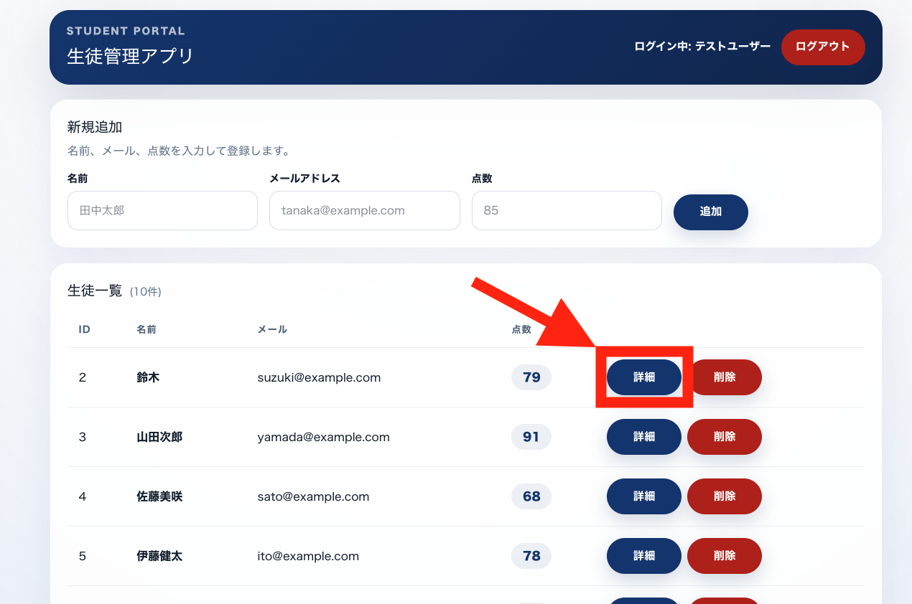
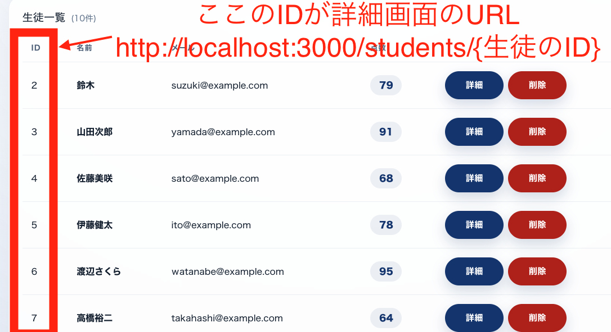
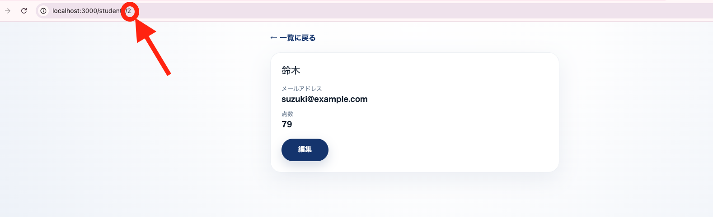
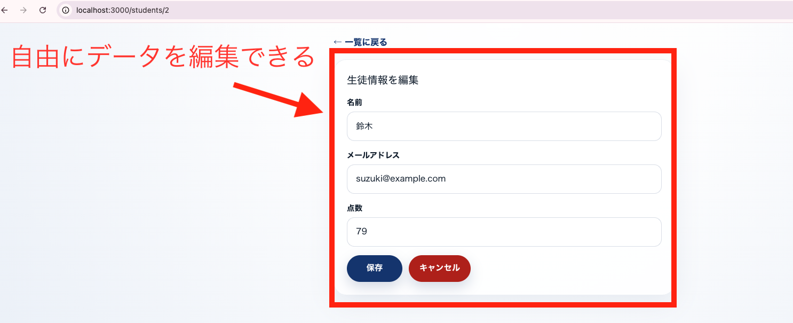
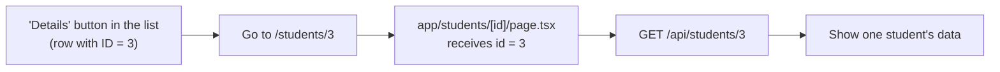

# Lesson 24 | Building the Detail Screen

> 🇯🇵 Original (Japanese version): [2026_07_16_課題.md](<../../../2年生_システム開発実践/前期/2026_07_16/2026_07_16_課題.md>) <!-- original-ja-link -->

---

# If you've made it this far, next let's build a detail screen

Right now, the list screen lets you see names, emails, and scores at a glance, but there's no screen where you can take your time reviewing an individual student's information and edit it from there. We'll build a screen that shows only that student's information when you press the "Details" button in the list.

## What we're building

When you press the "Details" button on any row of the list screen, you'll move to a screen that shows only that student's information.

The key point is that **the destination URL changes depending on which row's "Details" button you press**. The student's ID is included directly in the URL.

When you press the button, if you can move to a screen showing only that student's name, email address, and score, like in the image below, you've completed this part.

On top of that, when you press the "Edit" button on the detail screen, the screen should switch to a form right there so you can edit the student's information (this is the same idea as the update logic we built in Lesson 21).

## What is a detail screen?

In CRUD terms, the detail screen is **Read (viewing just one record)**. While the list screen is for "viewing everyone at once," the detail screen is for "viewing just the one person specified by their ID."

- List screen: `GET /api/students` → returns data for everyone
- Detail screen: `GET /api/students/{id}` → returns only the one student with the specified ID

For example, when you press "Details" for the student with ID 3, here's how the ID in the URL gets passed along:

In addition, editing and saving from the detail screen is **Update** in CRUD terms. Viewing (Read) and updating (Update) switch back and forth within the same screen.

## What the screen needs

- Display of the student's **name**
- Display of the student's **email address**
- Display of the student's **score**
- An "**Edit**" button (switches to a form when pressed)
- In the edit form, input fields for name, email address, and score, plus "**Save**" and "**Cancel**" buttons
- A "**Back to list**" link

## Implementation hints (this connects to what you've learned so far)

- Make the "Details" button on the list screen a link to `/students/{student ID}` for each student (build a URL with the ID embedded, like `` <Link href={`/students/${student.id}`}> ``)
- In Next.js, use **dynamic routing**, which lets you receive part of the URL (the ID). With a folder/file structure like `app/students/[id]/page.tsx`, you can receive the value of the `{id}` part of the URL inside the page
- When the page is displayed, use the received ID to send a request to the Laravel API, like `` fetch(`http://localhost:8000/api/students/${id}`) ``, and get only that one student's data
- On the Laravel side, `Route::apiResource('students', StudentController::class)` in `routes/api.php` actually already sets up routes for `show($id)` (get one record) and `update($id)` (update a record) as well. Check whether these two methods are implemented in `StudentController`
- Since you want the display to switch when the "Edit" button is pressed, keep track of "are we in view mode or edit mode right now?" with `useState`. That way, you can use the same approach to forms that you used in Lessons 17–21
- When the Save button is pressed, use `fetch` to send a `PUT` (or `PATCH`) request to `http://localhost:8000/api/students/{id}`. Don't forget to attach the token with `Authorization: Bearer ${token}`
