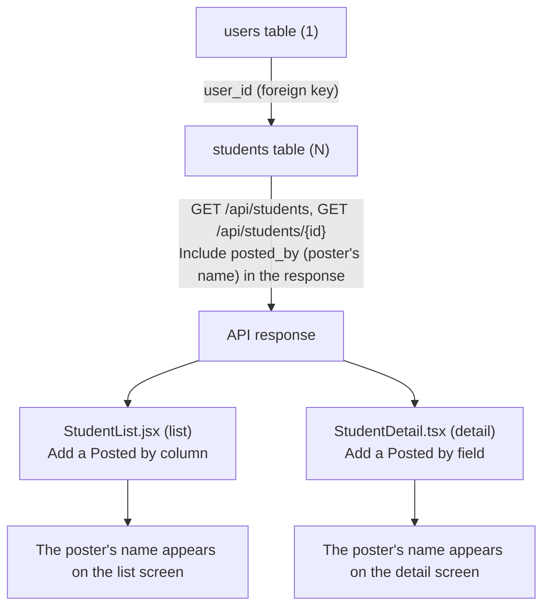
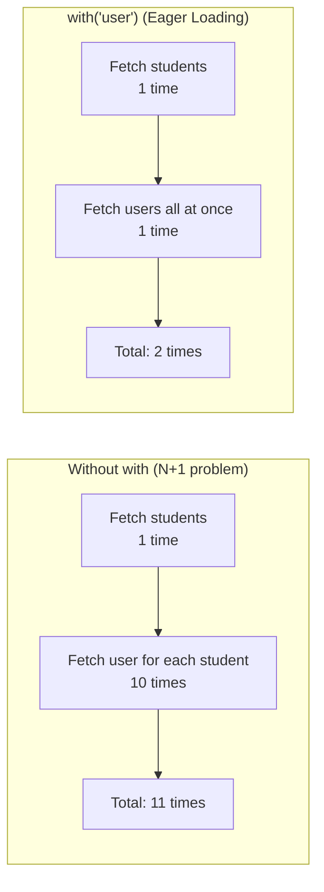

# Lesson 25 | Relating Users ⇔ Students and Showing Who Posted Each Record - Implementation Steps

> 🇯🇵 Original (Japanese version): [2026_07_23_実装 .md](<../../../2年生_システム開発実践/前期/2026_07_23/2026_07_23_実装 .md>) <!-- original-ja-link -->

## Today's Goals

- Give the `students` table a `user_id` column that shows "who registered this record"
- Connect `User` and `Student` with an Eloquent relationship (one user has many students)
- Include the "posted by" name (`posted_by`) in the responses of the student list and detail APIs
- When registering a new student, automatically link it to the logged-in user and save it
- Show the "Posted by" field on both the list screen and the detail screen

> **Where this fits:** Until now, the `students` table had no information about who registered each record. We will add a foreign key relationship to the `users` table, send that information through the API to the frontend, and display it on screen, building the whole flow end to end.

---

## The Big Picture: What We Are Building



> 💡 **Think of it like... a library checkout card**
>
> If each record in the `students` table is a "book," then `user_id` is the checkout card that says "who borrowed (registered) this book." Without the card, you can look at the book and still not know "who is responsible for it." First, we make a slot for the card in the book (`students`) (the `user_id` column). Next, we express the relationship "one library user can borrow many books" in code (Eloquent). Finally, we show that information on screen.

In Eloquent, this maps as follows.

| Class | Method | Meaning |
|---|---|---|
| `User` | `students()` | One user has many students (`hasMany`) |
| `Student` | `user()` | One student belongs to one user (`belongsTo`) |

### Why We Build It in This Order

Until the backend has `user_id` and the relationships in place, and the API can return `posted_by`, the frontend has no data to display at all. So we work in this order: **backend (migration → model → Controller/Seeder) → frontend (list → detail)**, building in small steps and running the code each time.

### File Structure (What We Touch This Time)

| Symbol | Meaning |
|---|---|
| 🆕 New | Create a new file |
| ➕ Add | Add code to an existing file |
| 🔁 Replace | Rewrite existing logic |
| 👀 Check | No changes needed. Just check that it is already done |

```
Laravel/
├── database/migrations/xxxx_add_user_id_to_students_table.php  🆕 New (adds the user_id column)
├── app/Models/User.php                                     ➕ Add the students() relationship
├── app/Models/Student.php                                  ➕ Add the user() relationship
├── app/Http/Controllers/Api/StudentController.php          🔁 Update index() and store()
├── app/Http/Resources/StudentResource.php                  ➕ Add posted_by
└── database/seeders/StudentSeeder.php                       🔁 Create students through a user

school-frontend/
├── components/students/StudentList.tsx     ➕ Add a Posted by column (header and cell)
└── components/students/StudentDetail.tsx   ➕ Add a Posted by field
```

---

## Step 1 | Backend: Add `user_id` with a Migration

**🆕 New file** — We do not edit the existing `create_students_table` migration directly. Rewriting a migration that has already been run is asking for trouble, so we create a new migration just for adding the `user_id` column.

```bash
cd Laravel
php artisan make:migration add_user_id_to_students_table --table=students
```

A file with a name like the one below is generated in `Laravel/database/migrations/` (the prefix is the date and time it was created).

```
2026_07_16_000001_add_user_id_to_students_table.php
```

Write the contents of the generated file as follows.

```php
<?php
// ▼ database/migrations/2026_07_16_000001_add_user_id_to_students_table.php

use Illuminate\Database\Migrations\Migration;
use Illuminate\Database\Schema\Blueprint;
use Illuminate\Support\Facades\Schema;

return new class extends Migration
{
    public function up(): void
    {
        // Add a user_id column to the existing students table
        Schema::table('students', function (Blueprint $table) {
            $table->foreignId('user_id') // Create a foreign key column that references users.id
                ->after('id')             // Place it right after the id column (for readability)
                ->constrained()           // Infer the referenced column (id on the users table) and add a foreign key constraint
                ->cascadeOnDelete();      // When a user is deleted, delete that user's student records too
        });
    }

    public function down(): void
    {
        // On migrate:rollback, undo the foreign key and column we added
        Schema::table('students', function (Blueprint $table) {
            $table->dropForeign(['user_id']); // Remove the foreign key constraint first
            $table->dropColumn('user_id');    // Then drop the column itself
        });
    }
};
```

- `Schema::table('students', ...)` … This change "adds a column" to an existing table, so we use `table` instead of `create`
- `foreignId('user_id')` … Creates a foreign key column that references `users.id`
- `->after('id')` … Places the `user_id` column right after `id` (for readability)
- `->constrained()` … Infers the referenced column (`id` on the `users` table) and adds a foreign key constraint
- `->cascadeOnDelete()` … When a user is deleted, the student records that user owns are deleted too
- `down()` … Makes it possible to undo the foreign key and column we added when you run `migrate:rollback`

> ⚠️ If you add `user_id` partway through a project, the existing rows have nothing to link to. During development, the easiest option is to rebuild the tables with `php artisan migrate:fresh --seed` and reload the data with a seeder that sets up users from the start. (If you need to keep production-like data, you have to do it in two stages: first add the column with `nullable()` and backfill it, then add the `NOT NULL` constraint in a later migration.)

---

## Step 2 | Backend: Define the Relationships in the Models

### 2-1. `app/Models/User.php`

**➕ Add** — Add the `use` statement for `HasMany` and the `students()` method.

```php
use Illuminate\Database\Eloquent\Relations\HasMany; // ← Lets us use the relationship type (HasMany)

// ...

// A method that expresses the relationship "one user has many students" (one-to-many)
// Once this is defined, $user->students gives you "the list of students this user registered"
public function students(): HasMany
{
    // hasMany(Student::class) … means "has many Student models"
    return $this->hasMany(Student::class);
}
```

### 2-2. `app/Models/Student.php`

**➕ Add** — Add the `use` statement for `BelongsTo` and the `user()` method.

```php
use Illuminate\Database\Eloquent\Relations\BelongsTo; // ← Lets us use the relationship type (BelongsTo)

// ...

// A method that expresses the relationship "one student belongs to one user" (many-to-one)
// Once this is defined, $student->user gives you "the user who registered this student"
public function user(): BelongsTo
{
    // belongsTo(User::class) … means "belongs to a User model"
    // * It looks at this table's user_id column and finds the matching users record
    return $this->belongsTo(User::class);
}
```

Now you can access the data in both directions: `$user->students` (get many students) and `$student->user` (get the poster of that student).

---

## Step 3 | Backend: Return the Poster's Name from the Controller

### 3-1. Update `index()`

**🔁 Replace** — Instead of a simple fetch like `Student::all()`, use `with('user')` to load the related records at the same time (Eager Loading), and convert the result into a response through `StudentResource`. `show()` already uses `StudentResource`, so if `index()` follows the same pattern, the logic for outputting the poster lives in just one place (`StudentResource`).

```php
public function index()
{
    // When fetching student data, load the poster (user) information along with it
    // → Otherwise, one extra "get the poster's name" SQL query runs for every student (the N+1 problem)
    $students = Student::with('user')->get();

    // Convert the fetched student data into the response format (StudentResource) and return it
    return StudentResource::collection($students);
}
```

> 💡 **What is the N+1 problem?**
>
> If you write `Student::all()` or `Student::get()` without `with('user')`, the following SQL queries run.
>
> 1. One SQL query that fetches all students from the `students` table (1 time)
> 2. For **each student**, accessing `$student->user->name` in the screen or response triggers an SQL query that "fetches this student's poster (user)" (once per student = N times)
>
> In other words, with 10 students you get "1 query for the student list" + "10 queries for the posters" = **11 SQL queries in total**. As the number of students grows to 100 or 1,000, the number of queries grows with it, and the API keeps getting slower. This is the **N+1 problem** (something that should take one query ends up running N extra queries for N rows of data).
>
> If you add `with('user')` at the start, Laravel gets it done with
>
> 1. One SQL query that fetches the `students` table (1 time)
> 2. One SQL query that collects all the `user_id` values that appeared and fetches the matching `users` in one go (1 time)
>
> for **2 queries in total** (this is called **Eager Loading** = loading everything up front in one batch). No matter how many students you have, the number of SQL queries always stays at 2. The key idea is to "fetch everything together at the start (Eager Loading)" instead of "going back for each one later (N+1)."
>
> Here is how the number of SQL queries compares with 10 students.



> ⚠️ You may be tempted to declare the return type as `: JsonResponse`, but in that case you need to import `use Illuminate\Http\JsonResponse;`. The other methods, `store()`/`show()`/`update()`/`destroy()`, don't declare a type either, so we leave it untyped to stay consistent.

### 3-2. Add `posted_by` to `app/Http/Resources/StudentResource.php`

**➕ Add** — Fixing `index()` alone does not make `posted_by` appear in the response yet. The class that actually converts data to JSON is `StudentResource`, so we add it there. `show()` (the detail API) goes through the same `StudentResource`, so a single change shows up in both the list and the detail.

```php
public function toArray($request): array
{
    // Pull the name of the poster (user) who registered this student into a variable first
    $postedByName = $this->user->name;

    return [
        'id'         => $this->id,
        'name'       => $this->name,
        'email'      => $this->email,
        'score'      => $this->score,
        'evaluation' => $this->score >= 80 ? 'A' : 'B',
        'created_at' => $this->created_at->format('Y/m/d'),
        'posted_by'  => $postedByName, // ★ Added: the poster's name
    ];
}
```

### 3-3. Update `store()`

**🔁 Replace** — Instead of `Student::create()`, we create the record through the logged-in user so that `user_id` is set automatically. Validation still uses the existing `$request->validate(...)`, and its result (`$validated`) is passed directly into creating the student.

```php
public function store(Request $request)
{
    // Validation: check the format of the submitted data
    $validated = $request->validate([
        'name'  => 'required|max:100',          // Required, max 100 characters
        'email' => 'required|email|unique:students', // Required, email format, no duplicates
        'score' => 'required|integer|min:0|max:100', // Required, integer, 0-100
    ]);

    // $request->user() … the currently logged-in user (authenticated by Sanctum)
    // ->students()->create(...) … create a new record as one of that user's students
    //   → Eloquent automatically puts the logged-in user's ID into user_id
    $student = $request->user()->students()->create($validated);

    // Return with the 201 Created (created successfully) status code
    return response()->json([
        'status' => 'ok',
        'data'   => $student,
    ], 201);
}
```

`$request->user()` is the user authenticated by Sanctum (= the instructor who is currently logged in). When you call `->students()->create(...)`, Eloquent automatically fills `user_id` with that user's ID. Also notice that we pass only the validated `$validated`, rather than passing "every parameter" as in `Student::create($request->all())`.

---

## Step 4 | Backend: Change the Seeder to Create Students Through a User

This project does not have a file called `StudentSeeder.php`. Instead, it creates student data directly inside `database/seeders/DatabaseSeeder.php` with `Student::factory(10)->create()`.

```php
// database/seeders/DatabaseSeeder.php (current contents)
public function run(): void
{
    \App\Models\Student::factory(10)->create(); // Create 10 student records
}
```

As it is, the student data won't get a `user_id` (there isn't even a user to link to), so we rewrite it in two stages: **① create a test user first → ② create students through that user**. You don't need to create a new file; just edit `DatabaseSeeder.php` directly.

**🔁 Replace**

```php
// database/seeders/DatabaseSeeder.php (after the change)
public function run(): void
{
    // ① Create one test user for logging in
    // User::factory() … creates a user with the dummy data defined in UserFactory
    //   UserFactory already sets password to a hashed value of "password",
    //   so if you override only name and email here, you can log in with test@example.com / password
    $user = \App\Models\User::factory()->create([
        'name'  => 'テストユーザー',
        'email' => 'test@example.com',
    ]);

    // ② If you insert ->for($user) when creating student data,
    //   $user->id is automatically set in user_id through the Student::user() relationship (belongsTo)
    \App\Models\Student::factory(10)->for($user)->create();
}
```

The `for()` in `Student::factory(10)->for($user)` is a Factory feature meaning "create these records associated with this model (`$user`)." Because the `Student` model already defines `user()` (`belongsTo(User::class)`), Laravel automatically sets `user_id` to `$user->id`. Think of it as getting the same result as calling `$user->students()->create(...)` one by one, but done all at once with a Factory.

### Checking That It Works (Backend)

```bash
cd Laravel
php artisan migrate:fresh --seed
php artisan serve
```

Log in and get a token, then call the list API and check that `posted_by` is included.

```bash
curl http://localhost:8000/api/students \
  -H "Authorization: Bearer <取得したトークン>" \
  -H "Accept: application/json"
```

| What to check | Action | Expected result |
|---|---|---|
| Relationship | Call the list API | Each student's JSON includes `posted_by` (the name of the user who registered it) |
| New registration | Add a student with `POST /api/students` | The logged-in user's ID is stored in `students.user_id` in the DB |
| Cascade delete | Delete the user from the DB (test on the development DB) | The student records registered by that user are also deleted |
| N+1 prevention | Add a query log to `index()` and check | Only about 1 query for `students` + 1 query for `users` runs (not one per student) |

---

## Step 5 | Frontend: Add a Posted by Column to the List Screen

Edit `school-frontend/components/StudentList.jsx`. This project is written in plain JSX (`.jsx`) without TypeScript types, so there is no type definition like `type Student` anywhere. As long as the backend returns `posted_by`, the frontend can get the value simply by writing `student.posted_by`. There is no need for a step to check or fix types.

**➕ Add (table header)** — Add a "Posted by" header after the "Score" column.

```jsx
<thead>
  <tr style={{ background: "#f5f5f5" }}>
    <th style={thStyle}>ID</th>
    <th style={thStyle}>名前</th>
    <th style={thStyle}>メール</th>
    <th style={thStyle}>点数</th>
    <th style={thStyle}>投稿者</th> {/* ★ Added: column for the name of the user who registered this student */}
    <th style={thStyle}></th>
  </tr>
</thead>
```

**➕ Add (inside `StudentRow`)** — After the score cell, add a cell that shows the poster's name.

```jsx
<td style={tdStyle}>{student.score}</td>
{/* ★ Added: the cell for the "Posted by" column we set up in the header. It only needs the poster's name as a string */}
<td style={tdStyle}>{student.posted_by}</td>
<td style={tdStyle}>
  <div style={{ display: "flex", gap: "0.5rem", flexWrap: "wrap" }}>
    {/* Detail and Delete buttons (unchanged) */}
  </div>
</td>
```

The key point is to add both the header and the cell, so that the number of headers matches the number of cells in each row.

---

## Step 6 | Frontend: Add a Posted by Field to the Detail Screen

Edit `school-frontend/components/students/StudentDetail.tsx`. This file does have the `.tsx` extension, but its `props` have no type annotations (it is written like `export default function StudentDetail({ student, token, onUpdated })`), so there is no need for a step to check or fix types. As long as the backend returns `posted_by`, you can reference it directly with `student.posted_by`.

**➕ Add (inside the view mode `<dl>`)** — Add a "Posted by" field after the "Score" field. Match the style of the existing `<dt>`/`<dd>` elements.

```tsx
<dl style={{ display: "grid", gap: "16px", margin: 0 }}>
  <div>
    <dt style={{ fontSize: "0.9em", color: "#666", marginBottom: "4px" }}>メールアドレス</dt>
    <dd style={{ margin: 0, fontWeight: "bold", fontSize: "1.1em" }}>{student.email}</dd>
  </div>
  <div>
    <dt style={{ fontSize: "0.9em", color: "#666", marginBottom: "4px" }}>点数</dt>
    <dd style={{ margin: 0, fontWeight: "bold", fontSize: "1.1em" }}>{student.score} 点</dd>
  </div>
  <div>
    {/* ★ Added: a field showing who registered this student record (display only; not added to the edit form) */}
    <dt style={{ fontSize: "0.9em", color: "#666", marginBottom: "4px" }}>投稿者</dt>
    <dd style={{ margin: 0, fontWeight: "bold", fontSize: "1.1em" }}>{student.posted_by}</dd>
  </div>
</dl>
```

The edit mode (form) can stay as it is, editing only the name, email, and score. "Posted by" is display-only information showing who registered the record, so we don't add it to the edit form.

### Checking That It Works (Frontend)

```bash
cd school-frontend && npm run dev
```

Start the backend (`php artisan serve`) first, then check while logged in.

| What to check | Action | Expected result |
|---|---|---|
| List view | Open `/students` | Each row has a "Posted by" column to the right of "Score," showing the name of the user who registered it |
| Detail view | Open "Details" for any row | "Posted by" appears in addition to the name, email, and score |
| No type errors | Run `npx tsc --noEmit` | No errors (because `posted_by` is already included in the existing types) |
| No broken layout | Compare the number of header columns and cells in the list | The number of headers matches the number of cells, and the table is not misaligned |

---

## Summary

| Concept | Where we handled it this time |
|---|---|
| One-to-many relationship | `students.user_id`, `User::students()`, `Student::user()` |
| Eager Loading (N+1 prevention) | `Student::with('user')` in `StudentController@index` |
| Automatically linking to the logged-in user | `$request->user()->students()->create(...)` in `StudentController@store` |
| Adding poster info to the API response | The `posted_by` field |
| Displaying it on the frontend | `StudentList.tsx` / `StudentDetail.tsx` |

## Completion Checklist (Definition of Done)

- [ ] The `students` table has a `user_id` column with a foreign key constraint to `users.id`
- [ ] The two-way relationship `User::students()` / `Student::user()` is defined
- [ ] The `GET /api/students` response includes `posted_by` (the poster's name)
- [ ] Creating a student with `POST /api/students` automatically links it to the logged-in user
- [ ] After re-running the seeder, `posted_by` contains the test user's name
- [ ] The list table at `/students` has a "Posted by" column showing the name of the user who registered each record
- [ ] The detail screen at `/students/{id}` has a "Posted by" field showing the name of the user who registered the record
- [ ] No poster field has been added to the edit form (because it is display only)
- [ ] `npx tsc --noEmit` passes with no errors

## Startup Commands

```bash
# Backend
cd Laravel && php artisan serve   # http://localhost:8000

# Frontend
cd school-frontend && npm run dev # http://localhost:3000
```

Test account: `test@example.com` / `password`
