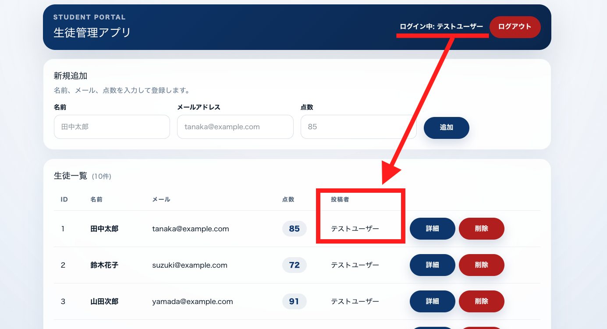
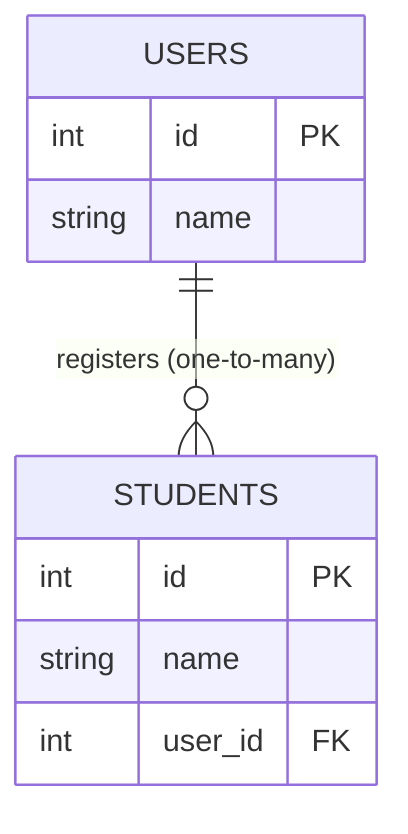

# Lesson 25 | Relating Users ⇔ Students

> 🇯🇵 Original (Japanese version): [2026_07_23_課題.md](<../../../2年生_システム開発実践/前期/2026_07_23/2026_07_23_課題.md>) <!-- original-ja-link -->

---

# If you've made it this far, let's create a relationship between the Users and Students tables

[About relational databases](./リレーショナルデータベース入門.md)

Right now, the `students` table has no information about "who registered this student record." Everyone just sees the same list, and the app has no way of telling that "this record was registered by me (the logged-in user)."

We will relate (link) the `users` table and the `students` table so that the list and detail screens show the name of the user who registered each record as the "Posted by" field.

## What We Are Building

When you register a new student, that student record is automatically linked to "the user who is currently logged in." Then, both the list screen and the detail screen show the name of the user who registered that student (the poster).

The key point is that **the logged-in user's name (top right) matches the name shown in the "Posted by" column of the list**. With this lesson's test user, every student row should show "Posted by: テストユーザー" (because the current seed data shows all students as registered by the same user).

## What Is a Relationship?

Right now, the `users` table and the `students` table exist as completely separate tables. The relationship we are building connects them with the rule "one user can register many students."

- `users` table: one record = one user (instructor)
- `students` table: one record = one student

We connect the two by giving the `students` side a column (a **foreign key**) that shows "which user registered it." This way,

- one user can have many students (a **one-to-many** relationship)
- each student record always belongs to exactly one user

and that relationship can be expressed in the database. Here is what it looks like as a diagram (`user_id` is the foreign key).

In Laravel, by defining relationships on the `User` and `Student` models based on this foreign key, you can easily get "the list of students this user registered" or "the user who registered this student."

## What the Screens Need

- A column on the student list screen (`/students`) that shows the **Posted by** name (the user who registered the student) for each row
- A field on the student detail screen (`/students/{id}`) that also shows **Posted by**
- When a new student is registered, the record is automatically linked to "the user who is currently logged in" (it must not be attributed to another user)

## Implementation Hints (These Build on What You've Learned So Far)

- On the database side, add a foreign key column (for example, `user_id`) to the `students` table that references the `users` table. Instead of directly rewriting the migration for a table that is already in use, it is safer to create a **new migration** that adds the column
- When you add a foreign key, you also need to decide "what happens when the referenced user is deleted" (for example, delete the student records along with it)
- In Laravel, define a relationship on the `User` model saying "one user has many students" (`hasMany`), and one on the `Student` model saying "one student belongs to one user" (`belongsTo`)
- In the API that returns the student list (`index()`), fetch the information about the user who registered each record along with the student data, and include the poster's name in the response. Be careful: fetching the user information one record at a time generates unnecessary SQL queries (eager loading with `with()` helps here)
- In the API that registers a new student (`store()`), create the data through `$request->user()` (the currently logged-in user) so that the foreign key is automatically set to that user's ID
- On the frontend, add a poster name field to the API response type (`type Student`), and add JSX to display it in both the list table and the detail screen

## Implementation Flow

**1. Add the foreign key on the DB side**

Add a `user_id` column to the `students` table. It is safer not to rewrite the existing migration and instead create a new migration file to add it (this is the standard practice when changing the structure of a table that is already running in production).

**↓**

**2. Decide what happens on delete**

When you set up the foreign key, you also need to configure what happens if the referenced `users` record is deleted (for example, use `onDelete('cascade')` to delete the student records along with it).

**↓**

**3. Define the relationships in the models**

- `User` model → `hasMany(Student::class)` (one user can have many students)
- `Student` model → `belongsTo(User::class)` (one student belongs to one user)

**↓**

**4. Update the list API (`index()`)**

When fetching the student data, fetch the poster (user) information along with it. Sending a separate query for each record causes the N+1 problem and generates unnecessary SQL queries, so use Eager Loading with something like `with('user')`.

**↓**

**5. Update the registration API (`store()`)**

When creating a new student, create the record through "the currently logged-in user" obtained from `$request->user()`. This way, `user_id` is automatically set to that user's ID, which prevents abuse such as anyone being able to specify someone else's ID.

**↓**

**6. Update the frontend**

Add a poster name field to the `type Student` type definition → add the parts that display "Posted by: ___" to the rows of the list table and to the JSX of the detail screen.
